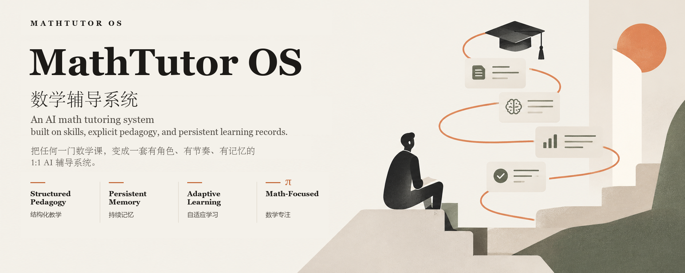
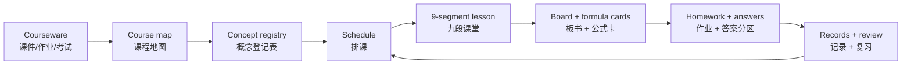

<p align="center">
  
</p>

# MathTutor OS · 数学辅导系统

> **An AI math tutoring system built on skills, explicit pedagogy, and persistent learning records.**
>
> 把任何一门数学课，变成一套有角色、有节奏、有记忆的 1:1 AI 辅导系统。

MathTutor OS is a skill-based math tutoring system for AI agents. It keeps pedagogy, state, and review separate from course content, so you can move between linear algebra, calculus, probability, optimization, and exam prep without losing the teaching style.

MathTutor OS 不是一组“万能提示词”，也不是一个只会聊天的 AI 老师。  
它是一套**数学教学操作系统**：把“怎么教”沉淀成稳定的 skill，把“教什么数学”隔离成可替换的课程层。  
换数学课时，教学风格、记录机制、复习节奏和自检流程都保留；只替换课件、课表和概念表。

> **参考实现**：仓库内的 `math-tutor-os/` 是随项目提供的参考 skill，面向机器学习数学。  
> MathTutor OS 是系统名；复制这份 skill，即可适配线性代数、微积分、概率统计、优化或考试冲刺等不同数学课程。

---

## 目录

- [Why MathTutor OS](#why-mathtutor-os)
- [核心设计](#核心设计)
- [教学闭环](#教学闭环)
- [九段课堂](#九段课堂)
- [Skill 架构](#skill-架构)
- [仓库结构](#仓库结构)
- [Quick Start](#quick-start)
- [适配不同的数学课程](#适配不同的数学课程)
- [规则系统 R1–R23](#规则系统-r1r23)
- [公开前的隐私与版权检查](#公开前的隐私与版权检查)
- [FAQ](#faq)
- [Roadmap](#roadmap)
- [Contributing](#contributing)
- [License](#license)

---

## Why MathTutor OS

大多数“AI 辅导”停留在问答层：

- 问什么答什么，没有课程地图；
- 一次倒出大量内容，学生跟不上；
- 公式不拆符号，计算跳步；
- 不记录错题、复习和掌握度；
- 换个模型/换个会话，之前学到哪全忘了；
- 把“讲过了”当成“学会了”。

MathTutor OS 想解决的是**教学过程**，而不是单次回答：

| 常见问题 | MathTutor OS 的做法 |
|---|---|
| AI 没有长期记忆 | 用 Markdown/JSON 记录进度、错题、复习队列、会话摘要 |
| 讲得太快、太密 | 一次只推进一个概念，九段结构固定 |
| 只给答案，不给理解 | 先直觉 → 几何 → 公式 → 手算 → 复现 → 易错点 |
| 换课就丢掉教学风格 | 系统层与课程层分离，换课只换课程层 |
| 复习靠感觉 | 复习队列 + 间隔复习 + 错题本 |
| 进度不可验证 | 自检脚本 + 单一事实来源 + 变更记录 |
| 上下文越来越长 | 归档冷存储、会话摘要、按需读取 |

**一句话**：MathTutor OS 让 AI 像一位有教案、有记性、有节奏的老师，而不是一个随叫随到的答案机器。

---

## 核心设计

### 1. 两层架构：系统层 / 课程层

```text
你
 │  上传：课件、作业、考试公告、课程大纲
 ▼
┌─────────────────────────────────────────────┐
│ 课程层：学习内容/                            │
│ 可替换：学什么、按什么顺序、讲到哪、错在哪    │
│ 计划 / 图谱 / 习题 / 板书 / 笔记本             │
└─────────────────────────────────────────────┘
                    ▲
                    │ 同一套教学法
                    ▼
┌─────────────────────────────────────────────┐
│ 系统层：系统/                                │
│ 常驻：老师是谁、怎么讲、怎么记、怎么自检      │
│ 角色 / 规则 / 偏好 / 模板 / 工具 / 进度机制   │
└─────────────────────────────────────────────┘
                    ▲
                    │ 项目级入口
┌─────────────────────────────────────────────┐
│ .opencode/skills/<skill-name>/SKILL.md       │
│ 只做指针：加载后读系统层三件套               │
└─────────────────────────────────────────────┘
```

**系统层稳定，课程层可替换。**  
这是整个项目最重要的设计约束：不要把你的课件内容写进教学法，也不要把教学法硬编码进某门课。

### 2. 五条设计原则

1. **Explicit pedagogy**：教学顺序、板书结构、公式卡格式、作业规则都写成明文，不靠模型临场发挥。
2. **Persistent memory**：进度、错题、复习、偏好、会话摘要都落盘；不依赖“模型记得”。
3. **Single source of truth**：概念以 `概念登记表.md` 为准，进度以 `progress.json` 为机读镜像。
4. **Cold storage**：旧课归档只留在磁盘，不进入日常上下文；只有明确要求时才读指定文件。
5. **No fake memory**：读不到历史就如实说明，不假装记得；没有证据就不升级掌握度。

### 3. 课程可替换，教学法常驻

换课时保留：

- 老师角色与语气；
- 九段课堂结构；
- 公式卡与例题模板；
- 几何优先、生活化引入；
- 作业与答案分区、默认不批改；
- 每轮记录、会话摘要、复习队列；
- 自检脚本与变更护栏。

换课时归档：

- 旧课表、旧概念登记、旧知识图谱；
- 旧板书、旧习题、旧错题、旧复习队列；
- 旧课程 PDF、旧进度快照；
- 旧会话记录与摘要。

---

## 教学闭环



每一步都有对应文件，不靠“聊天记录里找”：

| 阶段 | 产出 |
|---|---|
| 诊断 | 诊断结果 + 课程地图 |
| 规划 | `课程信息.md`、`学习路线.md`、`概念登记表.md`、`第01–NN课_课表.md` |
| 授课 | `04_板书/S{id}_第NN课_{主题}.md` + 几何配图 |
| 练习 | 分层习题 + 答案分区；学生提交后批改 |
| 记录 | `progress.json`、`错题本.md`、`复习队列.md`、`对话记录.md` |
| 复习 | 间隔复习队列 + 会话摘要 |
| 维护 | `自检.py` + `系统变更记录.md` + git tag |

---

## 九段课堂

每节新课（一个/一组概念）固定九段，顺序不变：

| # | 段落 | 内容 | 目的 |
|---|---|---|---|
| ① | 引入 | 1–2 句生活化场景，带具体数字 | 先知道“这玩意在干嘛” |
| ② | 直觉 | 一句话说清核心 | 建立第一层理解 |
| ③ | 几何 | 尽量配图；图后写“看图”说明 | 把符号变成画面 |
| ④ | 计算 / 公式卡 | 名称 → 公式 → 符号 → 意义与场景 → 例 | 把公式变成可查、可用的卡片 |
| ⑤ | 完整手算 | 中文；第 1 步 / 第 2 步……不跳步 | 能独立复现 |
| ⑥ | 独立复现 | 换数字/换情境，让学生自己算 | 检查是否真会 |
| ⑦ | 易错点 | 3 条左右，直说“这里会错” | 提前排雷 |
| ⑧ | 与已学关系 | 接回旧概念，形成知识网 | 不做孤岛 |
| ⑨ | 作业 + 答案 | 作业与答案**分区**；答案标注“先自己做完再看” | 先练后对 |

### 公式卡：固定五行

1. **名称**：中文（English），如「向量投影（vector projection）」。
2. **公式**：独立 `$$...$$`，一行一个，不折行。
3. **符号**：逐个字母/符号解释含义、形状（数/向量/矩阵）、从哪来。
4. **意义与场景**：1–5 句，生动形象，可用类比、画面、反例。
5. **例（三段式）**：
   - **背景与题干**：1–3 句中文，给数字/条件/要求什么；
   - **解**：Step 0 拆公式（角色分工）→ Step 1…n 逐步代入 → 检查；
   - **解读**：1–2 句，说明这个数意味着什么 + 一个常见误读。

### 作业与批改

- 默认给“作业 + 对应答案”，答案单独分区。
- **默认不批改、不催交**；学生主动提交时才批改、给提示和解析。
- 不直接给学校作业的完整答案；先判知识点 → 补前置 → 讲解 → 学生尝试 → 批改。

---

## Skill 架构

| 文件 | 作用 |
|---|---|
| `系统/04_辅导老师/SKILL.md` | 角色、教学目标、教学原则、板书机制、输出模板、启动协议、记录规则、目录结构 |
| `系统/04_辅导老师/startup_protocol.md` | 每次会话开始时的必读清单与执行顺序 |
| `系统/04_辅导老师/rules.md` | 硬性规则 R1–R23 |
| `系统/04_辅导老师/skill_metadata.yaml` | 机器可读元数据：入口、状态文件、输出路径、检查项 |
| `.opencode/skills/math-tutor-os/SKILL.md` | 项目级入口指针；真正规则在 `系统/04_辅导老师/` |
| `系统/01_学习进度/` | `progress.json`、对话记录、会话日志、错题本、复习队列、会话摘要、变更记录 |
| `系统/02_学习习惯/` | `habits.jsonl`、学习偏好 |
| `系统/03_模板/` | 习题模板 |
| `系统/05_工具/` | `自检.py`、`生成几何图.py` |
| `学习内容/01_学习计划/` | 课程信息、学习路线、概念优先级、概念登记表、课表 |
| `学习内容/02_知识图谱/` | Mermaid 知识图谱 + 关键路径 |
| `学习内容/03_习题/` | 题目与批改记录 |
| `学习内容/04_板书/` | 每节课完整讲义 + 几何配图 |
| `学习内容/05_笔记本/` | 学生自己的随手记、待问清单 |

### 为什么用纯文本？

- 可读：学生能直接打开、编辑、复习。
- 可 diff：git 能看出每次改了什么。
- 可迁移：不绑定数据库、不绑定模型。
- 可审计：进度、错题、复习、变更都有痕迹。
- 可冷存储：旧课归档不进入上下文，减少 token 消耗。

---

## 仓库结构

```text
.
├─ .opencode/
│  └─ skills/
│     └─ math-tutor-os/
│        └─ SKILL.md                 # 项目级入口（指针）
├─ docs/
│  └─ mathtutor-os-hero.png          # README 主题图
├─ math-tutor-os/
│  ├─ 系统/
│  │  ├─ 01_学习进度/                # 状态：progress / 对话 / 错题 / 复习 / 摘要
│  │  ├─ 02_学习习惯/                # 偏好与习惯流水
│  │  ├─ 03_模板/                    # 习题模板
│  │  ├─ 04_辅导老师/                # SKILL / startup / rules / metadata
│  │  └─ 05_工具/                    # 自检脚本、几何图生成器
│  └─ 学习内容/
│     ├─ 01_学习计划/                # 课程信息 / 路线 / 概念表 / 课表
│     ├─ 02_知识图谱/
│     ├─ 03_习题/
│     ├─ 04_板书/
│     │  └─ 图片/
│     └─ 05_笔记本/
└─ README.md
```

> `_archive/` 是本地冷存储，只用于保存旧课；**不要提交到公开仓库**。
> `.ignore` 会让 ripgrep 等工具默认跳过它，但 `.ignore` 不等于 `.gitignore`。

---

## Quick Start

### 环境

- 推荐运行时：**OpenCode**（项目级 skill 自动加载）。
- 核心内容只是 Markdown + JSON，任何支持“读取文件 + 按指令执行”的 Agent 都能改造使用。
- 可选：Python 3（自检、几何图生成）、matplotlib（配图）。

### 1. 克隆

```bash
git clone https://github.com/<your-name>/math-tutor-os.git
cd math-tutor-os
```

### 2. 打开项目

用 OpenCode 打开仓库根目录。项目级入口是：

```text
.opencode/skills/math-tutor-os/SKILL.md
```

首次启用或修改 skill 后，重启 OpenCode 让它重新加载。

### 3. 填课程信息

编辑：

```text
math-tutor-os/学习内容/01_学习计划/课程信息.md
```

至少填：课程代码、名称、学期、课件目录、作业目录、考试信息、当前状态。

### 4. 放课件

把课件、作业、考试公告放到一个**不公开**的课程资料目录，例如：

```text
课程资料/
  course-01/
    讲义/
    HW/
    考试/
```

公开仓库不要提交受版权保护的课件或学生数据。

### 5. 开始

对 Agent 说：

```text
开始新课。课程信息在 学习内容/01_学习计划/课程信息.md，
课件在 课程资料/。先给我课程地图和排课表，不要直接开讲。
```

Agent 应执行：

1. 读 skill 三件套；
2. 读课程信息与课件；
3. 建概念登记表、知识图谱、课表；
4. 输出“课程地图 + 排课骨架”；
5. 等你确认后再讲第 01 课。

### 6. 自检

```bash
python -X utf8 math-tutor-os/系统/05_工具/自检.py
```

Windows 用 `python -X utf8`；macOS/Linux 可用 `python3`。  
自检应输出 `0 个错误`；警告要逐条解释。

---

## 适配不同的数学课程

MathTutor OS 是系统，`math-tutor-os` 是参考实现。适配步骤：

1. **复制 skill 目录**：把 `math-tutor-os/` 复制成你的数学课程目录。
2. **改角色**：编辑 `系统/04_辅导老师/SKILL.md` 第 0–2 节，写清“教哪门数学、学生什么水平、怎么讲”。
3. **改入口**：新建 `.opencode/skills/<your-skill>/SKILL.md`，指向你的 `系统/04_辅导老师/`。
4. **改课程信息**：填 `学习内容/01_学习计划/课程信息.md`。
5. **改规则**：保留 R1–R23 的骨架，按数学课程调整公式卡、几何要求、作业规则；不要删掉“记录、复习、自检”。
6. **建概念表**：把数学大纲拆成 `id / 概念 / 优先级 / 前置 / 状态`。
7. **排课**：先出课程地图与课表，等学生确认再逐课生成板书。
8. **跑自检**：确保路径、索引、进度一致。

### 适合的数学课程

- 大学数学：线性代数、微积分、概率统计、优化、离散数学；
- 机器学习数学：线代、微积分、概率、优化、矩阵微分；
- 考试冲刺：考研数学、AP Calculus、数学竞赛、期末突击；
- 高中/预科：函数、几何、概率、微积分入门。

---

## 规则系统 R1–R23

规则是 MathTutor OS 的核心资产。它们不绑定具体数学课程，换课时应整体保留。

<details>
<summary>展开查看 R1–R23</summary>

| 规则 | 内容 |
|---|---|
| R1 | 少跳步：每个计算步骤都写出来 |
| R2 | 几何优先 + 先直觉后公式：直觉 → 几何（配图）→ 计算 |
| R3 | 每概念必给 3–5 道分层习题 |
| R4 | 先不给答案，学生提交后再批改 |
| R4b | 学生自测模式：作业 + 答案分区，默认不批改、不催交 |
| R5 | 学生说“没懂”就换更简单的说法/类比/更小步骤 |
| R6 | 方向混淆先澄清：谁对谁求导、结果形状、布局约定 |
| R7 | ML/数学用途要具体，不空谈“很有用” |
| R8 | 不代写作业：判知识点 → 补前置 → 讲解 → 尝试 → 批改 |
| R9 | 不记忆幻觉：读不到历史就如实说明 |
| R10 | 小步推进：一次一个概念/模块 |
| R11 | 分级标记：必学 / 掌握 / 了解 |
| R12 | 结构化记录：进度、错题、习惯可复用 |
| R13 | 命名规范：文件夹与文档中文，数据文件英文 |
| R14 | 每轮对话后立即记录，带会话 ID + 时间戳 |
| R15 | 会话边界判定：明确信号 / 跨天或换主题 / 下次启动兜底 |
| R16 | 会话 ID：`S` + 三位递增，计数器在 `progress.json` |
| R17 | 系统变更须先说明 → 改后报告 → 等确认 → 记入变更记录 |
| R18 | 单一事实来源：概念以登记表为准，进度以 `progress.json` 为镜像 |
| R19 | 板书机制：每节课对话里给 Markdown，同时写入 `04_板书/` 并登记索引 |
| R20 | 公式排版：学习内容类文档与对话统一 LaTeX |
| R21 | 笔记本：学生实时记录；老师不改原文 |
| R22 | 变更护栏：受保护文件、自检、git 回滚 |
| R23 | 几何配图：几何部分至少一张图，脚本生成，配色约定 |

</details>

> 规则不是“模型建议”，而是可检查的约束。`自检.py` 会验证其中一部分（文件存在、索引一致、会话 ID、版本号等）。

---

## 公开前的隐私与版权检查

**这是把项目放到 GitHub 前最重要的一节。**

MathTutor OS 的框架可以公开，但你的**学习历史、课程资料、个人信息**不应该公开。当前仓库如果直接推送，可能包含：

- `_archive/` 里的旧课 PDF、板书、笔记、错题；
- `progress.json` 里的姓名、背景、掌握度；
- `habits.jsonl`、`对话记录.md`、`会话摘要/` 里的学习过程；
- `系统变更记录.md` 里的个人课程信息；
- 受版权保护的讲义、作业、考试题。

### 发布前清单

- [ ] 确认 `_archive/` 没有被 git 跟踪：`git ls-files _archive`
- [ ] 如果已跟踪：`git rm -r --cached _archive`，并确保 `.gitignore` 包含 `_archive/`
- [ ] 删除/脱敏 `progress.json` 中的姓名、学校、成绩、诊断结果
- [ ] 清空或替换 `habits.jsonl`、`对话记录.md`、`会话摘要/`、`错题本.md`、`复习队列.md`
- [ ] 删除受版权保护的课件、作业、考试 PDF/PPT/DOCX
- [ ] 用合成数据或公开数据做示例
- [ ] 检查 `git log` 与 tag：历史里是否还有旧 PDF 或个人数据
- [ ] 如果历史里已有敏感内容：用 `git filter-repo`/BFG 重写历史，或**新建一个干净的公开仓库**
- [ ] 添加 `.gitignore`（`_archive/`、`课程资料/`、`*.pdf`、`*.pptx`、`*.docx`、`.env`）
- [ ] 添加 `LICENSE`（推荐 MIT；没有许可证默认保留所有权利）
- [ ] 检查没有 API key、cookie、token、内网地址

> **重要**：从当前提交里删除文件，不等于从 git 历史里删除。  
> 如果旧课件已经进入过 commit/tag，直接 push 仍会把它们公开。最安全的做法是：
> **新建一个只包含框架文件的干净仓库**，或者用 `git filter-repo` 清理全部历史后再公开。

---

## FAQ

### 它只适用于机器学习数学吗？

不是。`math-tutor-os` 是参考实现；同一套系统可以用于线性代数、微积分、概率统计、优化、离散数学等不同数学课程。  
你只需要替换角色、概念表、课表和板书模板。

### 必须用 OpenCode 吗？

OpenCode 是参考运行时，因为有项目级 skill 自动加载。  
核心只是 Markdown + JSON：任何能读文件、按指令执行的 Agent 都可以改造使用。

### 需要向量数据库/RAG 吗？

不需要。MathTutor OS 用 Markdown/JSON + 会话摘要 + 冷存储归档来控制上下文。  
如果课程资料很大，可以再加检索层，但不是必需。

### 为什么旧课要归档而不是删除？

因为“以后可能想查”，但“每天上课不想读”。  
归档 = 冷存储：文件在磁盘上，不在上下文里。

### 它会不会把学校作业答案直接给学生？

不会。R8 明确禁止代写；只做同型题、讲思路、批改。

### 多门数学课可以同时学吗？

建议一个仓库一个 active math course。  
多门数学课可以用 branch/tag/独立目录，或复制一份系统；不要让多个 `progress.json` 混在一起。

### 模型换掉还能用吗？

可以。规则、状态、课程表都是明文；换模型后重新读 skill 与状态即可。  
但不同模型的指令遵循能力不同，建议保留自检和人工确认。

---

## Roadmap

- [ ] 提供更多数学 skill：线性代数、微积分、概率统计、优化、考试冲刺
- [ ] 提供 `mathtutor-os init` 脚手架（生成课程信息、概念表、课表）
- [ ] 增强 `自检.py`：链接检查、进度一致性、归档隔离
- [ ] 提供静态站点导出（把板书变成可浏览的复习网站）
- [ ] 多数学课程 workspace 支持
- [ ] 英文 README 与示例
- [ ] 贡献指南与模板仓库

---

## Contributing

欢迎 issue / PR。请遵守三条：

1. **保持系统层与课程层分离**：不要把某门数学课的内容写进通用规则。
2. **不要提交个人数据或版权课件**：示例请用合成数据或公开许可材料。
3. **改规则/结构时先说明，再改，再跑自检**：这是项目自己的 R17/R22。

---

## License

推荐使用 **MIT License**。  
当前仓库尚未包含 `LICENSE` 文件；公开前请补上，否则默认保留所有权利。

---

## 致谢

MathTutor OS 受以下实践启发：

- mastery learning / 掌握学习；
- spaced repetition / 间隔复习；
- explicit instruction / 显性教学；
- plain-text knowledge management；
- OpenCode 的项目级 skill 机制。

---

## GitHub 仓库简介（可直接粘贴）

**Repository name**

```text
math-tutor-os
```

**About / 一句话简介**

```text
An AI math tutoring system: turn any math courseware into a structured 1:1 learning loop with persistent records, explicit pedagogy, and self-checks.
```

**中文简介**

```text
MathTutor OS（数学辅导系统）是一个面向数学课的 AI 辅导系统：把任何数学课件变成有角色、有节奏、有记忆的 1:1 学习闭环，内置九段课堂、公式卡、错题本、复习队列与自检机制。
```

**Topics**

```text
ai-math-tutor, math-education, linear-algebra, calculus, probability, optimization, ai-agent, opencode, skill, tutoring
```

**推荐 repo description**

```text
AI math tutoring system: structured lessons, formula cards, persistent records, spaced review, self-checks.
```
