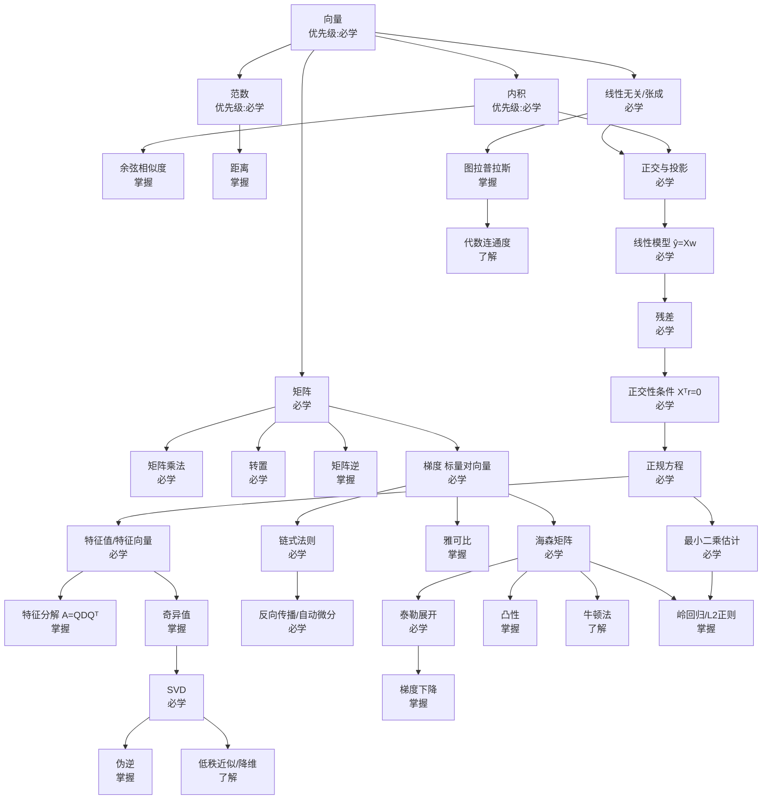
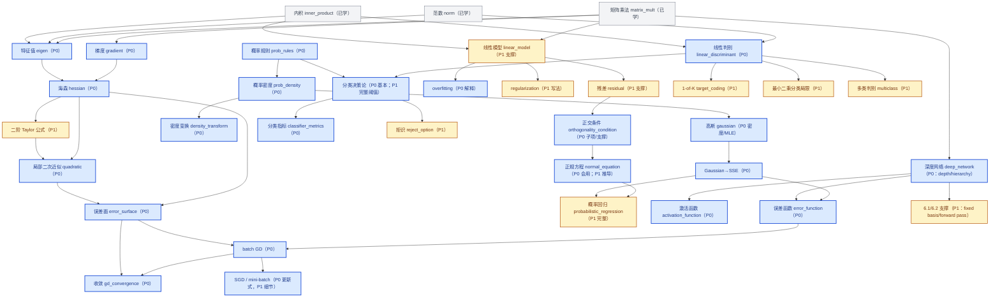

# 知识图谱（初版）

每个节点：概念名 / 一句话定义 / 前置 / 后续 / ML 用途 / 优先级。

## Mermaid 总图



## 关键路径（推荐学习主干）

```
向量 → 内积 → 范数 → 正交与投影 → 线性模型 → 残差
→ 正交性条件 → 正规方程 → 最小二乘估计
→ 特征值 → 奇异值 → SVD
→ 梯度 → 链式法则 → 反向传播
→ 海森矩阵 → 泰勒展开 → 梯度下降
```

## 节点明细（示例格式，后续在 学习内容/03_概念笔记/ 展开）

| 概念            | 一句话定义       | 前置           | 后续               | ML 用途          | 优先级 |
| --------------- | ---------------- | -------------- | ------------------ | ---------------- | ------ |
| 向量            | 一列有序数       | —             | 内积/矩阵/线性无关 | 特征、参数       | 必学   |
| 内积            | 对应相乘再求和   | 向量           | 正交/投影/余弦     | 相似度、线性模型 | 必学   |
| 范数            | 向量的"长度"度量 | 向量           | 距离/正则          | 距离、正则化     | 必学   |
| 正交与投影      | 垂直、投到子空间 | 内积、线性无关 | 最小二乘           | 最小二乘         | 必学   |
| 最小二乘估计    | 让残差平方和最小 | 投影、残差     | SVD、岭回归        | 线性回归         | 必学   |
| 正规方程        | XᵀXw=Xᵀy       | 正交性条件     | 特征值             | 闭式解           | 必学   |
| 特征值/特征向量 | 变换下方向不变   | 矩阵           | 特征分解/SVD       | PCA、稳定性      | 必学   |
| SVD             | 任意矩阵=UΣVᵀ  | 特征值         | 伪逆/低秩          | 降维、伪逆       | 必学   |
| 梯度            | 上升最快方向     | 偏导           | 链式/海森          | 优化             | 必学   |
| 链式法则        | 复合求导         | 梯度           | 反向传播           | 神经网络         | 必学   |
| 海森矩阵        | 二阶偏导方阵     | 二阶导         | 凸性/牛顿          | 二阶优化         | 必学   |
| 泰勒展开        | 多项式局部逼近   | 导数/海森      | 牛顿法             | 优化、误差       | 必学   |
| 梯度下降        | 沿负梯度迭代     | 梯度           | 训练               | 优化             | 掌握   |
| 图拉普拉斯      | D−A             | 矩阵、度       | 谱聚类             | 谱聚类/GNN       | 掌握   |

---

## 期中冲刺子图

> 只画 AISC5000 期中范围（2026-10-29），**不替换上面的总图**。
> P 级以 `AISC5000期中复习大纲.md` 的「考点总表」为准；这里只标 P0/P1。
> 灰 = 已学回炉；蓝 = P0；黄 = P1；P2/`—` 不画进来，避免复习跑偏。



**看图**：

- 左上是「线代 → eigen → Hessian → 局部二次近似 → 误差面 → 收敛」的 P0 主链；梯度从矩阵乘法接入 Hessian。
- 中间是「概率规则 → 密度 → Gaussian → Gaussian→SSE → 概率回归」；密度另分一支到密度变换。
- 下方是「线性模型 → 残差 → 正交条件 → 正规方程 → 概率回归」，与 S004 的投影几何接上。
- 右侧是「线性判别 → 决策论 → 指标」，以及「深度网络 → 激活/误差函数 → batch GD → 收敛」。
- 蓝色 = P0；黄色 = P1。`normal_equation`、`decision_theory`、`SGD` 是 P0 主体 + P1 细节，标签里已拆开。
