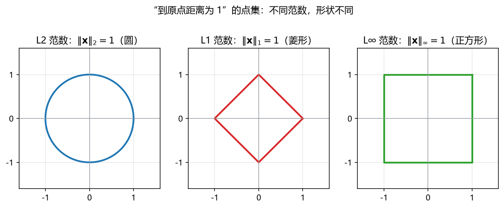
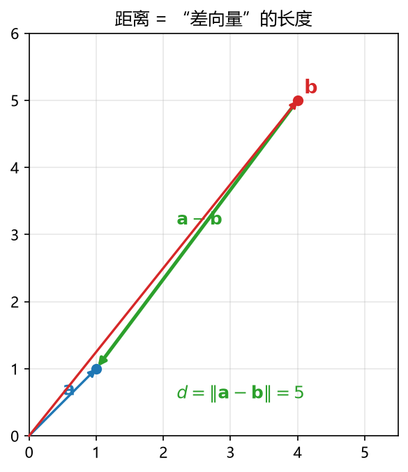
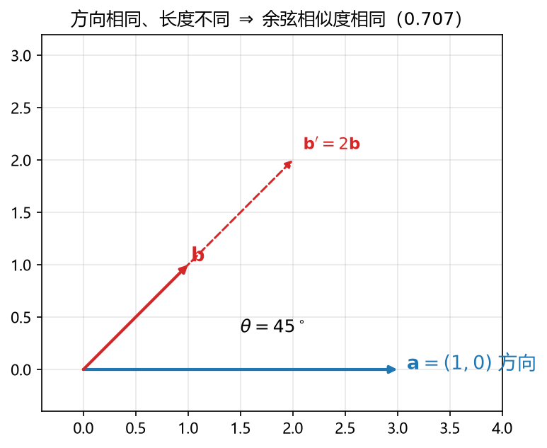

# 板书 · S003 · 第 02 课：范数（norm）、距离（distance）与余弦相似度（cosine similarity）

- 会话ID：`S003`
- 日期：2026-10-16
- 对应概念：`norm`（必学）、`distance_cosine`（掌握）
- 前置：`vector`、`inner_product`（已学）
- 修订记录：（初版）2026-10-16

---

## 0. 生活化引入

上一课的内积给了我们一个"像不像"的**原始分**：给两部电影打分，(5,1) 和 (4,2) 内积是 22。
但有个坑：**分数会随"量级"膨胀**。一个人给所有电影都打 5 星，和他的内积自然大，不代表他真的跟我口味像。

> 类比：比较两个人"谁跑得快"，不能只看谁跑的距离远，得看**每单位时间**跑多远。
> 所以我们要先学会**量一支箭多长**（= 范数），再学会**去掉长度影响只看方向像不像**（= 余弦相似度），
> 以及**两个点之间差多远**（= 距离）。

---

## 一、范数（norm）：向量的"长度 / 大小"

### 1) 直觉
内积让我们"把向量压成一个数"，但内积会受方向影响（正负）。
**范数**回答一个更朴素的问题：**这支箭有多长？** 不管它指向哪，长度永远是 $\ge 0$ 的。

### 2) 三种常见的范数（同一个"长度"家族的三个成员）

设向量 $\mathbf{x}=(x_1,x_2,\dots,x_n)$：

$$
\|\mathbf{x}\|_2=\sqrt{x_1^2+x_2^2+\dots+x_n^2}=\sqrt{\sum_{i=1}^{n}x_i^2}
\quad\text{（L2 范数 / 欧几里得范数）}
$$

$$
\|\mathbf{x}\|_1=|x_1|+|x_2|+\dots+|x_n|=\sum_{i=1}^{n}|x_i|
\quad\text{（L1 范数 / 曼哈顿范数）}
$$

$$
\|\mathbf{x}\|_\infty=\max_i |x_i|
\quad\text{（L∞ 范数 / 最大范数）}
$$

符号拆解：
- $\|\mathbf{x}\|$：双竖线读作"范数"，结果是一个**标量**（一个数），不是向量。
- 下标 $2,1,\infty$：表示用的是哪一套"量法"。**不写下标时，默认指 L2。**
- $\sum_{i=1}^{n}$：把 $i=1$ 到 $n$ 的每一项加起来。
- $|x_i|$：绝对值，因为长度不能是负的。

### 3) 几何视角：单位的形状不一样

- **L2**：到原点距离 $=1$ 的点集是个**圆**（三维是球面）。
- **L1**：到原点"曼哈顿距离" $=1$ 的点集是个**菱形**（旋转 45° 的正方形）。
- **L∞**：到原点最大坐标 $=1$ 的点集是个**正方形**（边与坐标轴平行）。



> 记法：L2 走斜线（直线距离），L1 只能沿网格横竖走（像出租车绕街区），L∞ 只看"最突出的那个分量"。
> **看图**：三条线都是"长度 $=1$"的等高线，但形状不同——这就是三种范数的差异。
> L1 的菱形有**尖角**落在坐标轴上，这正是后面"L1 产生稀疏解"的几何根源。

### 4) 计算视角（手算，不跳步）

**例 1** $\mathbf{x}=(3,-4)$：

$$
\|\mathbf{x}\|_2=\sqrt{3^2+(-4)^2}=\sqrt{9+16}=\sqrt{25}=5
$$
$$
\|\mathbf{x}\|_1=|3|+|-4|=3+4=7
$$
$$
\|\mathbf{x}\|_\infty=\max(|3|,|-4|)=\max(3,4)=4
$$

**例 2** $\mathbf{a}=(1,2,-2)$：

$$
\|\mathbf{a}\|_2=\sqrt{1^2+2^2+(-2)^2}=\sqrt{1+4+4}=\sqrt{9}=3
$$
$$
\|\mathbf{a}\|_1=1+2+2=5,\qquad \|\mathbf{a}\|_\infty=2
$$

### 5) 范数的三条性质（知道即可，理解为什么合理）

1. **非负性**：$\|\mathbf{x}\|\ge 0$，且 $\|\mathbf{x}\|=0\iff \mathbf{x}=\mathbf{0}$（只有零向量长度是 0）。
2. **齐次性**：$\|c\mathbf{x}\|=|c|\,\|\mathbf{x}\|$（把箭拉长 $c$ 倍，长度就变 $|c|$ 倍）。
3. **三角不等式**：$\|\mathbf{x}+\mathbf{y}\|\le\|\mathbf{x}\|+\|\mathbf{y}\|$（走直线不会比绕路更长）。

### 6) 范数的平方与内积的关系（重要桥梁）

$$
\|\mathbf{x}\|_2^2=\mathbf{x}\cdot\mathbf{x}=\sum_{i=1}^{n}x_i^2
$$

> 即"**自己和自己做内积 = 长度的平方**"。这是后面最小二乘、岭回归反复用到的一步。
> 注意区分：$\|\mathbf{x}\|_2$ 要开根号；$\|\mathbf{x}\|_2^2$ 不用，就是 $x\cdot x$。

---

## 二、距离（distance）：两个点差多远

### 1) 直觉
距离 = **两个向量相减得到的那支箭的长度**。先算差，再量差有多长。

### 2) 公式

$$
d(\mathbf{a},\mathbf{b})=\|\mathbf{a}-\mathbf{b}\|_2=\sqrt{\sum_{i=1}^{n}(a_i-b_i)^2}
\quad\text{（欧几里得距离）}
$$

符号拆解：
- $\mathbf{a}-\mathbf{b}$：逐位相减，得到一个新向量（从 $\mathbf{b}$ 指向 $\mathbf{a}$ 的箭头）。
- 外面再套 L2 范数：量这支箭头多长。
- 结果是一个标量。

### 3) 计算视角（手算）

**例** $\mathbf{a}=(0,0)$，$\mathbf{b}=(3,4)$：

$$
\mathbf{a}-\mathbf{b}=(-3,-4)
$$
$$
d(\mathbf{a},\mathbf{b})=\sqrt{(-3)^2+(-4)^2}=\sqrt{9+16}=5
$$

**例** $\mathbf{a}=(1,2)$，$\mathbf{b}=(4,6)$：

$$
\mathbf{a}-\mathbf{b}=(-3,-4)\ \Rightarrow\ d=\sqrt{9+16}=5
$$

（和上一例一样，因为差向量相同；距离只看"差"，与绝对位置无关。）



> **看图**：绿箭头就是从 $\mathbf{b}$ 指向 $\mathbf{a}$ 的差向量 $\mathbf{a}-\mathbf{b}$，
> 它的**长度**就是两点的距离。

### 4) 与范数的关系
**距离不是新东西**：它就是"差向量的范数"。所以学好范数，距离自然就会了。

---

## 三、余弦相似度（cosine similarity）：只看方向，不看长度

### 1) 直觉
上一课的几何公式 $\mathbf{a}\cdot\mathbf{b}=\|\mathbf{a}\|\,\|\mathbf{b}\|\cos\theta$ 里
藏着 $\cos\theta$。**把它单独拎出来**，就得到"两向量夹角的余弦"：

$$
\cos\theta=\frac{\mathbf{a}\cdot\mathbf{b}}{\|\mathbf{a}\|\,\|\mathbf{b}\|}
$$

它衡量的是**方向有多像**，与两支箭各自的**长短无关**。
> 类比：两个人走路速度不同、路程不同，但**方向一致**——余弦相似度就说他俩"方向上是同路人"。

### 2) 取值范围与含义

| $\cos\theta$ | 夹角 | 含义 |
|---|---|---|
| $+1$ | $0^\circ$ | 完全同方向（最相似） |
| $0$ | $90^\circ$ | 正交 / 无关 |
| $-1$ | $180^\circ$ | 完全反方向（最不相似） |

范围固定在 $[-1,1]$，所以可以跨样本、跨量级公平比较。

### 3) 计算视角（手算）

**例** $\mathbf{a}=(1,0)$，$\mathbf{b}=(1,1)$：

$$
\mathbf{a}\cdot\mathbf{b}=1\times1+0\times1=1
$$
$$
\|\mathbf{a}\|=\sqrt{1^2+0^2}=1,\qquad \|\mathbf{b}\|=\sqrt{1^2+1^2}=\sqrt{2}\approx1.414
$$
$$
\cos\theta=\frac{1}{1\times\sqrt{2}}=\frac{1}{\sqrt{2}}\approx0.707
\quad\Rightarrow\quad \theta=45^\circ
$$

**反例感受"长度不影响角度"** 把 $\mathbf{b}$ 拉长成 $\mathbf{b}'=(100,100)$：

$$
\cos\theta=\frac{100}{1\times\sqrt{100^2+100^2}}=\frac{100}{100\sqrt{2}}=\frac{1}{\sqrt{2}}\approx0.707
$$

一样是 $45^\circ$！这就是"只看方向不看长度"。



> **看图**：$\mathbf{b}$ 和 $\mathbf{b}'=2\mathbf{b}$ 方向完全一样、长度差一倍，
> 但它们跟 $\mathbf{a}$ 的夹角都是 $45^\circ$，所以余弦相似度相同。

### 4) 距离 vs 余弦相似度：用哪个？

| | 距离 $d$ | 余弦相似度 $\cos\theta$ |
|---|---|---|
| 关心什么 | 点的**绝对位置差异** | 向量的**方向** |
| 受长度影响 | 是 | 否 |
| 典型场景 | 位置/坐标类（房价、坐标点） | 文本/兴趣/嵌入向量 |

> 二者可互相转换：常用 **余弦距离** $=1-\cos\theta$（值越大越不相似）。

---

## 四、机器学习里干嘛用（具体到模型）

1. **L2 正则 / 岭回归（ridge）**：损失里加 $\lambda\|\mathbf{w}\|_2^2$，惩罚"权重太大"，
   防止过拟合。因为 $\|\mathbf{w}\|_2^2=\mathbf{w}\cdot\mathbf{w}$，求导特别干净。
2. **L1 正则 / Lasso**：加 $\lambda\|\mathbf{w}\|_1$，会把一部分权重**压成 0**，得到稀疏解（自动选特征）。
   > L1 的"菱形"单位球有尖角，最优解容易落在坐标轴上 → 稀疏；这是"为什么 L1 稀疏、L2 不稀疏"的几何原因。
3. **距离**：kNN（找最近的 k 个邻居）、K-means 聚类、最近邻检索、图像/向量数据库。
4. **余弦相似度**：文本相似度（TF-IDF）、推荐系统（用户/物品向量）、词向量（word2vec）、
   注意力机制里 query 与 key 的匹配。
5. **梯度裁剪（gradient clipping）**：梯度向量太大时按 $\|\mathbf{g}\|_2$ 缩放，稳定训练。
6. **归一化**：把向量除以自身范数 $\mathbf{x}/\|\mathbf{x}\|$ 变成单位向量，使后续只用方向信息。

---

## 五、常见易错点

1. **范数是标量**，别写成向量；写法是双竖线 $\|\cdot\|$，不是绝对值单竖线。
2. **"范数"默认 L2**；但 L1/L2/L∞ 是不同的量法，数值通常不同，别混用。
3. **余弦相似度 $\ne$ 内积**：内积受长度影响，余弦相似度不受。比较"像不像"时，量级不同要优先用余弦。
4. **余弦相似度不是距离**：它可能是负数，且"越大越像"；要当距离用就取 $1-\cos\theta$。
5. **别把 $\|\mathbf{x}\|^2$ 和 $\|\mathbf{x}\|$ 搞混**：前者不用开根号，就是 $\mathbf{x}\cdot\mathbf{x}$。
6. 距离要**先相减再量长度**，先对每个分量求差，最后整体开一次根号（不是每项都开根号）。

---

## 六、与已学概念的关系

```
inner_product ──定义──▶ norm        （‖x‖² = x·x）
vector ──减──▶ 差向量 ──norm──▶ distance
inner_product + norm ──▶ cosine similarity
```

- **范数**靠**内积**定义：$\|\mathbf{x}\|_2^2=\mathbf{x}\cdot\mathbf{x}$。
- **距离**靠**范数**定义：$d(\mathbf{a},\mathbf{b})=\|\mathbf{a}-\mathbf{b}\|_2$。
- **余弦相似度**同时用**内积**和**范数**。
- 下一课（A5 矩阵与矩阵乘法）会把这些"向量操作"推广到一次处理很多向量。

---

## 七、作业（先做完再看答案）

**Q1（概念）** 判断对错并说明理由：
- (a) 范数的结果是一个向量。
- (b) $\|\mathbf{x}\|_2=0$ 当且仅当 $\mathbf{x}$ 是零向量。
- (c) 把向量 $\mathbf{b}$ 拉长 $100$ 倍，它与 $\mathbf{a}$ 的余弦相似度会变大。

**Q2（手算，写完整步骤）** 设 $\mathbf{x}=(6,8)$。
- (a) 求 $\|\mathbf{x}\|_2$、$\|\mathbf{x}\|_1$、$\|\mathbf{x}\|_\infty$。
- (b) 求 $\|\mathbf{x}\|_2^2$，并验证它等于 $\mathbf{x}\cdot\mathbf{x}$。

**Q3（距离）** $\mathbf{a}=(1,1)$，$\mathbf{b}=(4,5)$。求欧几里得距离 $d(\mathbf{a},\mathbf{b})$。

**Q4（余弦相似度）** $\mathbf{a}=(1,0)$，$\mathbf{b}=(1,\sqrt{3})$。
- (a) 求内积 $\mathbf{a}\cdot\mathbf{b}$、范数 $\|\mathbf{a}\|$ 与 $\|\mathbf{b}\|$。
- (b) 求余弦相似度 $\cos\theta$ 与夹角 $\theta$。

**Q5（机器学习联系）** 你在做一个"新闻推荐"，把每篇文章表示成一个词频向量。
- (a) 两篇文章向量长度差很多（一篇写得很长、一篇很短）。比较"内容像不像"，你会用**内积**还是**余弦相似度**？为什么？
- (b) 岭回归的损失函数里有一项 $\lambda\|\mathbf{w}\|_2^2$。用一句话说明它在"惩罚"什么。

---

## 八、作业答案（先自己做完再看）

**Q1**
- (a) **错**。范数是长度的度量，结果是**一个标量**。
- (b) **对**。长度非负，只有零向量长度为 $0$（非负性 + 正定）。
- (c) **错**。余弦相似度与长度无关，拉长不改变方向，$\cos\theta$ 不变。

**Q2** $\mathbf{x}=(6,8)$
- (a) $\|\mathbf{x}\|_2=\sqrt{6^2+8^2}=\sqrt{36+64}=\sqrt{100}=10$；
  $\|\mathbf{x}\|_1=|6|+|8|=14$；$\|\mathbf{x}\|_\infty=\max(6,8)=8$。
- (b) $\|\mathbf{x}\|_2^2=10^2=100$；$\mathbf{x}\cdot\mathbf{x}=6\times6+8\times8=36+64=100$。
  两者相等，验证 $\|\mathbf{x}\|_2^2=\mathbf{x}\cdot\mathbf{x}$。

**Q3** $\mathbf{a}-\mathbf{b}=(1-4,\ 1-5)=(-3,-4)$；
$d=\sqrt{(-3)^2+(-4)^2}=\sqrt{9+16}=\sqrt{25}=5$。

**Q4** $\mathbf{a}=(1,0)$，$\mathbf{b}=(1,\sqrt{3})$
- (a) $\mathbf{a}\cdot\mathbf{b}=1\times1+0\times\sqrt{3}=1$；
  $\|\mathbf{a}\|=\sqrt{1^2+0^2}=1$；$\|\mathbf{b}\|=\sqrt{1^2+(\sqrt{3})^2}=\sqrt{1+3}=2$。
- (b) $\cos\theta=\dfrac{1}{1\times2}=\dfrac{1}{2}=0.5 \Rightarrow \theta=60^\circ$。

**Q5**
- (a) 用**余弦相似度**。因为文章长度（向量长度）差异会夸大内积，长度长的那篇内积天然偏大；
  余弦相似度去掉长度、只看词频**方向**（用词比例），更适合比较"内容像不像"。
- (b) 惩罚**权重向量 $\mathbf{w}$ 的总长度**（$\|\mathbf{w}\|_2^2=\mathbf{w}\cdot\mathbf{w}$，即各权重的平方和），
  抑制权重过大 → 缓解过拟合、让模型更稳。
