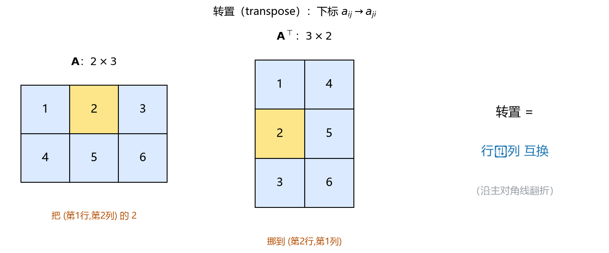
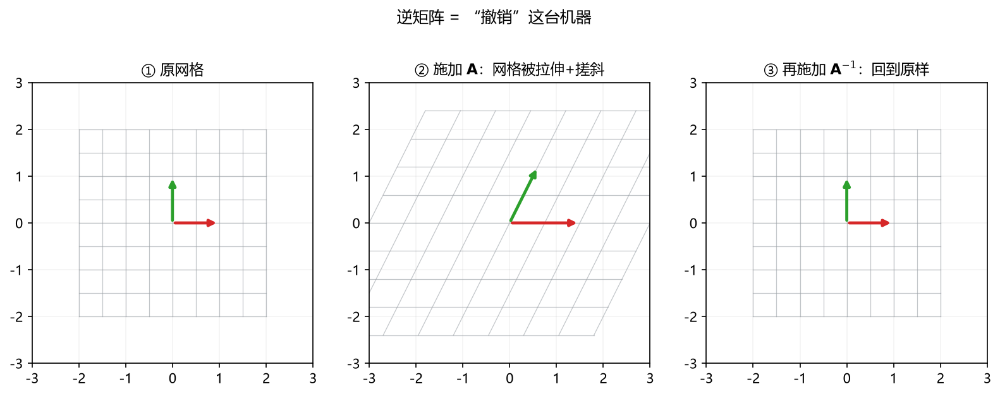
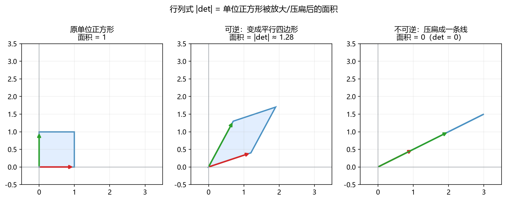

# 板书 · S003 · 第 04 课：转置（transpose）、单位矩阵与逆（inverse）

- 会话ID：`S003`
- 日期：2026-10-16
- 对应概念：`transpose_inv`（必学）
- 前置：`matrix_mult`（已学）
- 修订记录：（初版）2026-10-16
- 说明：按新偏好 **几何优先**（R2/R23）——每个概念先看图，再上计算。

---

## 0. 生活化引入

- **转置**：把一张 Excel 表**横竖对调**（行变列、列变行）。就这么简单，但到处都用。
- **逆**：矩阵是一台"变换机器"（上节课：把网格搬走）。**逆矩阵就是"撤销键"**——
  按一下 $\mathbf{A}$，网格被拉伸；按一下 $\mathbf{A}^{-1}$，**原封不动回到起点**。
- **能不能撤销？** 如果机器把整个平面**压扁成一条线**（信息丢了），就撤不回来——这叫**不可逆**。
  判断标准就是**行列式**（后面看图）。

---

## 一、转置（transpose）：行↔列 互换（先看图）

> **看图**：$\mathbf{A}$ 是 $2\times3$。把（第 1 行，第 2 列）的 $2$，挪到（第 2 行，第 1 列），
> 其余元素同样"行列对调"。整张表沿**主对角线**方向翻折，就得到 $\mathbf{A}^{\top}$（读"A 转置"）。

**记号**：$\mathbf{A}^{\top}$ 或 $\mathbf{A}^T$，元素满足

$$
(\mathbf{A}^{\top})_{ij}=a_{ji}
$$

**形状翻转**：若 $\mathbf{A}$ 是 $m\times n$，则 $\mathbf{A}^{\top}$ 是 $n\times m$。

**手算** $\mathbf{A}=\begin{bmatrix}1&2&3\\4&5&6\end{bmatrix}$（$2\times3$）：

$$
\mathbf{A}^{\top}=\begin{bmatrix}1&4\\2&5\\3&6\end{bmatrix}\quad(3\times2)
$$

**转置把"列向量 / 行向量"打通**：列向量 $\mathbf{x}$ 转置一下就成了行向量 $\mathbf{x}^{\top}$。
这也是书写内积最常用的写法：

$$
\mathbf{a}\cdot\mathbf{b}=\mathbf{a}^{\top}\mathbf{b}
$$

（左是行、右是列，$(1\times n)(n\times1)=1\times1$，正好是一个数。）

**性质**（先记形式，尤其注意"顺序反转"）：
- $(\mathbf{A}^{\top})^{\top}=\mathbf{A}$（转两次回来）。
- $(\mathbf{A}+\mathbf{B})^{\top}=\mathbf{A}^{\top}+\mathbf{B}^{\top}$。
- $(\mathbf{A}\mathbf{B})^{\top}=\mathbf{B}^{\top}\mathbf{A}^{\top}$ —— **顺序要反过来**！
- 若 $\mathbf{A}^{\top}=\mathbf{A}$，称 $\mathbf{A}$ 为**对称矩阵**（symmetric matrix），如协方差矩阵、海森矩阵。

---

## 二、单位矩阵（identity）：什么都不做的变换

**几何**：一张**完全没动**的网格。基向量 $e_1,e_2$ 原地不动。

$$
\mathbf{I}_n=\begin{bmatrix}1&0&\cdots&0\\0&1&\cdots&0\\\vdots&&\ddots&\vdots\\0&0&\cdots&1\end{bmatrix}
\quad(\text{主对角线为 }1,\text{ 其余为 }0)
$$

**性质**：$\mathbf{I}\mathbf{A}=\mathbf{A}\mathbf{I}=\mathbf{A}$，对任何形状合适的 $\mathbf{A}$ 成立。
就像数字里的 $1$：乘以它不改变东西。

---

## 三、逆矩阵（inverse）：撤销键（先看图）

> **看图**：① 原网格 → ② 施加 $\mathbf{A}$（拉伸 + 搓斜）→ ③ 再施加 $\mathbf{A}^{-1}$，**完全回到 ①**。
> 这就是"逆 = 撤销"。

**定义**：对方阵 $\mathbf{A}$，若存在 $\mathbf{A}^{-1}$ 使

$$
\mathbf{A}^{-1}\mathbf{A}=\mathbf{A}\mathbf{A}^{-1}=\mathbf{I}
$$

则称 $\mathbf{A}$ **可逆**（invertible），$\mathbf{A}^{-1}$ 是它的**逆矩阵**。

**性质**（又是"顺序反转"）：
- $(\mathbf{A}\mathbf{B})^{-1}=\mathbf{B}^{-1}\mathbf{A}^{-1}$（先穿袜子再穿鞋 → 先脱鞋再脱袜子）。
- $(\mathbf{A}^{\top})^{-1}=(\mathbf{A}^{-1})^{\top}$。
- $(\mathbf{A}^{-1})^{-1}=\mathbf{A}$。

---

## 四、可逆性：什么时候撤不回来？（先看图）

> **看图**：单位正方形被 $\mathbf{A}$ 变换成平行四边形；**面积放大的倍数 = $|\det\mathbf{A}|$**。
> - 左：$\det=1$，面积不变。
> - 中：平行四边形，面积 $\approx1.28$，**可逆**（没丢信息）。
> - 右：被**压扁成一条线**，面积 $=0$，$\det=0$，**不可逆**（信息丢了，撤不回来）。

**行列式（determinant）**：方阵 $\mathbf{A}=\begin{bmatrix}a&b\\c&d\end{bmatrix}$ 的

$$
\det\mathbf{A}=ad-bc
$$

- $\det\mathbf{A}\ne0$：可逆，$\mathbf{A}^{-1}$ 存在。
- $\det\mathbf{A}=0$：不可逆（称**奇异矩阵 / singular**），几何上把空间降维（压扁）。

> 一句话：**行列式是"面积放大倍数"，为 0 说明维度塌了、无法还原。**

---

## 五、2×2 逆公式（手算，不跳步）

对 $\mathbf{A}=\begin{bmatrix}a&b\\c&d\end{bmatrix}$，若 $ad-bc\ne0$：

$$
\mathbf{A}^{-1}=\frac{1}{ad-bc}\begin{bmatrix}d&-b\\-c&a\end{bmatrix}
$$

**记忆法**：主对角线 $a,d$ 互换位置；副对角线 $b,c$ 变号；整体除以行列式。

**例 1** $\mathbf{A}=\begin{bmatrix}2&1\\1&1\end{bmatrix}$：

$$
\det=2\times1-1\times1=1
$$
$$
\mathbf{A}^{-1}=\frac{1}{1}\begin{bmatrix}1&-1\\-1&2\end{bmatrix}=\begin{bmatrix}1&-1\\-1&2\end{bmatrix}
$$

**验证**（必做，能抓错）：
$$
\mathbf{A}\mathbf{A}^{-1}=\begin{bmatrix}2&1\\1&1\end{bmatrix}\begin{bmatrix}1&-1\\-1&2\end{bmatrix}
=\begin{bmatrix}2\times1+1\times(-1)&2\times(-1)+1\times2\\1\times1+1\times(-1)&1\times(-1)+1\times2\end{bmatrix}
=\begin{bmatrix}1&0\\0&1\end{bmatrix}\ \checkmark
$$

**例 2** $\mathbf{A}=\begin{bmatrix}1&2\\3&4\end{bmatrix}$：

$$
\det=1\times4-2\times3=4-6=-2\ne0\ \Rightarrow\ \text{可逆}
$$
$$
\mathbf{A}^{-1}=\frac{1}{-2}\begin{bmatrix}4&-2\\-3&1\end{bmatrix}
=\begin{bmatrix}-2&1\\1.5&-0.5\end{bmatrix}
$$

---

## 六、逆矩阵与解方程

线性方程组 $\mathbf{A}\mathbf{x}=\mathbf{b}$，若 $\mathbf{A}$ 可逆，则

$$
\mathbf{x}=\mathbf{A}^{-1}\mathbf{b}
$$

**含义**：$\mathbf{A}$ 把 $\mathbf{x}$ 变成 $\mathbf{b}$；要找"原来是哪个 $\mathbf{x}$"，就**撤销 $\mathbf{A}$**。

> ⚠️ 但**实际计算中几乎不真的求 $\mathbf{A}^{-1}$**（慢、数值不稳）。工程上直接解 $\mathbf{A}\mathbf{x}=\mathbf{b}$，
> 或对 $\mathbf{A}$ 做分解（LU / QR / Cholesky）。求逆多用于**推导公式**。

---

## 七、机器学习里干嘛用（具体）

1. **正规方程 / 最小二乘**（下一阶段 B）：$\mathbf{w}=(\mathbf{X}^{\top}\mathbf{X})^{-1}\mathbf{X}^{\top}\mathbf{y}$。
   这里 $\mathbf{X}^{\top}\mathbf{X}$ 是否可逆，决定最小二乘解是否唯一。
2. **内积写法**：$\mathbf{a}\cdot\mathbf{b}=\mathbf{a}^{\top}\mathbf{b}$，让"相似度/加权"能和矩阵运算统一。
3. **协方差矩阵、海森矩阵**是对称矩阵（$\mathbf{A}^{\top}=\mathbf{A}$），有很好的谱性质（阶段 C/E）。
4. **白化 / 预处理**：用协方差逆矩阵把特征"去相关"。
5. **高斯分布**里出现协方差矩阵的逆（$\Sigma^{-1}$）。
6. **岭回归**：当 $\mathbf{X}^{\top}\mathbf{X}$ 不可逆时，加 $\lambda\mathbf{I}$ 让它变得可逆
   （$(\mathbf{X}^{\top}\mathbf{X}+\lambda\mathbf{I})^{-1}$）——这正是正则化能救病态问题的原因之一。

---

## 八、常见易错点

1. **转置/逆的乘积顺序会反转**：$(\mathbf{A}\mathbf{B})^{\top}=\mathbf{B}^{\top}\mathbf{A}^{\top}$，
   $(\mathbf{A}\mathbf{B})^{-1}=\mathbf{B}^{-1}\mathbf{A}^{-1}$，别写成 $\mathbf{A}^{\top}\mathbf{B}^{\top}$。
2. **不是所有矩阵都能求逆**：必须**方阵**且 $\det\ne0$；非方阵没有通常意义的逆。
3. **$\det=0$ 不代表矩阵是零矩阵**：只是"把空间压扁了"（行/列线性相关）。
4. **求逆前先算行列式**：$\det=0$ 就别求了，直接说明不可逆。
5. **别把 $\mathbf{A}^{-1}$ 当成 $\dfrac{1}{\mathbf{A}}$ 逐元素取倒数**：完全不对（除了对角阵）。
6. **$(\mathbf{A}^{\top})^{-1}$ 存在的前提**是 $\mathbf{A}$ 可逆。

---

## 九、与已学概念的关系

- 转置把上节课的**行/列视角**打通：$\mathbf{a}^{\top}\mathbf{b}$ = 内积（接第 01 课）。
- 逆是"线性变换的撤销"，而"可逆性"由**行列式**（面积是否塌缩）决定。
- $(\mathbf{A}\mathbf{B})^{\top}$、$(\mathbf{A}\mathbf{B})^{-1}$ 的顺序反转，正是**矩阵乘法不可交换**的体现（第 03 课）。
- 下一课（A7 线性无关与张成）会解释：**为什么 $\det=0$ ⇔ 列向量线性相关 ⇔ 空间被压扁**。

---

## 十、作业（先做完再看答案）

**Q1（概念）** 判对错 + 理由：
- (a) $(\mathbf{A}\mathbf{B})^{\top}=\mathbf{A}^{\top}\mathbf{B}^{\top}$。
- (b) 任何方阵都可逆。
- (c) $\mathbf{a}\cdot\mathbf{b}$ 可以写成 $\mathbf{a}^{\top}\mathbf{b}$。

**Q2（转置手算）** $\mathbf{A}=\begin{bmatrix}1&2\\3&4\\5&6\end{bmatrix}$（$3\times2$）。
- (a) 写出 $\mathbf{A}^{\top}$ 的形状和内容。
- (b) 计算 $\mathbf{A}^{\top}\mathbf{A}$ 的形状。

**Q3（求逆手算）** $\mathbf{A}=\begin{bmatrix}2&1\\1&1\end{bmatrix}$。
- (a) 求 $\det\mathbf{A}$。
- (b) 用 2×2 公式求 $\mathbf{A}^{-1}$，并**验证** $\mathbf{A}\mathbf{A}^{-1}=\mathbf{I}$。

**Q4（可逆性）** $\mathbf{B}=\begin{bmatrix}1&2\\2&4\end{bmatrix}$。
- (a) 求 $\det\mathbf{B}$，判断是否可逆。
- (b) 用几何语言说明"不可逆"在这里意味着什么。

**Q5（机器学习联系）** 解线性方程组 $\mathbf{A}\mathbf{x}=\mathbf{b}$。
- (a) 写出用逆矩阵表示的解。
- (b) 如果 $\mathbf{A}$ 不可逆，会出现什么情况？（用一句话说清楚"解会怎样"）

---

## 十一、作业答案（先自己做完再看）

**Q1**
- (a) **错**。顺序要反：$(\mathbf{A}\mathbf{B})^{\top}=\mathbf{B}^{\top}\mathbf{A}^{\top}$。
- (b) **错**。必须方阵**且** $\det\ne0$；$\det=0$（如 $\begin{bmatrix}1&2\\2&4\end{bmatrix}$）就不可逆。
- (c) **对**。把 $\mathbf{a}$ 写成列向量，$\mathbf{a}^{\top}$ 是行向量，$\mathbf{a}^{\top}\mathbf{b}=(1\times n)(n\times1)$ 正是内积。

**Q2** $\mathbf{A}=\begin{bmatrix}1&2\\3&4\\5&6\end{bmatrix}$
- (a) 形状翻转：$2\times3$，
$$
\mathbf{A}^{\top}=\begin{bmatrix}1&3&5\\2&4&6\end{bmatrix}
$$
- (b) $(2\times3)(3\times2)=2\times2$（方阵）：
$$
\mathbf{A}^{\top}\mathbf{A}=\begin{bmatrix}1&3&5\\2&4&6\end{bmatrix}\begin{bmatrix}1&2\\3&4\\5&6\end{bmatrix}
=\begin{bmatrix}1+9+25 & 2+12+30\\2+12+30 & 4+16+36\end{bmatrix}
=\begin{bmatrix}35&44\\44&56\end{bmatrix}
$$

**Q3** $\mathbf{A}=\begin{bmatrix}2&1\\1&1\end{bmatrix}$
- (a) $\det=2\times1-1\times1=1$。
- (b)
$$
\mathbf{A}^{-1}=\frac{1}{1}\begin{bmatrix}1&-1\\-1&2\end{bmatrix}=\begin{bmatrix}1&-1\\-1&2\end{bmatrix}
$$
验证：$\mathbf{A}\mathbf{A}^{-1}=\begin{bmatrix}2\times1+1\times(-1)&2\times(-1)+1\times2\\1\times1+1\times(-1)&1\times(-1)+1\times2\end{bmatrix}=\begin{bmatrix}1&0\\0&1\end{bmatrix}=\mathbf{I}\ \checkmark$

**Q4** $\mathbf{B}=\begin{bmatrix}1&2\\2&4\end{bmatrix}$
- (a) $\det=1\times4-2\times2=4-4=0$，**不可逆**（奇异矩阵）。
- (b) 它把整个平面**压扁成一条直线**（两个列向量方向相同、共线），
  维度塌缩、信息丢失，所以无法撤销、$\mathbf{B}^{-1}$ 不存在。

**Q5**
- (a) $\mathbf{x}=\mathbf{A}^{-1}\mathbf{b}$。
- (b) 若 $\mathbf{A}$ 不可逆，方程可能**无解**或**有无穷多解**（不能唯一确定 $\mathbf{x}$）；
  对应"被压扁"的方向信息丢失——这正是后面要用**最小二乘/伪逆**处理的情形。
