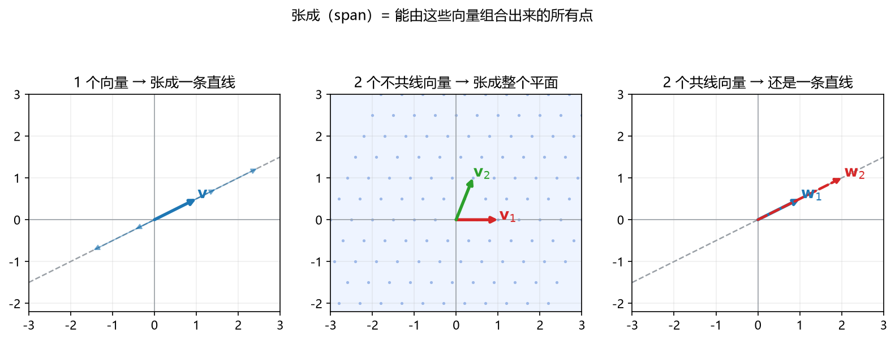
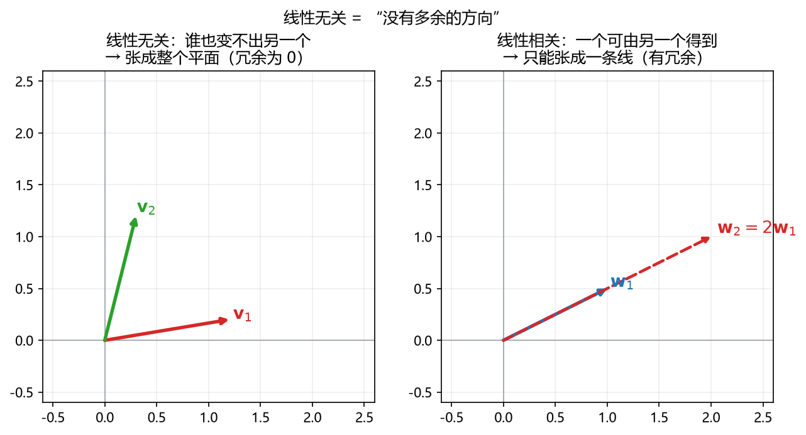
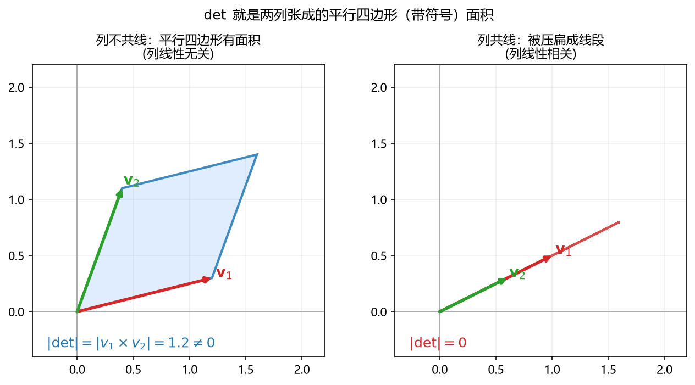

# 板书 · S003 · 第 05 课：线性组合（linear combination）、张成（span）与线性无关（linear independence）

- 会话ID：`S003`
- 日期：2026-10-16
- 对应概念：`linear_independence`（必学）
- 前置：`vector`、`matrix_mult`、`transpose_inv`（已学）
- 修订记录：（初版）2026-10-16；（v2）2026-10-16 追加第十一节「答疑补记」；（v3）2026-10-16 追加问 4（det 与列相关的几何联系）
- 说明：**几何优先**（R2/R23）——先看图，再上定义与计算。

---

## 0. 生活化引入

- **线性组合**：像调配饮料。有几种"基料"（向量），你把每种按不同倍数混一混，得到各种口味。
- **张成（span）**：**用这几种基料，总共能调出哪些口味**？（是所有可能的集合）
- **线性无关**：这些基料里**有没有多余的**？如果某一种是另几种混出来的，那它就是多余的——去掉它，能调的口味一样多。

> 三个词是一条链：**组合**（怎么调）→ **张成**（能调到哪）→ **无关**（有没有冗余）。

---

## 一、线性组合（linear combination）

**定义**：给定若干向量 $\mathbf{v}_1,\dots,\mathbf{v}_k$，给它们各乘一个数（**系数**）再相加：

$$
c_1\mathbf{v}_1+c_2\mathbf{v}_2+\dots+c_k\mathbf{v}_k=\sum_{i=1}^{k}c_i\mathbf{v}_i
$$

**手算** $\mathbf{v}_1=(1,0)$，$\mathbf{v}_2=(0,1)$，系数 $c_1=2,c_2=3$：

$$
2\mathbf{v}_1+3\mathbf{v}_2=2(1,0)+3(0,1)=(2,0)+(0,3)=(2,3)
$$

**关键联系（回看第 03 课）**：$\mathbf{A}\mathbf{x}=x_1(\text{第1列})+\dots+x_n(\text{第n列})$——
**矩阵乘向量，本质就是"用 $\mathbf{x}$ 当系数，对列向量做线性组合"**。

---

## 二、张成（span）：能"调"出的所有点（先看图）



> **看图**：
> - 左：**1 个向量** → 只能沿它的方向来回走，张成**一条直线**。
> - 中：**2 个不共线向量** → 两个方向都能走，铺满**整个平面**（蓝色阴影）。
> - 右：**2 个共线向量** → 方向其实只有一个，只能张成**一条直线**（和左图一样）。

**定义**：$\mathbf{v}_1,\dots,\mathbf{v}_k$ 的**张成**，是它们所有线性组合的集合：

$$
\operatorname{span}\{\mathbf{v}_1,\dots,\mathbf{v}_k\}=\Big\{\sum_{i=1}^{k}c_i\mathbf{v}_i\ \Big|\ c_i\in\mathbb{R}\Big\}
$$

**核心结论**：张成的**维度**，取决于这里有**几个真正独立的方向**：
- 0 个独立方向（全是零向量）→ 一个点（原点）。
- 1 个独立方向 → 一条线。
- 2 个独立方向 → 一个平面。
- $n$ 个独立方向 → $n$ 维空间。

---

## 三、线性无关（linear independence）：有没有多余的？(先看图)



> **看图**：
> - 左（**无关**）：$\mathbf{v}_1,\mathbf{v}_2$ 不共线，**谁也不能由对方表示** → 没有冗余，能张成整个平面。
> - 右（**相关**）：$\mathbf{w}_2=2\mathbf{w}_1$，两个向量方向相同，**有一个是多余的** → 只能张成一条线。

**定义（要记住的"零组合"判据）**：若

$$
c_1\mathbf{v}_1+c_2\mathbf{v}_2+\dots+c_k\mathbf{v}_k=\mathbf{0}
$$

**只有唯一解** $c_1=c_2=\dots=c_k=0$（叫**平凡解**），则称 $\mathbf{v}_1,\dots,\mathbf{v}_k$ **线性无关**；
否则（存在不全为 0 的系数也能凑出 $\mathbf{0}$）称**线性相关**。

> 白话：**只有"全部系数取 0"才能凑成零 → 无关；只要还能用别的系数凑出零 → 相关（有冗余）。**

**手算例子**

- $\mathbf{v}_1=(1,2)$，$\mathbf{v}_2=(2,4)$：
  取 $c_1=2,c_2=-1$，则 $2(1,2)-1(2,4)=(2,4)-(2,4)=(0,0)$，
  系数不全为 0 → **线性相关**（且 $\mathbf{v}_2=2\mathbf{v}_1$）。

- $\mathbf{v}_1=(1,2)$，$\mathbf{v}_2=(2,1)$：
  设 $c_1(1,2)+c_2(2,1)=(0,0)$，得
  $$
  \begin{cases}c_1+2c_2=0\\2c_1+c_2=0\end{cases}
  \Rightarrow c_1=c_2=0
  $$
  只有零解 → **线性无关**。

> **直觉判据（2 维）**：两个向量**共线 → 相关**；**不共线 → 无关**。
> 更一般地，在 $n$ 维里，**超过 $n$ 个向量必相关**（方向不够用）。

---

## 四、和矩阵 / 行列式 / 秩的联系（把前面几课串起来）

把向量**按列排成矩阵** $\mathbf{A}=[\,\mathbf{v}_1\ \mathbf{v}_2\ \cdots\ \mathbf{v}_k\,]$，则：

$$
\text{列向量线性无关}
\iff \mathbf{A}\mathbf{c}=\mathbf{0}\ \text{只有零解}
\iff \det\mathbf{A}\ne0\ (\text{方阵时})
\iff \mathbf{A}\ \text{可逆}
\iff \text{变换不把空间压扁}
$$

- $\det=0$ ⇔ 列相关 ⇔ 空间被压扁（回顾第 04 课那张"压扁成线"的图）。
- **秩（rank）** = 列（或行）里**线性无关的最大个数** = 张成空间的维度。
  - $\begin{bmatrix}1&2\\2&4\end{bmatrix}$ 秩 $=1$（两列共线）。
  - $\begin{bmatrix}1&2\\2&1\end{bmatrix}$ 秩 $=2$（两列独立）。

---

## 五、基（basis）

**定义**：一组向量，若**既线性无关、又能张成整个空间**，就叫做该空间的一组**基**。

- 例：二维平面的**标准基** $\mathbf{e}_1=(1,0),\ \mathbf{e}_2=(0,1)$：它们不共线（无关），又能拼出任意 $(a,b)=a\mathbf{e}_1+b\mathbf{e}_2$（张成平面）。
- **基的意义**：用一组"刚好够、不多不少"的方向来定位空间里任何一个点；坐标就是**在这组基下的组合系数**。

---

## 六、机器学习里干嘛用（具体）

1. **多重共线性（multicollinearity）**：特征列线性相关 → $\mathbf{X}^{\top}\mathbf{X}$ 不可逆 →
   最小二乘 $\mathbf{w}=(\mathbf{X}^{\top}\mathbf{X})^{-1}\mathbf{X}^{\top}\mathbf{y}$ 求不出唯一解。
   这也解释了为什么要加**岭回归**的 $\lambda\mathbf{I}$（让矩阵"回到"可逆）。
2. **冗余特征**：相关列意味着有特征可由别的特征线性表示，删掉它模型不会变差。
3. **PCA / 降维**：找"能张成数据、且相互正交"的主方向，把多余的维度丢掉。
4. **秩**：衡量数据/矩阵里"真正独立的信息量"；低秩近似用于压缩、推荐。
5. **解的存在与唯一性**：$\mathbf{A}\mathbf{x}=\mathbf{b}$ 有唯一解 ⇔ 列线性无关。

---

## 七、常见易错点

1. **"张成"是集合，不是向量**：$\operatorname{span}$ 是一大堆点的集合，别只写一个向量。
2. **线性无关看"零组合"是否只有零解**，不是看向量本身有没有零分量。
3. **含零向量的组一定相关**（取非零系数乘零向量即可凑零）。
4. **$n$ 维中超过 $n$ 个向量必相关**（方向数不够）。
5. **"相关"不是"重复"**：共线（成比例）就算相关，不要求一模一样。
6. **$\det=0$、列相关、不可逆、秩不足、空间被压扁——是同一件事的多种说法。**

---

## 八、与已学概念的关系

```
vector ──组合──▶ span（能到哪）
matrix_mult ──列视角──▶ A x 就是列的线性组合
transpose_inv ──det≠0 ⇔ 可逆──▶ 等价于「列线性无关」
```

- 回到第 03 课：$\mathbf{A}\mathbf{x}$ = 列的线性组合，所以"$\mathbf{A}$ 的列张成啥"决定了 $\mathbf{A}\mathbf{x}$ 能取到哪些值（这就是**列空间**）。
- 承接第 04 课：$\det=0$ ⇔ 列相关 ⇔ 不可逆，本课给了它"没有多余方向"的直观解释。
- 下一课（A8 正交与投影）：在"无关"的基础上加上"垂直"，用于把向量**投影**到一个子空间——这是阶段 B 最小二乘的直接地基。

---

## 九、作业（先做完再看答案）

**Q1（概念）** 判对错 + 理由：
- (a) 两个共线的非零向量一定线性相关。
- (b) 在二维平面里，3 个向量一定线性相关。
- (c) 线性相关意味着其中一个向量一定是零向量。

**Q2（线性组合与张成）** $\mathbf{v}_1=(1,2)$，$\mathbf{v}_2=(3,1)$。
- (a) 求 $2\mathbf{v}_1-1\mathbf{v}_2$。
- (b) 判断 $\mathbf{v}_1,\mathbf{v}_2$ 是否线性无关（用"零组合"法，写步骤）。

**Q3（判定相关/无关 + 行列式）** $\mathbf{A}=\begin{bmatrix}1&2\\2&4\end{bmatrix}$。
- (a) 求 $\det\mathbf{A}$，判断两列是否线性无关。
- (b) 写出一个"非平凡组合"（系数不全为 0）使两列的线性组合 $=\mathbf{0}$。

**Q4（秩）** 分别说出 $\begin{bmatrix}1&2\\2&4\end{bmatrix}$ 和 $\begin{bmatrix}1&2\\2&1\end{bmatrix}$ 的秩，并说明理由。

**Q5（机器学习联系）** 某个特征矩阵 $\mathbf{X}$ 里，"房间数"这一列正好等于"面积"这一列的 $0.02$ 倍。
- (a) 这两列线性相关吗？
- (b) 这会如何影响正规方程 $\mathbf{w}=(\mathbf{X}^{\top}\mathbf{X})^{-1}\mathbf{X}^{\top}\mathbf{y}$？给出一个补救办法。

---

## 十、作业答案（先自己做完再看）

**Q1**
- (a) **对**。共线即一个 $=c\times$ 另一个，取 $c_1=1,c_2=-c$ 可得非平凡零组合，故相关。
- (b) **对**。二维最多有 2 个独立方向，第 3 个必能被前两个（若独立）表示，故相关。
- (c) **错**。相关只要求"有冗余/共线"，例如 $(1,2)$ 与 $(2,4)$ 都非零但相关；含零向量只是相关的一种特例。

**Q2** $\mathbf{v}_1=(1,2)$，$\mathbf{v}_2=(3,1)$
- (a) $2\mathbf{v}_1-\mathbf{v}_2=(2,4)-(3,1)=(-1,3)$。
- (b) 设 $c_1(1,2)+c_2(3,1)=(0,0)$：
  $$
  \begin{cases}c_1+3c_2=0\\2c_1+c_2=0\end{cases}
  $$
  由第一式 $c_1=-3c_2$，代入第二式 $-6c_2+c_2=-5c_2=0\Rightarrow c_2=0\Rightarrow c_1=0$。
  只有零解 → **线性无关**。（且 $\det\begin{bmatrix}1&3\\2&1\end{bmatrix}=1-6=-5\ne0$。）

**Q3** $\mathbf{A}=\begin{bmatrix}1&2\\2&4\end{bmatrix}$
- (a) $\det=1\times4-2\times2=0$，所以两列**线性相关**（不是无关）。
- (b) 取 $c_1=2,c_2=-1$：$2\begin{bmatrix}1\\2\end{bmatrix}-1\begin{bmatrix}2\\4\end{bmatrix}=\begin{bmatrix}0\\0\end{bmatrix}$（系数不全为 0）。

**Q4**
- $\begin{bmatrix}1&2\\2&4\end{bmatrix}$：秩 $=1$。第 2 列 $=2\times$ 第 1 列，两列相关，独立方向只有 1 个。
- $\begin{bmatrix}1&2\\2&1\end{bmatrix}$：秩 $=2$。$\det=1-4=-3\ne0$，两列线性无关。

**Q5**
- (a) **相关**。第二列 $=0.02\times$ 第一列，是共线（成比例）的两列。
- (b) 相关列使 $\mathbf{X}^{\top}\mathbf{X}$ **不可逆（奇异）**，正规方程求不出唯一解（或数值极不稳定）。
  补救：删掉冗余特征之一，或加入 **$\lambda\mathbf{I}$ 做岭回归**（$\mathbf{w}=(\mathbf{X}^{\top}\mathbf{X}+\lambda\mathbf{I})^{-1}\mathbf{X}^{\top}\mathbf{y}$），
  使矩阵重新可逆。

---

## 十一、答疑补记（S003 学生追问，2026-10-16）

**问 1：在 $\mathbb{R}^2$ 里（都是 $2\times1$），是否只要向量个数 $>2$ 就必然相关？**
- **是（要精确说"超过维度"）**。$\mathbb{R}^2$ 里线性无关的向量**最多 2 个**，所以 **3 个及以上必相关**。
- 但**恰好 2 个**不一定相关：不共线才无关。
- 一般规律：**$n$ 维空间里，超过 $n$ 个向量必线性相关**。（方向数不够用）

**问 2：能否用矩阵乘法表示"是否相关"？能有几何看法吗？**
- **能，且最标准**。把向量按**列**排成 $\mathbf{A}=[\mathbf{v}_1\ \cdots\ \mathbf{v}_k]$，则
  $$
  c_1\mathbf{v}_1+\dots+c_k\mathbf{v}_k=\mathbf{A}\mathbf{c}
  $$
  "是否相关" ⇔ 看 $\mathbf{A}\mathbf{c}=\mathbf{0}$ 是否有**非零解**：只有零解 → 无关；有非零解 → 相关。
- **几何**：存在非零 $\mathbf{c}$ 被 $\mathbf{A}$ 压成 $\mathbf{0}$，意味着 $\mathbf{A}$ **把某个方向压没了**（该方向即 $\mathbf{A}$ 的"核 / kernel"）——
  正是第 04 课"压扁成一条线"的图（`图片/fig_determinant_invertibility.png`）。
  方阵时 ⇔ $\det\mathbf{A}=0$；非方阵看**秩**是否满。
  一句话：**相关 ⇔ 变换不可逆地塌缩了某个方向。**

**问 3：若集合里有 7 个向量线性无关，另有一个向量能由其中 2 个合成，整个集合是否相关？**
- **是**。只要集合里**任意一个向量能由"其余向量"线性表示**，整个集合就**线性相关**（该向量是"多余"的）。
- 更一般：**往一个已满秩的集合里加一个"落在它张成内"的向量，必然造成相关。**
- 与问 1 的区别：问 1 是"**数量**超标导致相关"，问 3 是"**内容**冗余导致相关"，两者都是相关的来源。

**问 4：为什么"$\mathbf{A}\mathbf{c}=\mathbf{0}$ 只有零解"等价于"$\det\mathbf{A}\ne0$"？$\det$ 不是有几何意义吗？**
- **核心**：正因为 $\det$ 就是**几何量（面积/体积伸缩倍数）**，这两个说法在描述同一件事——"有没有方向被压没"。



- **第一步**：$\mathbf{A}\mathbf{c}=c_1\mathbf{v}_1+c_2\mathbf{v}_2+\dots$ 就是**列的线性组合**。
  - "有非零解" = 存在配比让列**抵消成 0** = 列**相关** = 盒子被**压扁**。
  - "只有零解" = 没有非零配比能抵消 = 列**无关** = 盒子**满维不塌缩**。
- **第二步**：盒子的**带符号体积就是 $\det$**。$2\times2$ 时
  $$
  \det\begin{bmatrix}a&b\\c&d\end{bmatrix}=ad-bc=\mathbf{v}_1\times\mathbf{v}_2\ (\text{列 }(a,c),(b,d)\text{ 的带符号面积})
  $$
  列共线 → 压成线段 → 面积 $0$ → $\det=0$；列不共线 → 有面积 → $\det\ne0$。
- **第三步（等价链）**：
  $$
  \mathbf{A}\mathbf{c}=\mathbf{0}\ \text{只有零解}
  \iff \text{列无关}
  \iff \text{盒子满维、体积}\ne0
  \iff \det\mathbf{A}\ne0
  $$
- **旁证（纯代数）**：逆矩阵公式 $\mathbf{A}^{-1}=\dfrac{1}{\det\mathbf{A}}\mathrm{adj}(\mathbf{A})$ 的分母是 $\det$；
  $\det=0$ 就"除不了"、逆不存在 ⇔ 不可逆 ⇔ 有非零解。
- **结论**：$\det$ 不是额外符号，**它就是"面积/体积放大倍数"**；$\det=0$ 即放大 $0$ 倍 → 塌缩 → 必有非零 $\mathbf{c}$ 被压成 $\mathbf{0}$。
