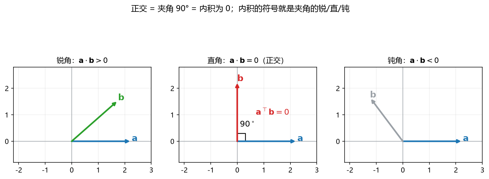
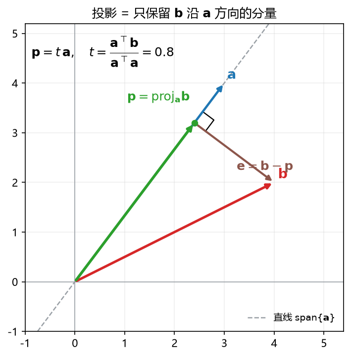
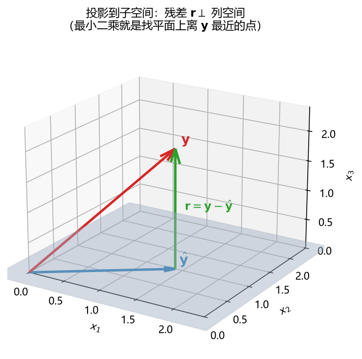

# 板书 · S004 · 第 06 课：正交（orthogonality）与投影（projection）

- 会话ID：`S004`
- 日期：2026-10-26
- 对应概念：`orthogonal_projection`（必学）
- 前置：`inner_product`、`norm`、`distance_cosine`、`linear_independence`（已学）
- 修订记录：（初版）2026-10-26
- 说明：**几何优先**（R2/R23）——先看图，再上公式与计算。本课是**阶段 A 的收尾**，
  也是阶段 B「最小二乘」的地基。

---

## 0. 生活化引入

三个画面，其实是同一件事：

1. **影子**：太阳在正上方，一根斜着的杆子在地上会投下一个"正投影"。
   影子 = 杆子**只保留地面里的那部分分量**，垂直地面的分量被"砍掉"了。
2. **找最近的地铁站**：你家在地图上是一个点，地铁线是一条**直线**（或一片站点的**平面**）。
   "最近的车站"就是**把家投影到这条线/这个面上**得到的垂足。
3. **机器学习**：模型只能输出它"能表达"的那些值（一个子空间）。真实标签 $\mathbf{y}$ 一般
   不落在里面，于是我们把 $\mathbf{y}$ **投影**进去——投影点就是模型的预测，剩下的部分
   就是残差（噪声）。**这就是最小二乘。**

> 一句话：**投影 = 在某个方向/空间里，找"离你最近的那个点"。**

---

## 一、几何视角：正交到底是什么



> **看图**：
> - 左（锐角）：$\mathbf{b}$ 和 $\mathbf{a}$ 大致同向，$\mathbf{a}\cdot\mathbf{b}>0$。
> - 中（直角）：$\mathbf{b}$ 和 $\mathbf{a}$ 成 $90^\circ$，$\mathbf{a}\cdot\mathbf{b}=0$ —— 这就是**正交**。
> - 右（钝角）：$\mathbf{b}$ 和 $\mathbf{a}$ 大致反向，$\mathbf{a}\cdot\mathbf{b}<0$。
>
> 所以**内积的符号**本身就在告诉你"同向还是反向、垂直还是一般"。

**定义**：两个向量正交（orthogonal），记作 $\mathbf{a}\perp\mathbf{b}$，当且仅当

$$
\mathbf{a}\cdot\mathbf{b}=\mathbf{a}^{\top}\mathbf{b}=\sum_{i=1}^{n}a_i b_i=0
$$

**符号逐个拆**：

| 符号 | 是什么 | 形状 |
|---|---|---|
| $\mathbf{a},\mathbf{b}$ | 两个向量 | $n\times1$ |
| $\mathbf{a}^{\top}\mathbf{b}$ | 内积，一个**数**（标量） | $1\times1$ |
| $\sum_{i=1}^{n}a_i b_i$ | 对应分量相乘再相加 | 标量 |
| $\|\mathbf{a}\|\,\|\mathbf{b}\|\cos\theta$ | 内积的几何写法；$\theta$ 是两向量夹角 | 标量 |

**为什么"内积为 0"就是"垂直"？**
由 $\mathbf{a}^{\top}\mathbf{b}=\|\mathbf{a}\|\,\|\mathbf{b}\|\cos\theta$，两向量都非零时，
内积为 $0$ $\iff$ $\cos\theta=0$ $\iff$ $\theta=90^\circ$。
几何上，$\mathbf{a}^{\top}\mathbf{b}$ 度量的是"**$\mathbf{b}$ 在 $\mathbf{a}$ 方向上有多少分量**"
（等于 $\|\mathbf{a}\|$ 乘以 $\mathbf{b}$ 在 $\mathbf{a}$ 上的投影长度）。垂直 = 沿 $\mathbf{a}$ 方向
一点分量都没有 = $0$。

**两个必须记住的细节**

1. **零向量与任何向量都正交**（因为 $\mathbf{0}^{\top}\mathbf{b}=0$），但它没有"方向"。
   所以"正交"这个词在讨论方向时，默认是**非零向量**。
2. **正交 ⟹ 线性无关**：若 $\mathbf{v}_1,\dots,\mathbf{v}_k$ 两两正交且都非零，设
   $c_1\mathbf{v}_1+\dots+c_k\mathbf{v}_k=\mathbf{0}$，两边与 $\mathbf{v}_i$ 做内积：
   $$
   c_i\,\|\mathbf{v}_i\|^2=0\ \Rightarrow\ c_i=0\quad(\text{因为 }\|\mathbf{v}_i\|\ne0)
   $$
   所以只有零组合 → **线性无关**。反过来不成立：无关的向量不一定垂直（可以斜着）。

**正交基 / 标准正交基（orthonormal basis）**
- 两两正交、且每个长度为 $1$ 的一组基，如 $\mathbf{e}_1=(1,0)$、$\mathbf{e}_2=(0,1)$。
- **好处**：在这种基下，坐标不用解方程，**直接做内积就能取出来**：$c_i=\mathbf{u}_i^{\top}\mathbf{x}$。
  这正是为什么很多算法要先"正交化"。

---

## 二、几何视角：投影到一条直线



> **看图**：
> - 蓝箭头是方向 $\mathbf{a}$（它张成的直线是那条虚线）。
> - 红箭头是 $\mathbf{b}$。
> - **绿箭头** $\mathbf{p}$ 是 $\mathbf{b}$ 在直线上的**投影**：从原点沿 $\mathbf{a}$ 方向走到"垂足"。
> - **棕色箭头** $\mathbf{e}=\mathbf{b}-\mathbf{p}$ 是**残差**：从 $\mathbf{p}$ 指回 $\mathbf{b}$，它与直线**垂直**（图中有直角记号）。
>
> 关键画面：$\mathbf{b}$ 被**拆成两块**——沿直线的 $\mathbf{p}$、垂直直线的 $\mathbf{e}$。这就是投影的全部内容。

**直觉**：直线上有无数个点，哪个离 $\mathbf{b}$ 最近？答案是**垂足**。
（斜着走一定更远；直角三角形里斜边最长。）

**数学形式（先给结论）**：

$$
\boxed{\ \mathbf{p}=\frac{\mathbf{a}^{\top}\mathbf{b}}{\mathbf{a}^{\top}\mathbf{a}}\,\mathbf{a}\ }
\qquad
\mathbf{e}=\mathbf{b}-\mathbf{p}
$$

**为什么长这样？一步步推（不跳步）**

1. **投影点必须在直线上**，而直线是 $\{t\mathbf{a}\mid t\in\mathbb{R}\}$。
   所以投影一定长成 $\mathbf{p}=t\mathbf{a}$，只有一个未知数 $t$。
   （$t$ 是**标量**，$\mathbf{a}$ 是**向量**，$t\mathbf{a}$ 还是向量。）
2. **"最近" ⟺ "残差垂直"**：如果 $\mathbf{e}=\mathbf{b}-t\mathbf{a}$ 不垂直于 $\mathbf{a}$，
   那么在直线上稍微挪一挪，还能更近。所以最近的充要条件是
   $$
   \mathbf{a}^{\top}\mathbf{e}=0\quad\Longleftrightarrow\quad \mathbf{a}^{\top}(\mathbf{b}-t\mathbf{a})=0
   $$
3. **解出 $t$**：把括号展开（内积对加法、数乘都是线性的）：
   $$
   \mathbf{a}^{\top}\mathbf{b}-t\,\mathbf{a}^{\top}\mathbf{a}=0
   \ \Longrightarrow\
   t=\frac{\mathbf{a}^{\top}\mathbf{b}}{\mathbf{a}^{\top}\mathbf{a}}
   $$
   分母 $\mathbf{a}^{\top}\mathbf{a}=\|\mathbf{a}\|^2$ 是**长度平方**，只要 $\mathbf{a}\ne\mathbf{0}$ 就不为 $0$。
4. **代回去**：
   $$
   \mathbf{p}=t\mathbf{a}=\frac{\mathbf{a}^{\top}\mathbf{b}}{\mathbf{a}^{\top}\mathbf{a}}\mathbf{a}
   =\frac{\mathbf{a}\mathbf{a}^{\top}}{\mathbf{a}^{\top}\mathbf{a}}\,\mathbf{b}
   $$
   最后一步用了"标量可以随便挪位置"：$\mathbf{a}\,\mathbf{a}^{\top}\mathbf{b}=(\mathbf{a}\mathbf{a}^{\top})\mathbf{b}$。

**符号逐个拆**：

| 符号 | 含义 | 形状 |
|---|---|---|
| $t=\dfrac{\mathbf{a}^{\top}\mathbf{b}}{\mathbf{a}^{\top}\mathbf{a}}$ | 投影系数（"沿 $\mathbf{a}$ 走几倍"） | 标量 |
| $\mathbf{p}=t\mathbf{a}$ | 投影向量 | $n\times1$ |
| $\mathbf{a}\mathbf{a}^{\top}$ | **外积（outer product）**，一个矩阵 | $n\times n$ |
| $\mathbf{P}=\dfrac{\mathbf{a}\mathbf{a}^{\top}}{\mathbf{a}^{\top}\mathbf{a}}$ | **投影矩阵（projection matrix）** | $n\times n$ |
| $\mathbf{P}\mathbf{b}$ | 把任意 $\mathbf{b}$ 投到 $\operatorname{span}\{\mathbf{a}\}$ | $n\times1$ |

**特别地，如果 $\mathbf{a}$ 已经是单位向量** $\mathbf{u}$（$\|\mathbf{u}\|=1$，所以 $\mathbf{u}^{\top}\mathbf{u}=1$）：

$$
\mathbf{p}=(\mathbf{u}^{\top}\mathbf{b})\,\mathbf{u}=\mathbf{u}\mathbf{u}^{\top}\mathbf{b},
\qquad \mathbf{P}=\mathbf{u}\mathbf{u}^{\top}
$$

**投影矩阵的三条性质**（后面经常用）

1. **对称**：$\mathbf{P}^{\top}=\mathbf{P}$。
   （因为 $(\mathbf{a}\mathbf{a}^{\top})^{\top}=\mathbf{a}\mathbf{a}^{\top}$）
2. **幂等**：$\mathbf{P}^2=\mathbf{P}$。
   几何含义：**投影两次 = 投影一次**（第一次已经落在直线上了，再投不动了）。
   $$
   \mathbf{P}^2=\frac{\mathbf{a}\mathbf{a}^{\top}\mathbf{a}\mathbf{a}^{\top}}{(\mathbf{a}^{\top}\mathbf{a})^2}
   =\frac{\mathbf{a}\,(\mathbf{a}^{\top}\mathbf{a})\,\mathbf{a}^{\top}}{(\mathbf{a}^{\top}\mathbf{a})^2}
   =\frac{\mathbf{a}\mathbf{a}^{\top}}{\mathbf{a}^{\top}\mathbf{a}}=\mathbf{P}
   $$
3. **$\mathbf{I}-\mathbf{P}$ 是"投到正交方向"的矩阵**，它给出残差：
   $$
   \mathbf{e}=(\mathbf{I}-\mathbf{P})\mathbf{b}
   $$
   $\mathbf{P}$ 和 $\mathbf{I}-\mathbf{P}$ 把空间分成"沿 $\mathbf{a}$"和"垂直于 $\mathbf{a}$"两块。

**勾股关系（投影不会让向量变长）**：

$$
\|\mathbf{b}\|^2=\|\mathbf{p}\|^2+\|\mathbf{e}\|^2\quad\Longrightarrow\quad \|\mathbf{p}\|\le\|\mathbf{b}\|
$$

因为 $\mathbf{p}\perp\mathbf{e}$，这就是直角三角形。

---

## 三、手算示例（每一步都写出来）

**题目**：$\mathbf{a}=(3,4)$，$\mathbf{b}=(4,2)$，求 $\mathbf{b}$ 在 $\operatorname{span}\{\mathbf{a}\}$ 上的投影。

**第 1 步：算分母** $\mathbf{a}^{\top}\mathbf{a}$

$$
\mathbf{a}^{\top}\mathbf{a}=3\times3+4\times4=9+16=25
$$

**第 2 步：算分子** $\mathbf{a}^{\top}\mathbf{b}$

$$
\mathbf{a}^{\top}\mathbf{b}=3\times4+4\times2=12+8=20
$$

**第 3 步：算系数**

$$
t=\frac{\mathbf{a}^{\top}\mathbf{b}}{\mathbf{a}^{\top}\mathbf{a}}=\frac{20}{25}=0.8
$$

**第 4 步：算投影向量**

$$
\mathbf{p}=t\mathbf{a}=0.8(3,4)=(2.4,\,3.2)
$$

**第 5 步：算残差**

$$
\mathbf{e}=\mathbf{b}-\mathbf{p}=(4,2)-(2.4,3.2)=(1.6,\,-1.2)
$$

**第 6 步：验证垂直**

$$
\mathbf{a}^{\top}\mathbf{e}=3\times1.6+4\times(-1.2)=4.8-4.8=0\ \checkmark
$$

**第 7 步：求距离（顺便复习第 02 课）**

$$
\|\mathbf{e}\|=\sqrt{1.6^2+(-1.2)^2}=\sqrt{2.56+1.44}=\sqrt{4}=2
$$

所以 $\mathbf{b}$ 到直线 $\operatorname{span}\{(3,4)\}$ 的**最短距离是 2**。

**第 8 步：勾股验算**

$$
\|\mathbf{b}\|^2=4^2+2^2=20,\quad
\|\mathbf{p}\|^2=2.4^2+3.2^2=5.76+10.24=16,\quad
\|\mathbf{e}\|^2=4
$$
$$
16+4=20\ \checkmark
$$

**一个常见错误示范**：有人会直接把 $\mathbf{b}$ 的 $x$ 分量拿来当投影，得到 $(4,0)$。
检验一下：

$$
\mathbf{a}^{\top}\big(\mathbf{b}-(4,0)\big)=\mathbf{a}^{\top}(0,2)=3\times0+4\times2=8\ne0
$$

不垂直 → **不是**投影（不是最近点）。
"取某个坐标分量"只有在**基是标准正交基**时才等于投影；一般方向必须用上面的公式。

---

## 四、升级：投影到一个子空间（矩阵版）



> **看图**：
> - 浅蓝平面是 $\mathbf{A}$ 的**列空间**（$\mathbf{A}$ 两列张成的平面）。
> - 红箭头 $\mathbf{y}$ 一般**不在**平面里（三维空间里的一个斜向量）。
> - 蓝箭头 $\hat{\mathbf{y}}$ 是 $\mathbf{y}$ 在平面上的投影 = 平面上离 $\mathbf{y}$ **最近**的点。
> - 绿箭头 $\mathbf{r}=\mathbf{y}-\hat{\mathbf{y}}$ 是残差，它**竖直地垂直于整个平面**。
>
> 这张图就是最小二乘的全部几何。

**设定**：$\mathbf{A}$ 是 $m\times n$，列线性无关。它的列张成一个子空间
$\mathcal{C}(\mathbf{A})=\{\mathbf{A}\mathbf{x}\mid \mathbf{x}\in\mathbb{R}^n\}$（列空间）。
给定 $\mathbf{y}\in\mathbb{R}^m$，一般 $\mathbf{y}\notin\mathcal{C}(\mathbf{A})$。

**目标**：在列空间里找一个 $\hat{\mathbf{y}}$，使它离 $\mathbf{y}$ 最近。

**第 1 步：投影点必须能写成 $\mathbf{A}\hat{\mathbf{x}}$**
因为列空间 = 所有 $\mathbf{A}\mathbf{x}$。这里 $\hat{\mathbf{x}}$ 是 $n\times1$（未知系数）。

**第 2 步：最近 ⟺ 残差垂直于整个列空间**
"垂直于整个子空间"= 垂直于它的**每一列**（因为列是子空间的生成元，垂直生成元就垂直一切组合）：

$$
\mathbf{A}^{\top}(\mathbf{y}-\mathbf{A}\hat{\mathbf{x}})=\mathbf{0}
$$

**第 3 步：展开**

$$
\mathbf{A}^{\top}\mathbf{y}-\mathbf{A}^{\top}\mathbf{A}\hat{\mathbf{x}}=\mathbf{0}
\ \Longrightarrow\
\boxed{\ \mathbf{A}^{\top}\mathbf{A}\,\hat{\mathbf{x}}=\mathbf{A}^{\top}\mathbf{y}\ }
$$

这个方程就是大名鼎鼎的**正规方程（normal equation）**，下一阶段 B 的核心。

**第 4 步：解出系数并写出投影**

$$
\hat{\mathbf{x}}=(\mathbf{A}^{\top}\mathbf{A})^{-1}\mathbf{A}^{\top}\mathbf{y},
\qquad
\hat{\mathbf{y}}=\mathbf{A}\hat{\mathbf{x}}=\mathbf{A}(\mathbf{A}^{\top}\mathbf{A})^{-1}\mathbf{A}^{\top}\mathbf{y}
$$

$$
\boxed{\ \mathbf{P}=\mathbf{A}(\mathbf{A}^{\top}\mathbf{A})^{-1}\mathbf{A}^{\top}\ }
$$

**第 5 步：前提条件（回看第 05 课）**

$(\mathbf{A}^{\top}\mathbf{A})^{-1}$ 存在 $\iff$ $\mathbf{A}^{\top}\mathbf{A}$ 可逆 $\iff$ $\mathbf{A}$ 的列**线性无关**。
- 若列相关，$\mathbf{A}^{\top}\mathbf{A}$ 不可逆，投影点 $\hat{\mathbf{y}}$ **仍然唯一存在**，
  但系数 $\hat{\mathbf{x}}$ **不唯一**（有无穷多组）。
- 这就是为什么"多重共线性"会让回归系数解不出来；补救：删冗余特征，或加 $\lambda\mathbf{I}$（岭回归）。

**形状检查（养成习惯）**：$\mathbf{A}$ 是 $m\times n$，则
$\mathbf{A}^{\top}\mathbf{A}$ 是 $n\times n$，$\mathbf{A}^{\top}\mathbf{y}$ 是 $n\times1$，
解出的 $\hat{\mathbf{x}}$ 是 $n\times1$，$\mathbf{P}$ 是 $m\times m$。全部对得上。

---

## 五、机器学习里到底干嘛用（具体）

1. **线性回归 / 最小二乘（最直接）**
   模型只能输出 $\mathbf{X}\mathbf{w}$（列空间里的向量）。真实 $\mathbf{y}$ 在列空间外，
   于是"预测"= 把 $\mathbf{y}$ 投影到列空间：$\hat{\mathbf{y}}=\mathbf{X}\mathbf{w}$，
   解 $\mathbf{X}^{\top}\mathbf{X}\mathbf{w}=\mathbf{X}^{\top}\mathbf{y}$。
   **残差 $\mathbf{r}=\mathbf{y}-\mathbf{X}\mathbf{w}$ 垂直于列空间**，即 $\mathbf{X}^{\top}\mathbf{r}=\mathbf{0}$。
2. **PCA / 降维**
   把中心化后的数据投影到"方差最大的几个正交方向"上，丢掉其余正交方向。
   投影保留了最多信息（方差），丢掉的正好是垂直方向上较小的成分。
3. **压缩 / 低秩近似 / 推荐系统**
   大数据矩阵近似成"投影到一个低维子空间"的结果（SVD 截断），既省空间又保留主要结构。
4. **去噪**
   若假设噪声落在与信号正交的方向，投影到信号子空间就能把噪声滤掉一大半。
5. **余弦相似度 / 注意力机制**
   注意力打分常用 $\mathbf{q}^{\top}\mathbf{k}$（内积）；把 $\mathbf{k}$ 投影到 $\mathbf{q}$ 方向，
   投影长度就是"这个 key 在 query 方向上有多少相关性"。
6. **正交初始化 / 正交约束**
   让不同方向的参数互不干扰，训练更稳定（了解即可，阶段 C/D 再回看）。

---

## 六、常见易错点

1. **投影是向量，不是数**。$\mathbf{p}$ 是向量；$t$ 才是标量；$\|\mathbf{p}\|$ 才是长度。
2. **非单位向量漏除 $\mathbf{a}^{\top}\mathbf{a}$**。只写 $\mathbf{a}^{\top}\mathbf{b}\,\mathbf{a}$ 是错的
   （那长度是 $\|\mathbf{a}\|^2\cdot$投影长度）。
3. **把"取坐标分量"当投影**。只有标准正交基才成立；一般方向要算 $t$。
4. **$\mathbf{P}^2=\mathbf{P}$ 不是所有矩阵的性质**，只是投影矩阵（幂等）。
5. **子空间投影要求 $\mathbf{A}^{\top}\mathbf{A}$ 可逆**，即列线性无关。列相关时投影点唯一、系数不唯一。
6. **正交一定线性无关，线性无关不一定正交**。任意无关组可通过 Gram–Schmidt 变成正交组。
7. **残差 ≠ 误差**。残差是"样本内、相对拟合值"的差；误差是"相对真实规律"的差。
8. **投影不会让向量变长**：$\|\mathbf{p}\|\le\|\mathbf{b}\|$（勾股）。若算出更长的，一定算错了。

---

## 七、与已学概念的关系

```
inner_product（第01课）──  aᵀb=0  ──▶ 正交
norm / distance（第02课）── 最近点 / ‖e‖  ──▶ 投影的"最近"含义
linear_independence（第05课）── 列无关  ──▶ (AᵀA)⁻¹ 存在
transpose（第04课）──  aᵀb=bᵀa, Pᵀ=P  ──▶ 投影矩阵对称
                              │
                              ▼
                    正交性条件 Aᵀr=0
                              │
                              ▼
                     正规方程 AᵀAx=Aᵀy
                              │
                              ▼
                   阶段 B：线性模型 / 最小二乘
```

- 回看第 01 课：内积度量"同向程度"；正交是它的零点。
- 回看第 02 课：投影点就是"距离最近的点"，$\|\mathbf{e}\|$ 就是那个最短距离。
- 回看第 04 课：外积 $\mathbf{a}\mathbf{a}^{\top}$ 是矩阵；转置让 $\mathbf{P}$ 对称。
- 回看第 05 课：$\mathbf{p}=\mathbf{A}\hat{\mathbf{x}}$ 要求系数唯一，靠的就是列线性无关。
- **下一课（B1 线性模型 $\hat{\mathbf{y}}=\mathbf{X}\mathbf{w}$）**：把今天这张"投影到平面"的图，
  换成"投影到 $\mathbf{X}$ 的列空间"，就是线性回归。

---

## 八、作业（先做完再看答案）

**Q1（概念判断）** 判对错并给一句理由：
- (a) 若 $\mathbf{a}^{\top}\mathbf{b}=0$，则 $\mathbf{a},\mathbf{b}$ 中至少有一个是零向量。
- (b) 两个非零向量若正交，则它们线性无关。
- (c) 投影 $\mathbf{p}$ 的长度一定不超过原向量 $\mathbf{b}$ 的长度。
- (d) 若 $\mathbf{P}$ 是投影矩阵，则 $\mathbf{P}^2=\mathbf{P}$。

**Q2（手算投影）** $\mathbf{a}=(1,2)$，$\mathbf{b}=(3,1)$。
- (a) 求 $t$、投影 $\mathbf{p}$、残差 $\mathbf{e}$。
- (b) 验证 $\mathbf{e}\perp\mathbf{a}$。
- (c) 求 $\mathbf{b}$ 到直线 $\operatorname{span}\{\mathbf{a}\}$ 的距离。

**Q3（投影矩阵）** 仍用 Q2 的 $\mathbf{a}=(1,2)$。
- (a) 写出 $\mathbf{P}=\dfrac{\mathbf{a}\mathbf{a}^{\top}}{\mathbf{a}^{\top}\mathbf{a}}$ 这个 $2\times2$ 矩阵。
- (b) 直接计算 $\mathbf{P}\mathbf{b}$，看是否等于 Q2 的 $\mathbf{p}$。
- (c) 验证 $\mathbf{P}^2=\mathbf{P}$。

**Q4（几何解释）** 在 $\mathbb{R}^3$ 中，子空间是平面 $z=0$，$\mathbf{y}=(1,2,5)$。
- (a) 不套公式，直接写出投影 $\hat{\mathbf{y}}$ 与残差 $\mathbf{r}$。
- (b) 解释为什么 $\mathbf{r}$ 垂直于整个平面。
- (c) 若改成 $\mathbf{y}=(1,2,-3)$，投影变不变？为什么？

**Q5（机器学习联系）** 线性回归 $\mathbf{y}=\mathbf{X}\mathbf{w}$，$\mathbf{X}$ 是 $4\times2$，两列线性无关。
- (a) $\mathbf{X}$ 的列空间是什么形状（几维）？为什么 $\mathbf{y}$ 一般不在其中？
- (b) 用"投影"的话说，最小二乘在做什么？残差 $\mathbf{r}=\mathbf{y}-\mathbf{X}\mathbf{w}$ 满足什么条件？
- (c) 如果 $\mathbf{X}$ 的两列成比例，会发生什么？给一个补救办法。

---

## 九、作业答案（先自己做完再看）

**Q1**
- (a) **错**。反例：$\mathbf{a}=(1,0)$，$\mathbf{b}=(0,1)$，内积 $0$，但两个都非零。
- (b) **对**。设 $c_1\mathbf{a}+c_2\mathbf{b}=\mathbf{0}$，两边与 $\mathbf{a}$ 做内积得
  $c_1\|\mathbf{a}\|^2+c_2(\mathbf{a}^{\top}\mathbf{b})=c_1\|\mathbf{a}\|^2=0$，
  因 $\mathbf{a}\ne\mathbf{0}$ 得 $c_1=0$；同理 $c_2=0$。只有零解 → 无关。
- (c) **对**。$\|\mathbf{b}\|^2=\|\mathbf{p}\|^2+\|\mathbf{e}\|^2$，故 $\|\mathbf{p}\|^2\le\|\mathbf{b}\|^2$。
- (d) **对**。投影两次等于一次，是投影矩阵（幂等矩阵）的定义性质。

**Q2** $\mathbf{a}=(1,2)$，$\mathbf{b}=(3,1)$
- (a)
  $$
  \mathbf{a}^{\top}\mathbf{a}=1+4=5,\qquad \mathbf{a}^{\top}\mathbf{b}=3+2=5
  $$
  $$
  t=\frac{5}{5}=1,\qquad \mathbf{p}=1\cdot(1,2)=(1,2)
  $$
  $$
  \mathbf{e}=\mathbf{b}-\mathbf{p}=(3,1)-(1,2)=(2,-1)
  $$
- (b) $\mathbf{a}^{\top}\mathbf{e}=1\times2+2\times(-1)=2-2=0$ ✓
- (c) $\|\mathbf{e}\|=\sqrt{2^2+(-1)^2}=\sqrt{5}\approx2.236$。

**Q3** $\mathbf{a}=(1,2)$，$\mathbf{a}^{\top}\mathbf{a}=5$
- (a)
  $$
  \mathbf{a}\mathbf{a}^{\top}=\begin{bmatrix}1\\2\end{bmatrix}\begin{bmatrix}1&2\end{bmatrix}
  =\begin{bmatrix}1&2\\2&4\end{bmatrix}
  \ \Longrightarrow\
  \mathbf{P}=\frac{1}{5}\begin{bmatrix}1&2\\2&4\end{bmatrix}
  =\begin{bmatrix}0.2&0.4\\0.4&0.8\end{bmatrix}
  $$
- (b)
  $$
  \mathbf{P}\mathbf{b}=\frac{1}{5}\begin{bmatrix}1&2\\2&4\end{bmatrix}\begin{bmatrix}3\\1\end{bmatrix}
  =\frac{1}{5}\begin{bmatrix}3+2\\6+4\end{bmatrix}
  =\frac{1}{5}\begin{bmatrix}5\\10\end{bmatrix}=\begin{bmatrix}1\\2\end{bmatrix}=\mathbf{p}\ \checkmark
  $$
- (c)
  $$
  \mathbf{P}^2=\frac{1}{25}\begin{bmatrix}1&2\\2&4\end{bmatrix}\begin{bmatrix}1&2\\2&4\end{bmatrix}
  =\frac{1}{25}\begin{bmatrix}1+4&2+8\\2+8&4+16\end{bmatrix}
  =\frac{1}{25}\begin{bmatrix}5&10\\10&20\end{bmatrix}
  =\frac{1}{5}\begin{bmatrix}1&2\\2&4\end{bmatrix}=\mathbf{P}\ \checkmark
  $$

**Q4** 平面 $z=0$，$\mathbf{y}=(1,2,5)$
- (a) 平面里的向量都长成 $(x,y,0)$，所以只能保留前两个分量：
  $$
  \hat{\mathbf{y}}=(1,2,0),\qquad \mathbf{r}=\mathbf{y}-\hat{\mathbf{y}}=(0,0,5)
  $$
- (b) 平面内任意向量 $\mathbf{v}=(v_1,v_2,0)$，都有
  $$
  \mathbf{r}^{\top}\mathbf{v}=0\cdot v_1+0\cdot v_2+5\cdot0=0
  $$
  所以 $\mathbf{r}$ 垂直于平面里的**每一个**向量，即垂直于整个子空间。
- (c) **投影不变**，仍是 $(1,2,0)$；但残差变成 $\mathbf{r}=(0,0,-3)$。
  因为最近点只看"平面内哪一点离得最近"，与垂直方向的正负无关（距离是 $\|\mathbf{r}\|=3$）。

**Q5** $\mathbf{X}$ 是 $4\times2$
- (a) 列空间是由 $\mathbf{X}$ 的两列张成的子空间：在 $\mathbb{R}^4$ 里是一个
  **2 维平面（过原点）**。4 维空间里只有一个 2 维平面，绝大多数 $\mathbf{y}$ 不在这个平面里
  （只有 $\mathbf{y}$ 恰好是两列的线性组合时才在）。
- (b) 最小二乘 = 在所有 $\mathbf{X}\mathbf{w}$ 里找**离 $\mathbf{y}$ 最近**的那个，
  即**把 $\mathbf{y}$ 投影到 $\mathbf{X}$ 的列空间**。
  残差满足**正交性条件**：
  $$
  \mathbf{X}^{\top}\mathbf{r}=\mathbf{X}^{\top}(\mathbf{y}-\mathbf{X}\mathbf{w})=\mathbf{0}
  \quad\Longleftrightarrow\quad
  \mathbf{X}^{\top}\mathbf{X}\mathbf{w}=\mathbf{X}^{\top}\mathbf{y}
  $$
- (c) 两列成比例 → 列线性相关 → $\mathbf{X}^{\top}\mathbf{X}$ **不可逆** →
  正规方程有无穷多组解（$\mathbf{w}$ 不唯一，数值上也不稳定），但 $\hat{\mathbf{y}}$ 仍然唯一。
  补救：① 删掉/合并冗余特征；② 岭回归
  $\mathbf{w}=(\mathbf{X}^{\top}\mathbf{X}+\lambda\mathbf{I})^{-1}\mathbf{X}^{\top}\mathbf{y}$，
  加 $\lambda\mathbf{I}$ 后矩阵重新可逆。

---

## 十、一句话总结 & 下节预告

> **投影 = 找最近点；最近 ⟺ 残差垂直。**
> 一条直线：$\mathbf{p}=\dfrac{\mathbf{a}^{\top}\mathbf{b}}{\mathbf{a}^{\top}\mathbf{a}}\mathbf{a}$；
> 一个子空间：$\hat{\mathbf{y}}=\mathbf{A}(\mathbf{A}^{\top}\mathbf{A})^{-1}\mathbf{A}^{\top}\mathbf{y}$，
> 系数由正规方程 $\mathbf{A}^{\top}\mathbf{A}\hat{\mathbf{x}}=\mathbf{A}^{\top}\mathbf{y}$ 给出。

**阶段 A 到此收尾。** 下一阶段从 **B1 线性模型 $\hat{\mathbf{y}}=\mathbf{X}\mathbf{w}$** 开始：
把今天的平面投影图直接搬进回归，一步步推到最小二乘公式。
