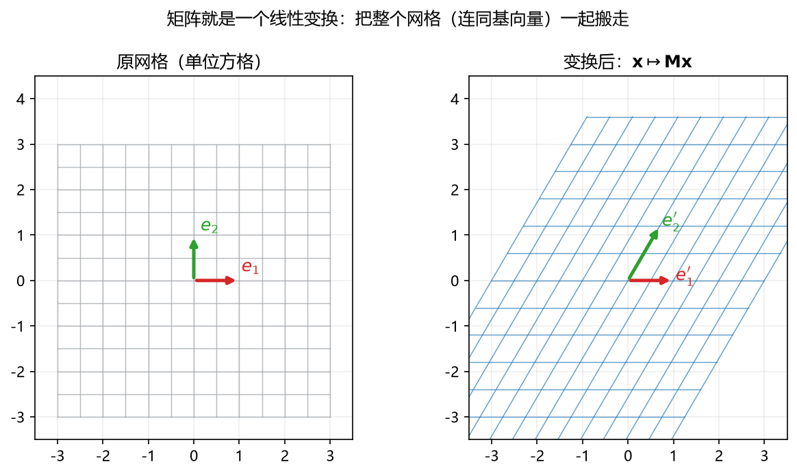

# 板书 · S005 · 第 03 课：矩阵–向量、转置、逆与行列式

- 会话ID：`S005`
- 日期：2026-10-26
- 对应：L03 / M1
- 修订记录：（初版）2026-10-26

---

## 0. 生活化引入

矩阵是一台**加工机**：扔进一个向量，出来另一个向量。
- 有的机器能把东西拉长、压扁、旋转；
- 有的机器能把做过的事**撤销**（逆矩阵）；
- 有的机器把平面**压成一条线**，压扁之后就再也回不去（不可逆）。

“能不能撤销”的判据，就是一个数：**行列式（determinant）**。

---

## 1. 直觉

| 操作 | 一句话直觉 |
|---|---|
| 矩阵 × 向量（matrix–vector） | 把列按系数加权混合，得到新向量 |
| 转置（transpose） | 沿对角线翻面，行列互换 |
| 逆（inverse） | 反向操作，把结果送回原处 |
| 行列式（determinant） | 面积/体积被放大几倍；为 0 表示被压扁 |

---

## 2. 几何

**看图**：左边是原来的方格网（红 $\mathbf{e}_1$、绿 $\mathbf{e}_2$ 是两根坐标轴方向），
右边是 $\mathbf{x}\mapsto\mathbf{M}\mathbf{x}$ 之后：整张网格被“搬走”并拉斜，
基向量变成了 $\mathbf{e}_1'$、$\mathbf{e}_2'$——**矩阵的两列就是新基向量的位置**。

**看图**：左图两列不共线，张成一块有面积的平行四边形，$\lvert\det\rvert=1.2\ne0$；
右图两列共线，平行四边形被压成线段，$\lvert\det\rvert=0$——**压扁 = 不可逆**。

---

## 3. 计算（公式卡片）

> 统一用 $\mathbf{A}=\begin{bmatrix}2&1\\1&3\end{bmatrix}$、
> $\mathbf{x}=(1,2)^\top$、$\mathbf{B}=\begin{bmatrix}1&2\\3&4\end{bmatrix}$ 当例子。

### 3.1 矩阵–向量乘法（matrix–vector product）

$$
\mathbf{A}\mathbf{x}=\sum_{j=1}^{n}x_j\,\mathbf{a}_{:j}
$$

- **符号**：$\mathbf{a}_{:j}$ 是 $\mathbf{A}$ 的**第 $j$ 列**；$x_j$ 是给这一列的权重；结果是 $m$ 维向量。
- **两种看法**：列视角 = “列的加权和”；行视角 = “每行与 $\mathbf{x}$ 做内积”。
- **例**：列视角 = 按系数加权求和；行视角 = 每行做内积，两者结果相同：

$$
\mathbf{A}\mathbf{x}
=1\begin{bmatrix}2\\1\end{bmatrix}+2\begin{bmatrix}1\\3\end{bmatrix}
=\begin{bmatrix}4\\7\end{bmatrix},
\qquad
(2\cdot1+1\cdot2,\ 1\cdot1+3\cdot2)=(4,7)
$$

### 3.2 形状规则（shape rule）

$$
(m\times n)\,(n\times 1)\;\longrightarrow\;(m\times 1),
\qquad
(m\times n)\,(n\times p)\;\longrightarrow\;(m\times p)
$$

- **符号**：$m$ 行、$n$ 列；**中间两个数必须相等**，消掉后剩下外面的两个数。
- **例**：$(2\times3)(3\times1)\to(2\times1)$ 合法；$(2\times3)(2\times1)$ 不合法（$3\ne2$）。

### 3.3 矩阵乘法（matrix–matrix product）

$$
(\mathbf{A}\mathbf{B})_{ij}=\sum_{k=1}^{p}a_{ik}b_{kj}
$$

- **符号**：$\mathbf{A}$ 是 $m\times p$，$\mathbf{B}$ 是 $p\times n$，结果 $\mathbf{C}$ 是 $m\times n$；
  $(\cdot)_{ij}$ 表示“第 $i$ 行第 $j$ 列那个元素”。
- **例**：

$$
\mathbf{A}\mathbf{B}
=\begin{bmatrix}2&1\\1&3\end{bmatrix}\begin{bmatrix}1&2\\3&4\end{bmatrix}
=\begin{bmatrix}2\cdot1+1\cdot3&2\cdot2+1\cdot4\\1\cdot1+3\cdot3&1\cdot2+3\cdot4\end{bmatrix}
=\begin{bmatrix}5&8\\10&14\end{bmatrix}
$$

### 3.4 转置（transpose）

$$
(\mathbf{A}^\top)_{ij}=A_{ji},\qquad
(\mathbf{A}\mathbf{B})^\top=\mathbf{B}^\top\mathbf{A}^\top
$$

- **符号**：$A_{ji}$ 表示“把第 $i$ 行第 $j$ 列搬到第 $j$ 行第 $i$ 列”；形状 $m\times n\to n\times m$。
- **注意**：乘积转置要**换顺序**，像穿脱衣服顺序相反。
- **例**：$\mathbf{B}^\top=\begin{bmatrix}1&3\\2&4\end{bmatrix}$；
  $(\mathbf{A}\mathbf{B})^\top=\mathbf{B}^\top\mathbf{A}^\top$，而 $\mathbf{A}^\top\mathbf{B}^\top$ 一般不对。

### 3.5 单位矩阵（identity matrix）

$$
\mathbf{A}\mathbf{I}=\mathbf{I}\mathbf{A}=\mathbf{A}
$$

- **符号**：$\mathbf{I}$ 是主对角线为 1、其余为 0 的方阵，相当于“乘以 1”。
- **例**：$\mathbf{I}_2=\begin{bmatrix}1&0\\0&1\end{bmatrix}$，
  $\begin{bmatrix}2&1\\1&3\end{bmatrix}\begin{bmatrix}1&0\\0&1\end{bmatrix}=\begin{bmatrix}2&1\\1&3\end{bmatrix}$。

### 3.6 逆矩阵（inverse matrix）

$$
\mathbf{A}\mathbf{A}^{-1}=\mathbf{A}^{-1}\mathbf{A}=\mathbf{I}
$$

- **符号**：$\mathbf{A}^{-1}$ 是“撤销键”；只有**方阵**且**可逆**时才有。
- **用途**：解 $\mathbf{A}\mathbf{x}=\mathbf{b}$ → $\mathbf{x}=\mathbf{A}^{-1}\mathbf{b}$。
- **例**：$\mathbf{A}=\begin{bmatrix}2&1\\1&3\end{bmatrix}$，$\mathbf{A}^{-1}=\dfrac15\begin{bmatrix}3&-1\\-1&2\end{bmatrix}$，
  相乘得 $\mathbf{I}$（验算见第 4 节）。

### 3.7 二阶逆公式（2×2 inverse formula）

$$
\mathbf{A}=\begin{bmatrix}a&b\\c&d\end{bmatrix}
\quad\Longrightarrow\quad
\mathbf{A}^{-1}=\frac{1}{ad-bc}\begin{bmatrix}d&-b\\-c&a\end{bmatrix}
$$

- **符号**：$a,b,c,d$ 是四个元素；分母 $ad-bc$ 就是行列式；分子是“主对角互换、副对角变号”。
- **例**：$a=2,b=1,c=1,d=3$，$ad-bc=5$，
  $\mathbf{A}^{-1}=\dfrac15\begin{bmatrix}3&-1\\-1&2\end{bmatrix}$。

### 3.8 二阶行列式（determinant）

$$
\det\mathbf{A}=ad-bc
$$

- **符号**：$\det$ 读“determinant”；结果是一个**数**。
- **几何**：$\lvert\det\rvert$ = 面积缩放倍数；符号 = 是否翻转方向（负号表示镜像）。
- **例**：$\det\mathbf{A}=2\cdot3-1\cdot1=5$，单位方格面积 $1\to5$。

### 3.9 可逆判定（invertibility criterion）

$$
\det\mathbf{A}\ne0\iff\mathbf{A}^{-1}\text{ 存在}
$$

- **符号**：$\iff$ 读“当且仅当”；$\det=0$ 表示列线性相关（有列能被其他列拼出来）。
- **例**：$\begin{bmatrix}1&2\\2&4\end{bmatrix}$，$\det=1\cdot4-2\cdot2=0$，不可逆（第二列是第一列的 2 倍）。

### 3.10 对称矩阵（symmetric matrix）

$$
\mathbf{A}^\top=\mathbf{A}
$$

- **符号**：转置后不变；$2\times2$ 情形等价于 $b=c$。
- **例**：$\mathbf{A}=\begin{bmatrix}2&1\\1&3\end{bmatrix}$ 对称；$\mathbf{B}=\begin{bmatrix}1&2\\3&4\end{bmatrix}$ 不对称。
- **为什么重要**：对称矩阵的特征值一定是实数（L05 会用到）。

---

## 4. 完整手算

**Example.** Let $\mathbf{A}=\begin{bmatrix}2&1\\1&3\end{bmatrix}$, $\mathbf{x}=(1,2)^\top$,
$\mathbf{b}=(4,7)^\top$. Find $\det\mathbf{A}$, $\mathbf{A}^{-1}$, verify $\mathbf{A}\mathbf{A}^{-1}=\mathbf{I}$,
and solve $\mathbf{A}\mathbf{x}=\mathbf{b}$.

1. 行列式：$\det\mathbf{A}=2\cdot3-1\cdot1=6-1=5$
2. 逆：$\mathbf{A}^{-1}=\dfrac{1}{5}\begin{bmatrix}3&-1\\-1&2\end{bmatrix}$
3. 验算：
$$
\mathbf{A}\mathbf{A}^{-1}
=\frac15\begin{bmatrix}2&1\\1&3\end{bmatrix}\begin{bmatrix}3&-1\\-1&2\end{bmatrix}
=\frac15\begin{bmatrix}6-1&-2+2\\3-3&-1+6\end{bmatrix}
=\frac15\begin{bmatrix}5&0\\0&5\end{bmatrix}
=\mathbf{I}
$$
4. 解方程：

$$
\mathbf{x}=\mathbf{A}^{-1}\mathbf{b}
=\frac15\begin{bmatrix}3&-1\\-1&2\end{bmatrix}\begin{bmatrix}4\\7\end{bmatrix}
=\frac15\begin{bmatrix}12-7\\-4+14\end{bmatrix}
=\frac15\begin{bmatrix}5\\10\end{bmatrix}
=\begin{bmatrix}1\\2\end{bmatrix}\ \checkmark
$$

> 中文：这题在问“这台机器能不能撤销、撤销怎么做”。关键是分母 $\det=5$；
> 最后用 $\mathbf{A}\mathbf{A}^{-1}=\mathbf{I}$ 和代回原方程两种方式验算。

**独立复现.** Let $\mathbf{B}=\begin{bmatrix}1&2\\3&4\end{bmatrix}$. Find $\det\mathbf{B}$ and $\mathbf{B}^{-1}$,
then verify $\mathbf{B}\mathbf{B}^{-1}=\mathbf{I}$.（答案见第 8 节）

---

## 5. 易错点

1. **矩阵乘法不交换**：$\mathbf{A}\mathbf{B}\ne\mathbf{B}\mathbf{A}$（一般）。
2. **逆公式位置**：分子是 $\begin{bmatrix}d&-b\\-c&a\end{bmatrix}$，不是“全部取负”。
3. **$\det=0$ 就别硬求逆**：分母为 0，逆不存在；先判 $\det$ 再动手。
4. **转置乘积换序**：$(\mathbf{A}\mathbf{B})^\top=\mathbf{B}^\top\mathbf{A}^\top$。

---

## 6. 与已学关系

S003 第 03 课（矩阵乘法 = 列组合）+ 第 04 课（转置/逆/det）→ 本课把它们收成一张公式卡；
下一步 L04 的 $\mathbf{A}\mathbf{v}=\lambda\mathbf{v}$ 就是问“这台机器有没有**方向不变**的向量”。

---

## 7. 作业

**Q1 (concept).** True or false? One line why.
(a) $\mathbf{A}\mathbf{B}=\mathbf{B}\mathbf{A}$ for all square matrices of the same size.
(b) If $\det\mathbf{A}=0$, the columns of $\mathbf{A}$ are linearly dependent.
(c) $(\mathbf{A}^\top)^\top=\mathbf{A}$.
(d) A $2\times2$ matrix is invertible if and only if $ad-bc\ne0$.

**Q2 (compute).** Let $\mathbf{C}=\begin{bmatrix}3&1\\2&4\end{bmatrix}$, $\mathbf{u}=(1,-1)^\top$.
Compute $\det\mathbf{C}$, $\mathbf{C}^{-1}$, verify $\mathbf{C}\mathbf{C}^{-1}=\mathbf{I}$, and compute $\mathbf{C}\mathbf{u}$.

**Q3 (compute).** Let $\mathbf{D}=\begin{bmatrix}1&2\\3&4\end{bmatrix}$, $\mathbf{x}=(2,3)^\top$.
Compute $\mathbf{D}\mathbf{x}$ in both ways: (i) as a weighted sum of columns, (ii) row-by-row dot products.

**Q4 (geometry).** A $2\times2$ matrix has $\det=-3$. Describe what it does to areas and to orientation.
Why does this imply the matrix is invertible?

**Q5 (ML).** The normal equation is $(\mathbf{X}^\top\mathbf{X})\mathbf{w}=\mathbf{X}^\top\mathbf{t}$.
Give one situation where $\mathbf{X}^\top\mathbf{X}$ is **not** invertible, and what people usually do about it.

---

## 8. 作业答案（先做完再看）

**A1.**
(a) False. Example: $\begin{bmatrix}1&1\\0&1\end{bmatrix}\begin{bmatrix}1&0\\1&1\end{bmatrix}=\begin{bmatrix}2&1\\1&1\end{bmatrix}$ but $\begin{bmatrix}1&0\\1&1\end{bmatrix}\begin{bmatrix}1&1\\0&1\end{bmatrix}=\begin{bmatrix}1&1\\1&2\end{bmatrix}$.
(b) True. $\det=0$ means the columns span zero area, i.e. they are linearly dependent.
(c) True. Transposing twice returns the original entries.
(d) True. $\mathbf{A}^{-1}=\frac{1}{ad-bc}\begin{bmatrix}d&-b\\-c&a\end{bmatrix}$ exists only when $ad-bc\ne0$.

**A2.**
- $\det\mathbf{C}=3\cdot4-1\cdot2=10$
- $\mathbf{C}^{-1}=\dfrac{1}{10}\begin{bmatrix}4&-1\\-2&3\end{bmatrix}$
- Verify：

$$
\frac{1}{10}\begin{bmatrix}3&1\\2&4\end{bmatrix}\begin{bmatrix}4&-1\\-2&3\end{bmatrix}
=\frac{1}{10}\begin{bmatrix}12-2&-3+3\\8-8&-2+12\end{bmatrix}
=\mathbf{I}\ \checkmark
$$

- $\mathbf{C}\mathbf{u}=1\begin{bmatrix}3\\2\end{bmatrix}+(-1)\begin{bmatrix}1\\4\end{bmatrix}=\begin{bmatrix}2\\-2\end{bmatrix}$

**A3.**
- (i) $2\begin{bmatrix}1\\3\end{bmatrix}+3\begin{bmatrix}2\\4\end{bmatrix}=\begin{bmatrix}2+6\\6+12\end{bmatrix}=\begin{bmatrix}8\\18\end{bmatrix}$
- (ii) $(1\cdot2+2\cdot3,\ 3\cdot2+4\cdot3)=(8,18)$ ✓

**A4.** $\lvert\det\rvert=3$ 表示面积变成 3 倍；负号表示方向翻转（镜像）。
只要面积没被压成 0，就没有信息丢失，所以存在逆矩阵。

**A5.** 当 $\mathbf{X}$ 的列线性相关时（例如两个特征完全共线、重复列，或样本数少于特征数 $n<p$），
$\mathbf{X}^\top\mathbf{X}$ 不可逆。常见做法：删冗余特征、用岭回归（加 $\lambda\mathbf{I}$）或用伪逆。

**复现答案.** $\det\mathbf{B}=1\cdot4-2\cdot3=-2$，于是

$$
\mathbf{B}^{-1}=\frac{1}{-2}\begin{bmatrix}4&-2\\-3&1\end{bmatrix}
=\begin{bmatrix}-2&1\\1.5&-0.5\end{bmatrix}
$$

验算 $\mathbf{B}\mathbf{B}^{-1}=\begin{bmatrix}1&0\\0&1\end{bmatrix}$ ✓
