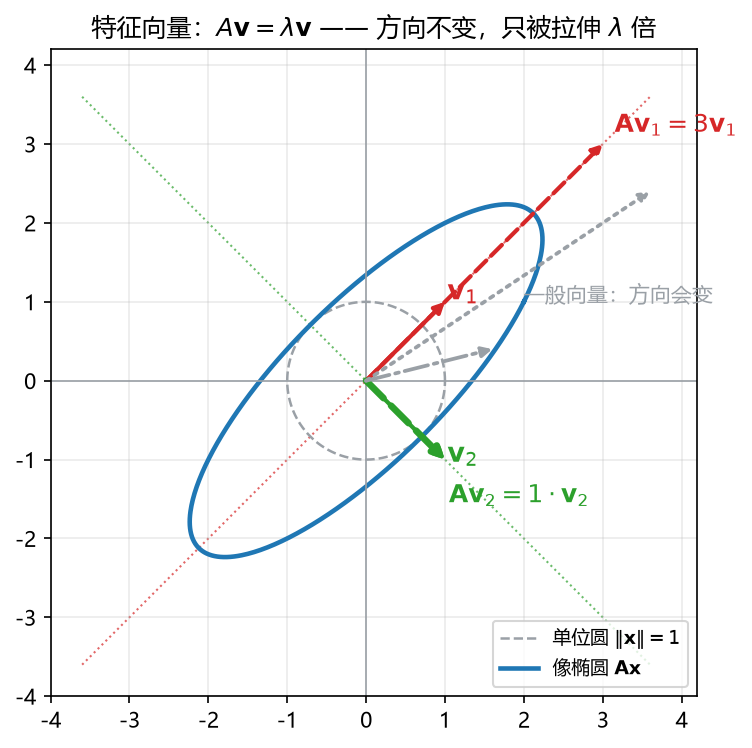

 

# 板书 · S005 · 第 04 课：特征值与特征向量

- 会话ID：`S005`
- 日期：2026-10-26
- 对应：L04 / M1
- 修订记录：（初版）2026-10-26；（v2）2026-10-26 4.4 补「二阶特征多项式推导」（逐项展开 + 韦达核对 + $n\times n$ 一般式）；（v3）2026-10-26 4.7 补「两根和/积」的推导（系数比较 + $\lambda=0$ 代入 + 几何直觉 + 适用条件）；（v4）2026-10-26 4.4 补记号 $p(\lambda)$ 的读法说明；（v5）2026-10-26 4.7 同步补同一记号提醒（便于单看 4.7 时理解）；（v6）2026-10-26 4.7 补「为什么一定能写成 $(\lambda-\lambda_1)(\lambda-\lambda_2)$」（因式定理 + 首项系数定 $c$ + 重根/复根）

---

## 0. 生活化引入

你推一扇门：大多数方向推，门会又转又歪；但有一个特定方向推，门只是“顺着那个方向走”，**方向不变**。

矩阵也一样：它对绝大多数向量都“转方向”，但总有那么几条**特权方向**，向量被推完之后还在原地那条线上，只是变长或变短。这个方向就是**特征向量（eigenvector）**，变长的倍数就是**特征值（eigenvalue）**。

---

## 1. 直觉

- 特征向量：被矩阵作用后**方向不变**的向量（可以反向，但仍在同一条直线上）。
- 特征值：沿这个方向被拉伸/压缩的**倍数**（可以为负、可以为 0）。
- 一个矩阵的特征方向通常只有少数几条；找到它们，就抓住了这个变换的“骨架”。

---

## 2. 几何

**看图**：

- 灰色虚线是单位圆，蓝色是它被 $\mathbf{A}$ 拉成的椭圆——**圆变椭圆，说明不同方向拉伸倍数不同**。
- 红色 $\mathbf{v}_1$ 被拉成 $3\mathbf{v}_1$：方向没变，长度 ×3。
- 绿色 $\mathbf{v}_2$ 满足 $\mathbf{A}\mathbf{v}_2=1\cdot\mathbf{v}_2$：方向没变，长度不变。
- 灰色那个一般向量，像之后**转了方向**——它不是特征向量。
- 椭圆的长轴、短轴方向，正是两个特征方向。

---

## 3. 计算（公式卡片）

> 统一用 $\mathbf{A}=\begin{bmatrix}2&1\\1&2\end{bmatrix}$ 当例子。

### 4.1 特征方程的定义（eigen-equation）

$$
\mathbf{A}\mathbf{v}=\lambda\mathbf{v},\qquad \mathbf{v}\ne\mathbf{0}
$$

- **符号**：$\mathbf{A}$ 是 $n\times n$ 方阵；$\mathbf{v}$ 是特征向量；$\lambda$ 是特征值（一个数）。
- **含义**：$\mathbf{A}$ 作用在 $\mathbf{v}$ 上，效果等于“把 $\mathbf{v}$ 拉长 $\lambda$ 倍”。
- **例**：$\mathbf{A}(1,1)^\top=(3,3)^\top=3(1,1)^\top$，所以 $\lambda=3$，$\mathbf{v}=(1,1)^\top$。

### 4.2 移项形式（shifted matrix）

$$
(\mathbf{A}-\lambda\mathbf{I})\mathbf{v}=\mathbf{0}
$$

- **符号**：$\mathbf{I}$ 是单位矩阵；$\mathbf{A}-\lambda\mathbf{I}$ 是“主对角线各减 $\lambda$”。
- **为什么**：$\mathbf{A}\mathbf{v}-\lambda\mathbf{v}=(\mathbf{A}-\lambda\mathbf{I})\mathbf{v}$。
- **例**：$\lambda=3$ 时，$\mathbf{A}-3\mathbf{I}=\begin{bmatrix}-1&1\\1&-1\end{bmatrix}$。

### 4.3 特征方程（characteristic equation）

$$
\det(\mathbf{A}-\lambda\mathbf{I})=0
$$

- **符号**：$\det$ 是行列式；这条方程只含 $\lambda$，解出它就是特征值。
- **为什么**：要 $({\mathbf{A}-\lambda\mathbf{I}})\mathbf{v}=\mathbf{0}$ 有**非零解**，矩阵必须“压扁”，即 $\det=0$。
- **例**：$\det\begin{bmatrix}2-\lambda&1\\1&2-\lambda\end{bmatrix}=(2-\lambda)^2-1=0$。

### 4.4 二阶特征多项式（characteristic polynomial）

$$
\lambda^2-\operatorname{tr}(\mathbf{A})\,\lambda+\det(\mathbf{A})=0
$$

- **符号**：$\operatorname{tr}(\mathbf{A})=a+d$ 是迹（trace，主对角线之和）；$\det=ad-bc$。
- **用途**：$2\times2$ 背这一个式子，就不用每次展开行列式。
- **例**：$\operatorname{tr}=4$，$\det=3$，得 $\lambda^2-4\lambda+3=0$。

> **记号 $p(\lambda)$ 怎么读**：$p$ 是函数名（polynomial，多项式），$\lambda$ 是自变量，
> $p(\lambda)$ 表示“把 $\lambda$ 代进去得到的值”，**不是 $p$ 乘 $\lambda$**。
> 本课里 $p(\lambda)=\det(\mathbf{A}-\lambda\mathbf{I})$。要指明是哪个矩阵时可写 $p_{\mathbf{A}}(\lambda)$。
> 代入具体数：$p(0)=\det(\mathbf{A})$，$p(3)=\det(\mathbf{A}-3\mathbf{I})$（若 3 是特征值，则 $p(3)=0$）。

**推导（为什么长这样，不跳步）**

设 $\mathbf{A}=\begin{bmatrix}a&b\\c&d\end{bmatrix}$，则 $\mathbf{A}-\lambda\mathbf{I}=\begin{bmatrix}a-\lambda&b\\c&d-\lambda\end{bmatrix}$。

$$
\det(\mathbf{A}-\lambda\mathbf{I})
=(a-\lambda)(d-\lambda)-bc
$$

展开乘法（四项逐个写出）：

$$
(a-\lambda)(d-\lambda)=ad-a\lambda-d\lambda+\lambda^2
$$

代回去：

$$
\det(\mathbf{A}-\lambda\mathbf{I})=\lambda^2-(a+d)\lambda+(ad-bc)
$$

按 $\lambda$ 的次数整理，就得到：

$$
\det(\mathbf{A}-\lambda\mathbf{I})=\lambda^2-\operatorname{tr}(\mathbf{A})\,\lambda+\det(\mathbf{A})
$$

令它等于 0，即得二阶特征多项式。三条信息由此而来：

1. $\lambda^2$ 的系数恒为 1（首一多项式）；
2. $\lambda$ 的系数是 $-(a+d)=-\operatorname{tr}(\mathbf{A})$，**因为乘开后只有 $-a\lambda$ 与 $-d\lambda$ 两项带 $\lambda$**；
3. 常数项是 $ad-bc=\det(\mathbf{A})$——**令 $\lambda=0$ 代入即得**：$\det(\mathbf{A}-0\cdot\mathbf{I})=\det(\mathbf{A})$。

**反过来用韦达定理（Vieta）核对**：若两根为 $\lambda_1,\lambda_2$，则

$$
\lambda_1+\lambda_2=\operatorname{tr}(\mathbf{A}),\qquad
\lambda_1\lambda_2=\det(\mathbf{A})
$$

这就是 4.7 那两条验算的来历：它们不是新公式，而是同一个多项式的两根之和/之积。

**一般 $n\times n$**：$\det(\mathbf{A}-\lambda\mathbf{I})$ 是 $n$ 次首一多项式，$\lambda^{n-1}$ 的系数是 $-\operatorname{tr}(\mathbf{A})$，
常数项是 $(-1)^n\det(\mathbf{A})$；所以 $n\times n$ 一定有 $n$ 个特征值（含重根、复根，按重数计）。

### 4.5 求根公式（quadratic formula）

$$
\lambda_{1,2}=\frac{\operatorname{tr}(\mathbf{A})\pm\sqrt{\operatorname{tr}(\mathbf{A})^2-4\det(\mathbf{A})}}{2}
$$

- **符号**：$\pm$ 表示两个根；根号里叫判别式（discriminant）$\Delta=\operatorname{tr}^2-4\det$。
- **三种情形**：$\Delta>0$ 两个不同实根；$\Delta=0$ 重根；$\Delta<0$ 一对复根（旋转，无实特征方向）。
- **例**：$\Delta=16-12=4$，$\lambda=\dfrac{4\pm2}{2}=3$ 或 $1$。

### 4.6 特征向量的求法（eigenvector from null space）

$$
(\mathbf{A}-\lambda_i\mathbf{I})\,\mathbf{v}_i=\mathbf{0}
$$

- **符号**：把每个 $\lambda_i$ 代回去，解一个**齐次方程**，取任一非零解。
- **注意**：解不唯一，$\mathbf{v}$ 的任何非零倍数都对；只需报一个方向。
- **例**：$\lambda=3$：$\begin{bmatrix}-1&1\\1&-1\end{bmatrix}\begin{bmatrix}x\\y\end{bmatrix}=\mathbf{0}$ ⇒ $x=y$ ⇒ $\mathbf{v}_1=(1,1)^\top$。

### 4.7 迹与行列式的验算（trace/determinant checks）

$$
\lambda_1+\lambda_2=\operatorname{tr}(\mathbf{A}),\qquad
\lambda_1\lambda_2=\det(\mathbf{A})
$$

- **符号**：和等于迹、积等于行列式；两条都满足才算算对。
- **例**：$3+1=4=\operatorname{tr}$ ✓；$3\times1=3=\det$ ✓。

**推导（两条都从同一个多项式来）**

> **记号提醒（同 4.4）**：$p(\lambda)$ 是函数记号——$p$ 是名字，$\lambda$ 是输入，
> $p(\lambda)=\det(\mathbf{A}-\lambda\mathbf{I})$，**不是 $p$ 乘 $\lambda$**；
> $p(0)$ 表示“把 $\lambda=0$ 代进去”，于是 $p(0)=\det(\mathbf{A})$。

由 4.4，特征多项式是

$$
p(\lambda)=\det(\mathbf{A}-\lambda\mathbf{I})=\lambda^2-\operatorname{tr}(\mathbf{A})\,\lambda+\det(\mathbf{A})
$$

另一方面，$p(\lambda)$ 的两个根是 $\lambda_1,\lambda_2$，所以它一定能写成“根的乘积”形式（首项系数为 1）：

$$
p(\lambda)=(\lambda-\lambda_1)(\lambda-\lambda_2)
=\lambda^2-(\lambda_1+\lambda_2)\lambda+\lambda_1\lambda_2
$$

**为什么一定可以这样写（因式定理）**

1. **根的定义**：$\lambda_1$ 是根，意思是 $p(\lambda_1)=0$。
2. **因式定理（factor theorem）**：若 $p(\lambda_1)=0$，则 $(\lambda-\lambda_1)$ 能整除 $p(\lambda)$，
   即 $p(\lambda)=(\lambda-\lambda_1)q(\lambda)$，其中 $q$ 是剩下的一次多项式。
3. **再用第二个根**：$\lambda_2\ne\lambda_1$ 时，
   $0=p(\lambda_2)=(\lambda_2-\lambda_1)q(\lambda_2)$，而 $\lambda_2-\lambda_1\ne0$，
   所以必须 $q(\lambda_2)=0$，于是 $q(\lambda)=c(\lambda-\lambda_2)$。
4. **定系数 $c$**：$p(\lambda)=c(\lambda-\lambda_1)(\lambda-\lambda_2)$。
   比较两边的 $\lambda^2$ 系数：左边是 $1$，右边是 $c$，所以 $c=1$。

> 若首项系数不是 1（比如 $2\lambda^2-6\lambda+4$），就必须写成 $c(\lambda-\lambda_1)(\lambda-\lambda_2)$，
> 此时**根不变、系数全被放大 $c$ 倍**，不能直接和 $\lambda^2-\operatorname{tr}\lambda+\det$ 逐项比较。
> 这正是“首项系数为 1”这句话非写不可的原因。

**重根也成立**：若 $\lambda_1=\lambda_2=2$，则 $p(\lambda)=(\lambda-2)^2$，仍然成立。

**复根也成立**：$\lambda_{1,2}=\pm i$ 时 $p(\lambda)=(\lambda-i)(\lambda+i)=\lambda^2+1$（代数基本定理保证一定能分解到复数域）。

同一个多项式的**对应系数必须相等**，于是逐项比较：

$$
\begin{aligned}
\lambda \text{ 的系数}:&\quad -\operatorname{tr}(\mathbf{A})=-(\lambda_1+\lambda_2)
&&\Rightarrow\quad \lambda_1+\lambda_2=\operatorname{tr}(\mathbf{A})\\
\text{常数项}:&\quad \det(\mathbf{A})=\lambda_1\lambda_2
&&\Rightarrow\quad \lambda_1\lambda_2=\det(\mathbf{A})
\end{aligned}
$$

**第二种看法（更快）**：在 $p(\lambda)$ 里令 $\lambda=0$：

$$
p(0)=\det(\mathbf{A}),\qquad
p(0)=(0-\lambda_1)(0-\lambda_2)=\lambda_1\lambda_2
$$

所以 $\det(\mathbf{A})=\lambda_1\lambda_2$。同理令 $\lambda=0$ 看不出和，只能比 $\lambda$ 的系数，所以和要展开比较。

**为什么直觉上也对**：$\lvert\det\rvert$ 是面积缩放倍数，而两个特征值就是两个特征方向上的拉伸倍数，
面积是两条边的乘积，所以 $|\det|=|\lambda_1||\lambda_2|$；符号由“是否翻转”决定，正好由 $\lambda_1\lambda_2$ 的符号给出。
迹则是这个变换的“发散率”（对角线上拉伸的总和），恰好等于各方向拉伸倍数之和。

**适用范围**：任何方阵都成立（包括重根 $\lambda_1=\lambda_2$、以及复根 $\lambda=\pm i$），
因为它只是多项式系数的恒等式，不依赖特征值是否为实数。

### 4.8 代回验证（verification）

$$
\mathbf{A}\mathbf{v}_i=\lambda_i\mathbf{v}_i
$$

- **符号**：不算“额外步骤”，是把答案代回定义；考试里写一行就能自查。
- **例**：$\mathbf{A}(1,-1)^\top=(2-1,\ 1-2)^\top=(1,-1)^\top=1\cdot(1,-1)^\top$ ✓。

---

## 4. 完整手算

**Example.** Let $\mathbf{A}=\begin{bmatrix}2&1\\1&2\end{bmatrix}$. Find all eigenvalues and eigenvectors.

1. 迹与行列式：$\operatorname{tr}=2+2=4$，$\det=2\cdot2-1\cdot1=3$
2. 特征方程：$\lambda^2-4\lambda+3=0$
3. 求根：$(\lambda-3)(\lambda-1)=0$ ⇒ $\lambda_1=3$，$\lambda_2=1$
4. 求 $\mathbf{v}_1$（$\lambda=3$）：

$$
(\mathbf{A}-3\mathbf{I})\mathbf{v}=\begin{bmatrix}-1&1\\1&-1\end{bmatrix}\begin{bmatrix}x\\y\end{bmatrix}=\begin{bmatrix}0\\0\end{bmatrix}
$$

两行都给 $x-y=0$，取 $\mathbf{v}_1=(1,1)^\top$。

5. 求 $\mathbf{v}_2$（$\lambda=1$）：

$$
(\mathbf{A}-\mathbf{I})\mathbf{v}=\begin{bmatrix}1&1\\1&1\end{bmatrix}\begin{bmatrix}x\\y\end{bmatrix}=\begin{bmatrix}0\\0\end{bmatrix}
$$

得 $x+y=0$，取 $\mathbf{v}_2=(1,-1)^\top$。

6. 验算：$\mathbf{A}(1,1)^\top=(3,3)^\top=3(1,1)^\top$ ✓；$\mathbf{A}(1,-1)^\top=(1,-1)^\top=1\cdot(1,-1)^\top$ ✓
7. 迹/行列式验算：$3+1=4$ ✓，$3\cdot1=3$ ✓

> 中文：这题在问“这台机器有没有方向不变的方向”。关键是**先解 $\det(\mathbf{A}-\lambda\mathbf{I})=0$ 拿 $\lambda$**，
> 再把 $\lambda$ 代回 $(\mathbf{A}-\lambda\mathbf{I})\mathbf{v}=\mathbf{0}$ 拿方向；最后一定要代回验证。

**独立复现.** Let $\mathbf{B}=\begin{bmatrix}3&1\\0&2\end{bmatrix}$. Find $\lambda$ and $\mathbf{v}$.
（提示：上三角矩阵的特征值就在对角线上；答案见第 8 节）

**第三个例子（复根）.** $\mathbf{C}=\begin{bmatrix}0&-1\\1&0\end{bmatrix}$ 是“逆时针转 $90^\circ$”。
特征方程 $\lambda^2+1=0$ ⇒ $\lambda=\pm i$，没有实特征方向——转 90° 的向量不可能还留在原直线上。

---

## 5. 易错点

1. **$\mathbf{v}=\mathbf{0}$ 不算**：定义要求非零向量；零向量对任何 $\lambda$ 都满足，没有信息量。
2. **特征向量不唯一**：$(1,1)$、$(2,2)$、$(-1,-1)$ 都是同一个特征向量，报一个即可。
3. **$\lambda=0$ 是允许的**：$\det\mathbf{A}=0$ 时必有一个特征值为 0，别以为“特征值一定非零”。
4. **先 $\lambda$ 后 $\mathbf{v}$**：顺序反了会很痛苦；拿到 $\lambda$ 再解齐次方程。
5. **重根可能缺向量**：$\begin{bmatrix}2&1\\0&2\end{bmatrix}$ 的 $\lambda=2$ 是二重根，但只有一个独立特征向量（这类矩阵不能对角化）。

---

## 6. 与已学关系

L03 的 $\det$ 与“压扁 ⇔ 不可逆” → 本课的 $\det(\mathbf{A}-\lambda\mathbf{I})=0$；
L05 会进一步用 $\operatorname{tr}$、$\det$ 与特征值的关系，判断**正定**与做**对称分解**；
L18/L28 的二次型、误差面形状，也都由特征值决定。

---

## 7. 作业

**Q1 (concept).** True or false? One line why.
(a) If $\mathbf{A}\mathbf{v}=\lambda\mathbf{v}$ with $\mathbf{v}\ne\mathbf{0}$, then $2\mathbf{v}$ is also an eigenvector with the same $\lambda$.
(b) An eigenvalue can be $0$.
(c) Every real matrix has at least one real eigenvalue.
(d) For a $2\times2$ matrix, $\lambda_1+\lambda_2=\operatorname{tr}(\mathbf{A})$.

**Q2 (compute).** Let $\mathbf{A}=\begin{bmatrix}4&1\\2&3\end{bmatrix}$. Find both eigenvalues and one eigenvector for each; verify by substitution.

**Q3 (compute).** Let $\mathbf{B}=\begin{bmatrix}1&2\\0&3\end{bmatrix}$. Find both eigenvalues and eigenvectors. Why are the eigenvalues so easy to read off here?

**Q4 (geometry).** In the figure, the unit circle becomes an ellipse. Explain why the major and minor axes of that ellipse are exactly the eigen-directions. Then explain what $\det\mathbf{A}<0$ means for the two eigenvalues, and what it does to the picture.

**Q5 (ML).** In PCA, we compute the eigenvectors and eigenvalues of the covariance matrix $\boldsymbol\Sigma$.
What does an eigenvector mean here, what does the eigenvalue mean, and why do we keep the direction with the largest eigenvalue?

---

## 8. 作业答案（先做完再看）

**A1.**
(a) True. $\mathbf{A}(2\mathbf{v})=2\mathbf{A}\mathbf{v}=2\lambda\mathbf{v}=\lambda(2\mathbf{v})$.
(b) True, e.g. $\begin{bmatrix}1&0\\0&0\end{bmatrix}$ has $\lambda=0,1$.
(c) False, e.g. $\begin{bmatrix}0&-1\\1&0\end{bmatrix}$ has $\lambda=\pm i$.
(d) True. It follows from $\lambda^2-\operatorname{tr}(\mathbf{A})\lambda+\det(\mathbf{A})=0$.

**A2.** $\operatorname{tr}=7$，$\det=4\cdot3-1\cdot2=10$；
$\lambda^2-7\lambda+10=0$ ⇒ $\lambda=5,2$。

- $\lambda=5$：$\begin{bmatrix}-1&1\\2&-2\end{bmatrix}\mathbf{v}=\mathbf{0}$ ⇒ $x=y$ ⇒ $\mathbf{v}_1=(1,1)^\top$；
  验算 $\mathbf{A}(1,1)^\top=(5,5)^\top$ ✓
- $\lambda=2$：$\begin{bmatrix}2&1\\2&1\end{bmatrix}\mathbf{v}=\mathbf{0}$ ⇒ $2x+y=0$ ⇒ $\mathbf{v}_2=(1,-2)^\top$；
  验算 $\mathbf{A}(1,-2)^\top=(2,-4)^\top=2(1,-2)^\top$ ✓

**A3.** 上三角矩阵，对角线就是特征值：$\lambda=1,3$（也可用 $\operatorname{tr}=4$、$\det=3$ 核对）。

- $\lambda=1$：$\begin{bmatrix}0&2\\0&2\end{bmatrix}\mathbf{v}=\mathbf{0}$ ⇒ $y=0$ ⇒ $\mathbf{v}_1=(1,0)^\top$
- $\lambda=3$：$\begin{bmatrix}-2&2\\0&0\end{bmatrix}\mathbf{v}=\mathbf{0}$ ⇒ $x=y$ ⇒ $\mathbf{v}_2=(1,1)^\top$；
  验算 $\mathbf{B}(1,1)^\top=(3,3)^\top$ ✓

**A4.** 椭圆上离原点最远/最近的点，正是“只被拉伸、不被扭转”的方向；
沿这些方向长度取极值，对应两个特征值 $\lvert\lambda_1\rvert,\lvert\lambda_2\rvert$。
$\det\mathbf{A}=\lambda_1\lambda_2<0$ ⇒ 两个特征值异号 ⇒ 一个方向被拉长、另一个方向被压短并**反向**，
几何上是“翻转 + 拉伸”，面积符号为负。

**A5.** 特征向量 = 主成分方向（数据投影后方差最大的方向）；特征值 = 该方向上的方差大小。
取最大特征值方向，是因为它保留了最多的方差，丢掉的信息最少（PCA 的最优性）。

**复现答案.** $\mathbf{B}=\begin{bmatrix}3&1\\0&2\end{bmatrix}$：$\operatorname{tr}=5$，$\det=6$，
$\lambda^2-5\lambda+6=0$ ⇒ $\lambda=3,2$。

- $\lambda=3$：$\begin{bmatrix}0&1\\0&-1\end{bmatrix}\mathbf{v}=\mathbf{0}$ ⇒ $y=0$ ⇒ $\mathbf{v}_1=(1,0)^\top$
- $\lambda=2$：$\begin{bmatrix}1&1\\0&0\end{bmatrix}\mathbf{v}=\mathbf{0}$ ⇒ $x+y=0$ ⇒ $\mathbf{v}_2=(1,-1)^\top$；
  验算 $\mathbf{B}(1,-1)^\top=(2,-2)^\top=2(1,-1)^\top$ ✓
