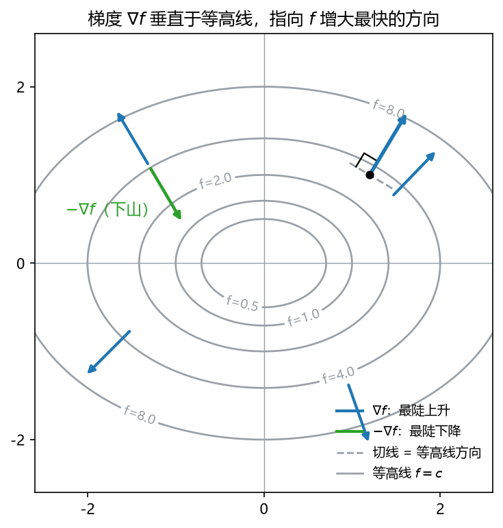

# 板书 · S005 · 第 06 课：偏导与梯度（partial derivatives & gradient）

- 会话ID：`S005`
- 日期：2026-10-27
- 对应：L06 / M2
- 修订记录：（初版）2026-10-27

---

## 0. 生活化引入

蒙着眼站在山坡上，你看不见地形，只能用脚摸出“**往哪个方向最陡**”。
脚底下那根指向最陡上坡的箭头，就是**梯度（gradient）**；反着走就是下山。

---

## 1. 直觉

| 对象 | 一句话 |
|---|---|
| 偏导（partial derivative）$\partial f/\partial x_i$ | **只让 $x_i$ 动**，其他变量全部按住当常数，看 $f$ 变多快 |
| 梯度（gradient）$\nabla f$ | 把所有偏导**按变量顺序打包成一根列向量** |
| 方向导数（directional derivative） | 沿任意方向 $\mathbf{u}$ 的坡度：等于 $\nabla f$ 在该方向上的投影 |
| 链式法则（chain rule） | 变量本身也在动时，把“每一层的变化率”连乘起来 |

一句话：**偏导是一个个“单人考核”，梯度是“总成绩单”。**

---

## 2. 几何

**看图**（$f(x,y)=x^2+2y^2$）：

- 灰色是等高线 $f=c$（同样的高度连成圈）。**沿等高线走，$f$ 一点不变**。
- 蓝色箭头是 $\nabla f$：它**永远垂直于等高线**，指向 $f$ 增大最快的方向（往高处走）。
- 绿色是 $-\nabla f$：最陡下降方向。**梯度下降法就是反复沿这个方向迈一小步。**
- 箭头越长 = 坡越陡：$\|\nabla f\|$ 就是“最陡坡度”的数值（最大方向导数）。

> 一句话：**梯度 = 最陡上坡的箭头；等高线 = 它的垂直方向。**

---

## 3. 计算（公式卡片）

### 3.1 偏导（partial derivative）

$$
\frac{\partial f}{\partial x_i}
=\lim_{h\to0}\frac{f(\dots,x_i+h,\dots)-f(\dots,x_i,\dots)}{h}
$$

- **符号**：$f$ 是标量函数；$x_i$ 是第 $i$ 个自变量；求导时**其他 $x_j$（$j\ne i$）当常数**；结果是**一个数**。
- **例**：$f(x,y)=x^2y+3xy^2$。
  - 对 $x$ 求偏导：把 $y$ 当常数 ⇒ $\partial f/\partial x=2xy+3y^2$（注意 $3xy^2$ 里的 $3y^2$ 是系数）。
  - 对 $y$ 求偏导：把 $x$ 当常数 ⇒ $\partial f/\partial y=x^2+6xy$。
  - 在 $(2,1)$ 处：$\partial f/\partial x=2\cdot2\cdot1+3=7$，$\partial f/\partial y=4+6\cdot2\cdot1=16$。

### 3.2 梯度（gradient）

$$
\nabla f(\mathbf{x})
=\begin{bmatrix}\dfrac{\partial f}{\partial x_1}\\[2pt]\vdots\\[2pt]\dfrac{\partial f}{\partial x_n}\end{bmatrix}
\in\mathbb{R}^{n\times1}
$$

- **符号**：$\nabla$ 读作 nabla；$\mathbf{x}\in\mathbb{R}^{n\times1}$；结果**一定是列向量**，形状 $n\times1$，和 $\mathbf{x}$ 同形。
- **例**：上面的 $f$：$\nabla f=\begin{bmatrix}2xy+3y^2\\x^2+6xy\end{bmatrix}$（$2\times1$）；在 $(2,1)$ 处 $\nabla f=\begin{bmatrix}7\\16\end{bmatrix}$。

### 3.3 方向导数（directional derivative）

$$
D_{\mathbf{u}}f(\mathbf{x})=\nabla f(\mathbf{x})^\top\mathbf{u},
\qquad \|\mathbf{u}\|=1
$$

- **符号**：$\mathbf{u}$ 是**单位**方向向量；结果是标量；$\mathbf{u}$ 取 $\nabla f/\|\nabla f\|$ 时取到最大值 $\|\nabla f\|$。
- **例**：$\nabla f=(7,16)^\top$，沿 $\mathbf{u}=(3/5,4/5)^\top$：$D_{\mathbf{u}}f=7\cdot\frac35+16\cdot\frac45=\frac{21+64}{5}=17$。

### 3.4 链式法则·路径版（chain rule along a path）

$$
\frac{d}{dt}f\big(\mathbf{x}(t)\big)=\nabla f(\mathbf{x}(t))^\top\mathbf{x}'(t)
=\sum_{i=1}^{n}\frac{\partial f}{\partial x_i}\frac{dx_i}{dt}
$$

- **符号**：$\mathbf{x}(t)$ 是随 $t$ 移动的点；$\mathbf{x}'(t)$ 是速度向量（$n\times1$）；左右都是标量。
- **例**：$f=x^2y$，$\mathbf{x}(t)=(t,t^2)$。直接代入得 $f=t^4$，故 $df/dt=4t^3$。
  用链式：$\nabla f=(2xy,x^2)^\top=(2t^3,t^2)^\top$，$\mathbf{x}'=(1,2t)^\top$，
  内积 $=2t^3+2t^3=4t^3$ ✓

### 3.5 链式法则·向量版（标量复合向量函数）

$$
\mathbf{r}=\mathbf{X}\mathbf{w}-\mathbf{y}
\quad\Longrightarrow\quad
\nabla_{\mathbf{w}}\Big(\tfrac12\|\mathbf{r}\|^2\Big)=\mathbf{X}^\top\mathbf{r}
$$

- **符号**：$\mathbf{X}\in\mathbb{R}^{m\times n}$、$\mathbf{w}\in\mathbb{R}^{n\times1}$、$\mathbf{y},\mathbf{r}\in\mathbb{R}^{m\times1}$；
  “$\partial\mathbf{r}/\partial\mathbf{w}$”就是 $\mathbf{X}$，搬到公式里要**转置**成 $\mathbf{X}^\top$，否则形状对不上。
- **例**：$m=3,n=2$ 时，$\mathbf{X}^\top$ 是 $2\times3$、$\mathbf{r}$ 是 $3\times1$，乘积 $2\times1$ ☑ 与 $\mathbf{w}$ 同形。

### 3.6 两个常用特例

$$
\nabla_{\mathbf{x}}(\mathbf{a}^\top\mathbf{x})=\mathbf{a},
\qquad
\nabla_{\mathbf{x}}(\mathbf{x}^\top\mathbf{x})=2\mathbf{x}
$$

- **符号**：$\mathbf{a},\mathbf{x}\in\mathbb{R}^{n\times1}$；结果都是 $n\times1$。
- **例**：$\mathbf{a}=(3,-2,1)^\top$，$f=3x_1-2x_2+x_3$ ⇒ $\nabla f=(3,-2,1)^\top=\mathbf{a}$；
  $f=\|\mathbf{x}\|^2=x_1^2+x_2^2+x_3^2$ ⇒ $\nabla f=(2x_1,2x_2,2x_3)^\top=2\mathbf{x}$。

> 含 $\mathbf{x}^\top\mathbf{A}\mathbf{x}$ 的一般公式 $\nabla=(A+A^\top)\mathbf{x}$ 放到 **L07**。

---

## 4. 完整手算（3 个函数 + 形状检查）

**Example 1.** $f(x,y)=x^2y+3xy^2$。求 $\nabla f$ 与 $\nabla f(2,1)$。

1. 对 $x$：$y$ 当常数 ⇒ $\partial f/\partial x=2xy+3y^2$。
2. 对 $y$：$x$ 当常数 ⇒ $\partial f/\partial y=x^2+6xy$。
3. 打包：$\nabla f=\begin{bmatrix}2xy+3y^2\\x^2+6xy\end{bmatrix}$，形状 $2\times1$ ☑（与 $(x,y)^\top$ 同形）。
4. 代点：$\nabla f(2,1)=\begin{bmatrix}2\cdot2\cdot1+3\cdot1\\4+6\cdot2\cdot1\end{bmatrix}=\begin{bmatrix}7\\16\end{bmatrix}$。
5. 含义：在 $(2,1)$ 处，往 $(7,16)$ 方向走 $f$ 上升最快；$\|\nabla f\|=\sqrt{49+256}=\sqrt{305}\approx17.46$ 就是最陡坡度。

**Example 2.** $f(\mathbf{x})=\mathbf{a}^\top\mathbf{x}$，$\mathbf{a}=(3,-2,1)^\top$。

$$
f=3x_1-2x_2+x_3
\ \Longrightarrow\
\nabla f=\begin{bmatrix}3\\-2\\1\end{bmatrix}=\mathbf{a}\in\mathbb{R}^{3\times1}\ \checkmark
$$

**Example 3.** $J(\mathbf{w})=\tfrac12\|\mathbf{X}\mathbf{w}-\mathbf{y}\|^2$，$\mathbf{X}\in\mathbb{R}^{m\times n}$。

1. 令 $\mathbf{r}=\mathbf{X}\mathbf{w}-\mathbf{y}$（$m\times1$），则 $J=\tfrac12\mathbf{r}^\top\mathbf{r}$。
2. 外层：$\partial J/\partial\mathbf{r}=\mathbf{r}$（就是 3.6 的 $2\mathbf{r}$ 再乘 $\tfrac12$）。
3. 内层：$\mathbf{r}$ 对 $\mathbf{w}$ 是线性的，系数矩阵是 $\mathbf{X}$。
4. 合起来（链式，内层要转置）：

$$
\nabla_{\mathbf{w}}J=\mathbf{X}^\top\mathbf{r}=\mathbf{X}^\top(\mathbf{X}\mathbf{w}-\mathbf{y})
$$

5. 形状检查：$\mathbf{X}^\top(n\times m)\cdot\mathbf{r}(m\times1)=n\times1$ ☑ 与 $\mathbf{w}$ 同形。

> 中文：这题就是线性回归的梯度。考试最爱考“形状对不对”，因为丢转置是最高频错误。

---

## 5. 独立复现（先自己写，答案见第 8 节）

**Exercise.** 岭回归目标 $J(\mathbf{w})=\tfrac12\|\mathbf{X}\mathbf{w}-\mathbf{y}\|^2+\tfrac{\lambda}{2}\|\mathbf{w}\|^2$。
求 $\nabla_{\mathbf{w}}J$，并检查形状（$\mathbf{X}\in\mathbb{R}^{m\times n}$、$\mathbf{w}\in\mathbb{R}^{n\times1}$）。

---

## 6. 易错点

1. **求偏导时把“其他变量”当 0**。错：$\partial(x^2y)/\partial x=2x$。对：$2xy$（$y$ 是常数，不是 $0$）。
2. **梯度写成行向量**。$\nabla f$ 必须是 $n\times1$ 列向量；写成 $1\times n$ 会让 $\mathbf{X}^\top\mathbf{r}$、$\nabla^\top\mathbf{d}$ 这些式子全部错位。
3. **把梯度当成“沿等高线”的方向**。梯度**垂直**等高线；沿等高线走 $f$ 不变（方向导数为 0）。
4. **链式法则漏转置**。标量对向量求导时，内层矩阵要转置：$\nabla_{\mathbf{w}}\frac12\|\mathbf{X}\mathbf{w}-\mathbf{y}\|^2=\mathbf{X}^\top(\mathbf{X}\mathbf{w}-\mathbf{y})$，不是 $\mathbf{X}(\mathbf{X}\mathbf{w}-\mathbf{y})$（形状都不对）。

---

## 7. 与已学关系

一维导数 $f'(x)$ 是“斜率”，梯度是它的 $n$ 维版（每个方向一个斜率，打包成向量）；
L05 的二次型求导（$\nabla(\mathbf{x}^\top\mathbf{A}\mathbf{x})$）与 L07 的 Hessian 都建立在这套“偏导 + 形状检查”上。

---

## 8. 作业

**Q1 (concept).** True or false? One line why.

(a) When computing $\partial f/\partial x$, the variable $y$ is treated as a constant.
(b) If $\nabla f(\mathbf{x}_0)=\mathbf{0}$, then $\mathbf{x}_0$ must be a local minimum.
(c) $\nabla f(\mathbf{x})$ is a column vector of the same shape as $\mathbf{x}$.
(d) $\nabla f$ points along the level curve $f=c$.
(e) For $f(\mathbf{x})=\mathbf{a}^\top\mathbf{x}$, we have $\nabla f=\mathbf{a}$.

**Q2 (compute).** Find $\nabla f$ and state its shape.

(a) $f(x,y)=x^3y^2-2xy$
(b) $f(\mathbf{x})=\tfrac12\left(x_1^2+3x_2^2\right)$
(c) $f(\mathbf{x})=\|\mathbf{x}\|^2$，$\mathbf{x}\in\mathbb{R}^3$

**Q3 (geometry).**

(a) Use the chain rule on a level curve to explain why $\nabla f\perp\{f=c\}$.
(b) What is the geometric meaning of $\|\nabla f\|$?
(c) Why does gradient descent move along $-\nabla f$ rather than $+\nabla f$?

**Q4 (ML).** Let $J(\mathbf{w})=\tfrac12\|\mathbf{X}\mathbf{w}-\mathbf{y}\|^2+\tfrac{\lambda}{2}\|\mathbf{w}\|^2$，$\mathbf{X}\in\mathbb{R}^{3\times2}$。

(a) Write $\nabla_{\mathbf{w}}J$ and give its shape.
(b) Write one gradient-descent update $\mathbf{w}_{k+1}=\dots$（use step size $\eta$）。
(c) At a stationary point $\nabla J=\mathbf{0}$, solve for $\mathbf{w}$ in terms of $\mathbf{X},\mathbf{y},\lambda$.

---

## 9. 作业答案（先做完再看）

**A1.**

(a) True. Partial differentiation freezes all other variables.
(b) False. $\nabla f=0$ only says it is a **stationary point**; it may be a max or a saddle (L07 uses the Hessian to decide).
(c) True. That is the layout convention used in this course.
(d) False. $\nabla f$ is **perpendicular** to the level curve; moving along it gives zero directional derivative.
(e) True. A linear function's gradient is its coefficient vector.

**A2.**

(a) $\nabla f=\begin{bmatrix}3x^2y^2-2y\\2x^3y-2x\end{bmatrix}$，$2\times1$。
(b) $\nabla f=\begin{bmatrix}x_1\\3x_2\end{bmatrix}$，$2\times1$（注意第二个分量是 $3x_2$，不是 $3x_2/2$：$\frac12\cdot3x_2^2$ 求导得 $3x_2$）。
(c) $\nabla f=2\mathbf{x}=\begin{bmatrix}2x_1\\2x_2\\2x_3\end{bmatrix}$，$3\times1$。

**A3.**

(a) Parametrize the level curve by $\mathbf{x}(t)$ with $f(\mathbf{x}(t))=c$ (constant). Differentiating:
$\frac{d}{dt}f(\mathbf{x}(t))=\nabla f^\top\mathbf{x}'(t)=0$. Since $\mathbf{x}'(t)$ is tangent to the curve, $\nabla f$ is perpendicular to every tangent ⇒ $\nabla f\perp$ level curve.
(b) $\|\nabla f\|$ is the **maximum directional derivative** = the steepest slope at that point.
(c) $-\nabla f$ is the direction of **steepest decrease**; we want $f$ to go down. And $D_{\mathbf{u}}f=\nabla f^\top\mathbf{u}$ is minimized (most negative) at $\mathbf{u}=-\nabla f/\|\nabla f\|$.

**A4.**

(a)

$$
\nabla_{\mathbf{w}}J=\mathbf{X}^\top(\mathbf{X}\mathbf{w}-\mathbf{y})+\lambda\mathbf{w}
\in\mathbb{R}^{2\times1}
$$

Shape: $\mathbf{X}^\top(2\times3)\cdot(\cdot)(3\times1)=2\times1$ ☑；$\lambda\mathbf{w}$ also $2\times1$.

(b) $\mathbf{w}_{k+1}=\mathbf{w}_k-\eta\left[\mathbf{X}^\top(\mathbf{X}\mathbf{w}_k-\mathbf{y})+\lambda\mathbf{w}_k\right]$.

(c) Set $\mathbf{X}^\top\mathbf{X}\mathbf{w}-\mathbf{X}^\top\mathbf{y}+\lambda\mathbf{w}=\mathbf{0}$，so

$$
(\mathbf{X}^\top\mathbf{X}+\lambda\mathbf{I})\mathbf{w}=\mathbf{X}^\top\mathbf{y}
\quad\Longrightarrow\quad
\mathbf{w}=(\mathbf{X}^\top\mathbf{X}+\lambda\mathbf{I})^{-1}\mathbf{X}^\top\mathbf{y}
$$

这是岭回归的闭式解：$\lambda>0$ 时矩阵正定（L05 第 8 节 A5(c)），一定可逆。

**A5（第 5 节独立复现）.**

$$
\nabla_{\mathbf{w}}J=\mathbf{X}^\top(\mathbf{X}\mathbf{w}-\mathbf{y})+\lambda\mathbf{w}
$$

形状 $n\times1$ ☑。第二项来自 $\nabla_{\mathbf{w}}\frac{\lambda}{2}\|\mathbf{w}\|^2=\frac{\lambda}{2}\cdot2\mathbf{w}=\lambda\mathbf{w}$。
