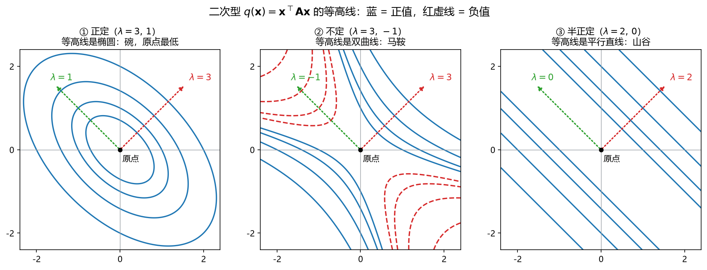

# 板书 · S005 · 第 07 课：Hessian 与二次型（Hessian & quadratic forms）

- 会话ID：`S005`
- 日期：2026-10-27
- 对应：L07 / M2
- 修订记录：（初版）2026-10-27；（v2）2026-10-27 修 7.2 例：原来把公式拆成两行写在行内 `$...$` 里，导致渲染成乱码，改为独立公式块，并把「12 与 21 位相同」改成「第 1 行第 2 列 = 第 2 行第 1 列」；（v3）2026-10-27 7.2 后新增 7.2.1「梯度 vs Hessian 对比例题」：$f=x^2+xy+y^3$ 在 $(1,1)$ 的梯度 $(3,4)^\top$ 与 Hessian $\begin{bmatrix}2&1\\1&6\end{bmatrix}$，并排对比表、切平面 3.7 vs 二次碗 3.75 vs 真值 3.751、开车比喻；（v4）2026-10-27 7.3/7.4 补推导：7.3.1 逐分量（双重和、$i=k$/$j=k$ 两项、$2\times2$ 核对）、7.3.2 矩阵微分（$df=\mathbf{x}^\top(\mathbf{A}^\top+\mathbf{A})d\mathbf{x}$）、7.3.3 三特例（$\mathbf{I}$/对称/反对称）、7.4.1 Hessian 推导（线性映射导数为自身 + 逐分量 + 对称性）、7.4.2 $\frac12$ 与线性项模板及最小二乘来源；（v5）2026-10-27 7.3.1 补「三行结论怎么来的」：$i=k$ 项提取 $x_k$ 得 $\mathbf{A}$ 第 $k$ 行内积、$j=k$ 项用 $(\mathbf{A}^\top)_{kj}=a_{jk}$ 换成 $\mathbf{A}^\top$ 第 $k$ 行、$a_{kk}x_k^2$ 两类各分一半；并加 $\mathbf{A}=\begin{bmatrix}1&2\\3&4\end{bmatrix}$ 的逐项表与两个和核对（$\nabla f=(7,13)^\top$）；（v6）2026-10-27 7.5 扩写为 7.5.1–7.5.7「符号表 / 为什么平方（含高斯最大似然、L1 对比）/ 投影几何与法方程 / 闭式解与可解性 / 残差正交性手算（$J=\frac16$）/ 翻车场景 / ML 位置」；（v7）2026-10-27 7.6 扩写为 7.6.1–7.6.3「四道手算（最小/最大/鞍点/双驻点）+ 二阶失效反例（$x^2\pm y^4$ 同 H 不同结局）+ 手算流程与汇总表」；（v8）2026-10-27 关键词改中英对照：7.3–7.7 小节标题加英文，例 1–4 标注 local minimum / local maximum / saddle point，新增 7.6.4 术语对照表（25 条）；（v9）2026-10-27 7.7 重写：明确 $a=H_{11}=f_{xx}$、$b=H_{12}=f_{xy}$、$d=H_{22}=f_{yy}$ 及「$a$ 不是特征值」；新增 7.7.1 配方一行证明判据 + $a>0$ 单独不够的反例 + 特征值对照；7.6.1 例 1 判号补 $a,b,d$ 的定义；（v10）2026-10-27 新增 7.7.2「特征值怎么算」：特征方程 $\lambda^2-8\lambda+8=0$、求根得 $4\pm2\sqrt2$、数值 $6.83/1.17$、$\operatorname{tr}/\det$ 速算与验算；（v11）2026-10-28 第 6 节易错点补第 5 条：$\det\mathbf{H}=0$ 是「判别法失效」而非「不定」，并给出三个同 $\mathbf{H}$ 不同结局的反例（呼应 7.6.2）；（v12）2026-10-28 应学生要求把原 7.6.3 手算流程、7.6.4 术语对照、7.7 判据**合并为 7.7**：7.7.1 四步流程（加 Step 0 前提与 Step 4 边界/局部性）、7.7.2 术语按用途分 A/B/C 三组、7.7.3 判别原理（二阶 Taylor 来源 → 沿坐标轴 $q=a t^2$ / $q=d t^2$ → 交叉项 $b$ 会掀碗 → 配方两系数 $a,\det/a$ → $\det>0\Rightarrow a,d$ 同号故 $\lambda$ 符号 $=a$ 符号 → **鞍点沿哪条轴**：对角看坐标轴、非对角看特征方向，例 $x^2-y^2$ 与 $x^2+6xy+y^2$）、7.7.4 特征值速算与 $\operatorname{tr}/\det$ 验算；（v13）2026-10-28 第 4 节完整手算补「符号一句话」（$\mathbf{X}/\mathbf{w}/\mathbf{y}/J(\mathbf{w})$ 各是什么，并区分正则化系数 $\lambda$ 与特征值 $\lambda$）

---

## 0. 生活化引入

走到一个“看起来平”的地方，一阶导数为 $0$——但你分不清是**谷底**、**山顶**，还是**山口（马鞍）**。
要分清，只能蹲下来摸摸“**往两边弯不弯、往哪边弯**”。这就是**二阶导 / Hessian（海森矩阵）**。

---

## 1. 直觉

| 对象 | 一句话 | 比作 |
|---|---|---|
| 梯度 $\nabla f$ | 往哪走最陡 | 坡度、方向 |
| Hessian $\mathbf{H}$ | 每个方向“弯多少、朝哪弯” | 曲率、碗还是鞍 |

- $\mathbf{H}$ **正定** ⇒ 每个方向都向上弯 ⇒ **碗** ⇒ 局部最小。
- $\mathbf{H}$ **负定** ⇒ 每个方向都向下弯 ⇒ **倒扣的碗** ⇒ 局部最大。
- $\mathbf{H}$ **不定** ⇒ 有的方向向上、有的向下 ⇒ **马鞍** ⇒ 驻点但不是极值。

---

## 2. 几何

**看图**（这张图 L05 用过，现在换个角度读）：

- ① 椭圆等高线 + 特征值 $3,1$ 全正 ⇒ $\mathbf{H}$ 正定 ⇒ 原点**最低**。
- ② 双曲线等高线 + 特征值 $3,-1$ 一正一负 ⇒ $\mathbf{H}$ **不定** ⇒ 原点**马鞍点**。
- ③ 平行直线 + 特征值 $2,0$ ⇒ **半正定** ⇒ 有一条“平的谷底”，不是严格极小。

> 一句话：**梯度和为 0 只找到“驻点”，Hessian 才能告诉你那是碗、鞍还是顶。**

---

## 3. 计算（公式卡片）

### 7.1 二阶偏导（second partial derivative）

$$
\frac{\partial^2 f}{\partial x_i\partial x_j}
=\frac{\partial}{\partial x_i}\left(\frac{\partial f}{\partial x_j}\right)
$$

- **符号**：先对 $x_j$ 求偏导，再对 $x_i$ 求；$i\ne j$ 时叫**混合偏导（mixed partial）**；结果是一个数。
- **例**：$f(x,y)=x^2y+3xy^2$。$f_x=2xy+3y^2$，再对 $y$ 求：$f_{xy}=2x+6y$；
  另一条路 $f_y=x^2+6xy$，再对 $x$ 求：$f_{yx}=2x+6y$。**两条路一样**。

### 7.2 Hessian 矩阵（Hessian matrix）

$$
\mathbf{H}(\mathbf{x})=\begin{bmatrix}
\dfrac{\partial^2 f}{\partial x_1^2} & \cdots & \dfrac{\partial^2 f}{\partial x_1\partial x_n}\\
\vdots & \ddots & \vdots\\
\dfrac{\partial^2 f}{\partial x_n\partial x_1} & \cdots & \dfrac{\partial^2 f}{\partial x_n^2}
\end{bmatrix},
\qquad
\mathbf{H}=\mathbf{H}^\top
$$

- **符号**：$\mathbf{H}$ 是 $n\times n$ **对称**矩阵（因为 $f_{x_ix_j}=f_{x_jx_i}$，Schwarz 定理）；第 $(i,j)$ 元 = 先对 $x_j$ 再对 $x_i$。
- **例**：上面的 $f$：

$$
\mathbf{H}=\begin{bmatrix}f_{xx}&f_{xy}\\f_{yx}&f_{yy}\end{bmatrix}
=\begin{bmatrix}2y&2x+6y\\2x+6y&6x\end{bmatrix}
$$

  明显对称（第 1 行第 2 列 = 第 2 行第 1 列，都是 $2x+6y$）。

#### 7.2.1 梯度 vs Hessian（gradient vs Hessian）：同一道题，两层信息

设

$$
f(x,y)=x^2+xy+y^3,
\qquad \text{在点 } (1,1)
$$

**先算梯度（一阶，回答“往哪走、多陡”）：**

$$
\nabla f=\begin{bmatrix}f_x\\f_y\end{bmatrix}
=\begin{bmatrix}2x+y\\x+3y^2\end{bmatrix}
\;\xrightarrow{(1,1)}\;
\begin{bmatrix}3\\4\end{bmatrix}
$$

**再算 Hessian（二阶，回答“地形怎么弯”）：**

$$
\mathbf{H}=\begin{bmatrix}f_{xx}&f_{xy}\\f_{yx}&f_{yy}\end{bmatrix}
=\begin{bmatrix}2&1\\1&6y\end{bmatrix}
\;\xrightarrow{(1,1)}\;
\begin{bmatrix}2&1\\1&6\end{bmatrix}
$$

**并排对比：**

| | 梯度 $\nabla f$ | Hessian $\mathbf{H}$ |
|---|---|---|
| 是什么 | 向量（$2\times1$） | 矩阵（$2\times2$） |
| 由几阶导构成 | 一阶偏导 | 二阶偏导 |
| 回答什么问题 | 往哪个方向走上升最快、有多陡 | 地形是碗还是鞍、弯得多厉害 |
| 本题结果 | $(3,4)^\top$ | $\begin{bmatrix}2&1\\1&6\end{bmatrix}$ |
| 拿它干什么 | 梯度下降走一步 | 判断驻点类型、牛顿法 |

**拿它俩各做一次预测（$\mathbf{d}=(0.1,0.1)^\top$，$f(1,1)=3$）：**

$$
\underbrace{3+3(0.1)+4(0.1)=3.7}_{\text{只用梯度（切平面）}}
\qquad
\underbrace{3+0.7+\tfrac12\mathbf{d}^\top\mathbf{H}\mathbf{d}=3.75}_{\text{梯度 + Hessian（二次碗）}}
$$

其中 $\mathbf{d}^\top\mathbf{H}\mathbf{d}=2(0.1)^2+2(0.1)(0.1)+6(0.1)^2=0.1$。
真值 $f(1.1,1.1)=1.21+1.21+1.331=3.751$：

- 切平面误差 $0.051$；
- 二次碗误差 $0.001$ —— **多了 Hessian，预测精度提高约 50 倍**。

**怎么读这两个结果：**

- 梯度 $(3,4)^\top$：往右上方走最陡；只告诉你“脚下这一点的坡”。
- Hessian $\begin{bmatrix}2&1\\1&6\end{bmatrix}$：$f_{xx}=2$、$f_{yy}=6$ ⇒ 沿 $y$ 方向比沿 $x$ 方向弯得厉害；
  $a=2>0$ 且 $\det=11>0$ ⇒ **正定**，所以脚下这块地是“碗形”，不是马鞍。
- 但 $(1,1)$ 处梯度**不为零**，说明这里还没到平的地方——Hessian 只描述“弯曲”，不负责“找底”。

> **开车比喻**：梯度 = 车头朝哪、当前坡度多陡；Hessian = 路是越走越陡还是越走越缓（凹/凸）。
> 梯度下降只看坡度，所以会冲过头；牛顿法两个都看，所以一步到位。

### 7.3 二次型的梯度（gradient of a quadratic form）

$$
f(\mathbf{x})=\mathbf{x}^\top\mathbf{A}\mathbf{x}
\quad\Longrightarrow\quad
\nabla f=(\mathbf{A}+\mathbf{A}^\top)\mathbf{x}
$$

- **符号**：$\mathbf{A}$ 是 $n\times n$（**不必对称**）；$\nabla f$ 是 $n\times1$；若 $\mathbf{A}=\mathbf{A}^\top$ 则化简为 $2\mathbf{A}\mathbf{x}$。
- **例**：$\mathbf{A}=\begin{bmatrix}1&2\\3&4\end{bmatrix}$（不对称）、$\mathbf{x}=(1,1)^\top$。
  $\mathbf{A}+\mathbf{A}^\top=\begin{bmatrix}2&5\\5&8\end{bmatrix}$ ⇒ $\nabla f=(7,13)^\top$。
  直接展开 $f=x_1^2+5x_1x_2+4x_2^2$：$f_{x_1}=2x_1+5x_2=7$，$f_{x_2}=5x_1+8x_2=13$ ✓

#### 7.3.1 推导一：逐分量（component-wise derivation）

把二次型写成双重和：

$$
f(\mathbf{x})=\sum_{i=1}^{n}\sum_{j=1}^{n}a_{ij}x_ix_j
$$

对 $x_k$ 求偏导，只有 $i=k$ 或 $j=k$ 的项还“活着”：

$$
\frac{\partial f}{\partial x_k}
=\underbrace{\sum_{j=1}^{n}a_{kj}x_j}_{i=k\ \text{的项}}
+\underbrace{\sum_{i=1}^{n}a_{ik}x_i}_{j=k\ \text{的项}}
=\big[(\mathbf{A}+\mathbf{A}^\top)\mathbf{x}\big]_k
$$

- 第一项 = $\mathbf{A}$ 的**第 $k$ 行**和 $\mathbf{x}$ 的内积 = $(\mathbf{A}\mathbf{x})_k$；
- 第二项 = $\mathbf{A}^\top$ 的第 $k$ 行和 $\mathbf{x}$ 的内积 = $(\mathbf{A}^\top\mathbf{x})_k$；
- $i=j=k$ 那一项被算了两次（$a_{kk}x_k+a_{kk}x_k=2a_{kk}x_k$），正好是 $a_{kk}x_k^2$ 的导数 ✓。

**这三行分别是怎么来的？**

1. **第一项 = “$x_k$ 站在第一个位置”的所有项**（即 $i=k$）：

$$
a_{k1}x_kx_1+a_{k2}x_kx_2+\cdots+a_{kn}x_kx_n
=x_k\sum_{j=1}^{n}a_{kj}x_j
$$

   对 $x_k$ 求导时，$x_k$ 这个因子留下 ⇒ 剩下 $\sum_j a_{kj}x_j$。
   而 $\sum_j a_{kj}x_j$ 正是 $\mathbf{A}$ 的**第 $k$ 行**与 $\mathbf{x}$ 的内积 $=(\mathbf{A}\mathbf{x})_k$。

2. **第二项 = “$x_k$ 站在第二个位置”的所有项**（即 $j=k$）：

$$
\sum_{i=1}^{n}a_{ik}x_ix_k
\ \xrightarrow{\ \partial/\partial x_k\ }\
\sum_{i=1}^{n}a_{ik}x_i
$$

   注意 $(\mathbf{A}^\top)_{kj}=a_{jk}$，所以
   $\sum_j(\mathbf{A}^\top)_{kj}x_j=\sum_j a_{jk}x_j=\sum_i a_{ik}x_i$，
   即 $\mathbf{A}^\top$ 的**第 $k$ 行**与 $\mathbf{x}$ 的内积 $=(\mathbf{A}^\top\mathbf{x})_k$。

3. **$a_{kk}x_k^2$ 同时属于上面两类**（$i=j=k$），所以在两个和里各出现一次：
   $a_{kk}x_k+a_{kk}x_k=2a_{kk}x_k$，正好等于 $(a_{kk}x_k^2)'=2a_{kk}x_k$。
   不是算重了，而是**两类各分一半**。

把 $k=1,\dots,n$ 摞成列向量：

$$
\nabla f=(\mathbf{A}+\mathbf{A}^\top)\mathbf{x}
$$

**具体例子：$\mathbf{A}=\begin{bmatrix}1&2\\3&4\end{bmatrix}$，$\mathbf{x}=(x_1,x_2)^\top$。**

先展开（注意 $a_{12}x_1x_2$ 与 $a_{21}x_2x_1$ 是两项）：

$$
f=\mathbf{x}^\top\mathbf{A}\mathbf{x}
=x_1^2+2x_1x_2+3x_2x_1+4x_2^2
=x_1^2+5x_1x_2+4x_2^2
$$

对 $x_1$ 逐项拆开看：

| 项 | 对 $x_1$ 求导 | 归到哪一类 |
|---|---|---|
| $a_{11}x_1^2=x_1^2$ | $2x_1=a_{11}x_1+a_{11}x_1$ | 两类都算（$i=j=1$） |
| $a_{12}x_1x_2=2x_1x_2$ | $2x_2=a_{12}x_2$ | 第一类（$i=1$） |
| $a_{21}x_2x_1=3x_2x_1$ | $3x_2=a_{21}x_2$ | 第二类（$j=1$） |
| $a_{22}x_2^2=4x_2^2$ | $0$ | 不含 $x_1$ |

加起来：$2x_1+(2+3)x_2=2x_1+5x_2$。再用“两个和”核对：

$$
(\mathbf{A}\mathbf{x})_1=1\cdot x_1+2\cdot x_2=x_1+2x_2
$$
$$
(\mathbf{A}^\top\mathbf{x})_1=1\cdot x_1+3\cdot x_2=x_1+3x_2
$$
$$
\Rightarrow\ \big[(\mathbf{A}+\mathbf{A}^\top)\mathbf{x}\big]_1
=(x_1+2x_2)+(x_1+3x_2)=2x_1+5x_2\ \checkmark
$$

对 $x_2$ 同理：$(\mathbf{A}\mathbf{x})_2=3x_1+4x_2$、$(\mathbf{A}^\top\mathbf{x})_2=2x_1+4x_2$，和为 $5x_1+8x_2$。
所以在 $\mathbf{x}=(1,1)^\top$ 处

$$
\nabla f=\begin{bmatrix}2+5\\5+8\end{bmatrix}=\begin{bmatrix}7\\13\end{bmatrix}
$$

与 7.3 开头的例子完全一致 ✓。

#### 7.3.2 推导二：矩阵微分（matrix differential）

只用两条事实：

1. 乘积法则：$d(\mathbf{x}^\top\mathbf{A}\mathbf{x})=(d\mathbf{x})^\top\mathbf{A}\mathbf{x}+\mathbf{x}^\top\mathbf{A}\,d\mathbf{x}$；
2. 标量的转置等于自己：$(d\mathbf{x})^\top\mathbf{A}\mathbf{x}=\mathbf{x}^\top\mathbf{A}^\top d\mathbf{x}$。

$$
\begin{aligned}
df
&=d(\mathbf{x}^\top\mathbf{A}\mathbf{x})\\
&=(d\mathbf{x})^\top\mathbf{A}\mathbf{x}+\mathbf{x}^\top\mathbf{A}\,d\mathbf{x}\\
&=\mathbf{x}^\top\mathbf{A}^\top d\mathbf{x}+\mathbf{x}^\top\mathbf{A}\,d\mathbf{x}\\
&=\mathbf{x}^\top(\mathbf{A}^\top+\mathbf{A})\,d\mathbf{x}\\
&=\big[(\mathbf{A}+\mathbf{A}^\top)\mathbf{x}\big]^\top d\mathbf{x}
\end{aligned}
$$

而全微分的定义是 $df=(\nabla f)^\top d\mathbf{x}$，**逐项比较系数**（$d\mathbf{x}$ 任意）得

$$
\nabla f=(\mathbf{A}+\mathbf{A}^\top)\mathbf{x}
$$

> 布局约定：本课统一用**分母布局**（梯度写成 $n\times1$ 列向量），所以结果直接是列向量；
> 若用分子布局（梯度写成行向量），结果是 $\mathbf{x}^\top(\mathbf{A}+\mathbf{A}^\top)$，只是转置了一下。

#### 7.3.3 三个特例（special cases）

| 情形 | 二次型 | 梯度 | 直觉 |
|---|---|---|---|
| $\mathbf{A}=\mathbf{I}$ | $\|\mathbf{x}\|^2$ | $2\mathbf{x}$ | 离原点越远，坡越陡 |
| $\mathbf{A}$ 对称 | $\mathbf{x}^\top\mathbf{A}\mathbf{x}$ | $2\mathbf{A}\mathbf{x}$ | 最常用，系数干净 |
| $\mathbf{A}$ 反对称（$\mathbf{A}^\top=-\mathbf{A}$） | $\mathbf{x}^\top\mathbf{A}\mathbf{x}$ | $\mathbf{0}$ | 反对称部分对二次型**毫无贡献** |

- 最后一行值得记：$\mathbf{x}^\top\mathbf{A}\mathbf{x}$ 里反对称部分自己抵消掉了，
  所以 $\nabla f$ 里只剩对称部分——这与 L05 5.6.2 视角 4 是同一件事。
- 对称时 $\mathbf{A}+\mathbf{A}^\top=2\mathbf{A}$，所以**梯度里的 2 就是这么来的**（不是背下来的）。

### 7.4 二次型的 Hessian（Hessian of a quadratic form）

$$
f(\mathbf{x})=\mathbf{x}^\top\mathbf{A}\mathbf{x}
\quad\Longrightarrow\quad
\mathbf{H}=\mathbf{A}+\mathbf{A}^\top;
\qquad
\mathbf{A}=\mathbf{A}^\top\ \Rightarrow\ \mathbf{H}=2\mathbf{A}
$$

- **符号**：梯度是**线性**的，再求一次导就回到常数矩阵；$\mathbf{H}$ 一定对称。
- **例**：上例 $\mathbf{H}=\begin{bmatrix}2&5\\5&8\end{bmatrix}$。直接算 $f_{x_1x_1}=2$、$f_{x_1x_2}=5$、$f_{x_2x_2}=8$ ✓

#### 7.4.1 推导：Hessian（differentiate the gradient）

7.3 已经得到

$$
\nabla f(\mathbf{x})=(\mathbf{A}+\mathbf{A}^\top)\mathbf{x}
$$

右边是 $\mathbf{x}$ 的**线性函数**（矩阵乘向量）。线性映射 $\mathbf{M}\mathbf{x}$ 对 $\mathbf{x}$ 的导数就是 $\mathbf{M}$ 本身：

$$
d(\nabla f)=(\mathbf{A}+\mathbf{A}^\top)\,d\mathbf{x}
\quad\Longrightarrow\quad
\nabla^2 f=\mathbf{A}+\mathbf{A}^\top
$$

**逐分量再验证一遍**：记 $g_k=(\nabla f)_k=\sum_j(a_{kj}+a_{jk})x_j$，再对 $x_l$ 求一次：

$$
\frac{\partial g_k}{\partial x_l}=a_{kl}+a_{lk}=(\mathbf{A}+\mathbf{A}^\top)_{kl}
$$

所以 $\mathbf{H}$ 的第 $(k,l)$ 元就是 $a_{kl}+a_{lk}$，即

$$
\mathbf{H}=\mathbf{A}+\mathbf{A}^\top,
\qquad
\mathbf{A}=\mathbf{A}^\top\ \Rightarrow\ \mathbf{H}=2\mathbf{A}
$$

**为什么 $\mathbf{H}$ 一定对称**：

$$
\mathbf{H}^\top=(\mathbf{A}+\mathbf{A}^\top)^\top=\mathbf{A}+\mathbf{A}^\top=\mathbf{H}
$$

这与 Schwarz 定理（$f_{x_ix_j}=f_{x_jx_i}$，混合偏导可交换）是同一件事——
**二次型的 Hessian 天生对称，而且是常数矩阵**（弯曲程度处处一样）。

> 一句话链条：**二次 → 求一次导变线性 → 再求一次导变常数**。
> 这也是为什么二次型是“最容易算”的函数。

#### 7.4.2 带 $\frac12$ 与线性项（least-squares template）

实际损失函数很少是“纯二次型”，更常见的是

$$
f(\mathbf{x})=\tfrac12\mathbf{x}^\top\mathbf{A}\mathbf{x}-\mathbf{b}^\top\mathbf{x}+c,
\qquad \mathbf{A}=\mathbf{A}^\top
$$

逐项求导（$\mathbf{b}^\top\mathbf{x}$ 的梯度是 $\mathbf{b}$，常数项为 $\mathbf{0}$）：

$$
\nabla f=\tfrac12(\mathbf{A}+\mathbf{A}^\top)\mathbf{x}-\mathbf{b}
=\mathbf{A}\mathbf{x}-\mathbf{b},
\qquad
\nabla^2 f=\mathbf{A}
$$

**为什么要写 $\frac12$**：正是为了让梯度里的 $2$ 被约掉，形式最干净。

**最小二乘就是它的一个实例**：

$$
J(\mathbf{w})=\tfrac12\|\mathbf{X}\mathbf{w}-\mathbf{y}\|^2
=\tfrac12\mathbf{w}^\top(\mathbf{X}^\top\mathbf{X})\mathbf{w}-(\mathbf{X}^\top\mathbf{y})^\top\mathbf{w}+\tfrac12\|\mathbf{y}\|^2
$$

对照上面的模板，取 $\mathbf{A}=\mathbf{X}^\top\mathbf{X}$、$\mathbf{b}=\mathbf{X}^\top\mathbf{y}$：

$$
\nabla J=\mathbf{X}^\top\mathbf{X}\mathbf{w}-\mathbf{X}^\top\mathbf{y}
=\mathbf{X}^\top(\mathbf{X}\mathbf{w}-\mathbf{y}),
\qquad
\mathbf{H}_J=\mathbf{X}^\top\mathbf{X}
$$

这正是 7.5 那两个公式的**来源**（7.5 只给结论，这里给推导）。
$\mathbf{X}^\top\mathbf{X}$ 半正定，加 $\lambda\mathbf{I}$ 后正定——L05 的二次型判号在这里直接派上用场。

### 7.5 最小二乘目标（least squares）的梯度与 Hessian

$$
J(\mathbf{w})=\tfrac12\|\mathbf{X}\mathbf{w}-\mathbf{y}\|^2
\quad\Longrightarrow\quad
\nabla J=\mathbf{X}^\top(\mathbf{X}\mathbf{w}-\mathbf{y}),
\qquad
\mathbf{H}_J=\mathbf{X}^\top\mathbf{X}
$$

- **符号**：$\mathbf{X}\in\mathbb{R}^{m\times n}$、$\mathbf{w}\in\mathbb{R}^{n\times1}$；$\mathbf{X}^\top\mathbf{X}$ 是 $n\times n$ **对称半正定**；加正则后 $\mathbf{H}=\mathbf{X}^\top\mathbf{X}+\lambda\mathbf{I}$ 正定（$\lambda>0$）。
- **例**：$\mathbf{X}=\begin{bmatrix}1&0\\1&1\\1&2\end{bmatrix}$，$\mathbf{X}^\top\mathbf{X}=\begin{bmatrix}3&3\\3&5\end{bmatrix}$，
  $\mathbf{H}=\begin{bmatrix}3&3\\3&5\end{bmatrix}$，$\operatorname{tr}=8$、$\det=6>0$ ⇒ 正定。

> 推导见 7.4.2（$\frac12$ 模板 + 展开）。本节讲**这个目标本身**：为什么这么写、几何上在干什么、解怎么来。

#### 7.5.1 符号与维度（notation & shapes）

| 符号 | 维度 | 含义 |
|---|---|---|
| $m$ | 标量 | 样本数 |
| $n$ | 标量 | 特征数（含截距时 $+1$） |
| $\mathbf{X}$ | $m\times n$ | 设计矩阵，**第 $i$ 行** = 第 $i$ 个样本 $\mathbf{x}_i^\top$ |
| $\mathbf{w}$ | $n\times1$ | 要学的参数 |
| $\mathbf{y}$ | $m\times1$ | 真实标签 |
| $\mathbf{X}\mathbf{w}$ | $m\times1$ | 预测值 $\hat{\mathbf{y}}$ |
| $\mathbf{r}=\mathbf{X}\mathbf{w}-\mathbf{y}$ | $m\times1$ | **残差（residual）**（预测减真实） |
| $J$ | **一个数** | 残差长度的平方 |

- $J$ 是“给一组 $\mathbf{w}$，返回一个分数”的函数：分数越小，拟合越好。
- 目标是 $\min_{\mathbf{w}}J(\mathbf{w})$，**不是**让每个残差都为零（一般做不到）。

#### 7.5.2 为什么用平方（why squared loss）

| 理由 | 说明 |
|---|---|
| 正负不抵消 | 用 $\sum r_i$ 的话，正负误差会互相抵消，可能 $J=0$ 但拟合很烂 |
| 大错罚更重 | 误差 $10$ 的代价是误差 $1$ 的 $100$ 倍 |
| 光滑可导 | $r^2$ 处处可导，可以直接令 $\nabla J=\mathbf{0}$ 解出来；$|r|$ 在 $0$ 处不可导 |
| 几何上是距离 | $\|\mathbf{r}\|^2$ 就是欧氏距离的平方 |
| 概率上是最大似然 | 若 $\mathbf{y}=\mathbf{X}\mathbf{w}+\boldsymbol{\varepsilon}$、$\boldsymbol{\varepsilon}\sim N(\mathbf{0},\sigma^2\mathbf{I})$，最大化似然**等价于**最小化 $\|\mathbf{X}\mathbf{w}-\mathbf{y}\|^2$ |

> 换成 $\sum|r_i|$ 就是**最小绝对偏差（L1 / 中位数回归）**：更抗离群点，但没有闭式解。
> **平方 → 均值；绝对值 → 中位数。**

#### 7.5.3 几何：正交投影（orthogonal projection）

$\mathbf{X}\mathbf{w}$ 无论 $\mathbf{w}$ 怎么取，都只能落在 $\mathbf{X}$ 的**列空间（column space）**里（一张过原点的平面/超平面）。
$\mathbf{y}$ 一般**不在这张平面上**，于是

$$
\min_{\mathbf{w}}\|\mathbf{X}\mathbf{w}-\mathbf{y}\|^2
=\text{在列空间里找离 }\mathbf{y}\text{ 最近的点}
$$

最近点就是 $\mathbf{y}$ 的**正交投影（orthogonal projection）**，所以残差必须垂直于列空间：

$$
\mathbf{X}^\top(\mathbf{X}\mathbf{w}-\mathbf{y})=\mathbf{0}
\quad\Longleftrightarrow\quad
\boxed{\mathbf{X}^\top\mathbf{X}\,\mathbf{w}=\mathbf{X}^\top\mathbf{y}}
$$

这叫**法方程（normal equations）**。勾股定理也成立：

$$
\|\mathbf{y}\|^2=\|\mathbf{X}\mathbf{w}\|^2+\|\mathbf{r}\|^2
$$

> 一句话：**$\mathbf{X}\mathbf{w}$ 是 $\mathbf{y}$ 投在列空间上的影子，$J$ 是“影子到本体距离”的平方。**

#### 7.5.4 闭式解与可解性（closed form & solvability）

令 $\nabla J=\mathbf{0}$ 得法方程，若 $\mathbf{X}^\top\mathbf{X}$ 可逆：

$$
\mathbf{w}^\star=(\mathbf{X}^\top\mathbf{X})^{-1}\mathbf{X}^\top\mathbf{y}
$$

| $\mathbf{X}^\top\mathbf{X}$ 的状态 | 条件 | 结果 |
|---|---|---|
| **正定** | $\mathbf{X}$ 列满秩（无共线、样本够） | 唯一解，碗底唯一 |
| **半正定、有零特征值** | 特征冗余 / $m<n$ | 无穷多解，取最小范数解（伪逆 / pseudoinverse $\mathbf{X}^+$） |

- “有零特征值”的方向就是**不可辨识（unidentifiable）**的方向：沿它走 $J$ 完全不变（一条平底槽）。
- 加 $\lambda\|\mathbf{w}\|^2$ 后 $\mathbf{H}=\mathbf{X}^\top\mathbf{X}+\lambda\mathbf{I}$ 正定，槽被填成碗 ⇒ 唯一解（岭回归）。

#### 7.5.5 残差与正交性（residual & orthogonality）

第 4 节已经解出 $\mathbf{w}^\star=(\tfrac76,\tfrac12)^\top$。把它代回去看残差：

$$
\hat{\mathbf{y}}=\mathbf{X}\mathbf{w}^\star
=\Big(\tfrac76,\ \tfrac53,\ \tfrac{13}{6}\Big)^\top,
\qquad
\mathbf{r}=\hat{\mathbf{y}}-\mathbf{y}
=\Big(\tfrac16,\ -\tfrac13,\ \tfrac16\Big)^\top
$$

$$
J=\|\mathbf{r}\|^2=\tfrac1{36}+\tfrac19+\tfrac1{36}=\tfrac16
\quad\Big(\text{若用 }\tfrac12\|\cdot\|^2\text{ 则为 }\tfrac1{12}\Big)
$$

**验证“残差垂直于列空间”**（$\mathbf{X}^\top\mathbf{r}=\mathbf{0}$）：

- 第 1 列（全 $1$）：$\tfrac16-\tfrac13+\tfrac16=0$ ✓
- 第 2 列（$0,1,2$）：$0-\tfrac13+\tfrac13=0$ ✓

这就是 7.5.3 那个“影子”的代数证据。

#### 7.5.6 失效场景（failure modes）

| 问题 | 原因 | 对策 |
|---|---|---|
| 离群点把线拉歪 | 平方放大异常值 | Huber / L1 损失 |
| 特征共线，解乱跳 | $\mathbf{X}^\top\mathbf{X}$ 接近奇异，条件数爆炸 | 岭回归、PCA、去相关 |
| 关系是弯的 | 模型太简单 | 多项式/基函数特征 |
| 样本数 < 特征数 | 欠定，无穷多解 | 正则化 / 最小范数解 |

#### 7.5.7 在机器学习中的位置（where it shows up）

- **线性回归 / 多项式回归**：就是它本身；
- **岭回归**：加 $\lambda\|\mathbf{w}\|^2$，把碗捏圆；
- **Gauss–Newton**：非线性最小二乘，每步解一个加权最小二乘；
- **神经网络最后一层**：固定特征时，输出层就是最小二乘；
- **矩阵分解 / 推荐系统**：交替最小二乘（ALS）；
- **卡尔曼滤波**：每步更新也是一个加权最小二乘。

> **只记三句**：$J$ 是一个数（残差长度平方）；$\nabla J=0$ 给法方程 $\mathbf{X}^\top\mathbf{X}\mathbf{w}=\mathbf{X}^\top\mathbf{y}$；$\mathbf{H}=\mathbf{X}^\top\mathbf{X}$ 半正定，列满秩才是碗。

### 7.6 驻点分类（stationary point classification）

$$
\nabla f(\mathbf{x}_0)=\mathbf{0}
\ \Longrightarrow\
\begin{cases}
\mathbf{H}\succ\mathbf{0} & \text{局部最小（local min）}\\
\mathbf{H}\prec\mathbf{0} & \text{局部最大（local max）}\\
\mathbf{H}\ \text{不定} & \text{鞍点（saddle）}\\
\mathbf{H}\ \text{半定} & \text{判不了，需更高阶}
\end{cases}
$$

- **符号**：$\succ\mathbf{0}$ 读作“正定”（$\lambda_i>0$）；前提是 $\mathbf{H}$ 对称——这总成立。
- **用法**：先在**驻点（stationary point）**处算 $\mathbf{H}$ 再判号；$\mathbf{H}$ 随 $\mathbf{x}$ 变，**不能拿别处的 $\mathbf{H}$**。

#### 7.6.1 四道手算（four cases）

**例 1（局部最小 / local minimum）** $f(x,y)=x^2+2xy+3y^2$

1. 求驻点：

$$
f_x=2x+2y,\qquad f_y=2x+6y
$$

   令两者为 $0$，两式相减得 $4y=0\Rightarrow y=0\Rightarrow x=0$。唯一驻点 $(0,0)$。

2. Hessian：

$$
\mathbf{H}=\begin{bmatrix}2&2\\2&6\end{bmatrix}
$$

3. 判号：把 $\mathbf{H}$ 写成 $\begin{bmatrix}a&b\\b&d\end{bmatrix}$，这里 $a=H_{11}=f_{xx}=2$、$b=H_{12}=f_{xy}=2$、$d=H_{22}=f_{yy}=6$；
   $a>0$ 且 $\det=ad-b^2=12-4=8>0$ ⇒ **正定**（特征值 $4\pm2\sqrt2>0$，一致）。
4. 结论：$(0,0)$ 是局部最小，$f(0,0)=0$。

**例 2（局部最大 / local maximum）** $f(x,y)=5-x^2-xy-y^2$

1. 求驻点：

$$
f_x=-2x-y,\qquad f_y=-x-2y
$$

   由第一式 $y=-2x$，代入第二式：$-x+4x=3x=0\Rightarrow x=0,\ y=0$。唯一驻点 $(0,0)$。

2. Hessian：

$$
\mathbf{H}=\begin{bmatrix}-2&-1\\-1&-2\end{bmatrix}
$$

3. 判号：$a=-2<0$，$\det=4-1=3>0$ ⇒ **负定**。
4. 结论：$(0,0)$ 是局部最大，$f(0,0)=5$。

**例 3（鞍点 / saddle point）** $f(x,y)=x^2-y^2$

1. 求驻点：$f_x=2x,\ f_y=-2y$ ⇒ 唯一驻点 $(0,0)$。
2. Hessian：

$$
\mathbf{H}=\begin{bmatrix}2&0\\0&-2\end{bmatrix}
$$

3. 判号：$\det=-4<0$ ⇒ **不定**。
4. 结论：**鞍点**。沿 $x$ 轴上坡（$f=x^2>0$），沿 $y$ 轴下坡（$f=-y^2<0$）。

**例 4（两个驻点 / stationary points，类型不同）** $f(x,y)=x^3-3x+y^2$

1. 求驻点：

$$
f_x=3x^2-3=3(x-1)(x+1),\qquad f_y=2y
$$

   ⇒ $x=\pm1,\ y=0$，两个驻点 $(1,0)$ 与 $(-1,0)$。

2. Hessian（**随 $x$ 变**）：

$$
\mathbf{H}=\begin{bmatrix}6x&0\\0&2\end{bmatrix}
$$

3. 逐点判：

| 驻点 | $\mathbf{H}$ | 判号 | 结论 | $f$ |
|---|---|---|---|---|
| $(1,0)$ | $\operatorname{diag}(6,2)$ | 正定 | 局部最小 | $-2$ |
| $(-1,0)$ | $\operatorname{diag}(-6,2)$ | $\det=-12<0$ 不定 | 鞍点 | $2$ |

4. 教训：**同一个函数，不同驻点可以完全不同**——必须逐点算 $\mathbf{H}$，不能算一次用到底。

#### 7.6.2 二阶判别失效（inconclusive Hessian）

$$
f_1=x^2+y^4,\qquad f_2=x^2-y^4,\qquad f_3=-(x^2+y^4)
$$

在原点的梯度都是 $\mathbf{0}$，Hessian **完全一样**：

$$
\mathbf{H}=\begin{bmatrix}2&0\\0&0\end{bmatrix}
\quad(\text{半正定，有零特征值};\ \det=0)
$$

二阶判别法在这里**失效**（$\det=0$，四种结论都套不上）。但直接看函数：

- $f_1=x^2+y^4\ge0$，只在原点取 $0$ ⇒ **全局最小**；
- $f_2=x^2-y^4$：沿 $x$ 轴为正、沿 $y$ 轴为负 ⇒ **鞍点**；
- $f_3=-(x^2+y^4)\le0$，只在原点取 $0$ ⇒ **全局最大**（同一 $\mathbf{H}$ 也能是最大，
  所以「$\det=0$ 就是不定」是错的）。

> 教训：**“$\mathbf{H}$ 半定”不是“没有结论”，而是“二阶信息不够”**，必须看三阶、四阶项。
> （对比：$f=x^4$ 在 $0$ 处 $f''=0$，但仍是极小——所以 $f''=0$ 从来不能直接判最大。）

### 7.7 二阶判别法：先会做 → 再认词 → 最后懂为什么（second-order test, merged）

> 本节合并原「7.6.3 手算流程」「7.6.4 术语对照」「7.7 判据」三块：
> **7.7.1 做题流程**（考场上照抄）→ **7.7.2 术语对照**（看懂题）→ **7.7.3 判别原理**（为什么 $a$、$\det$ 够用；鞍点沿哪条轴上下坡）→ **7.7.4 特征值与验算**。

#### 7.7.1 做题流程（recipe，四步 + 两个前提）

**Step 0｜前提检查**（30 秒）
- $f$ 二阶可导，且 $\mathbf{H}$ 对称（$f_{xy}=f_{yx}$，Clairaut 定理）；
- 只在**内部点**用这套判据；边界上的极值另算（见 Step 4 备注）。

**Step 1｜找驻点**：解 $\nabla f(\mathbf{x})=\mathbf{0}$，列出**所有**解。
$\nabla f=\mathbf{0}$ 是极值的**必要不充分**条件：谷底/山顶/山口都满足它。

**Step 2｜逐点算 Hessian**：$\mathbf{H}(\mathbf{x})=\begin{bmatrix}a&b\\b&d\end{bmatrix}=\begin{bmatrix}f_{xx}&f_{xy}\\f_{xy}&f_{yy}\end{bmatrix}$。
$\mathbf{H}$ 是 $\mathbf{x}$ 的函数，**每个驻点单独代**，不要一个矩阵用到底。

**Step 3｜$2\times2$ 判号**（只需 $a$、$\det$）：

| $\det=ad-b^2$ | $a=f_{xx}$ | 特征值 | 结论 |
|---|---|---|---|
| $>0$ | $>0$ | 全正 | 正定（positive definite）⇒ **局部最小** |
| $>0$ | $<0$ | 全负 | 负定（negative definite）⇒ **局部最大** |
| $<0$ | 任意 | 一正一负 | 不定（indefinite）⇒ **鞍点** |
| $=0$ | 任意 | 有 $0$ | 半定 ⇒ **判别法失效**，看更高阶（7.6.2） |

**Step 4｜收尾**
- 把驻点代回 $f$ 求极值；多个候选点要**逐个比大小**；
- 若定义域有边界（如 $x\ge0$、$x^2+y^2\le1$），边界上的最大/最小**单独检查**；
- 一切结论都是**局部**的；要全局结论需额外论证（如 $\mathbf{H}\succ\mathbf{0}$ 处处成立 ⇒ 凸 ⇒ 全局最小）。

**一页汇总：**

| 例子 | 驻点 | $\mathbf{H}$ | 判号 | 结论 |
|---|---|---|---|---|
| $x^2+2xy+3y^2$ | $(0,0)$ | $\begin{bmatrix}2&2\\2&6\end{bmatrix}$ | $a>0,\ \det=8>0$ | 最小 |
| $5-x^2-xy-y^2$ | $(0,0)$ | $\begin{bmatrix}-2&-1\\-1&-2\end{bmatrix}$ | $a<0,\ \det=3>0$ | 最大 |
| $x^2-y^2$ | $(0,0)$ | $\operatorname{diag}(2,-2)$ | $\det=-4<0$ | 鞍点 |
| $x^3-3x+y^2$ | $(1,0)$ | $\operatorname{diag}(6,2)$ | 正定 | 最小 |
| 同上 | $(-1,0)$ | $\operatorname{diag}(-6,2)$ | $\det=-12<0$ | 鞍点 |

#### 7.7.2 术语对照（glossary，按用途分三组）

**A. 点与极值**

| 中文 | English | 一句话 |
|---|---|---|
| 驻点 | stationary point | $\nabla f=\mathbf{0}$ 的点（不一定是极值） |
| 局部最小 | local minimum | 附近都比它高 |
| 局部最大 | local maximum | 附近都比它低 |
| 全局最小 / 最大 | global minimum / maximum | 整个定义域里最低 / 最高 |
| 鞍点 | saddle point | 有的方向上坡、有的方向下坡 |

**B. 矩阵定性与判别**

| 中文 | English | 一句话 |
|---|---|---|
| 正定 | positive definite | $\mathbf{x}^\top\mathbf{A}\mathbf{x}>0$，碗 |
| 负定 | negative definite | 倒扣的碗 |
| 半正定 | positive semidefinite | 允许某些方向为 $0$，槽 |
| 半负定 | negative semidefinite | 槽，但朝下 |
| 不定 | indefinite | 有正有负，马鞍 |
| 梯度 | gradient | 一阶信息：往哪走最陡 |
| Hessian | Hessian matrix | 二阶信息：怎么弯 |
| 特征值 / 特征向量 | eigenvalue / eigenvector | 主方向上的伸缩倍数 / 主方向 |
| 二阶判别法 | second-order test | 用 $\mathbf{H}$ 判驻点类型 |
| 条件数 | condition number | $\lambda_{\max}/\lambda_{\min}$，碗有多扁 |

**C. 回归 / 最小二乘（后面 L17–L19 要用）**

| 中文 | English | 一句话 |
|---|---|---|
| 残差 | residual | $\mathbf{r}=\mathbf{X}\mathbf{w}-\mathbf{y}$ |
| 设计矩阵 | design matrix | $\mathbf{X}$，每行一个样本 |
| 列空间 | column space | $\mathbf{X}\mathbf{w}$ 能到达的所有点 |
| 正交投影 | orthogonal projection | 列空间里离 $\mathbf{y}$ 最近的点 |
| 法方程 | normal equations | $\mathbf{X}^\top\mathbf{X}\mathbf{w}=\mathbf{X}^\top\mathbf{y}$ |
| 闭式解 | closed-form solution | 能用公式直接写出来的解 |
| 伪逆 | pseudoinverse | $\mathbf{X}^+$，不可逆时的替代 |
| 不可辨识 | unidentifiable | 那个方向上 $J$ 完全不变 |
| 岭回归 | ridge regression | 加 $\lambda\|\mathbf{w}\|^2$ 把槽填成碗 |
| 离群点 | outlier | 把线拉歪的极端点 |
| 共线 | collinearity | 特征之间线性相关 |
| 欠定 | underdetermined | 样本数 $<$ 特征数 |
| 最大似然 | maximum likelihood | 高斯噪声下等价于最小二乘 |

#### 7.7.3 判别原理（为什么只看 $a$ 与 $\det$ 就够）

**一句话来源**：在驻点处一阶项消失，函数长什么样由二次项决定。

$$
f(\mathbf{x}_0+\mathbf{d})\approx f(\mathbf{x}_0)+\underbrace{\nabla f(\mathbf{x}_0)^\top\mathbf{d}}_{=0}
+\frac12\mathbf{d}^\top\mathbf{H}\mathbf{d}
=f_0+\frac12\,q(\mathbf{d})
$$

$\mathbf{d}$ 是从驻点迈出的一小步。$\dfrac12q(\mathbf{d})$ 是**正**还是**负**，就决定这一步是上坡还是下坡。
所以整个判别法只回答一个问题：$q(\mathbf{d})=\mathbf{d}^\top\mathbf{H}\mathbf{d}$ 的符号能不能固定？

**第一步：先沿两条坐标轴走**（这就是 $a$ 和 $d$ 的含义）

$$
q(\mathbf{d})\Big|_{\mathbf{d}=(t,0)}=a\,t^2,
\qquad
q(\mathbf{d})\Big|_{\mathbf{d}=(0,t)}=d\,t^2
$$

- $a>0$：沿 $x$ 轴走，**上坡**；$a<0$：下坡；
- $d>0$：沿 $y$ 轴走，**上坡**；$d<0$：下坡。

但**两条轴都上坡，不等于所有方向都上坡**——因为还有交叉项 $b$：

$$
q(t,t)=(a+2b+d)\,t^2
$$

$\mathbf{H}=\begin{bmatrix}1&3\\3&1\end{bmatrix}$ 就是活例子：$a=d=1>0$，$x$ 轴、$y$ 轴都上坡，
但沿 $(1,-1)$ 走：

$$
q(1,-1)=1-3-3+1=-4<0\ \Rightarrow\ \text{下坡}
$$

所以「只看 $a>0$」会被交叉项骗。$\det=ad-b^2$ 正是用来量 $b$ 有没有大到把碗掀翻。

**第二步：把 $q$ 配方，得到真正的两个曲率**

$$
q=a x_1^2+2b x_1x_2+d x_2^2
=a\left(x_1+\frac{b}{a}x_2\right)^2+\frac{ad-b^2}{a}\,x_2^2
$$

两个平方项的系数是 $a$ 和 $\dfrac{\det}{a}$：

| 情形 | 两个系数 | 地形 | 结论 |
|---|---|---|---|
| $a>0,\ \det>0$ | 正、正 | 碗 | 正定 ⇒ 最小 |
| $a<0,\ \det>0$ | 负、负 | 倒扣的碗 | 负定 ⇒ 最大 |
| $\det<0$ | 一正一负 | 马鞍 | 不定 ⇒ 鞍点 |
| $\det=0$ | 有一个是 $0$ | 槽 / 更复杂 | 失效 |

**第三步：为什么 $\det>0$ 时看 $a$ 的符号就够**

$$
\det=ad-b^2>0\ \Longrightarrow\ ad>b^2\ge0\ \Longrightarrow\ a,d\ \text{同号}
$$

又因为 $\lambda_1\lambda_2=\det>0$（同号）且 $\lambda_1+\lambda_2=a+d$（与 $a$ 同号），
所以**两个特征值的符号 = $a$ 的符号**。这就是判据 $a>0\ \&\ \det>0$ 的全部来历。

**第四步：鞍点到底沿哪条轴上下坡？**

| $\mathbf{H}$ 的形状 | 上/下坡方向 | 怎么找 |
|---|---|---|
| 对角（$b=0$） | 就是坐标轴 | 直接看 $a$、$d$ 的符号 |
| 非对角（$b\ne0$） | **不是**坐标轴，是**特征向量方向** | 解 $(\mathbf{H}-\lambda\mathbf{I})\mathbf{v}=\mathbf{0}$，或直接试算 $q(\mathbf{d})$ |

两个必会例子：

**(a) $f=x^2-y^2$**，$\mathbf{H}=\operatorname{diag}(2,-2)$。
沿 $x$ 轴上坡（$a=2>0$），沿 $y$ 轴下坡（$d=-2<0$）——鞍点，两条轴就是特征方向。

**(b) $f=x^2+6xy+y^2$**，$\mathbf{H}=\begin{bmatrix}1&3\\3&1\end{bmatrix}$，$\operatorname{tr}=2$、$\det=-8$。
特征值 $\lambda=\dfrac{2\pm\sqrt{4+32}}{2}=1\pm3=4,-2$；
特征向量：$\lambda=4\Rightarrow(1,1)/\sqrt2$（**上坡**），$\lambda=-2\Rightarrow(1,-1)/\sqrt2$（**下坡**）。
注意：沿 $x$ 轴、$y$ 轴**都是上坡**，只有斜着走才下坡——所以「沿哪个轴」在非对角情形要理解成「沿哪个**特征方向**」。

**考场速判**：$\det<0$ 就一定一上一下；只需再写一句「沿特征向量 $\mathbf{v}_-$ 方向下坡」即可，不必求完整特征向量。

> 几何图：`图片/fig_quadratic_contours.png`（正定椭圆 / 不定双曲线 / 半正定平行线）。
> **看图**：双曲线那格的两条渐近线方向就是两个特征方向；一条上坡、一条下坡，交叉点就是鞍点。

#### 7.7.4 特征值算法与一致性验算（when you need $\lambda$）

**速算**：$2\times2$ 的特征方程永远是

$$
\lambda^2-\operatorname{tr}(\mathbf{H})\,\lambda+\det(\mathbf{H})=0
$$

**完整例**：$\mathbf{H}=\begin{bmatrix}2&2\\2&6\end{bmatrix}$，$\operatorname{tr}=8$、$\det=8$：

$$
\lambda=\frac{8\pm\sqrt{8^2-4\cdot1\cdot8}}{2}
=\frac{8\pm\sqrt{32}}{2}
=\frac{8\pm4\sqrt2}{2}
=4\pm2\sqrt2\approx6.83,\ 1.17
$$

两个都正 ⇒ 正定，与「$a=2>0,\ \det=8>0$」一致。

**验算两件套**（永远成立）：

$$
\lambda_1+\lambda_2=\operatorname{tr}\mathbf{H},\qquad
\lambda_1\lambda_2=\det\mathbf{H}
$$

> 两条路等价：$\lambda_i>0\iff$ 正定 $\iff$（$2\times2$）$a>0$ 且 $\det>0$。
> 考试用后者（两次乘法），前者只用来验算或写理由。

---

## 4. 完整手算

**Example.** Let $\mathbf{X}=\begin{bmatrix}1&0\\1&1\\1&2\end{bmatrix}$，$\mathbf{y}=\begin{bmatrix}1\\2\\2\end{bmatrix}$，
$J(\mathbf{w})=\tfrac12\|\mathbf{X}\mathbf{w}-\mathbf{y}\|^2+\tfrac{\lambda}{2}\|\mathbf{w}\|^2$（取 $\lambda=0$）。
Find $\nabla J$、$\mathbf{H}_J$，判其正定性，并求驻点。

> **符号一句话**：$\mathbf{X}$ 是设计矩阵（每行一个样本）；$\mathbf{w}$ 是待求参数；$\mathbf{y}$ 是真实输出；
> $J(\mathbf{w})$ 是**目标函数 / 损失**——给一个 $\mathbf{w}$，它告诉你预测 $\mathbf{X}\mathbf{w}$ 离真值 $\mathbf{y}$ 有多远
> （平方误差总和的一半），越小越好；
> 公式里的 $\lambda$ 是**正则化系数**（取 $0$ = 普通最小二乘），第 4 步的 $\lambda$ 是**特征值**，两者不是一回事。

1. 先算两个“零件”：

$$
\mathbf{X}^\top\mathbf{X}
=\begin{bmatrix}1&1&1\\0&1&2\end{bmatrix}\begin{bmatrix}1&0\\1&1\\1&2\end{bmatrix}
=\begin{bmatrix}3&3\\3&5\end{bmatrix},
\qquad
\mathbf{X}^\top\mathbf{y}
=\begin{bmatrix}1&1&1\\0&1&2\end{bmatrix}\begin{bmatrix}1\\2\\2\end{bmatrix}
=\begin{bmatrix}5\\6\end{bmatrix}
$$

2. 梯度：

$$
\nabla J=\mathbf{X}^\top\mathbf{X}\mathbf{w}-\mathbf{X}^\top\mathbf{y}
=\begin{bmatrix}3w_1+3w_2-5\\3w_1+5w_2-6\end{bmatrix}
\in\mathbb{R}^{2\times1}\ \checkmark
$$

3. Hessian：

$$
\mathbf{H}_J=\mathbf{X}^\top\mathbf{X}=\begin{bmatrix}3&3\\3&5\end{bmatrix}
\quad(\text{对称}\ \checkmark)
$$

4. 正定性：$\operatorname{tr}=8>0$，$\det=15-9=6>0$ ⇒ 两个特征值同号且和为正 ⇒ 都正 ⇒ **正定**。

$$
\lambda=\frac{8\pm\sqrt{64-24}}{2}=\frac{8\pm\sqrt{40}}{2}=4\pm\sqrt{10}\approx7.16,\ 0.84
$$

5. 驻点（$\nabla J=\mathbf{0}$）：

$$
\begin{cases}3w_1+3w_2=5\\3w_1+5w_2=6\end{cases}
\ \Rightarrow\
w_2=\tfrac12,\quad w_1=\tfrac{7}{6}
$$

6. 结论：$\mathbf{H}$ 正定 ⇒ 这个驻点是**唯一的全局最小**（凸二次函数，只有一个碗底）。

> 中文：这题就是 HW1 Q4 的骨架——“$\nabla$ 写成 $n\times1$，$\mathbf{H}$ 写成 $n\times n$ 且对称”，
> 再用 $\operatorname{tr}$/$\det$ 或特征值判正定。

---

## 5. 独立复现（先自己写，答案见第 9 节）

**Exercise.** $f(x,y)=x^3-3xy+y^2$。求所有驻点，并用 $\mathbf{H}$ 分类。

---

## 6. 易错点

1. **Hessian 不是“梯度的梯度”向量，而是 $n\times n$ 矩阵**；写成一列 $n$ 个数就错了。
2. **$\nabla(\mathbf{x}^\top\mathbf{A}\mathbf{x})=2\mathbf{A}\mathbf{x}$ 只在 $\mathbf{A}$ 对称时成立**；一般情形是 $(\mathbf{A}+\mathbf{A}^\top)\mathbf{x}$。
3. **$\nabla f=\mathbf{0}$ 不能直接说是最小**。$f=x^2-y^2$ 在原点梯度为 $0$，但 $\mathbf{H}=\operatorname{diag}(2,-2)$ 不定 ⇒ 鞍点。
4. **$\det\mathbf{H}<0$ 是鞍点，不是最大**。最大要求 $\det>0$ 且 $f_{xx}<0$。
5. **$\det\mathbf{H}=0$ 不是“不定”**，而是“**二阶判别法失效**”（inconclusive）：可能是最小、最大，也可能是鞍点。
   “不定”（indefinite）是 $\det<0$ 的专属说法。三个同 Hessian 的反例见 7.6.2：
   $x^2+y^4$（最小）、$-(x^2+y^4)$（最大）、$x^2-y^4$（鞍点），在原点都有 $\mathbf{H}=\operatorname{diag}(2,0)$、$\det=0$。

---

## 7. 与已学关系

L05 的“正定”原来只是一个矩阵性质，现在有了归宿：**Hessian 正定 ⇔ 局部最小**。
L06 的梯度是一阶信息（往哪走），本课的 Hessian 是二阶信息（走一步会怎样变）；L08 的二阶 Taylor 把两者拼成一条公式。

---

## 8. 作业

**Q1 (concept).** True or false? One line why.

(a) For a twice continuously differentiable $f$, the Hessian is symmetric.
(b) If $\mathbf{H}$ is positive definite at a stationary point, that point is a local minimum.
(c) In 2D, $\det\mathbf{H}<0$ at a stationary point means a local maximum.
(d) For symmetric $\mathbf{A}$, $\nabla(\mathbf{x}^\top\mathbf{A}\mathbf{x})=2\mathbf{A}\mathbf{x}$ and $\mathbf{H}=2\mathbf{A}$.
(e) If $\mathbf{H}=\mathbf{0}$ at a stationary point, the point is neither a max nor a min.

**Q2 (compute).** Find $\nabla f$ and $\mathbf{H}$; state shapes.

(a) $f(x,y)=x^2y+3xy^2$
(b) $f(\mathbf{x})=3x_1^2+2x_1x_2+x_2^2$
(c) $f(\mathbf{x})=x_1^2+2x_2^2+3x_3^2+x_1x_2$

**Q3 (classify).** At a stationary point the Hessian is

(i) $\begin{bmatrix}2&1\\1&2\end{bmatrix}$，(ii) $\begin{bmatrix}-2&1\\1&-2\end{bmatrix}$，(iii) $\begin{bmatrix}1&3\\3&1\end{bmatrix}$。

Classify each as min / max / saddle. (Eigenvalues or $\operatorname{tr}$/$\det$ both fine.)

**Q4 (ML).** $J(\mathbf{w})=\tfrac12\|\mathbf{X}\mathbf{w}-\mathbf{y}\|^2+\tfrac{\lambda}{2}\|\mathbf{w}\|^2$，$\mathbf{X}\in\mathbb{R}^{m\times n}$。

(a) Write $\nabla J$ and $\mathbf{H}_J$; give shapes.
(b) Explain why $\mathbf{H}_J$ is positive definite when $\lambda>0$.
(c) For $\mathbf{X}^\top\mathbf{X}=\begin{bmatrix}3&3\\3&5\end{bmatrix}$、$\lambda=0$，compute the eigenvalues of $\mathbf{H}_J$ and the condition number $\kappa=\lambda_{\max}/\lambda_{\min}$.

---

## 9. 作业答案（先做完再看）

**A1.**

(a) True. Mixed partials commute (Schwarz), so $h_{ij}=h_{ji}$.
(b) True. Positive curvature in every direction ⇒ strict local minimum.
(c) False. $\det\mathbf{H}<0$ ⇒ one eigenvalue positive, one negative ⇒ **saddle**.
(d) True. $\mathbf{A}+\mathbf{A}^\top=2\mathbf{A}$ when symmetric.
(e) False. It is **undetermined** by the second-order test; you need higher-order terms (e.g. $f=x^4$ at $0$ is a min with $\mathbf{H}=0$).

**A2.**

(a) $\nabla f=\begin{bmatrix}2xy+3y^2\\x^2+6xy\end{bmatrix}$，$2\times1$；

$$
\mathbf{H}=\begin{bmatrix}2y&2x+6y\\2x+6y&6x\end{bmatrix},\quad 2\times2\ \checkmark
$$

(b) $\nabla f=\begin{bmatrix}6x_1+2x_2\\2x_1+2x_2\end{bmatrix}$，$2\times1$；$\mathbf{H}=\begin{bmatrix}6&2\\2&2\end{bmatrix}$。
$\det=12-4=8>0$、$f_{xx}=6>0$ ⇒ 正定（处处）。
(c) $\nabla f=\begin{bmatrix}2x_1+x_2\\4x_2+x_1\\6x_3\end{bmatrix}$，$3\times1$；

$$
\mathbf{H}=\begin{bmatrix}2&1&0\\1&4&0\\0&0&6\end{bmatrix},\quad 3\times3\ \checkmark
$$

**A3.**

(i) $\operatorname{tr}=4$、$\det=3$ ⇒ $\lambda=3,1>0$ ⇒ **min**。
(ii) $\operatorname{tr}=-4$、$\det=3$ ⇒ $\lambda=-1,-3<0$ ⇒ **max**。
(iii) $\operatorname{tr}=2$、$\det=1-9=-8<0$ ⇒ 异号 ⇒ **saddle**。

**A4.**

(a)

$$
\nabla J=\mathbf{X}^\top(\mathbf{X}\mathbf{w}-\mathbf{y})+\lambda\mathbf{w}\in\mathbb{R}^{n\times1},
\qquad
\mathbf{H}_J=\mathbf{X}^\top\mathbf{X}+\lambda\mathbf{I}\in\mathbb{R}^{n\times n}
$$

(b) 对任意 $\mathbf{w}\ne\mathbf{0}$：

$$
\mathbf{w}^\top\mathbf{H}_J\mathbf{w}=\|\mathbf{X}\mathbf{w}\|^2+\lambda\|\mathbf{w}\|^2>0
$$

因为 $\lambda>0$ 且 $\|\mathbf{w}\|^2>0$（第一项 $\ge0$ 不破坏）⇒ 正定 ⇒ 唯一全局最小。

(c) $\operatorname{tr}=8$、$\det=6$ ⇒

$$
\lambda=\frac{8\pm\sqrt{64-24}}{2}=4\pm\sqrt{10}\approx7.16,\ 0.84,
\qquad
\kappa=\frac{4+\sqrt{10}}{4-\sqrt{10}}\approx8.5
$$

**A5（第 5 节独立复现）.**

$\nabla f=(3x^2-3y,\ -3x+2y)$。令其为零：$y=x^2$ 且 $-3x+2x^2=0$ ⇒ $x=0$ 或 $x=\tfrac32$。

驻点：$(0,0)$ 与 $\left(\tfrac32,\tfrac94\right)$。

$$
\mathbf{H}=\begin{bmatrix}6x&-3\\-3&2\end{bmatrix}
$$

- $(0,0)$：$\mathbf{H}=\begin{bmatrix}0&-3\\-3&2\end{bmatrix}$，$\det=0-9=-9<0$ ⇒ **鞍点**。
- $\left(\tfrac32,\tfrac94\right)$：$\mathbf{H}=\begin{bmatrix}9&-3\\-3&2\end{bmatrix}$，$\det=18-9=9>0$、$f_{xx}=9>0$ ⇒ **局部最小**。
