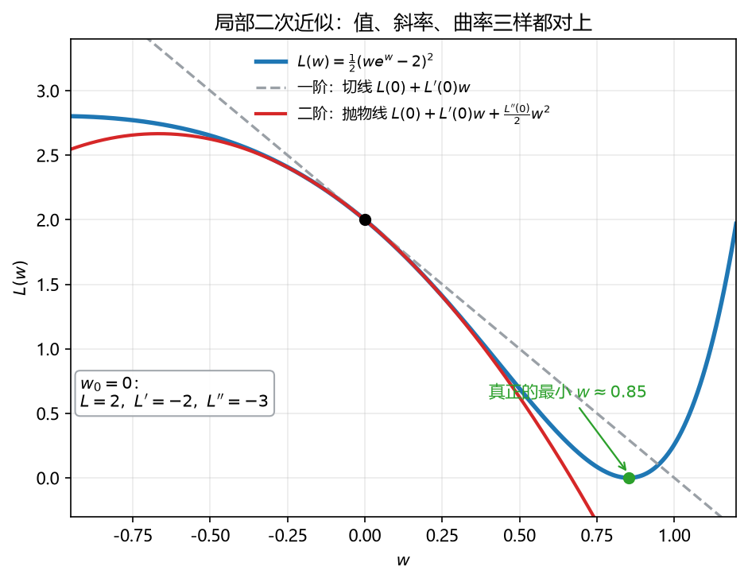

# 板书 · S005 · 第 08 课：乘积/链式法则与二阶 Taylor

- 会话ID：`S005`
- 日期：2026-10-27
- 对应：L08 / M2
- 修订记录：（初版）2026-10-27；v2 2026-10-28：按学生要求把 8.3–8.6 的例题补到逐步手算（一阶/二阶误差对照、多元二次型逐项展开、GD 通项与收敛条件表）

---

## 0. 生活化引入

拧音量旋钮，声音经过“功放”再经过“喇叭”，最后才到耳朵。
**旋钮转一点，中间每一层都放大一次**——这就是**链式法则**。
而“我只需在当前位置附近估个值”，用一条抛物线贴住曲线就够了——这就是**二阶 Taylor**。

---

## 1. 直觉

| 工具 | 一句话 | 什么时候用 |
|---|---|---|
| 乘积法则（product rule） | 两个因子都在变，**各管一半再相加** | $(we^w)'$、$\|\mathbf{X}\mathbf{w}-\mathbf{y}\|^2$ 展开时 |
| 链式法则（chain rule） | **外层导数 × 内层导数**，一层层剥 | $e^{2w}$、$(3w+1)^4$、$J(\mathbf{w})$ |
| 二阶 Taylor | 用**值 + 斜率 + 曲率**贴一条抛物线 | 估附近的值、判极值、看收敛 |

一句话：**乘积法则管“并列”，链式法则管“套娃”，Taylor 管“以点代面”。**

---

## 2. 几何

**看图**（$L(w)=\frac12(we^w-2)^2$，在 $w_0=0$ 处展开）：

- 蓝线是真函数；灰虚线是**一阶**近似（切线），只在 $w_0$ 附近贴合，走远就偏。
- 红线是**二阶**近似（抛物线），在 $w_0$ 附近**几乎与蓝线重合**——因为它的值、斜率、曲率三样都和真函数一样。
- 但注意：这条抛物线**开口向下**（$L''(0)=-3<0$），说明从 $0$ 往右走 $L$ 会**下降**——
  真正的最小点在 $w\approx0.85$，离展开点不算近，所以抛物线走远就失效（红线穿到 0 以下）。
- **教训**：Taylor 是“局部”的，只在展开点附近可信。

> 一句话：**一阶近似给方向，二阶近似给弯曲；越远越不准。**

---

## 3. 计算（公式卡片）

### 8.1 乘积法则（product rule）

$$
\big(u(w)v(w)\big)'=u'(w)v(w)+u(w)v'(w)
$$

- **符号**：$u,v$ 都是 $w$ 的函数；“$u'v$”= 只有 $u$ 变，“$uv'$”= 只有 $v$ 变，两部分相加。
- **例**：$\big(we^w\big)'=1\cdot e^w+w\cdot e^w=e^w(1+w)$。

### 8.2 链式法则·一元（chain rule）

$$
\big(f(g(w))\big)'=f'(g(w))\cdot g'(w)
$$

- **符号**：$g$ 是内层（先算），$f$ 是外层（后算）；**别忘了乘 $g'(w)$**。
- **例**：$\big(e^{2w}\big)'=e^{2w}\cdot2=2e^{2w}$；$\big((3w+1)^4\big)'=4(3w+1)^3\cdot3=12(3w+1)^3$。

**常用导数小表**

| $f(w)$ | $f'(w)$ |
|---|---|
| $w^n$ | $nw^{n-1}$ |
| $e^{w}$ | $e^{w}$ |
| $\ln w$ | $1/w$ |
| $\sigma(w)=\dfrac{1}{1+e^{-w}}$ | $\sigma(w)\big(1-\sigma(w)\big)$ |

### 8.3 一阶 Taylor（linear approximation）

$$
f(w)\approx f(w_0)+f'(w_0)(w-w_0)
$$

- **符号**：$w_0$ 是展开点（必须靠近你要估的点）；$(w-w_0)$ 是**位移**，不是 $w$。右边 = "起点高度 $f(w_0)$" + "用起点斜率外推的增量 $f'(w_0)(w-w_0)$"。
- **几何**：右边就是过点 $\big(w_0,f(w_0)\big)$、斜率为 $f'(w_0)$ 的**切线**。拿直线代替曲线，所以只在 $w_0$ 附近贴合。

**例 1（手算全流程）**：$f(w)=e^w$，在 $w_0=0$ 处估 $e^{0.1}$。

| 步 | 做什么 | 结果 |
|---|---|---|
| 1 | 算函数值 | $f(0)=e^0=1$ |
| 2 | 求导 | $f'(w)=e^w$ ⇒ $f'(0)=1$ |
| 3 | 代公式 | $e^w\approx f(0)+f'(0)(w-0)=1+w$ |
| 4 | 代 $w=0.1$ | $e^{0.1}\approx1+0.1=1.1$ |

- **对真值**：$e^{0.1}=1.105170$，误差 $0.005170$，相对误差 $0.47\%$。
- **误差为什么这么小**：一阶 Taylor 的余项约为 $\dfrac{f''(0)}{2}(w-w_0)^2=\dfrac12\times0.01=0.005$，和实测 $0.00517$ 对得上——位移是**平方**进入误差的。

**例 2（位移变大，误差加速变大）**：同一个展开式估 $e^{0.5}$。

$$
e^{0.5}\approx1+0.5=1.5,\qquad\text{真值 }e^{0.5}=1.648721
$$

绝对误差 $0.1487$，相对误差 $9.0\%$。位移从 $0.1$ 到 $0.5$（×5），绝对误差从 $0.00517$ 到 $0.1487$（约 ×29，量级正是 $5^2=25$）。**误差随位移平方（再加高阶）增长，所以"越远越不准"是加速变坏的。**

**例 3（$w_0$ 要靠近目标点）**：估 $e^1$。

- 在 $w_0=0$ 展开：$e^1\approx1+1=2$，真值 $2.718282$，误差 $26.4\%$。
- 在 $w_0=1$ 展开：$f(1)=e$、$f'(1)=e$ ⇒ $e^w\approx e+e(w-1)=e\,w$；代 $w=1$ 得 $e\cdot1=e$，**误差 0**。

位移 $w-w_0=0$ 时公式退化成 $f(w_0)$，所以展开点本身永远精确——这就是"必须先看估的点离 $w_0$ 多远"的原因。

### 8.4 二阶 Taylor·一元（quadratic approximation）

$$
f(w)\approx f(w_0)+f'(w_0)(w-w_0)+\frac{f''(w_0)}{2}(w-w_0)^2
$$

- **符号**：三项各管一样东西——**值**（起点高度）、**斜率**（往哪走）、**曲率**（弯多少）。第三项的 $\dfrac12$ 不能丢。
- **符号判形**：$f''(w_0)>0$ 开口向上（谷），$f''(w_0)<0$ 开口向下（峰）。
- **几何**：同时匹配"同一点、同一斜率、同一弯曲程度"的抛物线只有一条，所以它比切线贴得久。

**例（完整手算，并与一阶对照）**：$f(w)=\ln(1+w)$，在 $w_0=0$ 处估 $\ln1.1$。

**Step 1 备料**（三个数）：

$$
f(0)=\ln1=0,\qquad
f'(w)=\frac{1}{1+w}\Rightarrow f'(0)=1,\qquad
f''(w)=-\frac{1}{(1+w)^2}\Rightarrow f''(0)=-1
$$

**Step 2 套公式**：

$$
\ln(1+w)\approx0+1\cdot w+\frac{-1}{2}w^2=w-\frac{w^2}{2}
$$

**Step 3 代 $w=0.1$**：

$$
\ln1.1\approx0.1-\frac{0.01}{2}=0.1-0.005=0.095
$$

**Step 4 对真值**：$\ln1.1=0.0953102$，误差 $0.000310$，相对误差 $0.33\%$。

**Step 5 和一阶比**（同一点、同一真值）：

| 近似 | 取值 | 绝对误差 | 相对误差 |
|---|---|---|---|
| 一阶 $w$ | $0.1$ | $0.00310$ | $3.3\%$ |
| 二阶 $w-\frac{w^2}{2}$ | $0.095$ | $0.000310$ | $0.33\%$ |

误差缩小约 $10$ 倍 $=\dfrac{1}{w}$。主导余项是三阶项 $\dfrac{w^3}{3}\approx0.000333$，再扣掉四阶项约 $0.000025$，正好落到 $0.000310$ ✓。**经验：多保留一阶，通常多一位有效数字。**

**Step 6 用符号解释为什么偏小**：$f''(0)=-1<0$ ⇒ 抛物线开口向下 ⇒ 近似值应**小于**真值：$0.095<0.09531$ ✓。（$\ln(1+w)$ 是凹函数：切线在上方，抛物线在切线下方但更贴近曲线。）

**Step 7 走远会怎样**：$w=0.5$。

| 近似 | 取值 | 真值 $\ln1.5=0.405465$ | 误差 |
|---|---|---|---|
| 一阶 | $0.5$ | $0.405465$ | $0.0945$ |
| 二阶 | $0.5-0.125=0.375$ | $0.405465$ | $0.0305$ |

二阶仍然更好，但两者都开始偏——位移 $0.5$ 已经不算"附近"。

### 8.5 二阶 Taylor·多元（向量形式）

$$
f(\mathbf{x}_0+\mathbf{d})\approx f(\mathbf{x}_0)+\nabla f(\mathbf{x}_0)^\top\mathbf{d}
+\frac12\,\mathbf{d}^\top\mathbf{H}(\mathbf{x}_0)\,\mathbf{d}
$$

- **符号**：$\mathbf{d}=\mathbf{x}-\mathbf{x}_0\in\mathbb{R}^{n\times1}$ 是位移；$\nabla f(\mathbf{x}_0)\in\mathbb{R}^{n\times1}$ 是梯度（列向量）；$\mathbf{H}(\mathbf{x}_0)\in\mathbb{R}^{n\times n}$ 是海森矩阵（对称）。三项**都是标量**：第一项是数，第二项 $(\nabla f)^\top\mathbf{d}$ 是数，第三项是二次型（也是数）。
- **形状检查**：$(1\times n)(n\times1)$、$(1\times n)(n\times n)(n\times1)$，都收成 $1\times1$——写错转置会当场对不上。

**例 1（二次函数：Taylor 精确）**：$f(x,y)=x^2+2xy+3y^2$，在 $\mathbf{x}_0=(0,0)$ 展开，位移 $\mathbf{d}=(d_1,d_2)$。

**Step 1 值**：$f(0,0)=0$。

**Step 2 梯度**：

$$
\frac{\partial f}{\partial x}=2x+2y,\qquad
\frac{\partial f}{\partial y}=2x+6y
\quad\Longrightarrow\quad
\nabla f(0,0)=\begin{bmatrix}0\\0\end{bmatrix}
$$

一阶项 $=\nabla f(\mathbf{0})^\top\mathbf{d}=0$（原点已是驻点，没有"往哪走"的信息）。

**Step 3 海森矩阵**：

$$
\frac{\partial^2f}{\partial x^2}=2,\qquad
\frac{\partial^2f}{\partial x\partial y}=2,\qquad
\frac{\partial^2f}{\partial y^2}=6
\quad\Longrightarrow\quad
\mathbf{H}=\begin{bmatrix}2&2\\2&6\end{bmatrix}
$$

**Step 4 二次型逐项展开**（别跳）：

$$
\mathbf{d}^\top\mathbf{H}\mathbf{d}
=\begin{bmatrix}d_1&d_2\end{bmatrix}
\begin{bmatrix}2&2\\2&6\end{bmatrix}
\begin{bmatrix}d_1\\d_2\end{bmatrix}
=2d_1^2+2d_1d_2+2d_2d_1+6d_2^2
=2d_1^2+4d_1d_2+6d_2^2
$$

交叉项出现**两次**（$2d_1d_2$ 与 $2d_2d_1$），合并成 $4d_1d_2$；这是最容易漏的一步。

**Step 5 代公式**：

$$
f\approx0+0+\frac12\big(2d_1^2+4d_1d_2+6d_2^2\big)=d_1^2+2d_1d_2+3d_2^2
$$

**Step 6 为什么"精确"**：$f$ 本身就是二次的，把 $(x,y)$ 换成 $(d_1,d_2)$ 就回到原式——二阶 Taylor 对二次函数**没有余项**，走多远都对。

**Step 7 数值验**：$\mathbf{d}=(0.1,0.2)$：

$$
d_1^2+2d_1d_2+3d_2^2=0.01+0.04+0.12=0.17
$$

真值 $f(0.1,0.2)=0.01+0.04+0.12=0.17$ ✓。

**Step 8 从 $\mathbf{H}$ 读形状**：$\det\mathbf{H}=2\times6-2\times2=8>0$、$\operatorname{tr}\mathbf{H}=2+6=8>0$ ⇒ $\mathbf{H}\succ\mathbf{0}$ ⇒ 原点严格极小，碗口朝上。

**例 2（非二次：看余项）**：$f(x,y)=e^{x+2y}$，在 $(0,0)$ 展开，$\mathbf{d}=(0.1,0.1)$。

| 步 | 算什么 | 结果 |
|---|---|---|
| 1 | 函数值 | $f(0,0)=1$ |
| 2 | 梯度 | $\nabla f=e^{x+2y}\begin{bmatrix}1\\2\end{bmatrix}\Rightarrow\begin{bmatrix}1\\2\end{bmatrix}$ |
| 3 | 一阶项 | $1\times0.1+2\times0.1=0.3$ |
| 4 | 海森 | $\mathbf{H}=e^{x+2y}\begin{bmatrix}1&2\\2&4\end{bmatrix}\Rightarrow\begin{bmatrix}1&2\\2&4\end{bmatrix}$ |
| 5 | 二次型 | $d_1^2+4d_1d_2+4d_2^2=0.01+0.04+0.04=0.09$，乘 $\frac12$ 得 $0.045$ |
| 6 | 二阶近似 | $1+0.3+0.045=1.345$ |

真值 $e^{0.3}=1.349859$，误差 $0.00486$（$0.36\%$）。这次**不精确**：差的部分就是被丢掉的三阶项，位移越小余项越小。

### 8.6 梯度下降一步（gradient-descent update）

$$
\mathbf{w}_{k+1}=\mathbf{w}_k-\eta\,\nabla f(\mathbf{w}_k)
$$

- **符号**：$\eta>0$ 是步长（learning rate）；**减号**因为要往下降方向走；$\nabla f$ 与 $\mathbf{w}$ 同形（同为 $n\times1$）。

**为什么减号对（直接用 8.3 的一阶 Taylor 推）**：取 $w_{k+1}=w_k-\eta f'(w_k)$，

$$
f(w_{k+1})\approx f(w_k)+f'(w_k)\big(-\eta f'(w_k)\big)=f(w_k)-\eta\big[f'(w_k)\big]^2\le f(w_k)
$$

只要 $\eta$ 足够小、高阶项可忽略，函数值必下降；$\eta$ 太大时高阶项翻盘，这个近似失效（见 Step 8）。

**例（逐步手算，顺便看出收敛速度）**：$f(w)=w^2$，$w_0=1$，$\eta=0.1$。

**Step 1 求导**：$f'(w)=2w$。

**Step 2 第 1 步**：$f'(1)=2$ ⇒

$$
w_1=1-0.1\times2=0.8,\qquad f(w_1)=0.64<f(w_0)=1\ \checkmark
$$

**Step 3 第 2 步**：$f'(0.8)=1.6$ ⇒ $w_2=0.8-0.1\times1.6=0.64$，$f(w_2)=0.4096$。

**Step 4 第 3 步**：$f'(0.64)=1.28$ ⇒ $w_3=0.64-0.128=0.512$。

**Step 5 找通项**：

$$
w_{k+1}=w_k-0.1\times2w_k=0.8\,w_k
\quad\Longrightarrow\quad
w_k=0.8^k
$$

（对 $f=w^2$，梯度下降就是每步乘 $(1-2\eta)$。）

**Step 6 列表看趋势**：

| $k$ | $w_k$ | $f'(w_k)$ | $f(w_k)$ |
|---|---|---|---|
| 0 | 1.0000 | 2.0000 | 1.0000 |
| 1 | 0.8000 | 1.6000 | 0.6400 |
| 2 | 0.6400 | 1.2800 | 0.4096 |
| 3 | 0.5120 | 1.0240 | 0.2621 |
| 4 | 0.4096 | 0.8192 | 0.1678 |
| 5 | 0.3277 | 0.6554 | 0.1074 |

**Step 7 读表**：$w_k$ 每步乘 $0.8$（等比收敛），$f(w_k)$ 每步乘 $0.64$。想让 $|w_k|<10^{-3}$，需 $0.8^k<10^{-3}$，即 $k>\dfrac{\ln10^{-3}}{\ln0.8}\approx31$ 步。

**Step 8 换 $\eta$ 会怎样**（收敛条件）：通项是 $w_k=(1-2\eta)^k$，所以

| $\eta$ | $1-2\eta$ | 行为 |
|---|---|---|
| $0.1$ | $0.8$ | 单调下降，收敛 |
| $0.6$ | $-0.2$ | 左右横跳，但收敛 |
| $1.0$ | $-1$ | 在 $1$ 与 $-1$ 之间振荡，永不收敛 |
| $1.5$ | $-2$ | 越跳越远，发散 |

收敛的充要条件是 $|1-2\eta|<1$，即 $0<\eta<1$。

**反例（符号写反就上坡）**：若写成 $w_1=w_0+\eta f'(w_0)=1+0.2=1.2$，则 $f(1.2)=1.44>f(1)=1$——这就是第 6 节易错点 4。

---

## 4. 完整手算

**Example.** $L(w)=\frac12(we^w-2)^2$。求 $L'(0)$、$L''(0)$、$w_0=0$ 处的二阶 Taylor，并从 $w_0=0$ 走一步 GD（$\eta=0.1$）。

1. 拆层：令 $u=we^w-2$，则 $L=\frac12u^2$。

2. 内层用乘积法则：

$$
u'=1\cdot e^w+w\cdot e^w=e^w(1+w)
$$

3. 外层用链式：

$$
L'(w)=u\cdot u'=(we^w-2)\,e^w(1+w)
$$

4. 代 $w=0$：$u(0)=0-2=-2$，$u'(0)=1$ ⇒

$$
L'(0)=(-2)\cdot1=-2
$$

5. 再求一次导，用乘积法则 $(u u')'=(u')^2+u\,u''$：

$$
u''=\big(e^w(1+w)\big)'=e^w(1+w)+e^w=e^w(2+w)
$$

$$
L''(w)=(u')^2+u\,u''
$$

6. 代 $w=0$：$u'(0)=1$、$u(0)=-2$、$u''(0)=2$ ⇒

$$
L''(0)=1^2+(-2)\cdot2=1-4=-3
$$

7. 二阶 Taylor：

$$
L(w)\approx L(0)+L'(0)w+\frac{L''(0)}{2}w^2
=2-2w-\frac32w^2
$$

8. 验算 $w=0.2$：Taylor 给 $2-0.4-0.06=1.54$；
   真值 $L(0.2)=\frac12(0.2e^{0.2}-2)^2$，$e^{0.2}\approx1.2214$ ⇒ $0.2\cdot1.2214=0.2443$，
   $(-1.7557)^2=3.0825$，$L\approx1.5413$。**误差 $0.0013$** ✓

9. 走一步 GD：$w_1=w_0-\eta L'(0)=0-0.1\cdot(-2)=0.2$。

10. 读结论：$L''(0)=-3<0$ ⇒ 抛物线开口向下 ⇒ $0$ 处**不是**最小，往右走 $L$ 下降，与图里真正最小 $w\approx0.85$ 一致。

> 中文：这题就是 HW1 Q3(b)：先“拆层”再“乘积/链式”，二阶导再用一次乘积法则；Taylor 只代三个数。

---

## 5. 独立复现（先自己写，答案见第 9 节）

**Exercise.** $f(w)=w^2e^w$。求 $f'(w)$、$f''(w)$，写出 $w_0=1$ 处的二阶 Taylor，并给出一步 GD（$\eta=0.05$）。

---

## 6. 易错点

1. **乘积法则写成 $u'v'$**。必须 $u'v+uv'$，两项都不能少。
2. **链式法则忘乘内层导数**：$(e^{2w})'=2e^{2w}$，不是 $e^{2w}$；$(3w+1)^4$ 的导数是 $12(3w+1)^3$。
3. **Taylor 丢 $\frac12$**：二阶项是 $\frac{f''(w_0)}{2}(w-w_0)^2$；多元版是 $\frac12\mathbf{d}^\top\mathbf{H}\mathbf{d}$。
4. **GD 符号写反**：是 $-\eta\nabla f$；写成 $+$ 就是**上坡**，$L$ 会越来越大。
5. **GD 卡在驻点**：$\nabla f=\mathbf{0}$ 时无论 $\eta$ 多大都动不了——它只保证收敛到**驻点**，不保证是最小。

---

## 7. 与已学关系

L06 的 $\nabla f$ 是 Taylor 的第二项，L07 的 $\mathbf{H}$ 是第三项；L05 的“正定”现在有了几何含义：
$\mathbf{H}\succ\mathbf{0}$ ⇒ 抛物线开口向上 ⇒ 极小。L28 的误差面、L30 的收敛速度都从这条抛物线出发。

---

## 8. 作业

**Q1 (concept).** True or false? One line why.

(a) $(uv)'=u'v'$.
(b) $\dfrac{d}{dw}e^{2w}=2e^{2w}$.
(c) The second-order Taylor expansion matches $f$, $f'$, and $f''$ at the expansion point.
(d) If $f'(x_0)=0$ and $f''(x_0)>0$, then $x_0$ is a local minimum.
(e) The update $w_{k+1}=w_k+\eta f'(w_k)$ makes $f$ decrease for small $\eta>0$.

**Q2 (compute).** Find $f'$ (and $f''$ where asked).

(a) $f(w)=w^2e^w$ — find $f'$ and $f''$.
(b) $f(w)=(3w+1)^4$ — find $f'$.
(c) $f(w)=\ln(1+e^w)$ — find $f'$, and show it equals the sigmoid $\sigma(w)$.
(d) $J(\mathbf{w})=\frac12\|\mathbf{X}\mathbf{w}-\mathbf{y}\|^2+\frac{\lambda}{2}\|\mathbf{w}\|^2$ — find $\nabla J$.

**Q3 (Taylor).** Expand $f(w)=\ln(1+w)$ at $w_0=0$ up to second order, and estimate $\ln(1.1)$.

**Q4 (ML).** $f(w)=(w^2-1)^2$.

(a) Find $f'(w)$ and $f''(w)$.
(b) Write the second-order Taylor expansion at $w_0=0$.
(c) Starting at $w_0=0$ with $\eta=0.1$, compute $w_1$. What happens, and what does it teach about gradient descent?

---

## 9. 作业答案（先做完再看）

**A1.**

(a) False. It is $u'v+uv'$; the product rule has two terms.
(b) True. Chain rule with inner $2w$.
(c) True. By construction the first three terms are chosen to match those three quantities.
(d) True. Zero slope + positive curvature ⇒ bowl ⇒ local min.
(e) False. The minus sign is essential; with $+$ you move uphill.

**A2.**

(a) $f'=2we^w+w^2e^w=e^w(w^2+2w)$；

$$
f''=e^w(w^2+2w)+e^w(2w+2)=e^w(w^2+4w+2)
$$

(b) $f'=4(3w+1)^3\cdot3=12(3w+1)^3$.
(c) $f'=\dfrac{e^w}{1+e^w}=\dfrac{1}{1+e^{-w}}=\sigma(w)$（分子分母同除 $e^w$）。
(d) $\nabla J=\mathbf{X}^\top(\mathbf{X}\mathbf{w}-\mathbf{y})+\lambda\mathbf{w}$，形状 $n\times1$。

**A3.** $f(0)=0$，$f'(w)=\frac{1}{1+w}\Rightarrow f'(0)=1$，$f''(w)=-\frac{1}{(1+w)^2}\Rightarrow f''(0)=-1$。

$$
\ln(1+w)\approx w-\frac{w^2}{2}
\quad\Longrightarrow\quad
\ln(1.1)\approx0.1-0.005=0.095
$$

（真值 $0.09531$，误差约 $3\times10^{-4}$。）

**A4.**

(a) $f'=2(w^2-1)\cdot2w=4w^3-4w$；$f''=12w^2-4$。
(b) $f(0)=1$、$f'(0)=0$、$f''(0)=-4$ ⇒

$$
f(w)\approx1-2w^2
$$

(c) $w_1=w_0-\eta f'(0)=0-0.1\cdot0=0$。**卡住不动**。
因为 $w=0$ 是驻点（其实是**局部最大**：$f(0)=1$，两侧都下降到 $0$）。
教训：**梯度下降只保证到驻点，不保证到最小**；遇到鞍点/极大也会停。

**A5（第 5 节独立复现）.**

$f=w^2e^w$：$f'=e^w(w^2+2w)$，$f''=e^w(w^2+4w+2)$。

在 $w_0=1$：$f(1)=e$，$f'(1)=3e$，$f''(1)=7e$，

$$
f(w)\approx e+3e\,(w-1)+\frac{7e}{2}(w-1)^2
$$

一步 GD（$\eta=0.05$）：

$$
w_1=1-0.05\cdot3e=1-0.15e\approx1-0.4077=0.5923
$$
