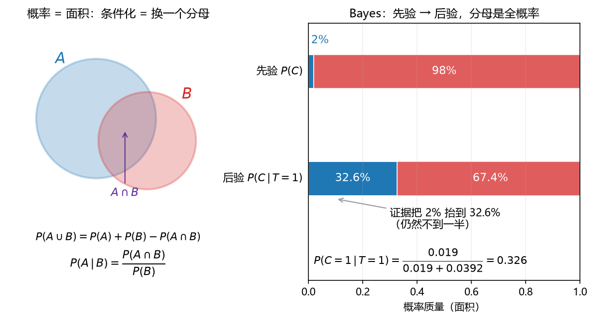

# 板书 · S006 · 第 09 课：概率规则与 Bayes（sum / product / independence）

- 会话ID：`S006`
- 日期：2026-10-28
- 对应：L09 / M3
- 修订记录：（初版）2026-10-28；v2 2026-10-28：9.3「符号」勘误——原句把划分说成「$\{A=a\}$ 是一组情况」，与第一式按 $b$ 求和不符；改为「$\{B=b\}$ / $\{A=a\}$ 对求和变量构成划分」，并统一中文引号；v3 2026-10-28：9.3 全概率例题扩写为 8 步（定义事件→验划分→先验→似然→概率树→求和→自检→Bayes 预热）+ 三产线变式；v4 2026-10-28：按学生反馈「不要那么复杂，讲清一件事即可」把 9.3 例题收回为「一个式子 + 两句为什么 + 一个前提」；v5 2026-10-28：9.4 例题改为生活版「体检阳性」，逐个点明先验/似然/分母/后验，并解释「为什么不是 95%」

---

## 0. 生活化引入

体检报告上出现"阳性"两个字，很多人当场就慌了。
但如果这个病在人群里只占 **2%**，而检测有 **4%** 的假阳性——**阳性之后真正患病的概率可能只有 33%**。
这一课就是把这句话算出来。

---

## 1. 直觉

| 工具 | 一句话 | 什么时候用 |
|---|---|---|
| 条件概率（conditional probability） | **已知 $B$ 发生**，世界就缩小成 $B$，重新量比例 | 题目出现"已知…"、"在…条件下" |
| 乘积法则（product rule） | 两件事同时发生 = 先发生一件，再在它里面发生另一件 | 算 $P(A\cap B)$ |
| 和法则（sum rule） | 把不需要的变量"加掉"，得到边缘概率 | 算 $P(T=1)$ 这种"总概率" |
| Bayes 定理 | 把 $P(T\mid C)$ 翻成 $P(C\mid T)$ | 由"检测表现"反推"到底有没有病" |
| 独立（independence） | 知道一个，对另一个**毫无信息** | 判断能不能直接相乘 |

一句话：**条件概率是"换分母"，Bayes 是"把分子分母调个头"，独立是"调头也不变"。**

---

## 2. 几何

**看图**：

- **左图**：概率就是面积。$A\cup B$ 的面积 = $A$ + $B$ 再减掉被数了两次的 $A\cap B$——这就是和法则。
- **左图下方**：$P(A\mid B)=\dfrac{P(A\cap B)}{P(B)}$ 的意思是"**只看 $B$ 这块面积，再按 $B$ 的总面积重新归一化**"。
- **右图**：先验 2% 是那条细蓝条；做一次检测（看到 $T=1$）后，蓝条被"重新分配"成 32.6%。**分母从 1 换成了 $P(T=1)=0.0582$**。
- 关键：后验 32.6% 仍然不到一半——因为先验太小，一次证据拉不动。

> 一句话：**条件化 = 换一个分母；Bayes = 分子用似然、分母用全概率。**

---

## 3. 计算（公式卡片）

### 9.1 条件概率（conditional probability）

$$
P(A\mid B)=\frac{P(A\cap B)}{P(B)},\qquad P(B)>0
$$

- **符号**：$A$ 是"关心的事件"，$B$ 是"已知发生的条件"（写在竖线右边）。分母是 $P(B)$——**新的总面积**；结果仍是 $[0,1]$ 里的数。
- **例**：掷一枚骰子，$A=\{1,2\}$、$B=\{2,4,6\}$。$P(A\mid B)=\dfrac{P(\{2\})}{P(\{2,4,6\})}=\dfrac{1/6}{3/6}=\dfrac13$。

### 9.2 乘积法则（product rule）

$$
P(A\cap B)=P(A\mid B)\,P(B)=P(B\mid A)\,P(A)
$$

- **符号**：两个写法都行，看哪个条件概率已知；**顺序不能反着乘**（$P(A\mid B)$ 配 $P(B)$，不是配 $P(A)$）。
- **例**：袋里 3 红 2 蓝，不放回抽两次。$P(\text{两次都红})=\dfrac35\times\dfrac24=\dfrac{3}{10}$（第二次的 $\frac24$ 已经在"第一次红"的世界里）。

### 9.3 和法则与全概率（sum rule / total probability）

$$
P(A)=\sum_{b}P(A\cap B=b),
\qquad
P(B)=\sum_{a}P(B\mid A=a)\,P(A=a)
$$

- **符号**：求和变量要取遍**全部可能取值**；对应的事件族 $\{B=b\}$（第一式）或 $\{A=a\}$（第二式）必须构成一个**划分**（partition）——两两互斥、合起来穷尽整个样本空间；漏一项就错。第一式把联合概率沿行/列相加、加掉一个变量（边缘化），第二式“先验 × 似然，再相加”（全概率）。
**例**：产线 1 占 $60\%$、次品率 $2\%$；产线 2 占 $40\%$、次品率 $5\%$。求次品率。

$$
P(D)=\underbrace{0.6\times0.02}_{\text{产线 1}}+\underbrace{0.4\times0.05}_{\text{产线 2}}
=0.012+0.020=0.032
$$

- **为什么乘**：走这条路要连过两关——先到这条产线，再在里面出次品。
- **为什么加**：两条路互不重叠，合起来就是全部次品。
- **前提**：分支必须**不重叠 + 全覆盖**（这两条产线不能缺、不能重）。

### 9.4 Bayes 定理（Bayes' theorem）

$$
P(A\mid B)=\frac{P(B\mid A)\,P(A)}{P(B)}
=\frac{P(B\mid A)\,P(A)}{\sum_{a}P(B\mid A=a)P(A=a)}
$$

- **符号**（四个名字必须会叫）：
  - $P(A)$：**先验**（prior）——看到证据前你认为的概率；
  - $P(B\mid A)$：**似然**（likelihood）——假如 $A$ 成立，证据出现的可能性；
  - $P(B)$：**证据**（evidence / marginal）——证据本身的总概率，由全概率算出；
  - $P(A\mid B)$：**后验**（posterior）——看到证据后更新过的概率。
**例（生活版：体检阳性）**：这个病在人群里占 $2\%$；检测对病人有 $95\%$ 能查出来，对健康人有 $4\%$ 会误报。现在某人报告阳性——他真患病的概率是多少？

$$
P(C=1\mid T=1)=\frac{P(T=1\mid C=1)\,P(C=1)}{P(T=1)}
=\frac{0.95\times0.02}{0.0582}\approx32.6\%
$$

- **先验 $2\%$**：还没检测时，随便抓一个人，患病率就是 $2\%$。
- **似然 $95\%$**：**假如他真病了**，报告呈阳性的可能性是 $95\%$。
- **分母 $0.0582$**：所有人里报告阳性的比例 = 真病人 $0.019$ + 健康人误报 $0.0392$。
- **后验 $32.6\%$**：在“报告阳性”这群人里，真病人只占约三分之一。

**为什么不是 $95\%$？** 因为健康人太多（$98\%$）：$4\%$ 的误报乘上 $98\%$，凑出 $0.0392$，比真病人的 $0.019$ 还多。检测说的是“**病人里 $95\%$ 会阳性**”，不是“**阳性里 $95\%$ 是病人**”——Bayes 就是把这两个方向翻过来。（完整手算见第 4 节。）

### 9.5 独立（independence）

$$
A\perp B
\iff P(A\cap B)=P(A)P(B)
\iff P(A\mid B)=P(A)\quad(P(B)>0)
$$

- **符号**：$\perp$ 表示独立；三个条件等价。直观：知道 $B$ 之后 $A$ 的概率**一点没变**。
- **例**：两次独立抛硬币，$P(\text{正,正})=\frac12\cdot\frac12=\frac14$。
- **反例（互斥不是独立）**：$A$ 与 $B$ 互斥时 $P(A\cap B)=0$，而独立要求 $P(A)P(B)>0$。**知道 $A$ 发生就否定了 $B$，这是最强的信息，恰恰最不独立。**

### 9.6 条件独立（conditional independence，了解）

$$
P(A\cap B\mid C)=P(A\mid C)\,P(B\mid C)
$$

- **符号**：在给定 $C$ 的**每一层里**独立；整体不一定独立。朴素 Bayes 分类器就是假设"给定类别后，各特征条件独立"。
- **例**：给定"下雨"，"带伞"和"穿雨衣"可以近似条件独立，但不带伞和穿雨衣整体上明显相关。

---

## 4. 完整手算（HW2 Q1 同型）

**题目**：某病在人群中占 $2\%$。检测满足
$P(T=1\mid C=1)=0.95$、$P(T=1\mid C=0)=0.04$。
求 $P(T=1)$、$P(C=1\mid T=1)$、$P(C=1\mid T=0)$。

**Step 0 写清符号**：$C=1$ 患病、$C=0$ 健康；$T=1$ 阳性、$T=0$ 阴性。

**Step 1 先验**：

$$
P(C=1)=0.02,\qquad P(C=0)=0.98
$$

**Step 2 四个条件概率**（每行必须和为 1，这是自检点）：

$$
\begin{aligned}
P(T=1\mid C=1)&=0.95, & P(T=0\mid C=1)&=0.05\\
P(T=1\mid C=0)&=0.04, & P(T=0\mid C=0)&=0.96
\end{aligned}
$$

**Step 3 乘积法则 → 联合概率（2×2 表）**：

| | $T=1$ | $T=0$ | 合计 |
|---|---|---|---|
| $C=1$ | $0.02\times0.95=0.019$ | $0.02\times0.05=0.001$ | $0.02$ |
| $C=0$ | $0.98\times0.04=0.0392$ | $0.98\times0.96=0.9408$ | $0.98$ |
| 合计 | $0.0582$ | $0.9418$ | $1$ |

**Step 4 和法则 → 边缘概率**：沿列相加，

$$
P(T=1)=0.019+0.0392=0.0582,\qquad P(T=0)=0.001+0.9408=0.9418
$$

**Step 5 Bayes → 阳性后的后验**：

$$
P(C=1\mid T=1)=\frac{P(T=1\mid C=1)P(C=1)}{P(T=1)}
=\frac{0.019}{0.0582}=0.32646\approx32.6\%
$$

**Step 6 阴性后的后验**：

$$
P(C=1\mid T=0)=\frac{0.001}{0.9418}=0.001062\approx0.11\%
$$

**Step 7 验算（全概率还原先验）**：

$$
0.32646\times0.0582+0.001062\times0.9418=0.019+0.001=0.02=P(C=1)\ \checkmark
$$

**Step 8 读结论**：

- 灵敏度 $P(T=1\mid C=1)=95\%$，但阳性后真正患病只有 $32.6\%$——**$P(C\mid T)\ne P(T\mid C)$**，一个是后验、一个是似然。
- 原因：先验只有 $2\%$，健康人多（$98\%$），$4\%$ 的假阳性在健康人里凑出 $0.0392$，比真阳性的 $0.019$ 还大。
- 阴性几乎可以排除（$0.11\%$），所以这个检测**更适合当"排除工具"而不是"确诊工具"**。

---

## 5. 独立复现（先自己写，答案见第 9 节）

**Exercise.** 盒 1 有 3 红 2 蓝，盒 2 有 1 红 4 蓝。先以各 $1/2$ 的概率选一个盒，再从中随机抽一球。已知抽到红球，求它来自盒 1 的概率。

---

## 6. 易错点

1. **把 $P(C\mid T)$ 和 $P(T\mid C)$ 混为一谈**（base-rate fallacy）。$95\%$ 是似然，$32.6\%$ 才是后验；题目问"阳性后患病概率"要的是后者。
2. **全概率漏项或忘乘先验**。$P(T=1)\ne P(T=1\mid C=1)$；必须"**每个分支：先验 × 似然，再相加**"。
3. **独立当互斥**。互斥：$P(A\cap B)=0$；独立：$P(A\cap B)=P(A)P(B)$。两者只在某个概率为 $0$ 时才同时成立。
4. **条件概率分母写错**。分母是**条件** $P(B)$，不是 $1$、也不是 $P(A)$。

---

## 7. 与已学关系

- 条件化 = "把样本空间限制到 $B$，再按新尺度重新归一化（除以 $P(B)$）"——和 L02 投影"先限制到子空间、再按子空间尺度重新量"是同一个动作。
- 这张 $2\times2$ 表是"联合 / 边缘 / 条件"三件事的离散模板；L10 的密度、L12 的 likelihood/MLE、L20 的分类、L27 的损失（NLL）都建立在这四个名字上。

---

## 8. 作业

**Q1 (concept).** True or false? One line why.

(a) $P(A\mid B)+P(A\mid B^{c})=1$.
(b) If $A\perp B$ and $P(B)>0$, then $P(A\mid B)=P(A)$.
(c) Mutually exclusive events are independent.
(d) $P(A\cap B)\le P(A)$.
(e) In Bayes' theorem the denominator is $P(B)$, the total probability of the evidence.

**Q2 (compute).** 产线 1 占 60%、次品率 2%；产线 2 占 40%、次品率 5%。抽到一件次品，求它来自产线 1 的概率。

**Q3 (compute).** 掷两枚公平骰子。已知至少有一个 6，求两个都是 6 的概率。

**Q4 (ML).** 垃圾邮件先验 $P(S)=0.3$；词 "free" 出现率 $P(F\mid S)=0.8$、$P(F\mid H)=0.1$。求 $P(S\mid F)$。

**Q5 (independence).** 若检测结果 $T$ 与患病状态 $C$ 独立，证明 $P(C\mid T)=P(C)$，并解释这种检测为什么毫无价值。

---

## 9. 答案（先做完再看）

**A1.**

(a) False. 正确的是 $P(A\mid B)+P(A^{c}\mid B)=1$（同一个条件下互补）。反例：骰子 $A=\{1,2\}$、$B=\{1,2,3\}$，左边 $=\frac23+0=\frac23\ne1$。
(b) True. 这正是独立的等价定义。
(c) False. 互斥时 $P(A\cap B)=0$，独立要求 $P(A)P(B)>0$；知道一个发生就否定另一个，是最强相关。
(d) True. $A\cap B\subseteq A$，概率单调。
(e) True. 分母是证据的总概率，由全概率展开。

**A2.** 全概率 + Bayes：

$$
P(D)=0.6\times0.02+0.4\times0.05=0.012+0.02=0.032
$$

$$
P(M_1\mid D)=\frac{0.012}{0.032}=0.375
$$

**A3.** 设 $E=$ 至少一个 6，$F=$ 两个都是 6。$P(E)=\frac{11}{36}$、$P(F)=\frac{1}{36}$、$F\subseteq E$：

$$
P(F\mid E)=\frac{P(F\cap E)}{P(E)}=\frac{1/36}{11/36}=\frac{1}{11}\approx0.0909
$$

（不是 $\frac16$：分母被"至少一个 6"改写了。）

**A4.**

$$
P(F)=0.3\times0.8+0.7\times0.1=0.24+0.07=0.31,
\qquad
P(S\mid F)=\frac{0.24}{0.31}\approx0.774
$$

**A5.** 若 $T\perp C$，则 $P(T\mid C)=P(T)$。代入 Bayes：

$$
P(C\mid T)=\frac{P(T\mid C)P(C)}{P(T)}=\frac{P(T)P(C)}{P(T)}=P(C)
$$

后验等于先验 ⇒ 看到 $T$ 之后对 $C$ 的判断**一点没变** ⇒ 这个检测不携带任何关于患病状态的信息。

**A6（第 5 节独立复现）.**

$$
P(R)=\frac12\cdot\frac35+\frac12\cdot\frac15=0.3+0.1=0.4,
\qquad
P(\text{盒1}\mid R)=\frac{0.3}{0.4}=0.75
$$
