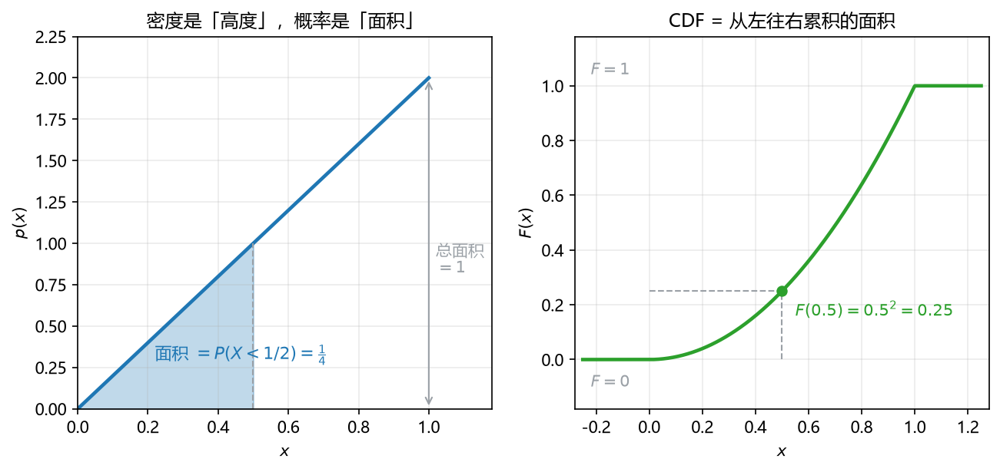

# 板书 · S006 · 第 10 课：密度、CDF、期望/方差/协方差

- 会话ID：`S006`
- 日期：2026-10-28
- 对应：L10 / M3
- 修订记录：（初版）2026-10-28；v2 2026-10-28：10.2 补生活版例子（考试成绩的累计比例，$F(90)-F(60)=0.70$），原曲线例子保留为对照；v3 2026-10-28：10.3–10.5 补生活版例子（平均分 / 两个班 / 成绩与学习时长），与 10.2 共用“全班成绩”场景；v4 2026-10-28：按「每个概念一个例题，生活背景 + 对应计算」把 10.3–10.5 改成三个带完整手算的生活例题（$E=82$；$\operatorname{Var}=196,\sigma=14$；$\operatorname{Cov}=10,\rho=0.8$），删去纯直觉版与抽象例；v5 2026-10-28：按学生反馈「不要假定人人 100 分」把期望/方差的例子换成「外卖配送时间」（$E=29$ 分钟、$\operatorname{Var}=49,\sigma=7$ 分钟）；v6 2026-10-28：10.5 补 $E[XY]$ 的计算式（离散求和 / 连续二重积分），并注明 $\ne E[X]E[Y]$；v7 2026-10-28：10.5 例子把 $E[XY]$ 写成显式加权（每项乘 $\frac14$），点明“等可能时权重各 $\frac14$，看起来像普通平均”

---

## 0. 生活化引入

"明天下雨概率 30%"和"明天降雨量 3 mm"不是一回事。
连续型随机变量**不能问"等于某个值的概率"**（那永远是 0），只能问"落在某个区间里的概率"——所以需要**密度**。
而"平均下多少""波动多大""两件事一起变吗"，分别就是**期望、方差、协方差**。

---

## 1. 直觉

| 工具 | 一句话 | 关键点 |
|---|---|---|
| 密度（density）$p(x)$ | **概率的密度**，不是概率本身；只有**积分**才是概率 | 可以大于 1 |
| 分布函数（CDF）$F(x)$ | 累积到 $x$ 为止的概率 | 单调不减，$F(-\infty)=0$，$F(+\infty)=1$ |
| 期望（expectation）$E[X]$ | 概率加权的"重心" | 位置 |
| 方差（variance）$\operatorname{Var}(X)$ | 偏离重心的平均平方距离 | 宽度 |
| 协方差（covariance）$\operatorname{Cov}(X,Y)$ | 两个变量"一起变大/一正一负"的程度 | 方向 |

一句话：**密度是高度，概率是面积，CDF 是累计面积，期望是重心，方差是宽度。**

---

## 2. 几何

**看图**（$p(x)=2x$，$0<x<1$）：

- 蓝线是**高度**；阴影面积才是**概率**：$P(X<1/2)=\frac14$。
- 整条曲线下的总面积必须 $=1$（归一化）。
- 右图 $F(x)=x^2$：**从左往右累积的面积**。所以 $F(0.5)=0.5^2=0.25$，正好是左图阴影面积。
- 密度**可以超过 1**：左图右端高度到 2，但面积仍然只有 1——所以看到 $p(x)>1$ 不要慌。

> 一句话：**密度管形状，面积管概率，CDF 管累积。**

---

## 3. 计算（公式卡片）

### 10.1 密度与区间概率（density）

$$
p(x)\ge0,\qquad \int_{-\infty}^{+\infty}p(x)\,dx=1,\qquad
P(a<X<b)=\int_{a}^{b}p(x)\,dx
$$

- **符号**：$p(x)$ 是**密度函数**（可 $>1$）；概率只能是**积分**（面积）；连续型 $P(X=a)=0$，所以 $<$ 与 $\le$ 结果相同。
- **例**：$p(x)=2x$（$0<x<1$）：$P(0.2<X<0.5)=\int_{0.2}^{0.5}2x\,dx=0.25-0.04=0.21$。

### 10.2 分布函数（CDF）

$$
F(x)=P(X\le x)=\int_{-\infty}^{x}p(t)\,dt,
\qquad
\frac{dF}{dx}=p(x)
$$

- **符号**：$F$ 是"累积"；在 $p$ 连续的点上 $F'=p$（微积分基本定理）。$F$ 单调不减、右连续、两端极限为 $0,1$。
**例（生活版：考试成绩）**：全班 100 人，$F(60)=0.15$ 意思是“60 分以下的人占 $15\%$”；$F(90)=0.85$ 意思是“90 分以下的占 $85\%$”。那么 60–90 分之间的人占

$$
F(90)-F(60)=0.85-0.15=0.70
$$

- $F$ 就是“从左往右累计的比例”：分数从低到高，人数一路往上加。
- 所以它**只能升不能降**，最后必然加到 $100\%$。
- 连续情形把“加人数”换成“加面积”：$F(x)=\int_{-\infty}^{x}p(t)\,dt$。

**例（对应 10.1 的曲线）**：$p(x)=2x$ ⇒ $F(x)=0\ (x<0)$；$F(x)=x^2\ (0\le x\le1)$；$F(x)=1\ (x>1)$。

### 10.3 期望（expectation）

$$
E[X]=\int_{-\infty}^{+\infty}x\,p(x)\,dx,
\qquad
E[g(X)]=\int_{-\infty}^{+\infty}g(x)\,p(x)\,dx
$$

- **符号**：$E[\cdot]$ 是线性算子（$E[aX+b]=aE[X]+b$）；**$E[g(X)]\ne g(E[X])$**（除非 $g$ 是线性的）。
**例（生活版：外卖要等多久）**：你常点的一家店，$30\%$ 的订单 20 分钟送到、$50\%$ 的 30 分钟、$20\%$ 的 40 分钟。长期看平均要等多久？

$$
E[X]=0.3\times20+0.5\times30+0.2\times40=6+15+8=29\ \text{分钟}
$$

- 不能算成 $\dfrac{20+30+40}{3}=30$——要按**出现比例**加权。
- 29 也不是“最可能的时间”（最可能是 30 分钟，占一半），而是**长期平均**。

### 10.4 方差（variance）

$$
\operatorname{Var}(X)=E\big[(X-E[X])^2\big]=E[X^2]-\big(E[X]\big)^2,
\qquad
\operatorname{Var}(aX+b)=a^2\operatorname{Var}(X)
$$

- **符号**：$\operatorname{Var}(X)\ge0$；**必减掉 $(E[X])^2$**；标准差 $\sigma=\sqrt{\operatorname{Var}(X)}$。平移不改方差，缩放按平方。
**例（生活版：等餐时间稳不稳）**：还是这家店（平均 29 分钟），先算二阶矩：

$$
E[X^2]=0.3\times20^2+0.5\times30^2+0.2\times40^2=120+450+320=890
$$

$$
\operatorname{Var}(X)=890-29^2=890-841=49,\qquad \sigma=\sqrt{49}=7\ \text{分钟}
$$

方差的单位是“分钟的平方”，开根号才回到分钟。所以对外说 **“平均等 29 分钟，上下大约 7 分钟”**，比报方差 49 更好懂。

### 10.5 协方差与相关系数（covariance / correlation）

$$
\operatorname{Cov}(X,Y)=E[XY]-E[X]E[Y],
\qquad
\rho=\frac{\operatorname{Cov}(X,Y)}{\sigma_X\sigma_Y}\in[-1,1]
$$

- **符号**：$\operatorname{Cov}>0$ 同向、$<0$ 反向、$=0$ 称不相关；$\rho$ 是去掉量纲的版本。**独立 $\Rightarrow$ $\operatorname{Cov}=0$，但反过来不成立**。
- **$E[XY]$ 怎么算**：先把 $x$ 和 $y$ **相乘**，再按概率加权——离散 $\sum_i\sum_j x_iy_j\,P(X=x_i,Y=y_j)$，连续 $\displaystyle\iint xy\,p(x,y)\,dx\,dy$。**不是** $E[X]E[Y]$（只有独立时才相等）。
**例（生活版：学习时长 vs 分数）**：4 个同学，学习时长 $x$（小时）与分数 $y$：

| 同学 | 1 | 2 | 3 | 4 |
|---|---|---|---|---|
| $x$ | 1 | 2 | 3 | 4 |
| $y$ | 60 | 80 | 70 | 90 |

先算三个平均值：

随机抽一个同学，4 人被抽到的概率都是 $\frac14$——**这个 $\frac14$ 就是权重**：

$$
E[XY]=\tfrac14(1\times60)+\tfrac14(2\times80)+\tfrac14(3\times70)+\tfrac14(4\times90)
=\frac{60+160+210+360}{4}=\frac{790}{4}=197.5
$$

$$
E[X]=2.5,\qquad E[Y]=75
$$

$$
\operatorname{Cov}(X,Y)=197.5-2.5\times75=197.5-187.5=10>0
$$

再除标准差：$\sigma_X=\sqrt{1.25}\approx1.118$、$\sigma_Y=\sqrt{125}\approx11.18$，

$$
\rho=\frac{10}{1.118\times11.18}=\frac{10}{12.5}=0.8
$$

学得越久分数越高（正相关），但没到“完全一条线”。

### 10.6 常用分布速查（了解）

| 分布 | $E[X]$ | $\operatorname{Var}(X)$ |
|---|---|---|
| Bernoulli$(p)$ | $p$ | $p(1-p)$ |
| Binomial$(n,p)$ | $np$ | $np(1-p)$ |
| Uniform$(a,b)$ | $\dfrac{a+b}{2}$ | $\dfrac{(b-a)^2}{12}$ |
| Gaussian$(\mu,\sigma^2)$ | $\mu$ | $\sigma^2$ |

---

## 4. 完整手算（HW2 Q2 Part I 同型）

**题目**：$p(x)=2x$（$0<x<1$），其余为 0。验证归一化，求 $F(x)$、$P(X<1/2)$、$E[X]$、$\operatorname{Var}(X)$。

**Step 1 归一化**：

$$
\int_{0}^{1}2x\,dx=\Big[x^2\Big]_0^1=1\ \checkmark
$$

（顺便：$p(x)\le2$，**大于 1 是合法的**，因为它是密度。）

**Step 2 写 CDF**：对 $x\in[0,1]$，

$$
F(x)=\int_0^x 2t\,dt=x^2
$$

所以

$$
F(x)=
\begin{cases}
0, & x<0\\
x^2, & 0\le x\le1\\
1, & x>1
\end{cases}
$$

**Step 3 区间概率**：

$$
P(X<1/2)=F(1/2)=\frac14=0.25
$$

**Step 4 期望**：

$$
E[X]=\int_0^1 x\cdot2x\,dx=\int_0^1 2x^2\,dx=\Big[\tfrac23x^3\Big]_0^1=\frac23
$$

**Step 5 二阶矩**：

$$
E[X^2]=\int_0^1 x^2\cdot2x\,dx=\int_0^1 2x^3\,dx=\Big[\tfrac12x^4\Big]_0^1=\frac12
$$

**Step 6 方差**：

$$
\operatorname{Var}(X)=E[X^2]-\big(E[X]\big)^2=\frac12-\frac49=\frac{9-8}{18}=\frac{1}{18}\approx0.0556
$$

**Step 7 读结论**：重心在 $0.667$（偏右，因为密度随 $x$ 增大）；标准差 $\sqrt{1/18}\approx0.236$，分布比 Uniform$(0,1)$（方差 $1/12\approx0.083$）更集中。

---

## 5. 独立复现（先自己写，答案见第 9 节）

**Exercise.** $p(x)=3x^2$（$0<x<1$）。验证归一化，求 $F(x)$、$P(X<1/2)$、$E[X]$、$\operatorname{Var}(X)$。

---

## 6. 易错点

1. **把 $p(x)$ 当概率**。$p(0.9)=1.8$ 不是"90% 的概率"；概率是它下面的面积。密度 $>1$ 完全正常。
2. **连续型算 $P(X=a)$**。答案恒为 $0$，题目只会问区间；所以 $P(X<a)=P(X\le a)=F(a)$。
3. **方差忘减 $(E[X])^2$**，或写成 $E[(X-E[X])^2]=E[X^2]-E[X]^2$ 时符号抄错。$\operatorname{Var}(X)\ge0$ 是自检。
4. **以为 $\operatorname{Cov}=0$ 就独立**。只有"独立 ⇒ 不相关"；反例：$X\sim$ 对称分布、$Y=X^2$，$\operatorname{Cov}=0$ 但强烈依赖。
5. **归一化不检查**。先算 $\int p=1$ 再做题，能立刻抓出抄错的系数。

---

## 7. 与已学关系

- L09 的和法则 $P(A)=\sum_b P(A,B=b)$，连续版就是"积分掉一个变量"：$p_X(x)=\int p(x,y)\,dy$。**边缘化 = 求和/积分**。
- L09 的独立 $P(A\cap B)=P(A)P(B)$，连续版是 $p(x,y)=p(x)p(y)$，它直接推出 $\operatorname{Cov}=0$。
- 这条链往后接：L11 Gaussian（写出 $\mu,\sigma^2$）→ L12 MLE（对 likelihood 求导）→ L17 Gaussian noise ⇒ SSE。**期望/方差是后面所有"损失"的语言。**

---

## 8. 作业

**Q1 (concept).** True or false? One line why.

(a) A density can exceed 1.
(b) For a continuous $X$, $P(X=a)=0$ for every $a$.
(c) $F'(x)=p(x)$ at every point where $p$ is continuous.
(d) $\operatorname{Var}(X)=E[X^2]-(E[X])^2$.
(e) $\operatorname{Cov}(X,Y)=0$ implies $X$ and $Y$ are independent.

**Q2 (compute).** $p(x)=cx$（$0<x<2$）。求 $c$、$P(X<1)$、$E[X]$、$\operatorname{Var}(X)$。

**Q3 (compute).** 已知 $E[X]=1$、$E[Y]=2$、$E[XY]=3$、$\operatorname{Var}(X)=4$、$\operatorname{Var}(Y)=9$。求 $\operatorname{Cov}(X,Y)$ 与 $\rho$。

**Q4 (ML).** 写出 Gaussian 密度 $p(x)=\dfrac{1}{\sqrt{2\pi}\sigma}\exp\!\left(-\dfrac{(x-\mu)^2}{2\sigma^2}\right)$，并指出 $\mu,\sigma^2$ 分别是什么、各控制曲线的什么。

**Q5 (independence).** 若 $X\perp Y$，证明 $\operatorname{Cov}(X,Y)=0$。

---

## 9. 答案（先做完再看）

**A1.**

(a) True. 密度是"单位长度的概率"，只需要非负且积分为 1。
(b) True. 单点没有长度，积分为 0。
(c) True. 微积分基本定理；在 $p$ 不连续处 $F$ 只是不可导。
(d) True. 展开 $(X-E[X])^2$ 再取期望即可。
(e) False. 只说明"不相关"；$Y=X^2$、$X$ 关于 0 对称时 $\operatorname{Cov}=0$ 但强烈依赖。

**A2.** 归一化：

$$
\int_0^2 cx\,dx=c\cdot\frac{4}{2}=2c=1\Rightarrow c=\frac12
$$

$$
P(X<1)=\int_0^1\frac{x}{2}\,dx=\frac14,\qquad
E[X]=\int_0^2\frac{x^2}{2}\,dx=\frac{4}{3}
$$

$$
E[X^2]=\int_0^2\frac{x^3}{2}\,dx=2,\qquad
\operatorname{Var}(X)=2-\frac{16}{9}=\frac{2}{9}
$$

**A3.**

$$
\operatorname{Cov}(X,Y)=3-1\cdot2=1,
\qquad
\rho=\frac{1}{\sqrt{4}\sqrt{9}}=\frac{1}{6}
$$

**A4.** $\mu=E[X]$ 是**位置**（曲线中心），$\sigma^2=\operatorname{Var}(X)$ 是**宽度**（越大越扁越宽）；$\sigma$ 是标准差，曲线在 $\mu\pm\sigma$ 处有拐点。

**A5.** 独立 ⇒ $E[XY]=E[X]E[Y]$，故

$$
\operatorname{Cov}(X,Y)=E[XY]-E[X]E[Y]=0
$$

（逆命题不成立。）

**A6（第 5 节独立复现）.**

$$
\int_0^1 3x^2\,dx=1,\qquad F(x)=x^3,\qquad P(X<1/2)=\frac18
$$

$$
E[X]=\int_0^1 3x^3\,dx=\frac34,\qquad
E[X^2]=\int_0^1 3x^4\,dx=\frac35
$$

$$
\operatorname{Var}(X)=\frac35-\frac{9}{16}=\frac{48-45}{80}=\frac{3}{80}=0.0375
$$
