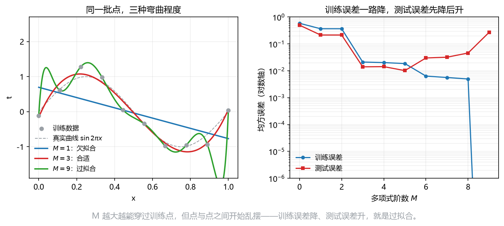

# 板书 · S006 · 第 15 课：曲线拟合、SSE/RMS 与过拟合（+ 正则/验证）

- 覆盖：原 L15+L16｜公告依据：L3 §1.2；"Questions will focus on conceptual understanding of the topics covered in these sections."
- 会话批次：批 A（第 14–18 课）｜日期：2026-10-28｜修订记录：（初版）2026-10-28；v2 2026-10-28：审核修正 + 公式卡例细化（三段式，数字与 §4/§5 去重）；v3 2026-10-28：补过拟合几何图 `fig_overfit_M.png` + 概念题模板；v4 2026-10-29：明确 SSE 与 half-SSE 的口径（$\text{SSE}=\sum r^2$、$E=\frac12\text{SSE}$），改 15.1 标题与例、15.2 符号、§4 步骤标注、§6 易错点 1 与考场第一步
- 主线：SSE 怎么算、为什么 $M$ 大反而测试差；次线（P1）：L2 正则与验证集。

## 0. 生活化引入
用 5 单外卖的"距离"估"送达时间"：画一条直线，还是画一条穿过每个点的弯线？
弯线能把 5 个点全对上，但下一单可能错得离谱。

## 1. 直觉
误差 = 每个点竖直方向差多少，平方后加起来（平方让正负不抵消、大错罚更重）。
$M$ 越大，模型越"软"，能把噪声也背下来——这就是过拟合。
**次线一句**：正则化就是给"系数太大"额外罚款，让弯线不敢乱摆。

## 2. 几何
散点图上，每个点往拟合线画一条**竖线**，竖线长度就是残差；SSE 是这些竖线平方的总长。
$M=1$ 是一条直线（欠拟合）；$M=3$ 顺着趋势；$M=9$ 在点之间疯狂摆动（过拟合）。
训练误差随 $M$ 一路降到 0，测试误差先降后升——两条线的分叉就是过拟合的画面。

**看图**：左图绿线（$M=9$）穿过了每个点，却在点与点之间上下乱摆；右图蓝线（训练误差）一路降到近 $0$，
红线（测试误差）在 $M\approx5$ 后回升——两条线分叉就是过拟合。

## 3. 计算（公式卡片）
### 15.1 平方和误差（SSE）与半平方和（half-SSE）
$$
E(\mathbf w)=\frac12\sum_{n=1}^{N}\big\{y(x_n,\mathbf w)-t_n\big\}^2
$$
- **符号**：$y(x_n,\mathbf w)$ 是模型预测；$t_n$ 是真实目标；$N$ 是样本数；$\frac12$ 只为求导时消掉 2。
- **记号约定（重要）**：严格说 $\text{SSE}=\sum_n(y_n-t_n)^2$（**不带** $\frac12$）；上面这个 $E=\frac12\sum_n(y_n-t_n)^2$ 是 **half-SSE**，很多教材（含 Bishop）也直接把它叫作 SSE。两者**是同一个误差概念、最优点相同**，只是**数值差 $2$ 倍**：$\text{SSE}=2E$。$\hat\sigma^2_{ML}$ 的分子用 SSE（即 $2E$）。
- **意义与场景**：回归的"总罚单"。它把每个点的错都折成钱，再求和；训练就是找让罚单最小的 $\mathbf w$。
- **例（生活版）**：
  - **背景与题干**：3 单外卖预测 $30,40,50$ 分钟，实际 $32,38,47$ 分钟；求 SSE 与 $E$。
  - **解**：Step 1 残差 $\hat y-t=-2,2,3$；Step 2 平方 $4,4,9$，和 $\text{SSE}=17$ 分钟$^2$；Step 3 $E=\frac12\times17=8.5$ 分钟$^2$。
  - **解读**：$17$ 是 SSE、$8.5$ 是 half-SSE；单位都是“分钟$^2$”，开方才回到分钟。答题时写清用哪个口径。
### 15.2 均方根误差（root-mean-square error, RMS）
$$
E_{\mathrm{RMS}}=\sqrt{\frac{2E(\mathbf w^*)}{N}}
=\sqrt{\frac1N\sum_{n=1}^{N}\big\{y(x_n,\mathbf w^*)-t_n\big\}^2}
$$
- **符号**：$E(\mathbf w^*)$ 是最优的 half-SSE（$2E$ 才是 SSE）；除以 $N$ 让不同数据集可比；开根号让单位和 $t$ 一致（$\sqrt{2E/N}=\sqrt{\text{SSE}/N}$）。
- **意义与场景**：把"罚单总额"翻译回"平均每次错多少分钟"。$E_{\mathrm{RMS}}=0.4$ 就是"平均差 0.4 小时"。
- **例（生活版）**：
  - **背景与题干**：4 单预测 $10,20,30,40$ 分钟，实际 $12,18,33,37$ 分钟；求 RMS。
  - **解**：Step 1 残差 $-2,2,-3,3$；Step 2 平方和 $4+4+9+9=26$；Step 3 $E=13$；Step 4 $E_{\mathrm{RMS}}=\sqrt{26/4}=\sqrt{6.5}\approx2.55$ 分钟。
  - **解读**：RMS 与目标同单位；它不为 $0$，是因为有一单错了 $3$ 分钟。
### 15.3 L2 正则化损失（regularized loss，P1）
$$
\tilde E(\mathbf w)=\frac12\sum_{n}\{y(x_n,\mathbf w)-t_n\}^2+\frac{\lambda}{2}\|\mathbf w\|_2^2
$$
- **符号**：$\lambda\ge0$ 控制惩罚强度；$\|\mathbf w\|_2^2=\sum_j w_j^2$ 是系数平方和；$\lambda=0$ 退回普通 SSE。
- **意义与场景**：给"系数太大"额外罚款，逼模型别为了穿过每个点而疯狂摆动；$\lambda$ 越大，线越"僵"。
- **例（生活版）**：
  - **背景与题干**：某模型 SSE $=3.0$，$\mathbf w=(2,-1)$，正则系数 $\lambda=0.4$；求正则化总损失。
  - **解**：Step 1 $\|\mathbf w\|_2^2=2^2+(-1)^2=5$；Step 2 惩罚项 $\frac{0.4}{2}\times5=1.0$；Step 3 $\tilde E=3.0+1.0=4.0$。
  - **解读**：$\lambda$ 把“系数大”折成罚款；$\lambda=0$ 时退回普通 SSE。

## 4. 完整手算
**Example.** Data: $(0,1),(1,2),(2,2),(3,4),(4,5)$; the fitted line is $\hat y=0.8+x$. Compute SSE and RMS.
1. **Predictions.** $0.8,\ 1.8,\ 2.8,\ 3.8,\ 4.8$.
2. **Residuals** $\hat y-t$: $-0.2,\ -0.2,\ 0.8,\ -0.2,\ -0.2$.
3. **Squares.** $0.04+0.04+0.64+0.04+0.04=0.80$ —— 这是 SSE。
4. **half-SSE.** $E=\frac12(0.80)=0.40$.
5. **RMS.** $E_{\mathrm{RMS}}=\sqrt{2(0.40)/5}=\sqrt{0.80/5}=\sqrt{0.16}=0.40$.
6. **Overfit check.** A degree-4 polynomial can hit all five points ($E=0$), but it swings between them; that is overfitting.

平均每次差 0.4 小时；注意 SSE 与 RMS 不是同一个数，差一个 $\frac12$ 和 $\sqrt{}$。

## 5. 独立复现
**Exercise.** Same data, constant model $\hat y=2.8$ (the sample mean). Compute SSE and RMS.

## 6. 易错点
1. 把 $\text{SSE}=\sum r_n^2$ 与 $E=\frac12\sum r_n^2$ 混用：两者最优点相同，但数值差 $2$ 倍（$\text{SSE}=2E$）；写答案时标明口径。
2. RMS 里忘了开根号，或把 $2E/N$ 写成 $E/N$。
3. 用**训练**误差挑 $M$ 或 $\lambda$：训练误差永远偏爱更复杂的模型。

## 7. 与已学关系
L10 的期望/方差是"平均"的语言；第 16 课会用 Gaussian 解释 SSE 为什么长这样；第 17 课把它写成矩阵形式。
**次线（正则/验证）**：超参数 $\lambda,M$ 不能靠训练误差选；训练集定 $\mathbf w$，验证集选超参数，测试集只做最终报告。
**考场第一步**：先列残差 $y_n-t_n$ 的表，平方求和得 **SSE**；若题目/公式用的是 $E=\frac12\text{SSE}$，再乘 $\frac12$（并说明口径）。

**概念题 30 秒模板（过拟合）**：
1. 定义：模型把训练数据里的噪声也学进去了——训练误差很低，测试误差反而升高。
2. 判别：$M$ 或参数量增大后，训练/测试两条误差曲线分叉；训练误差趋 $0$ 不是好事。
3. 对策：增大数据、降低模型复杂度，或用正则化/验证集选超参数。

## 8. 作业（答案在第 9 节，先做完再看）
**Q1 (concept).** True or false? One line why.
(a) $E=0$ means the model passes through every training point. (b) A larger $M$ always gives a smaller test error. (c) $E_{\mathrm{RMS}}$ has the same units as $t$. (d) $\lambda$ is a parameter learned by minimizing training error.

**Q2 (exam-style, self-made 5 points).** Data: $(0,2),(1,2),(2,3),(3,5),(4,5)$; the fitted line is $\hat y=1.6+0.9x$. Compute SSE and RMS.

**Q3 (self-test).** Why does minimizing SSE alone tend to overfit when $M$ is large?

**Q4 (self-test).** What happens to the fitted coefficients as $\lambda\to\infty$?

## 9. 答案（先做完再看）
**A1.** (a) True. All residuals are zero. (b) False. It first decreases, then increases. (c) True. The square root restores the unit. (d) False. It is a hyperparameter chosen on validation data.
**A2.** Predictions $1.6,2.5,3.4,4.3,5.2$; residuals $-0.4,0.5,0.4,-0.7,0.2$; squares sum $=1.10$; $E=0.55$; $E_{\mathrm{RMS}}=\sqrt{1.10/5}\approx0.469$.
**A3.** A flexible curve can bend to pass through noise; training error drops but the learned wiggles do not generalize.
**A4.** They shrink toward zero; the model becomes rigid (underfitting).

**P2 一句（4.3）**：期望损失 $=$ $(\text{bias})^2+$ variance $+$ noise；$\lambda$ 大 $\Rightarrow$ 高 bias、低 variance。

**A5（第 5 节）.** Predictions all $2.8$; residuals $1.8,0.8,0.8,-1.2,-2.2$; squares sum $=10.8$; $E=5.4$; $E_{\mathrm{RMS}}=\sqrt{10.8/5}=\sqrt{2.16}\approx1.47$.
