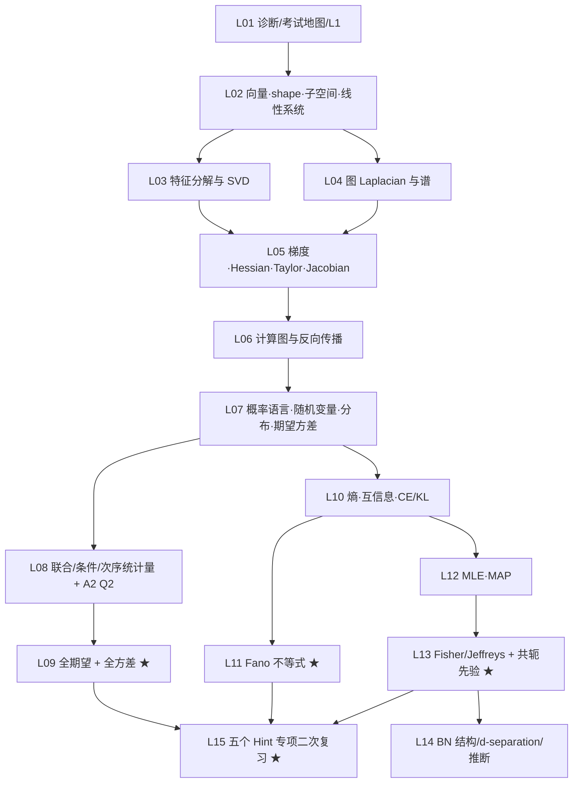

# 知识图谱（AISC5020 期中复习 v2）

> 范围 L1–L8；箭头表示前置依赖。课次对应 `第01–NN课_课表.md` v2。

## 关键路径

1. **线代与微积分主干**：L02 → L03/L04 → L05 → L06。
2. **概率主干**：L07 → L08 → L09（全期望/全方差）。
3. **信息论与推断**：L07 → L10 → L11（Fano）→ L12（MLE/MAP）。
4. **贝叶斯**：L12 → L13（Fisher/Jeffreys + 共轭）→ L14（BN）。
5. **收口**：L15 五个 Hint 专项二次复习，不再安排全真模考。

## 考试 Hint 在图中的位置

- 全期望：L09（W5 p.50）；全方差：L09（W5 p.51）。
- Fano：L11（W6 pp.38–43）。
- 共轭先验：L13（W8 pp.5–17）；Fisher：L13（W8 pp.6–7）。
