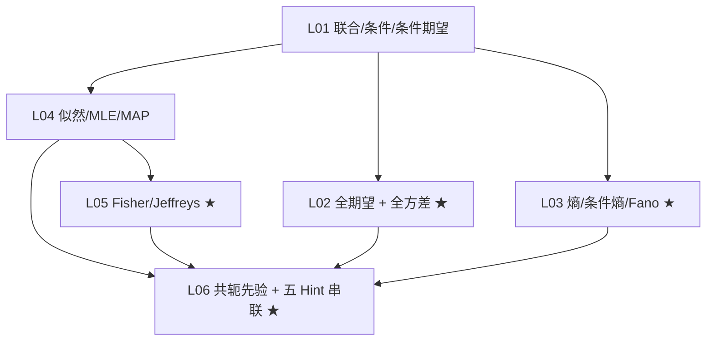

# 知识图谱（五 Hint 重学版，6 课）

> 箭头表示前置依赖；课次对应 `第01–NN课_课表.md`。
> 五个 Hint 用 ★ 标出。

## 关键路径

1. **地基**：L01（联合/条件/条件期望/条件方差）是后面所有课的共同前置。
2. **矩的两条公式**：L01 → L02（TLE/TLV）。
3. **信息与误差**：L01 → L03（熵 → Fano）。
4. **推断与信息量**：L01 → L04（似然/MLE/MAP）→ L05（Fisher/Jeffreys）。
5. **贝叶斯收口**：L04 → L06（共轭）；L05 → L06（Jeffreys 是先验，和共轭同一条线）。
6. **串联**：L02、L03、L05、L06 在最后一课合成一张图。

## 五个 Hint 在图中的位置

- 全期望：L02（W5 p.50）。
- 全方差：L02（W5 p.51）。
- Fano：L03（W6 pp.38–43）。
- Fisher：L05（W8 pp.6–7）。
- 共轭先验：L06（W8 pp.5–17）。

## 不在图上的内容

- 贝叶斯网络、次序统计量、Poisson thinning、损失函数全家桶、CV/BIC：本轮不排。
- 线代/微积分：不占节点；第 04/05 课按需补「求导与对数」。
