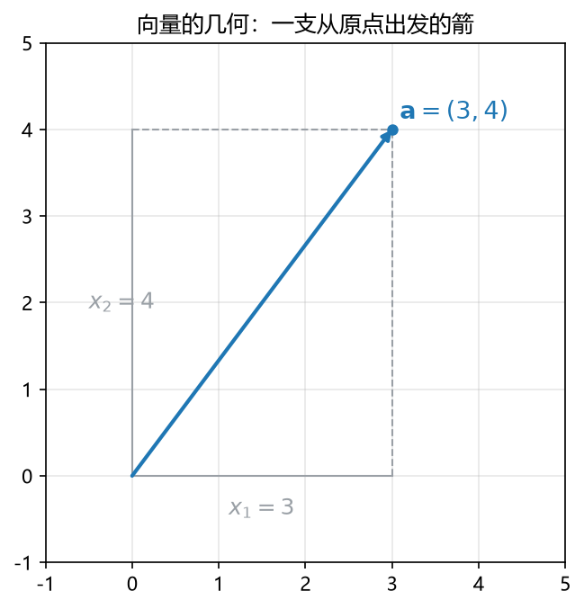

# S009_第01课_诊断·考试地图·L1串讲

- 日期：2026-11-01
- 时长：60 分钟
- 范围：L1（并预告 L2–L8）
- 概念：`vector_geometry`、`tensor_shape`
- 目标：用一张地图把 L1–L8 串起来；用 3 点线性回归把“数据 → 模型 → 损失 → 参数”走一遍；用 10 题诊断定位薄弱点。

---

## 1. 引入

三天后期中。现在最怕的不是“少背一个公式”，而是**不知道一道题在考哪一块**。

L1 不是单独一章，它是整门课的地图：  
> 数据怎么表示？模型怎么定义？损失怎么衡量？参数怎么更新？

这四个问题，分别对应线代、微积分、概率统计、优化。今天先看地图，再用最小二乘走一遍完整流程。

---

## 2. 直觉：AI pipeline

一条典型的 AI 流水线：

$$
\text{Data }(\mathbf X,\mathbf y)
\;\rightarrow\;
\text{Model }f_\theta
\;\rightarrow\;
\text{Loss }J(\theta)
\;\rightarrow\;
\text{Update }\theta
\;\rightarrow\;
\text{Repeat}
$$

四个问题与工具的对应：

| 问题 | 数学工具 | 对应讲次 |
|---|---|---|
| 测量怎么表示？ | 向量、矩阵、张量 | L2–L3 |
| 输出怎么随输入变化？ | 微积分、梯度、Jacobian、Hessian | L4 |
| 不确定性怎么描述？ | 概率、分布、期望、方差 | L5–L6 |
| 模型怎么变好？ | 优化、梯度下降、约束 | L9–L11 |

三类任务：

| 任务 | 输出 | 例子 | 典型损失 |
|---|---|---|---|
| Regression（回归） | 数值 | 预测浓度、房价 | MSE / RSS |
| Classification（分类） | 类别或类别概率 | 判断邮件是否垃圾 | Cross-Entropy / Hinge |
| Generative modelling（生成） | 新的结构化样本 | 生成候选分子 | 似然 / ELBO 等 |

> 同一批数据可以做不同任务：预测反应产率是回归；预测产率是否超过阈值是分类；提出新候选分子是生成。

---

## 3. 几何：一次测量就是一个向量

**看图**：图中的 $(3,4)$ 不是两个孤立的数，而是一支从原点出发的箭。  
- 第一维是 $3$，第二维是 $4$；
- 长度是 $\sqrt{3^2+4^2}=5$；
- **顺序不能随便换**：$(3,4)$ 和 $(4,3)$ 是两个不同的数据点。

AI 的第一步，就是把原始对象变成这样的向量或矩阵：

$$
\mathbf x=\begin{bmatrix}20\\7\\0.4\end{bmatrix}
\;\leftrightarrow\;
\begin{bmatrix}\text{temperature}\\\text{pH}\\\text{signal}\end{bmatrix}
$$

多个样本叠起来就是矩阵；彩色图像可以看成三维张量（高 × 宽 × 通道）。

---

## 4. 计算 / 公式卡

### 4.1 残差平方和（RSS / SSE）

**名称**：残差平方和（residual sum of squares, RSS；也称 sum of squared errors, SSE）

**公式**：

$$
\mathrm{RSS}(\theta)=\sum_{i=1}^{n}\bigl(y_i-f_\theta(\mathbf x_i)\bigr)^2
$$

**符号**：
- $n$：样本数；
- $y_i$：第 $i$ 个真实目标值；
- $f_\theta(\mathbf x_i)$：模型对第 $i$ 个输入的预测；
- $r_i=y_i-f_\theta(\mathbf x_i)$：残差（residual），可为正可为负。

**意义与场景**：残差平方和把“预测差多少”变成一个非负的总误差；平方让正负不抵消，也会放大离谱的大误差。训练模型就是找让 RSS 最小的参数。

**例（三段式）**：
- **背景与题干**：两个样本 $(0,1)$、$(1,2)$，模型取 $f(x)=1+1.5x$，求 RSS。
- **解**：
  - 第 1 步：$\hat y_0=1+1.5\cdot0=1$，残差 $r_0=1-1=0$；
  - 第 2 步：$\hat y_1=1+1.5\cdot1=2.5$，残差 $r_1=2-2.5=-0.5$；
  - 第 3 步：$\mathrm{RSS}=0^2+(-0.5)^2=0.25$。
- **解读**：RSS 越小，拟合越好；但 RSS 会随样本数增大，比较不同数据集时更常用 MSE $=\mathrm{RSS}/n$。

### 4.2 正规方程（normal equation）

**名称**：正规方程（normal equation）

**公式**：

$$
\widehat{\boldsymbol\beta}=(\mathbf X^\top\mathbf X)^{-1}\mathbf X^\top\mathbf y
$$

**符号**：
- $\mathbf X$：设计矩阵（design matrix），每行一个样本，第一列通常补 $1$；
- $\mathbf y$：目标向量；
- $\boldsymbol\beta$：参数向量（截距 + 斜率等）；
- $\mathbf X^\top\mathbf X$：必须可逆；不可逆时要用伪逆或正则化。

**意义与场景**：把“最小化 RSS”对参数求导并令导数为 $0$，就得到正规方程。它给出线性回归的闭式解；也是 L2 最小二乘、L3 伪逆的入口。

**例（三段式）**：
- **背景与题干**：两个样本 $(0,1)$、$(1,2)$，拟合 $y=\beta_0+\beta_1x$，求 $\widehat{\boldsymbol\beta}$。
- **解**：
  - 第 1 步：$\mathbf X=\begin{bmatrix}1&0\\1&1\end{bmatrix}$，$\mathbf y=\begin{bmatrix}1\\2\end{bmatrix}$；
  - 第 2 步：$\mathbf X^\top\mathbf X=\begin{bmatrix}2&1\\1&1\end{bmatrix}$，$(\mathbf X^\top\mathbf X)^{-1}=\begin{bmatrix}1&-1\\-1&2\end{bmatrix}$；
  - 第 3 步：$\mathbf X^\top\mathbf y=\begin{bmatrix}3\\2\end{bmatrix}$；
  - 第 4 步：$\widehat{\boldsymbol\beta}=\begin{bmatrix}1&-1\\-1&2\end{bmatrix}\begin{bmatrix}3\\2\end{bmatrix}=\begin{bmatrix}1\\1\end{bmatrix}$。
- **解读**：拟合直线是 $y=1+x$；两点确定一条直线，RSS 为 $0$。注意：不是所有 $\mathbf X^\top\mathbf X$ 都可逆。

### 4.3 集合与概率语言速查

| 记号 | 含义 | 考试提醒 |
|---|---|---|
| $A\cup B$ | 并集：至少一个发生 | $P(A\cup B)=P(A)+P(B)-P(A\cap B)$ |
| $A\cap B$ | 交集：同时发生 | 互斥时 $P(A\cap B)=0$ |
| $A^c$ | 补集 | $P(A^c)=1-P(A)$ |
| $P(A\mid B)$ | 条件概率 | $P(A\mid B)=\dfrac{P(A\cap B)}{P(B)}$，$P(B)>0$ |
| 独立 | $P(A\cap B)=P(A)P(B)$ | 独立不等于互斥 |
| Bayes | $P(A\mid B)=\dfrac{P(B\mid A)P(A)}{P(B)}$ | 分母常先用全概率展开 |

### 4.4 两类任务的损失（MSE / cross-entropy）

$$
\mathrm{MSE}=\frac1n\sum_{i=1}^{n}(y_i-\hat y_i)^2,
\qquad
\mathrm{CE}=-\sum_{k=1}^{K}p_k\log q_k.
$$

- **符号**：$y_i$ 是真实数值，$\hat y_i$ 是回归预测；$p_k$ 是真实类别分布（one-hot 或软标签），$q_k$ 是模型预测概率。
- **意义与场景**：回归用 MSE/RSS，分类用交叉熵。两者都来自“负对数似然”：高斯噪声 ⇒ MSE，Bernoulli/Categorical ⇒ 交叉熵。不要看到“预测”就默认 MSE。
- **例**：
  - **背景**：真实类别是第 $2$ 类，模型预测 $q=(0.1,0.7,0.2)$，求 one-hot 交叉熵。
  - **解**：
    - Step 1：$p=(0,1,0)$，只有 $k=2$ 的项保留。
    - Step 2：$\mathrm{CE}=-\log 0.7$。
    - Step 3：以 $e$ 为底约 $0.357$ nat；以 $2$ 为底约 $0.515$ bit。
    - 检查：$q_2$ 越接近 $1$，损失越接近 $0$。
  - **解读**：交叉熵只惩罚真实类别的低概率；考试若没写底数，先看课件约定（ML 常用自然对数）。

---

## 5. 完整手算：3 点线性回归

给三个点：

$$
(1,2),\quad (2,4),\quad (3,5).
$$

拟合 $y=a+bx$。

**第 1 步：列设计矩阵与目标向量**

$$
\mathbf X=\begin{bmatrix}1&1\\1&2\\1&3\end{bmatrix},
\qquad
\mathbf y=\begin{bmatrix}2\\4\\5\end{bmatrix}.
$$

**第 2 步：算 $\mathbf X^\top\mathbf X$**

$$
\mathbf X^\top\mathbf X=
\begin{bmatrix}
1&1&1\\
1&2&3
\end{bmatrix}
\begin{bmatrix}
1&1\\1&2\\1&3
\end{bmatrix}
=
\begin{bmatrix}
3&6\\
6&14
\end{bmatrix}.
$$

**第 3 步：算 $\mathbf X^\top\mathbf y$**

$$
\mathbf X^\top\mathbf y=
\begin{bmatrix}
1&1&1\\
1&2&3
\end{bmatrix}
\begin{bmatrix}2\\4\\5\end{bmatrix}
=
\begin{bmatrix}11\\25\end{bmatrix}.
$$

**第 4 步：解正规方程**

$$
\begin{bmatrix}3&6\\6&14\end{bmatrix}
\begin{bmatrix}a\\b\end{bmatrix}
=
\begin{bmatrix}11\\25\end{bmatrix}.
$$

第一式：$3a+6b=11$。  
第二式：$6a+14b=25$。

由第一式 $a=\dfrac{11-6b}{3}$，代入第二式：

$$
6\cdot\frac{11-6b}{3}+14b=25
\Rightarrow 2(11-6b)+14b=25
\Rightarrow 22+2b=25
\Rightarrow b=\frac32.
$$

再代回：

$$
a=\frac{11-6\cdot\frac32}{3}=\frac{11-9}{3}=\frac23.
$$

**第 5 步：写拟合直线并检查**

$$
\boxed{\hat y=\frac23+\frac32x}
$$

检查：直线应经过样本均值点 $(\bar x,\bar y)=(2,11/3)$：

$$
\frac23+\frac32\cdot2=\frac23+3=\frac{11}{3}.
$$

**第 6 步：算预测与 RSS**

| $x_i$ | $y_i$ | $\hat y_i$ | $r_i=y_i-\hat y_i$ |
|---|---:|---:|---:|
| 1 | 2 | $13/6$ | $-1/6$ |
| 2 | 4 | $11/3$ | $1/3$ |
| 3 | 5 | $31/6$ | $-1/6$ |

$$
\mathrm{RSS}=\left(-\frac16\right)^2+\left(\frac13\right)^2+\left(-\frac16\right)^2
=\frac1{36}+\frac4{36}+\frac1{36}=\frac6{36}=\frac16.
$$

---

## 6. 独立复现

用同样的方法拟合下面三个点：

$$
(1,1),\quad (2,3),\quad (3,4).
$$

要求：
1. 写出 $\mathbf X^\top\mathbf X$ 与 $\mathbf X^\top\mathbf y$；
2. 解出 $a,b$；
3. 算 RSS；
4. 检查直线是否经过 $(\bar x,\bar y)$。

---

## 7. 易错点

1. **回归 vs 分类**：输出是数值用回归；输出是类别/类别概率用分类。不要看到“预测”就写 MSE。
2. **RSS vs MSE**：$\mathrm{MSE}=\mathrm{RSS}/n$；最小化两者等价，但报告数值不同。
3. **正规方程不是永远可用**：$\mathbf X^\top\mathbf X$ 不可逆时（共线、特征重复、$p>n$），需要伪逆/正则化；这是 L3 的内容。
4. **条件概率不是除法乱写**：$P(A\mid B)=\dfrac{P(A\cap B)}{P(B)}$，分子不是 $P(A)$。
5. **向量顺序有含义**：$(3,4)\neq(4,3)$；集合 $\{3,4\}=\{4,3\}$。数据向量换顺序就是换特征含义。
6. **模型不是数据**：$f_\theta$ 里的 $\theta$ 是参数；训练是改 $\theta$，不是改样本。

---

## 8. 与已学 / 后续的关系

- **L1 是地图**：今天只走通“线性回归”这一条线；后面每一讲都是把某一块工具加深。
- **L2–L3**：向量、矩阵、span、特征值、SVD——把 $\mathbf X^\top\mathbf X$、最小二乘、伪逆讲清楚。
- **L4**：梯度、Hessian、Taylor、Jacobian、反向传播——解释“为什么求导能得到最优参数”。
- **L5–L6**：概率、分布、期望、方差、熵、KL、Fano——处理不确定性。
- **L7–L8**：MLE、MAP、正则化、共轭先验、贝叶斯网络——把统计推断和贝叶斯串起来。

---

## 9. 作业

### 9.1 诊断 10 题（限时 15 分钟，先不查书）

1. $\mathbf u=(3,4)$，$\mathbf v=(4,-3)$，求 $\mathbf u\cdot\mathbf v$，并判断是否正交。
2. $\mathbf v_1=(1,2,0)$，$\mathbf v_2=(2,4,-1)$，$\mathbf v_3=(0,0,1)$，判断是否线性无关，并描述 span。
3. 求 $\mathbf A=\begin{bmatrix}2&1\\1&2\end{bmatrix}$ 的特征值。
4. $f(x,y)=x^2+3xy+y^2$，求 $\nabla f(1,2)$ 与 $H_f(1,2)$。
5. $X\sim\mathrm{Binomial}(n,p)$，写 $E[X]$ 与 $\operatorname{Var}(X)$。
6. 写出全期望公式。
7. $p=(0.5,0.5)$，求熵 $H(p)$（以 2 为底）。
8. 伯努利样本 $x_1,\dots,x_n\in\{0,1\}$，写对数似然与 MLE $\hat p$。
9. 先验 $\theta\sim\mathrm{Beta}(a,b)$，观测到 $k$ 次成功、$n-k$ 次失败，写后验分布。
10. 写出 Fano 不等式，并写出由它得到的 $P_e$ 下界。

### 9.2 线性回归练习

对 §6 的三个点，完成 $a,b,\mathrm{RSS}$ 的计算，并写出拟合直线。

---

## 10. 作业答案（先自己做完再看）

### 10.1 诊断答案

1. $\mathbf u\cdot\mathbf v=3\cdot4+4\cdot(-3)=0$，所以正交。
2. 设 $a\mathbf v_1+b\mathbf v_2+c\mathbf v_3=\mathbf0$，由 $z$ 分量得 $-b+c=0\Rightarrow c=b$；由 $x$ 分量得 $a+2b=0\Rightarrow a=-2b$。取 $b=1$，得 $a=-2,c=1$，非零解，所以线性相关。  
   $\mathrm{span}\{\mathbf v_1,\mathbf v_2,\mathbf v_3\}=\{(s,2s,t)^\top:s,t\in\mathbb R\}$，是一个二维平面。
3. $\det(\mathbf A-\lambda\mathbf I)=(2-\lambda)^2-1=(\lambda-3)(\lambda-1)$，特征值为 $3,1$。
4. $\nabla f=(2x+3y,\;3x+2y)$，在 $(1,2)$ 为 $(8,7)$；  
   $H_f=\begin{bmatrix}2&3\\3&2\end{bmatrix}$，在 $(1,2)$ 不变。
5. $E[X]=np$，$\operatorname{Var}(X)=np(1-p)$。
6. $E[Y]=E\bigl[E[Y\mid X]\bigr]$。
7. $H(p)=-\frac12\log_2\frac12-\frac12\log_2\frac12=1$ bit。
8. 设 $k=\sum_i x_i$，$\ell(p)=k\ln p+(n-k)\ln(1-p)$，$\hat p=k/n$。
9. $\theta\mid y\sim\mathrm{Beta}(a+k,\;b+n-k)$。
10. $H(X\mid Y)\le H(P_e)+P_e\log|\mathcal X|$；弱下界 $P_e\ge\dfrac{H(X\mid Y)-1}{\log|\mathcal X|}$。

### 10.2 线性回归练习答案

$$
\mathbf X^\top\mathbf X=\begin{bmatrix}3&6\\6&14\end{bmatrix},
\qquad
\mathbf X^\top\mathbf y=\begin{bmatrix}8\\19\end{bmatrix}.
$$

解得：

$$
b=\frac32,\qquad a=-\frac13.
$$

拟合直线：

$$
\boxed{\hat y=-\frac13+\frac32x}
$$

预测与残差：

| $x_i$ | $y_i$ | $\hat y_i$ | $r_i$ |
|---|---:|---:|---:|
| 1 | 1 | $7/6$ | $-1/6$ |
| 2 | 3 | $8/3$ | $1/3$ |
| 3 | 4 | $25/6$ | $-1/6$ |

$$
\mathrm{RSS}=\frac1{36}+\frac4{36}+\frac1{36}=\frac16.
$$

检查：$\bar x=2,\bar y=8/3$，而 $-\frac13+\frac32\cdot2=\frac83$，直线经过均值点。

---

## 修订记录

- 2026-11-01：创建 S009 第 01 课板书。
- 2026-11-02：补充两类任务的损失（MSE / 交叉熵）公式卡，避免“预测就写 MSE”的误用。
