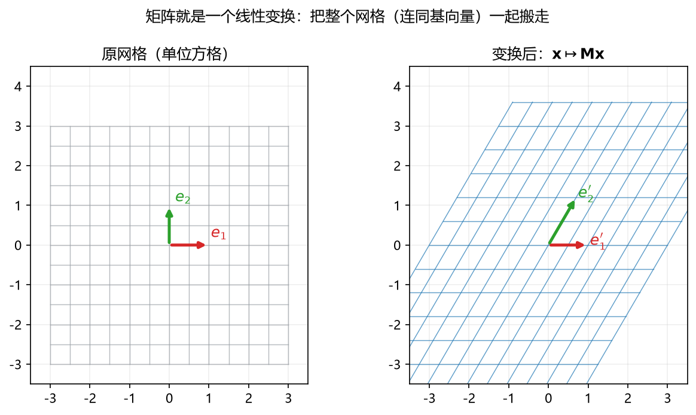
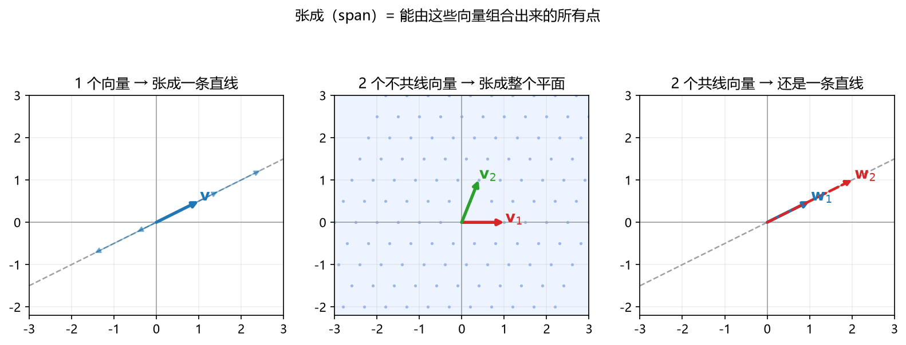
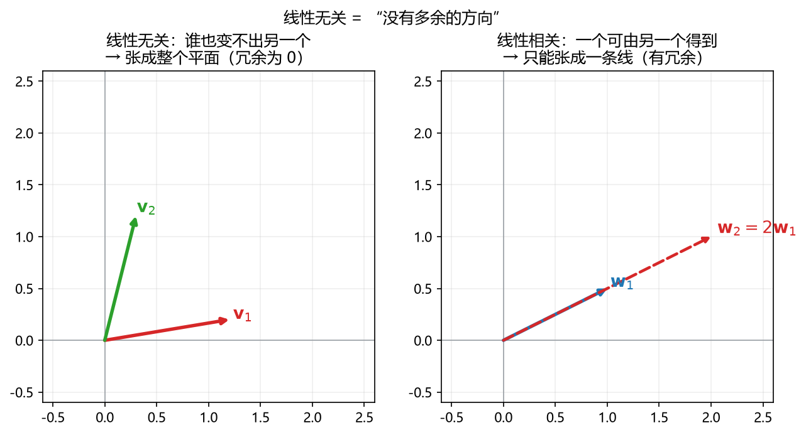

# S010_第02课_向量·子空间·秩与线性系统

- **日期**：2026-11-02
- **课程**：AISC5020 Mathematics & Statistics for AI
- **范围**：L2 pp.7–14, 30–82；L3 pp.7–18
- **时长**：75 分钟
- **概念**：`vector_geometry`、`tensor_shape`、`linear_independence`、`rank_nullspace`、`linear_system`
- **作业来源**：A1 Q1/Q2 同型

---

## 0. 本课目标

1. 把 $\mathbf A\mathbf x=\mathbf b$ 看成“用 $\mathbf A$ 的列去拼 $\mathbf b$”。
2. 会判断线性无关、求 span、秩、零空间。
3. 会用秩-零化度定理判断 $\mathbf A\mathbf x=\mathbf b$ 有解/唯一。

---

## 1. 引入：一锅汤能不能用几种“底料”调出来？

你开了一家奶茶店，仓库里只有三种底料：茶、奶、糖。

- 任何一杯饮料 = 三种底料按不同比例混合；
- 有些底料是“多余”的（比如“奶精”只是“奶 + 糖”的另一种说法）；
- 顾客点的那杯，如果不在你能调出的范围里，就**做不出来**。

线性代数里：

- 底料 = 向量；
- 按比例混合 = 线性组合；
- 能调出的所有饮料 = **span（张成空间）**；
- 多余底料 = **线性相关**；
- “最多能调出几种独立口味” = **秩（rank）**；
- “怎么配都尝不出来的方向” = **零空间（null space）**；
- 顾客点单 = $\mathbf b$；能不能做 = $\mathbf A\mathbf x=\mathbf b$ 是否有解。

---

## 2. 直觉与几何

### 2.1 标量、向量、矩阵、张量：先看 shape

| 对象 | 例子 | shape |
|---|---|---|
| 标量 scalar | 学习率 $0.01$ | $()$ |
| 向量 vector | 一个学生的 12 门成绩 | $(12,)$ |
| 矩阵 matrix | 40 个学生 $\times$ 12 门成绩 | $(40,12)$ |
| 张量 tensor | 24 张 $3\times4$ 的 RGB 图 | $(24,3,4,3)$ |

- 最后一行拆开看：24 张图；每张高 3、宽 4、3 个通道。
- `reshape` 只改“看法”，不改数据本身。
- 习惯上 batch 放第 0 维；展平（flatten）一张图会得到 $3\times4\times3=36$ 个数。

### 2.2 矩阵乘向量 = 用列去拼

把 $\mathbf A$ 按列切开：

$$
\mathbf A=[\mathbf a_1\ \mathbf a_2\ \cdots\ \mathbf a_d],
\qquad
\mathbf x=\begin{bmatrix}x_1\\x_2\\\vdots\\x_d\end{bmatrix}.
$$

则

$$
\mathbf A\mathbf x=x_1\mathbf a_1+x_2\mathbf a_2+\cdots+x_d\mathbf a_d.
$$

**一句话**：$\mathbf A\mathbf x$ 就是“以 $\mathbf x$ 为配方，把 $\mathbf A$ 的各列混起来”。

**看图**：左图是原来的方格；右图是乘 $\mathbf A$ 后的方格。红色、绿色箭头是 $\mathbf e_1,\mathbf e_2$ 被 $\mathbf A$ 搬到的位置——它们正好是 $\mathbf A$ 的两列。所以“矩阵的列”就是“基向量被送到了哪里”。

### 2.3 span：所有能拼出来的点

$$
\operatorname{span}\{\mathbf a_1,\dots,\mathbf a_d\}
=\left\{c_1\mathbf a_1+\cdots+c_d\mathbf a_d:\ c_i\in\mathbb R\right\}.
$$

**看图**：

- 左：只有 1 个向量，无论怎么伸缩，只能落在一条直线上；
- 中：2 个不共线向量，两个方向都能走，铺满整个平面；
- 右：2 个共线向量，第二个只是第一个的倍数，仍然只是一条直线。

**结论**：span 的维数 = 真正“独立”的方向数，不是向量个数。

### 2.4 线性无关：没有多余方向

$$
c_1\mathbf v_1+\cdots+c_d\mathbf v_d=\mathbf 0
\quad\Rightarrow\quad
c_1=\cdots=c_d=0
$$

才叫线性无关。只要存在**不全为 0** 的系数让组合为 $\mathbf 0$，就是线性相关。

**看图**：左边两个向量谁也不是谁的倍数，缺一不可；右边 $\mathbf w_2=2\mathbf w_1$，第二个是多余的，去掉它 span 不变。

### 2.5 秩、零空间、秩-零化度

设 $\mathbf A$ 是 $m\times n$（$m$ 行、$n$ 列）。

| 对象 | 在哪 | 维数 | 含义 |
|---|---|---|---|
| 列空间 $\operatorname{Col}(\mathbf A)$ | $\mathbb R^m$ | $r=\operatorname{rank}(\mathbf A)$ | 所有能到达的输出 |
| 零空间 $\operatorname{Null}(\mathbf A)$ | $\mathbb R^n$ | $n-r$ | 被压成 $\mathbf 0$ 的输入方向 |
| 行空间 $\operatorname{Row}(\mathbf A)$ | $\mathbb R^n$ | $r$ | 真正有效的输入方向 |

$$
\underbrace{n}_{\text{输入维数}}
=\underbrace{r}_{\text{有效输出维数}}
+\underbrace{n-r}_{\text{被压掉的维数}}.
$$

---

## 3. 公式卡

### 3.1 内积、L2 范数、距离（inner product, L2 norm, distance）

$$
\mathbf u\cdot\mathbf v=\sum_{i=1}^{d}u_iv_i,
\qquad
\|\mathbf u\|_2=\sqrt{\mathbf u\cdot\mathbf u},
\qquad
d(\mathbf u,\mathbf v)=\|\mathbf u-\mathbf v\|_2.
$$

- **符号**：$\mathbf u,\mathbf v\in\mathbb R^d$；$u_i,v_i$ 是第 $i$ 个分量；$\|\cdot\|_2$ 是欧氏长度；$d(\cdot,\cdot)$ 是两点距离。
- **意义与场景**：内积衡量“方向有多一致”，范数衡量“有多长”，距离衡量“差多远”。推荐系统算相似度、KNN 找最近邻、聚类量距离，都从这里出发。
- **例**：
  - **背景**：两个用户对两部电影的评分向量 $\mathbf u=(1,2)$、$\mathbf v=(2,-1)$，判断口味是否相反。
  - **解**：
    - Step 1：$\mathbf u\cdot\mathbf v=1\times2+2\times(-1)=0$。
    - Step 2：$\|\mathbf u\|_2=\sqrt{1^2+2^2}=\sqrt5$，$\|\mathbf v\|_2=\sqrt{2^2+(-1)^2}=\sqrt5$。
    - Step 3：$d(\mathbf u,\mathbf v)=\|(1-2,\ 2-(-1))\|_2=\|(-1,3)\|_2=\sqrt{10}\approx3.16$。
    - 检查：$\|\mathbf u\|^2+\|\mathbf v\|^2=5+5=10=d^2$，符合“正交时勾股定理”。
  - **解读**：内积为 $0$，两人口味正好垂直（不相关）；距离约 $3.16$，并不近。

### 3.2 矩阵-向量乘法（matrix-vector product）

$$
\mathbf A\mathbf x=\sum_{j=1}^{d}x_j\mathbf a_j,
\qquad
\mathbf A=[\mathbf a_1\ \cdots\ \mathbf a_d].
$$

- **符号**：$\mathbf A$ 是 $m\times n$；$\mathbf x\in\mathbb R^n$；$\mathbf a_j$ 是第 $j$ 列；$x_j$ 是第 $j$ 个系数。
- **意义与场景**：这是“线性组合”的机器语言。神经网络一层 $\mathbf y=\mathbf W\mathbf x+\mathbf b$、线性回归预测 $\hat{\mathbf y}=\mathbf X\boldsymbol\theta$，都是它。
- **例**：
  - **背景**：$\mathbf A=\begin{bmatrix}1&2\\3&4\end{bmatrix}$，配方 $\mathbf x=(2,-1)$。
  - **解**：
    - Step 1：$2\mathbf a_1=2(1,3)=(2,6)$。
    - Step 2：$(-1)\mathbf a_2=(-1)(2,4)=(-2,-4)$。
    - Step 3：相加得 $(0,2)$。
    - 检查（行视角）：$(1\times2+2\times(-1),\ 3\times2+4\times(-1))=(0,2)$。
  - **解读**：结果 $(0,2)$ 就是“两列按 $2:-1$ 混合”的产物。

### 3.3 线性无关（linear independence）

$$
\mathbf v_1,\dots,\mathbf v_d\ \text{线性无关}
\iff
\left(
c_1\mathbf v_1+\cdots+c_d\mathbf v_d=\mathbf 0
\Rightarrow
c_1=\cdots=c_d=0
\right).
$$

- **符号**：$c_i$ 是任意实数系数；“$\Rightarrow$”表示“只要左边成立，就必有右边”。
- **意义与场景**：判断一组特征/方向里有没有重复信息。特征共线、embedding 冗余、矩阵不可逆，本质都是线性相关。
- **例**：
  - **背景**：$\mathbf v_1=(1,2)$，$\mathbf v_2=(2,4)$，判断是否无关。
  - **解**：
    - Step 1：设 $c_1\mathbf v_1+c_2\mathbf v_2=\mathbf 0$，得 $c_1+2c_2=0$，$2c_1+4c_2=0$。
    - Step 2：两式其实相同（第二式是第一式的 2 倍），只有一个独立约束。
    - Step 3：取 $c_2=1$，得 $c_1=-2$，存在非零解。
    - 检查：$-2(1,2)+1(2,4)=(0,0)$。
  - **解读**：第二个向量只是第一个的 2 倍，是多余方向，所以相关。

### 3.4 秩-零化度定理（rank-nullity theorem）

$$
n=\operatorname{rank}(\mathbf A)+\operatorname{nullity}(\mathbf A),
\qquad
\operatorname{nullity}(\mathbf A)=\dim\operatorname{Null}(\mathbf A).
$$

- **符号**：$n$ 是列数（输入维数）；$\operatorname{rank}$ 是列空间的维数；$\operatorname{nullity}$ 是零空间的维数。
- **意义与场景**：输入空间被分成两块：一块“有效”地映射出去（秩），一块被压成 $0$（零空间）。压缩、降维、信息损失都靠它算账。
- **例**：
  - **背景**：$\mathbf A=\begin{bmatrix}1&2&3\\2&4&6\\0&1&1\end{bmatrix}$，求秩与零化度。
  - **解**：
    - Step 1：第二行 $=2\times$ 第一行，去掉；剩下 $(1,2,3)$ 与 $(0,1,1)$ 不成比例。
    - Step 2：$\operatorname{rank}(\mathbf A)=2$。
    - Step 3：$n=3$，所以 $\operatorname{nullity}=3-2=1$。
    - 检查：解 $\mathbf A\mathbf x=\mathbf 0$，由第 3 行 $x_2+x_3=0$，由第 1 行 $x_1+2x_2+3x_3=0$，取 $x_2=1$ 得 $x_3=-1,x_1=1$，零空间由 $(1,1,-1)$ 张成，确实 1 维。
  - **解读**：3 个输入方向里有 1 个被压没了，只剩 2 个有效输出方向。

### 3.5 $\mathbf A\mathbf x=\mathbf b$ 有解与唯一性

$$
\exists\mathbf x:\mathbf A\mathbf x=\mathbf b
\iff
\operatorname{rank}(\mathbf A)=\operatorname{rank}([\mathbf A\mid\mathbf b])
\iff
\mathbf b\in\operatorname{Col}(\mathbf A).
$$

唯一解 $\iff \operatorname{nullity}(\mathbf A)=0$（即零空间只有 $\mathbf 0$）。

- **符号**：$[\mathbf A\mid\mathbf b]$ 是把 $\mathbf b$ 添到 $\mathbf A$ 右边得到的增广矩阵；$\operatorname{Col}(\mathbf A)$ 是列空间。
- **意义与场景**：考试里判断方程组“无解 / 唯一解 / 无穷多解”的标准流程；也是最小二乘出现的原因——无解时退而求“最近”。
- **例**：
  - **背景**：$\mathbf A=\begin{bmatrix}1&2\\2&4\end{bmatrix}$，分别取 $\mathbf b_1=(3,6)$、$\mathbf b_2=(3,5)$。
  - **解**：
    - Step 1：两列成比例，$\operatorname{rank}(\mathbf A)=1$。
    - Step 2：$\mathbf b_1=(3,6)=3(1,2)$，在列空间里；方程 $x_1+2x_2=3$，解为 $(3,0)+t(-2,1)$，无穷多解。
    - Step 3：$\mathbf b_2=(3,5)$ 不在列空间：$x_1+2x_2=3$ 时左边第二式必为 $6$，不可能等于 $5$，无解。
    - 检查：$\operatorname{rank}([\mathbf A\mid\mathbf b_2])=2\ne1$，确实无解。
  - **解读**：$\mathbf b$ 必须落在“两列张成的那条直线”上；偏一点就无解。

### 3.6 最小二乘与正规方程（least squares, normal equation）

$$
\mathbf A^\top\mathbf A\hat{\mathbf x}=\mathbf A^\top\mathbf b,
\qquad
\hat{\mathbf x}=(\mathbf A^\top\mathbf A)^{-1}\mathbf A^\top\mathbf b
\quad(\text{当 }\mathbf A^\top\mathbf A\text{ 可逆}).
$$

- **符号**：$\hat{\mathbf x}$ 是让 $\|\mathbf A\mathbf x-\mathbf b\|_2^2$ 最小的系数；$\mathbf A^\top\mathbf A$ 是 $n\times n$ 对称半正定矩阵。
- **意义与场景**：$\mathbf A\mathbf x=\mathbf b$ 无解时，找“投影到列空间”的最近点。线性回归、岭回归、推荐系统的最小二乘，全用它。
- **例**：
  - **背景**：三点 $(0,1),(1,2),(2,2)$，拟合 $\hat y=a+bx$。
  - **解**：
    - Step 1：$\mathbf A=\begin{bmatrix}1&0\\1&1\\1&2\end{bmatrix}$，$\mathbf b=(1,2,2)^\top$。
    - Step 2：$\mathbf A^\top\mathbf A=\begin{bmatrix}3&3\\3&5\end{bmatrix}$，$\mathbf A^\top\mathbf b=(5,6)^\top$。
    - Step 3：解 $3a+3b=5$、$3a+5b=6$，相减得 $2b=1$，$b=\frac12$；代回 $3a+\frac32=5$，$a=\frac76$。
    - 检查：残差 $( \frac16,-\frac13,\frac16)$ 与 $\mathbf A$ 的每一列正交：$\sum r_i=0$，$\sum x_ir_i=0$。
  - **解读**：直线是 $\hat y=\frac76+\frac12x$；RSS $=\frac16$。没有一条直线能同时穿过三点，这是“最近”的解。

### 3.7 span、基与维数（span, basis, dimension）

$$
\operatorname{span}\{\mathbf v_1,\dots,\mathbf v_d\}
=\left\{\sum_{j=1}^{d}c_j\mathbf v_j:\ c_j\in\mathbb R\right\},
\qquad
\dim\operatorname{span}\{\mathbf v_1,\dots,\mathbf v_d\}=\operatorname{rank}[\mathbf v_1\ \cdots\ \mathbf v_d].
$$

- **符号**：$c_j$ 是任意实数系数；$\dim$ 是维数；$\operatorname{rank}$ 是这组向量中“真正独立”的个数。
- **意义与场景**：span 是“所有能拼出来的点”；基是 span 里最少、无冗余的一组积木；维数是积木的个数。判断一个模型能不能表示某个输出、参数是否唯一，都要先看 span 和维数。
- **例**：
  - **背景**：$\mathbf v_1=(1,2,0)^\top$、$\mathbf v_2=(2,4,0)^\top$、$\mathbf v_3=(0,0,1)^\top$，求 span 的维数。
  - **解**：
    - Step 1：$\mathbf v_2=2\mathbf v_1$，是冗余方向，去掉。
    - Step 2：$\mathbf v_1,\mathbf v_3$ 不成比例，线性无关。
    - Step 3：所以 $\operatorname{span}\{\mathbf v_1,\mathbf v_2,\mathbf v_3\}=\operatorname{span}\{\mathbf v_1,\mathbf v_3\}$，维数为 $2$。
  - **解读**：三个向量只张成一个二维平面；“向量个数”不等于“维数”，多出来的那个是冗余。

### 3.8 秩怎么算：行化简（rank by Gaussian elimination）

$$
\mathbf A\ \xrightarrow{\text{初等行变换}}\ \mathbf R\ \text{（行阶梯形）},
\qquad
\operatorname{rank}(\mathbf A)=\mathbf R\ \text{中非零行的个数}.
$$

- **符号**：初等行变换包括交换两行、某行乘非零常数、某行加另一行的倍数；这些操作不改变行空间和秩。
- **意义与场景**：这是考试里最稳的求秩方法，比“盯着看哪几列成比例”可靠。求零空间也用它：把 $\mathbf R$ 的主元列当自由变量，解回代。
- **例**：
  - **背景**：$\mathbf A=\begin{bmatrix}1&2&3\\2&4&6\\0&1&1\end{bmatrix}$，用行化简求秩。
  - **解**：
    - Step 1：第 2 行减去第 1 行的 $2$ 倍，得 $\begin{bmatrix}1&2&3\\0&0&0\\0&1&1\end{bmatrix}$。
    - Step 2：交换第 2、3 行，得 $\begin{bmatrix}1&2&3\\0&1&1\\0&0&0\end{bmatrix}$。
    - Step 3：非零行有 $2$ 行，所以 $\operatorname{rank}(\mathbf A)=2$。
    - 检查：第 2 行原来是第 1 行的 $2$ 倍，确实只有一个独立方向被去掉。
  - **解读**：行化简后“非零行数”就是秩；不要数原矩阵里“看起来不一样”的行。

### 3.9 投影与投影矩阵（projection）

$$
\mathbf p=\mathbf A(\mathbf A^\top\mathbf A)^{-1}\mathbf A^\top\mathbf b
=\mathbf P\mathbf b,
\qquad
\mathbf P=\mathbf A(\mathbf A^\top\mathbf A)^{-1}\mathbf A^\top.
$$

- **符号**：$\mathbf A$ 的列满秩；$\mathbf p$ 是 $\mathbf b$ 在 $\operatorname{Col}(\mathbf A)$ 上的正交投影；$\mathbf P$ 是投影矩阵，满足 $\mathbf P^2=\mathbf P$、$\mathbf P^\top=\mathbf P$。
- **意义与场景**：$\mathbf A\mathbf x=\mathbf b$ 无解时，投影给出“列空间里离 $\mathbf b$ 最近的点”；残差 $\mathbf b-\mathbf p$ 与列空间正交。最小二乘、PCA、去噪都用它。
- **例**：
  - **背景**：$\mathbf A=(1,1)^\top$，$\mathbf b=(2,0)^\top$，求 $\mathbf b$ 在 $\operatorname{Col}(\mathbf A)$ 上的投影。
  - **解**：
    - Step 1：$\mathbf A^\top\mathbf A=2$，$(\mathbf A^\top\mathbf A)^{-1}=1/2$。
    - Step 2：$\mathbf P=\mathbf A(1/2)\mathbf A^\top=\frac12\begin{bmatrix}1&1\\1&1\end{bmatrix}$。
    - Step 3：$\mathbf p=\mathbf P\mathbf b=\frac12(2,2)^\top=(1,1)^\top$。
    - 检查：$\mathbf b-\mathbf p=(1,-1)^\top$，与 $\mathbf A=(1,1)^\top$ 的内积为 $0$，确实正交。
  - **解读**：$(2,0)$ 在直线 $y=x$ 上的最近点就是 $(1,1)$；残差垂直落下。

### 3.10 L1/L∞ 范数与余弦相似度（L1/L∞ norm, cosine similarity）

$$
\|\mathbf x\|_1=\sum_{i=1}^{d}|x_i|,
\qquad
\|\mathbf x\|_\infty=\max_i|x_i|,
\qquad
\cos\theta=\frac{\mathbf u\cdot\mathbf v}{\|\mathbf u\|_2\|\mathbf v\|_2}.
$$

- **符号**：$\|\cdot\|_1$ 是绝对值之和；$\|\cdot\|_\infty$ 是最大绝对值；$\cos\theta\in[-1,1]$。
- **意义与场景**：L1 产生稀疏解（Lasso），L∞ 控制最大偏差；余弦相似度只看向量方向、不看长度，推荐系统和 embedding 检索常用。
- **例**：
  - **背景**：$\mathbf u=(3,4)$、$\mathbf v=(4,-3)$。
  - **解**：
    - Step 1：$\|\mathbf u\|_1=7$，$\|\mathbf u\|_\infty=4$。
    - Step 2：$\mathbf u\cdot\mathbf v=0$，$\|\mathbf u\|_2=\|\mathbf v\|_2=5$。
    - Step 3：$\cos\theta=0/(25)=0$，所以夹角 $90^\circ$。
  - **解读**：内积为 $0$ 时余弦相似度为 $0$，但不代表“距离为 $0$”；这两个向量其实离得很远。

### 3.11 线性系统的三条路线（LU / QR / SVD，了解）

$$
\begin{cases}
\text{方阵：}\ \mathbf A=\mathbf L\mathbf U, & \text{解 }\mathbf L\mathbf U\mathbf x=\mathbf b,\\
\text{超定：}\ \mathbf A=\mathbf Q\mathbf R, & \text{最小二乘 }\hat{\mathbf x}=\mathbf R^{-1}\mathbf Q^\top\mathbf b,\\
\text{欠定：}\ \mathbf x=\mathbf A^+\mathbf b, & \text{最小范数解}.
\end{cases}
$$

- **符号**：$\mathbf L$ 下三角、$\mathbf U$ 上三角；$\mathbf Q$ 列正交、$\mathbf R$ 上三角；$\mathbf A^+$ 是伪逆。
- **意义与场景**：这是“拿到 $Ax=b$ 先看形状”的决策表：方阵用 LU，超定（方程多）用 QR/最小二乘，欠定（未知数多）用 SVD/伪逆。下一课会讲 $\mathbf A^+$ 的构造。
- **例**：
  - **背景**：$\mathbf A$ 是 $3\times2$，$\mathbf b\in\mathbb R^3$。
  - **解**：
    - Step 1：行数 $3>$ 列数 $2$，是超定系统，通常无精确解。
    - Step 2：用 QR 或正规方程求最小二乘解。
    - Step 3：若 $\mathbf A$ 列满秩，解唯一；否则有无穷多最小二乘解。
  - **解读**：先看 $m,n$ 的大小关系，再选方法；不要对方阵公式硬套到长方形矩阵。

---

## 4. 完整手算：A1 Q2 原题

$$
\mathbf v_1=\begin{bmatrix}1\\2\\0\end{bmatrix},
\qquad
\mathbf v_2=\begin{bmatrix}2\\4\\-1\end{bmatrix},
\qquad
\mathbf v_3=\begin{bmatrix}0\\0\\1\end{bmatrix}.
$$

### 4.1 判断线性无关

设

$$
c_1\mathbf v_1+c_2\mathbf v_2+c_3\mathbf v_3=\mathbf 0.
$$

**第 1 步**：按分量写方程。

$$
\begin{cases}
c_1+2c_2=0 & (x\text{ 分量}),\\
2c_1+4c_2=0 & (y\text{ 分量}),\\
-c_2+c_3=0 & (z\text{ 分量}).
\end{cases}
$$

**第 2 步**：第二式是第一式的 2 倍，重复，丢掉。由第三式得

$$
c_3=c_2.
$$

**第 3 步**：由第一式得

$$
c_1=-2c_2.
$$

**第 4 步**：取 $c_2=1$，则 $c_1=-2$、$c_3=1$，得到非零解

$$
-2\mathbf v_1+\mathbf v_2+\mathbf v_3=\mathbf 0.
$$

所以 $\{\mathbf v_1,\mathbf v_2,\mathbf v_3\}$ **线性相关**。

等价写法：

$$
\mathbf v_2=2\mathbf v_1-\mathbf v_3.
$$

### 4.2 描述 span

任意线性组合：

$$
c_1\mathbf v_1+c_2\mathbf v_2+c_3\mathbf v_3
=c_1\mathbf v_1+c_2(2\mathbf v_1-\mathbf v_3)+c_3\mathbf v_3
=(c_1+2c_2)\mathbf v_1+(c_3-c_2)\mathbf v_3.
$$

令 $s=c_1+2c_2$、$t=c_3-c_2$，则

$$
\operatorname{span}\{\mathbf v_1,\mathbf v_2,\mathbf v_3\}
=\operatorname{span}\{\mathbf v_1,\mathbf v_3\}
=\left\{\begin{bmatrix}s\\2s\\t\end{bmatrix}:s,t\in\mathbb R\right\}.
$$

这是一个**二维平面**（$z$ 可以任意，$y$ 始终是 $x$ 的 2 倍）。

### 4.3 秩与零空间

- $\mathbf v_1,\mathbf v_3$ 不成比例，线性无关，所以 $\operatorname{rank}=2$。
- 列数 $n=3$，由秩-零化度：

$$
\operatorname{nullity}=3-2=1.
$$

- 零空间由 4.1 的非零解给出：

$$
\operatorname{Null}(\mathbf A)=\operatorname{span}\left\{\begin{bmatrix}-2\\1\\1\end{bmatrix}\right\}.
$$

### 4.4 用同一个 $\mathbf A$ 解 $\mathbf A\mathbf x=\mathbf b$

令 $\mathbf A=[\mathbf v_1\ \mathbf v_2\ \mathbf v_3]$。

**情形 1**：$\mathbf b=(3,6,1)^\top$。

要解

$$
s\mathbf v_1+t\mathbf v_3=\begin{bmatrix}s\\2s\\t\end{bmatrix}
=\begin{bmatrix}3\\6\\1\end{bmatrix}.
$$

得 $s=3$、$t=1$，所以一个特解是

$$
\mathbf x_p=\begin{bmatrix}3\\0\\1\end{bmatrix}
\quad(\text{系数对应 }\mathbf v_1,\mathbf v_2,\mathbf v_3).
$$

通解 = 特解 + 零空间：

$$
\mathbf x=\begin{bmatrix}3\\0\\1\end{bmatrix}
+\lambda\begin{bmatrix}-2\\1\\1\end{bmatrix},
\qquad \lambda\in\mathbb R.
$$

**情形 2**：$\mathbf b=(1,0,0)^\top$。

需要 $s=1$ 且 $2s=0$，矛盾，所以**无解**。

用秩判断：

$$
\operatorname{rank}(\mathbf A)=2,\qquad
\operatorname{rank}([\mathbf A\mid\mathbf b])=3,
$$

两者不等，确实无解。

---

## 5. 机器学习里的用途

1. **Embedding / 推荐系统**：用户和物品都是向量；内积越大越相似；余弦相似度只看向量方向。
2. **秩 = 有效信息量**：矩阵秩越低，说明数据越“扁”，可以压缩。SVD、PCA、低秩近似都在利用这一点。
3. **零空间 = 不可辨识方向**：如果两个特征完全共线，权重沿某个方向怎么改，预测都不变；这就是零空间。岭回归加 $\lambda\|\boldsymbol\theta\|^2$ 把平的方向“抬起来”，让解唯一。
4. **$\mathbf A\mathbf x=\mathbf b$ 无解 → 最小二乘**：线性回归的损失

$$
L(\boldsymbol\theta)=\|\mathbf X\boldsymbol\theta-\mathbf y\|^2
$$

的 Hessian 是

$$
H_L=2\mathbf X^\top\mathbf X.
$$

它永远半正定；$\mathbf X$ 列满秩时才正定，才有唯一最优解。列共线时 $\mathbf X^\top\mathbf X$ 不可逆，正规方程失效。

5. **Shape / batch**：一张 RGB 图是 $(H,W,3)$，一批图是 $(B,H,W,3)$；进全连接层前常 flatten 成 $(B,H\cdot W\cdot3)$。

---

## 6. 常见易错点

1. **秩不是行数或列数**：$\operatorname{rank}(\mathbf A)\le\min(m,n)$，只有满秩时才取等号。
2. **“相关”不等于“有零向量”**：只要有一组不全为 0 的系数组合出 $\mathbf 0$，就相关。
3. **零空间是 $\mathbf x$ 的集合，不是 $\mathbf b$ 的集合**：$\operatorname{Null}(\mathbf A)=\{\mathbf x:\mathbf A\mathbf x=\mathbf 0\}$。
4. **有解看 $\mathbf b\in\operatorname{Col}(\mathbf A)$**，不是看 $\mathbf A$ 是不是方阵、可不可逆。
5. **秩-零化度用的是列数 $n$**，不是行数 $m$。
6. **shape 要分清**：$(d,)$ 是一维向量，$(d,1)$ 是列矩阵；很多 bug 来自这里。
7. **reshape 的顺序**：NumPy 默认按行优先（C order），最后一个轴变化最快；展平图像时容易把通道顺序弄反。
8. **最小二乘解存在，但不一定唯一**：$\mathbf A^\top\mathbf A$ 可逆才唯一。

---

## 7. 与已学 / 后续的关系

- **L01 的线性回归**：$\mathbf X\boldsymbol\theta=\mathbf y$ 通常无解，所以用最小二乘；今天把“为什么无解”“解长什么样”讲清楚了。
- **笔记本里的正规方程 vs 梯度下降**：正规方程就是在解 $\mathbf A^\top\mathbf A\boldsymbol\theta=\mathbf A^\top\mathbf b$；Hessian $=2\mathbf X^\top\mathbf X$ 的正定性决定解是否唯一。
- **下一课 L03**：特征值、SVD。秩可以用奇异值数出来；PCA 就是“保留大的奇异值方向”。
- **L05**：梯度/Hessian 会反复用到“矩阵作用于向量”的列组合视角。

---

## 8. 作业

> 先自己做，答案在最后。默认不批改，交了我再看。

1. **A1 Q1 同型（内积/范数/距离）**  
   设 $\mathbf u=(3,4)$、$\mathbf v=(4,-3)$、$\mathbf w=(1,2)$。求
   $\mathbf u\cdot\mathbf v$、$\mathbf u\cdot\mathbf w$、$\mathbf v\cdot\mathbf w$；
   $\|\mathbf u\|_2$、$\|\mathbf v\|_2$、$\|\mathbf w\|_2$；
   $d(\mathbf u,\mathbf v)$、$d(\mathbf u,\mathbf w)$、$d(\mathbf v,\mathbf w)$。
   哪一对向量正交？简要说明。

2. **A1 Q2 同型（线性无关与 span）**  
   设 $\mathbf a_1=(1,1,0)$、$\mathbf a_2=(0,1,1)$、$\mathbf a_3=(1,2,1)$。
   (a) 判断是否线性无关，说明理由；
   (b) 把 $\operatorname{span}\{\mathbf a_1,\mathbf a_2,\mathbf a_3\}$ 尽量简单地表示出来；
   (c) 求秩与零化度，并写出一个零空间基向量。

3. **秩与解的结构**  
   设

$$
\mathbf A=\begin{bmatrix}1&2&1\\2&4&2\\0&1&1\end{bmatrix},
\qquad
\mathbf b_1=\begin{bmatrix}1\\2\\0\end{bmatrix},
\qquad
\mathbf b_2=\begin{bmatrix}1\\0\\0\end{bmatrix}.
$$

   分别判断 $\mathbf A\mathbf x=\mathbf b_1$、$\mathbf A\mathbf x=\mathbf b_2$ 是否有解；有解时写通解。

4. **Shape 与 reshape**  
   24 张 $3\times4$ 的 RGB 图组成一个 batch。
   (a) 写出这个张量的 shape；
   (b) 如果把每张图展平，batch 的 shape 变成什么？
   (c) 8 张 $5\times5$ 灰度图呢？展平后呢？

5. **机器学习联系**  
   设 $\mathbf X\in\mathbb R^{n\times d}$ 中有两列完全相同。  
   (a) 说明 $\mathbf X^\top\mathbf X$ 为什么不可逆；  
   (b) 零空间里至少有一个什么向量？  
   (c) 这对最小二乘解和正规方程意味着什么？实际中怎么处理？

---

## 9. 作业答案（先自己做完再看）

### 9.1 第 1 题

内积：

$$
\mathbf u\cdot\mathbf v=3\times4+4\times(-3)=0,
$$

$$
\mathbf u\cdot\mathbf w=3\times1+4\times2=11,
\qquad
\mathbf v\cdot\mathbf w=4\times1+(-3)\times2=-2.
$$

范数：

$$
\|\mathbf u\|_2=\sqrt{3^2+4^2}=5,
\qquad
\|\mathbf v\|_2=\sqrt{4^2+(-3)^2}=5,
\qquad
\|\mathbf w\|_2=\sqrt{1^2+2^2}=\sqrt5.
$$

距离：

$$
d(\mathbf u,\mathbf v)=\|(-1,7)\|_2=\sqrt{50}=5\sqrt2\approx7.07,
$$

$$
d(\mathbf u,\mathbf w)=\|(2,2)\|_2=\sqrt8=2\sqrt2\approx2.83,
$$

$$
d(\mathbf v,\mathbf w)=\|(3,-5)\|_2=\sqrt{34}\approx5.83.
$$

正交：只有 $\mathbf u\cdot\mathbf v=0$，所以 $\mathbf u$ 与 $\mathbf v$ 正交。  
理由：内积为 $0$ 等价于夹角 $90^\circ$。

### 9.2 第 2 题

**(a)** 设

$$
c_1\mathbf a_1+c_2\mathbf a_2+c_3\mathbf a_3=\mathbf 0.
$$

按分量：

$$
\begin{cases}
c_1+c_3=0,\\
c_1+c_2+2c_3=0,\\
c_2+c_3=0.
\end{cases}
$$

由第一式 $c_1=-c_3$；由第三式 $c_2=-c_3$；代入第二式：

$$
-c_3-c_3+2c_3=0,
$$

自动成立。取 $c_3=1$，得 $(c_1,c_2,c_3)=(-1,-1,1)$，非零解，所以**线性相关**。

关系：

$$
\mathbf a_3=\mathbf a_1+\mathbf a_2.
$$

**(b)**

$$
c_1\mathbf a_1+c_2\mathbf a_2+c_3\mathbf a_3
=(c_1+c_3)\mathbf a_1+(c_2+c_3)\mathbf a_2.
$$

令 $s=c_1+c_3$、$t=c_2+c_3$：

$$
\operatorname{span}\{\mathbf a_1,\mathbf a_2,\mathbf a_3\}
=\operatorname{span}\{\mathbf a_1,\mathbf a_2\}
=\left\{\begin{bmatrix}s\\s+t\\t\end{bmatrix}:s,t\in\mathbb R\right\}.
$$

这是一个二维平面。

**(c)** $\mathbf a_1,\mathbf a_2$ 不成比例，$\operatorname{rank}=2$；$n=3$，所以

$$
\operatorname{nullity}=3-2=1.
$$

零空间基向量：$(-1,-1,1)^\top$（因为 $-\mathbf a_1-\mathbf a_2+\mathbf a_3=\mathbf 0$）。

### 9.3 第 3 题

先看 $\mathbf A$：第二行是第一行的 2 倍，去掉；剩下 $(1,2,1)$ 与 $(0,1,1)$ 不成比例，所以

$$
\operatorname{rank}(\mathbf A)=2,\qquad
\operatorname{nullity}=3-2=1.
$$

零空间：解 $\mathbf A\mathbf x=\mathbf 0$：

$$
x_1+2x_2+x_3=0,
\qquad
x_2+x_3=0.
$$

由第二式 $x_3=-x_2$；代入第一式 $x_1+2x_2-x_2=x_1+x_2=0$，所以 $x_1=-x_2$。取 $x_2=1$：

$$
\operatorname{Null}(\mathbf A)=\operatorname{span}\left\{\begin{bmatrix}-1\\1\\-1\end{bmatrix}\right\}.
$$

**对 $\mathbf b_1=(1,2,0)^\top$**：观察 $\mathbf b_1=(1,2,0)^\top$ 正好是 $\mathbf A$ 的第一列，所以

$$
\mathbf x_p=(1,0,0)^\top
$$

是特解。通解：

$$
\mathbf x=\begin{bmatrix}1\\0\\0\end{bmatrix}
+\lambda\begin{bmatrix}-1\\1\\-1\end{bmatrix},
\qquad \lambda\in\mathbb R.
$$

**对 $\mathbf b_2=(1,0,0)^\top$**：第二行要求

$$
2x_1+4x_2+2x_3=0,
$$

但第一行是 $x_1+2x_2+x_3=1$，左边乘以 2 应得 $2$，与 $0$ 矛盾，所以**无解**。

用秩看：$\operatorname{rank}([\mathbf A\mid\mathbf b_2])=3\ne2$。

### 9.4 第 4 题

**(a)** 24 张 $3\times4$ RGB 图：

$$
(24,\ 3,\ 4,\ 3).
$$

含义：batch、高、宽、通道。

**(b)** 每张图展平有 $3\times4\times3=36$ 个数：

$$
(24,\ 36).
$$

**(c)** 8 张 $5\times5$ 灰度图：

$$
(8,\ 5,\ 5),
$$

展平后：

$$
(8,\ 25).
$$

注意：灰度图没有通道维，别多写一个 1，除非数据确实存成 $(8,5,5,1)$。

### 9.5 第 5 题

**(a)** 设第 $i$ 列与第 $j$ 列相同，记为 $\mathbf c$。则

$$
\mathbf X^\top\mathbf X
$$

的第 $i$ 列与第 $j$ 列也相同，两列线性相关，所以矩阵不可逆（行列式为 $0$）。

**(b)** 取向量 $\mathbf e_i-\mathbf e_j$（第 $i$ 个位置为 $1$、第 $j$ 个位置为 $-1$、其余为 $0$），则

$$
\mathbf X(\mathbf e_i-\mathbf e_j)=\mathbf c-\mathbf c=\mathbf 0.
$$

所以 $\mathbf e_i-\mathbf e_j\in\operatorname{Null}(\mathbf X)$，零空间至少含这个方向。

**(c)** 最小二乘解不唯一：若 $\hat{\boldsymbol\theta}$ 是最优解，则

$$
\hat{\boldsymbol\theta}+t(\mathbf e_i-\mathbf e_j)
$$

对所有 $t$ 都给出同样的预测，RSS 不变。正规方程

$$
\mathbf X^\top\mathbf X\boldsymbol\theta=\mathbf X^\top\mathbf y
$$

的系数矩阵不可逆，不能直接求逆。

实际处理：删掉一列冗余特征，或加 $\ell_2$ 正则（岭回归）：

$$
(\mathbf X^\top\mathbf X+\lambda\mathbf I)\boldsymbol\theta=\mathbf X^\top\mathbf y,
$$

这时矩阵正定，解唯一。

---

## 修订记录

- 2026-11-02：创建（S010 第 02 课）。
- 2026-11-02：补充 span/基/维数、行化简求秩、投影矩阵、L1/L∞ 与余弦相似度、LU/QR/SVD 三条路线；补公式卡完整性。
