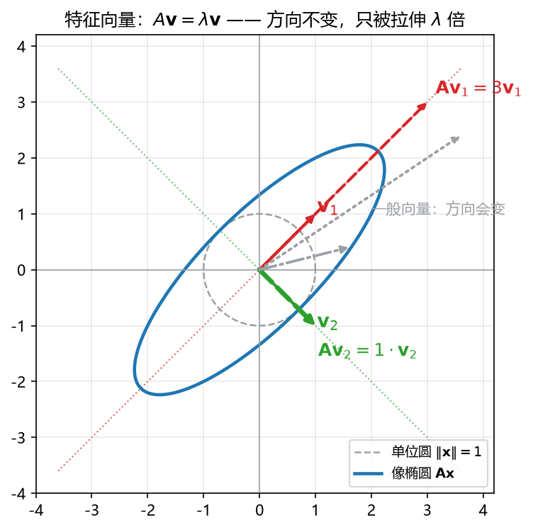
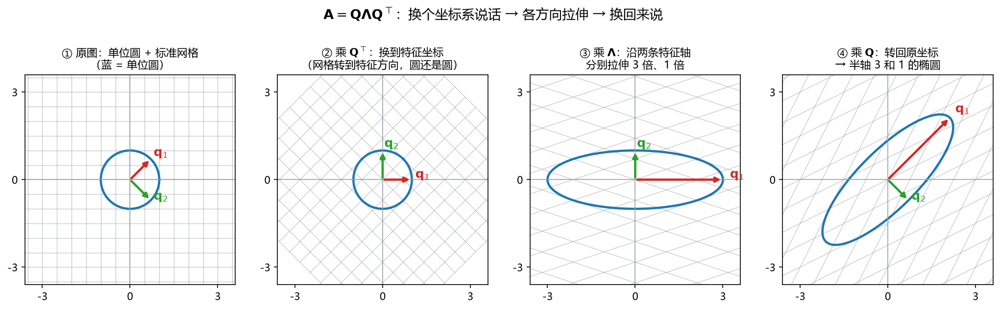
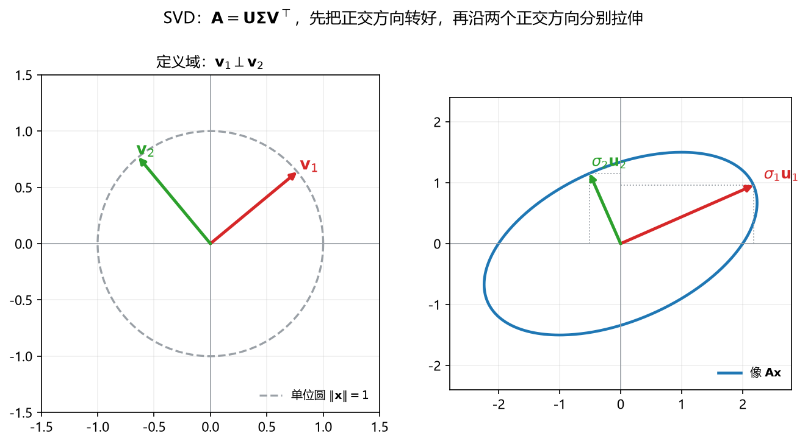

# S010_第03课_特征分解与SVD

- **日期**：2026-11-02
- **课程**：AISC5020 Mathematics & Statistics for AI
- **范围**：L3 pp.20–63（pp.53–63 选）
- **时长**：75 分钟
- **概念**：`eigen`、`svd`、`pseudoinverse_condition`
- **作业来源**：A1 Q3 同型

---

## 0. 本课目标

1. 会解特征方程，求特征值与单位特征向量。
2. 会对对称矩阵写正交分解 $\mathbf A=\mathbf Q\boldsymbol\Lambda\mathbf Q^\top$。
3. 会求奇异值并写（完整）SVD $\mathbf A=\mathbf U\boldsymbol\Sigma\mathbf V^\top$。
4. 知道 SVD 与低秩近似、PCA、条件数的关系。

---

## 1. 引入：矩阵是一台“揉面机”

把单位圆放进矩阵这台机器：

- 圆会被揉成一个椭圆；
- **特征向量**：有些方向进去、出来方向不变，只是长度被拉伸——这些方向就是“机器的骨架”；
- **奇异值**：椭圆的半轴长度，告诉你“最多拉多长、最少压多扁”；
- **SVD**：任意矩阵（哪怕不是方阵）都能找到两组正交方向，把“转 → 拉 → 转”三步拆开。

应用：照片压缩、推荐系统、PCA 降维、人脸识别、图聚类。

---

## 2. 直觉与几何

### 2.1 特征向量：方向不变的箭头

$$
\mathbf A\mathbf v=\lambda\mathbf v,
\qquad \mathbf v\ne\mathbf 0.
$$

- $\mathbf v$ 是特征向量（eigenvector）；
- $\lambda$ 是特征值（eigenvalue）；
- 几何上：$\mathbf A$ 把 $\mathbf v$ 拉到同一条直线上，长度乘 $|\lambda|$；$\lambda<0$ 还会反向。

**看图**：单位圆被 $\mathbf A$ 拉成椭圆。红色、绿色两条虚线方向上的箭头，进去和出来仍在同一直线上；其他方向（灰色）会被转走。

### 2.2 对称矩阵：特征向量互相垂直

若 $\mathbf A=\mathbf A^\top$，则：

- 特征值全是实数；
- 不同特征值对应的特征向量互相正交；
- 可以选出一组**标准正交**的特征向量，拼成 $\mathbf Q$，使

$$
\mathbf A=\mathbf Q\boldsymbol\Lambda\mathbf Q^\top,
\qquad
\mathbf Q^\top\mathbf Q=\mathbf I.
$$

**看图**：① 原图；② 乘 $\mathbf Q^\top$ 换到特征坐标，网格转到特征方向；③ 乘 $\boldsymbol\Lambda$ 沿两条特征轴分别拉伸；④ 乘 $\mathbf Q$ 转回原坐标，圆变成半轴为 $3,1$ 的椭圆。

### 2.3 SVD：任意矩阵的“两组正交方向”

任意 $m\times n$ 矩阵 $\mathbf A$ 都可以写成

$$
\mathbf A=\mathbf U\boldsymbol\Sigma\mathbf V^\top,
$$

- $\mathbf U$：$m\times m$ 正交矩阵，列是左奇异向量；
- $\mathbf V$：$n\times n$ 正交矩阵，列是右奇异向量；
- $\boldsymbol\Sigma$：$m\times n$，对角线上是奇异值 $\sigma_1\ge\sigma_2\ge\cdots\ge0$。

**看图**：左边定义域里，$\mathbf v_1,\mathbf v_2$ 是一组正交方向；右边像空间里，它们被送到 $\sigma_1\mathbf u_1$、$\sigma_2\mathbf u_2$，仍然正交。椭圆的两条半轴就是 $\sigma_1,\sigma_2$。

**关键事实**：

- $\operatorname{rank}(\mathbf A)$ = 非零奇异值的个数；
- 零奇异值对应的右奇异向量张成零空间；
- 条件数 $\kappa(\mathbf A)=\dfrac{\sigma_{\max}}{\sigma_{\min}}$（了解）。

### 2.4 低秩近似：只留最大的几个半轴

$$
\mathbf A_k=\sum_{i=1}^{k}\sigma_i\mathbf u_i\mathbf v_i^\top.
$$

只保留前 $k$ 个奇异值，就得到“秩不超过 $k$ 的最优近似”（Eckart–Young）。照片压缩、推荐系统、PCA 都用它。

---

## 3. 公式卡

### 3.1 特征方程（characteristic equation）

$$
\det(\mathbf A-\lambda\mathbf I)=0.
$$

- **符号**：$\mathbf A$ 是 $n\times n$；$\mathbf I$ 是单位阵；$\lambda$ 是未知特征值。
- **意义与场景**：把“$\mathbf A\mathbf v=\lambda\mathbf v$ 有非零解”翻译成“$\mathbf A-\lambda\mathbf I$ 不可逆”，于是行列式为 $0$。求稳定性、振动频率、PCA 方向都从这步开始。
- **例**：
  - **背景**：$\mathbf A=\begin{bmatrix}2&1\\1&2\end{bmatrix}$，求特征值。
  - **解**：
    - Step 1：$\mathbf A-\lambda\mathbf I=\begin{bmatrix}2-\lambda&1\\1&2-\lambda\end{bmatrix}$。
    - Step 2：$\det=(2-\lambda)^2-1=\lambda^2-4\lambda+3$。
    - Step 3：$(\lambda-1)(\lambda-3)=0$，所以 $\lambda_1=1,\lambda_2=3$。
    - 检查：$\lambda_1+\lambda_2=4=\operatorname{tr}(\mathbf A)$，$\lambda_1\lambda_2=3=\det(\mathbf A)$。
  - **解读**：两个特征值都是正的，说明这个对称矩阵正定（对应碗形）。

### 3.2 特征向量方程（eigenvector equation）

$$
(\mathbf A-\lambda\mathbf I)\mathbf v=\mathbf 0,
\qquad \mathbf v\ne\mathbf 0.
$$

- **符号**：$\lambda$ 已求出；$\mathbf v$ 是待求的非零向量。
- **意义与场景**：特征向量就是 $\mathbf A-\lambda\mathbf I$ 的零空间中的非零向量。求 PCA 主轴、解微分方程、判断对角化，都要解它。
- **例**：
  - **背景**：接 3.1，$\mathbf A=\begin{bmatrix}2&1\\1&2\end{bmatrix}$，求 $\lambda=3$ 的特征向量。
  - **解**：
    - Step 1：$\mathbf A-3\mathbf I=\begin{bmatrix}-1&1\\1&-1\end{bmatrix}$。
    - Step 2：方程 $-x+y=0$，即 $y=x$。
    - Step 3：取 $x=1$，得 $\mathbf v=(1,1)^\top$；单位化 $\hat{\mathbf v}=\frac{1}{\sqrt2}(1,1)^\top$。
    - 检查：$\mathbf A(1,1)^\top=(3,3)^\top=3(1,1)^\top$。
  - **解读**：沿 $(1,1)$ 方向，矩阵只是把长度乘 $3$，方向不变。

### 3.3 正交对角化（orthogonal diagonalization）

$$
\mathbf A=\mathbf Q\boldsymbol\Lambda\mathbf Q^\top,
\qquad
\mathbf Q^\top\mathbf Q=\mathbf I,
\qquad
\boldsymbol\Lambda=\operatorname{diag}(\lambda_1,\dots,\lambda_n).
$$

- **符号**：$\mathbf Q$ 的列是标准正交特征向量；$\boldsymbol\Lambda$ 对角线是特征值。
- **意义与场景**：对称矩阵的“换坐标 → 拉伸 → 换回来”。PCA 的协方差矩阵、图的 Laplacian、Hessian 都是对称矩阵，都能这样拆。
- **例**：
  - **背景**：$\mathbf A=\begin{bmatrix}2&1\\1&2\end{bmatrix}$，写正交分解。
  - **解**：
    - Step 1：$\lambda=3$ 的单位特征向量 $\mathbf q_1=\frac{1}{\sqrt2}(1,1)^\top$。
    - Step 2：$\lambda=1$ 的单位特征向量 $\mathbf q_2=\frac{1}{\sqrt2}(1,-1)^\top$。
    - Step 3：$\mathbf Q=\frac{1}{\sqrt2}\begin{bmatrix}1&1\\1&-1\end{bmatrix}$，$\boldsymbol\Lambda=\begin{bmatrix}3&0\\0&1\end{bmatrix}$。
    - 检查：$\mathbf Q^\top\mathbf Q=\mathbf I$；$\mathbf Q\boldsymbol\Lambda\mathbf Q^\top=\begin{bmatrix}2&1\\1&2\end{bmatrix}$。
  - **解读**：在 $\mathbf q_1$ 方向拉伸 3 倍，在 $\mathbf q_2$ 方向保持 1 倍。

### 3.4 SVD 分解（singular value decomposition）

$$
\mathbf A=\mathbf U\boldsymbol\Sigma\mathbf V^\top,
\qquad
\mathbf U^\top\mathbf U=\mathbf I_m,
\qquad
\mathbf V^\top\mathbf V=\mathbf I_n.
$$

- **符号**：$\mathbf U$ 是 $m\times m$；$\boldsymbol\Sigma$ 是 $m\times n$（对角线上 $\sigma_i\ge0$）；$\mathbf V$ 是 $n\times n$。
- **意义与场景**：任意矩阵都能“先转正交方向、再拉伸、再转正交方向”。降维、压缩、推荐、伪逆、最小二乘数值解都靠它。
- **例**：
  - **背景**：$\mathbf A=\begin{bmatrix}3&0\\4&0\end{bmatrix}$，求 SVD。
  - **解**：
    - Step 1：$\mathbf A^\top\mathbf A=\begin{bmatrix}25&0\\0&0\end{bmatrix}$，特征值 $25,0$，所以 $\sigma_1=5,\sigma_2=0$。
    - Step 2：$\mathbf v_1=(1,0)^\top$，$\mathbf u_1=\frac{\mathbf A\mathbf v_1}{\sigma_1}=\frac{(3,4)^\top}{5}=(\frac35,\frac45)^\top$。
    - Step 3：补一个与 $\mathbf u_1$ 正交的单位向量 $\mathbf u_2=(-\frac45,\frac35)^\top$；$\mathbf v_2=(0,1)^\top$。
    - 检查：$\mathbf U\boldsymbol\Sigma\mathbf V^\top=\begin{bmatrix}3&0\\4&0\end{bmatrix}=\mathbf A$。
  - **解读**：这个矩阵把二维压成一维（秩 1），第二个奇异值为 $0$，对应方向被压没。

### 3.5 奇异值与 $\mathbf A^\top\mathbf A$ 的特征值

$$
\sigma_i=\sqrt{\lambda_i(\mathbf A^\top\mathbf A)},
\qquad
\mathbf v_i\ \text{是}\ \mathbf A^\top\mathbf A\ \text{的单位特征向量},
\qquad
\mathbf u_i=\frac{\mathbf A\mathbf v_i}{\sigma_i}.
$$

- **符号**：$\lambda_i(\mathbf A^\top\mathbf A)$ 是 $\mathbf A^\top\mathbf A$ 的特征值；$\sigma_i$ 取非负平方根。
- **意义与场景**：这是手算 SVD 的标准路线：先算小矩阵 $\mathbf A^\top\mathbf A$（$n\times n$），再开方、再算 $\mathbf u_i$。比直接猜 $\mathbf U$ 稳。
- **例**：
  - **背景**：接 3.4，$\mathbf A=\begin{bmatrix}3&0\\4&0\end{bmatrix}$。
  - **解**：
    - Step 1：$\mathbf A^\top\mathbf A=\begin{bmatrix}25&0\\0&0\end{bmatrix}$。
    - Step 2：特征值 $25,0$。
    - Step 3：$\sigma_1=\sqrt{25}=5$，$\sigma_2=0$。
    - 检查：$\sigma_1^2+\sigma_2^2=25=\|\mathbf A\|_F^2=3^2+4^2$。
  - **解读**：奇异值是“拉伸倍数”，不是特征值本身；这里特征值是 $25,0$，奇异值是 $5,0$。

### 3.6 低秩近似（low-rank approximation）

$$
\mathbf A_k=\sum_{i=1}^{k}\sigma_i\mathbf u_i\mathbf v_i^\top,
\qquad
\min_{\operatorname{rank}(\mathbf B)\le k}\|\mathbf A-\mathbf B\|_2=\sigma_{k+1}.
$$

- **符号**：$\mathbf A_k$ 是保留前 $k$ 个奇异值的近似；$\|\cdot\|_2$ 是谱范数（最大奇异值）。
- **意义与场景**：用少量“主方向”概括大矩阵。图像压缩、降维、推荐系统的隐因子模型都是它。
- **例**：
  - **背景**：$\mathbf A=\begin{bmatrix}5&0\\0&2\end{bmatrix}$，求最佳秩 1 近似。
  - **解**：
    - Step 1：奇异值 $5,2$，对应方向 $\mathbf e_1,\mathbf e_2$。
    - Step 2：保留最大的一项：$\mathbf A_1=5\mathbf e_1\mathbf e_1^\top=\begin{bmatrix}5&0\\0&0\end{bmatrix}$。
    - Step 3：误差 $\mathbf A-\mathbf A_1=\begin{bmatrix}0&0\\0&2\end{bmatrix}$，谱范数 $=2=\sigma_2$。
    - 检查：误差正好等于被丢掉的奇异值，符合定理。
  - **解读**：秩 1 近似丢掉了“第二大方向”，误差就是 $\sigma_2$。

---

## 4. 完整手算：A1 Q3 原题

### 4.1 (a) 特征分解

$$
\mathbf A=\begin{bmatrix}
0&1&0\\
1&0&0\\
0&0&2
\end{bmatrix}.
$$

**第 1 步：特征多项式。**

$$
\det(\mathbf A-\lambda\mathbf I)
=\begin{vmatrix}
-\lambda&1&0\\
1&-\lambda&0\\
0&0&2-\lambda
\end{vmatrix}
=(2-\lambda)(\lambda^2-1)
=(2-\lambda)(\lambda-1)(\lambda+1).
$$

所以

$$
\lambda_1=2,\qquad \lambda_2=1,\qquad \lambda_3=-1.
$$

**第 2 步：$\lambda=2$ 的特征向量。**

$$
\mathbf A-2\mathbf I=
\begin{bmatrix}
-2&1&0\\
1&-2&0\\
0&0&0
\end{bmatrix}.
$$

方程：

$$
-2x+y=0,\qquad x-2y=0.
$$

两式合起来给 $x=y=0$；$z$ 自由。取 $z=1$：

$$
\mathbf v_1=\begin{bmatrix}0\\0\\1\end{bmatrix}.
$$

**第 3 步：$\lambda=1$ 的特征向量。**

$$
\mathbf A-\mathbf I=
\begin{bmatrix}
-1&1&0\\
1&-1&0\\
0&0&1
\end{bmatrix}.
$$

方程：

$$
-x+y=0,\qquad z=0.
$$

取 $x=y=1$：

$$
\mathbf v_2=\begin{bmatrix}1\\1\\0\end{bmatrix},
\qquad
\hat{\mathbf v}_2=\frac{1}{\sqrt2}\begin{bmatrix}1\\1\\0\end{bmatrix}.
$$

**第 4 步：$\lambda=-1$ 的特征向量。**

$$
\mathbf A+\mathbf I=
\begin{bmatrix}
1&1&0\\
1&1&0\\
0&0&3
\end{bmatrix}.
$$

方程：

$$
x+y=0,\qquad z=0.
$$

取 $x=1,y=-1$：

$$
\mathbf v_3=\begin{bmatrix}1\\-1\\0\end{bmatrix},
\qquad
\hat{\mathbf v}_3=\frac{1}{\sqrt2}\begin{bmatrix}1\\-1\\0\end{bmatrix}.
$$

**第 5 步：拼正交分解。**

按 $\lambda=2,1,-1$ 的顺序：

$$
\mathbf Q=
\begin{bmatrix}
0&\frac{1}{\sqrt2}&\frac{1}{\sqrt2}\\[4pt]
0&\frac{1}{\sqrt2}&-\frac{1}{\sqrt2}\\[4pt]
1&0&0
\end{bmatrix},
\qquad
\boldsymbol\Lambda=
\begin{bmatrix}
2&0&0\\
0&1&0\\
0&0&-1
\end{bmatrix}.
$$

则

$$
\mathbf A=\mathbf Q\boldsymbol\Lambda\mathbf Q^\top.
$$

**检查**：三列两两正交、长度为 1，所以 $\mathbf Q^\top\mathbf Q=\mathbf I$；$\mathbf Q\boldsymbol\Lambda\mathbf Q^\top$ 乘开等于原 $\mathbf A$。

### 4.2 (b) 奇异值分解

$$
\mathbf B=\begin{bmatrix}
3&0\\
0&2\\
0&0
\end{bmatrix}.
$$

**第 1 步：算 $\mathbf B^\top\mathbf B$。**

$$
\mathbf B^\top\mathbf B=
\begin{bmatrix}
3&0&0\\
0&2&0
\end{bmatrix}
\begin{bmatrix}
3&0\\
0&2\\
0&0
\end{bmatrix}
=
\begin{bmatrix}
9&0\\
0&4
\end{bmatrix}.
$$

**第 2 步：特征值与奇异值。**

$$
\lambda_1=9,\quad \lambda_2=4
\quad\Rightarrow\quad
\sigma_1=3,\quad \sigma_2=2.
$$

**第 3 步：右奇异向量。**

$\mathbf B^\top\mathbf B$ 已经是对角阵，所以

$$
\mathbf v_1=\begin{bmatrix}1\\0\end{bmatrix},
\qquad
\mathbf v_2=\begin{bmatrix}0\\1\end{bmatrix},
\qquad
\mathbf V=\mathbf I_2.
$$

**第 4 步：左奇异向量。**

$$
\mathbf u_1=\frac{\mathbf B\mathbf v_1}{\sigma_1}
=\frac{1}{3}\begin{bmatrix}3\\0\\0\end{bmatrix}
=\begin{bmatrix}1\\0\\0\end{bmatrix},
$$

$$
\mathbf u_2=\frac{\mathbf B\mathbf v_2}{\sigma_2}
=\frac{1}{2}\begin{bmatrix}0\\2\\0\end{bmatrix}
=\begin{bmatrix}0\\1\\0\end{bmatrix}.
$$

还缺第三个左奇异向量，取与 $\mathbf u_1,\mathbf u_2$ 都正交的单位向量：

$$
\mathbf u_3=\begin{bmatrix}0\\0\\1\end{bmatrix}.
$$

**第 5 步：拼完整 SVD。**

$$
\mathbf U=\begin{bmatrix}
1&0&0\\
0&1&0\\
0&0&1
\end{bmatrix}=\mathbf I_3,
\qquad
\boldsymbol\Sigma=
\begin{bmatrix}
3&0\\
0&2\\
0&0
\end{bmatrix},
\qquad
\mathbf V=\mathbf I_2.
$$

所以

$$
\mathbf B=\mathbf U\boldsymbol\Sigma\mathbf V^\top
=\begin{bmatrix}
3&0\\
0&2\\
0&0
\end{bmatrix}.
$$

**检查**：$\mathbf U$ 是 $3\times3$、$\boldsymbol\Sigma$ 是 $3\times2$、$\mathbf V$ 是 $2\times2$，形状对；$\mathbf U^\top\mathbf U=\mathbf I_3$，$\mathbf V^\top\mathbf V=\mathbf I_2$。

---

## 5. 机器学习里的用途

1. **PCA 降维**：中心化数据 $\mathbf X$ 的协方差矩阵 $\mathbf C=\frac1n\mathbf X^\top\mathbf X$。$\mathbf C$ 的特征向量是主方向，特征值是方差；保留最大的 $k$ 个，就是降到 $k$ 维。用 SVD 算 $\mathbf X$ 更稳。
2. **图像/模型压缩**：只存前 $k$ 个奇异值和向量，用 $\mathbf A_k$ 近似原矩阵；$k$ 越小，压得越狠、误差越大。
3. **推荐系统**：用户–物品评分矩阵做低秩分解，隐因子就是奇异向量。
4. **伪逆与最小二乘**：$\mathbf A^+=\mathbf V\boldsymbol\Sigma^+\mathbf U^\top$；$\hat{\mathbf x}=\mathbf A^+\mathbf b$ 给最小二乘解，秩亏时也能用。
5. **条件数**：$\kappa=\sigma_{\max}/\sigma_{\min}$。$\kappa$ 很大时，输入一点扰动会让解剧烈变化；$\sigma_{\min}=0$ 时 $\kappa=\infty$，矩阵奇异。
6. **下一课图 Laplacian**：$\mathbf L$ 对称半正定，特征值 $0$ 的个数 = 连通分量数；第二小特征值 = 代数连通度。

---

## 6. 常见易错点

1. **特征值不是奇异值**：$\sigma_i=\sqrt{\lambda_i(\mathbf A^\top\mathbf A)}$；只有对称半正定矩阵两者才相同。
2. **特征向量不能是零向量**：$\mathbf v=\mathbf 0$ 会让方程恒成立，没有意义。
3. **对称矩阵才能保证正交对角化**：一般矩阵只能用 $\mathbf A=\mathbf V\boldsymbol\Lambda\mathbf V^{-1}$，$\mathbf V$ 不一定正交。
4. **特征向量要单位化**：写 $\mathbf A=\mathbf Q\boldsymbol\Lambda\mathbf Q^\top$ 时，$\mathbf Q$ 的列必须是单位正交向量。
5. **特征向量有符号歧义**：$\mathbf v$ 与 $-\mathbf v$ 都是特征向量，答案不唯一，只要方向对。
6. **SVD 的奇异值要降序排**：$\sigma_1\ge\sigma_2\ge\cdots$；$\mathbf U,\mathbf V$ 的列要跟着同一顺序。
7. **形状别搞错**：完整 SVD 中 $\mathbf U$ 是 $m\times m$、$\boldsymbol\Sigma$ 是 $m\times n$、$\mathbf V$ 是 $n\times n$；截断 SVD 形状会变小。
8. **零奇异值 = 秩亏**：$\sigma_i=0$ 的个数 = $n-\operatorname{rank}(\mathbf A)$；对应右奇异向量张成零空间。

---

## 7. 与已学 / 后续的关系

- **L02 的秩**：$\operatorname{rank}(\mathbf A)$ 等于非零奇异值个数；零空间由 $\sigma_i=0$ 的右奇异向量张成。
- **L01 的最小二乘**：$H=2\mathbf X^\top\mathbf X$，其特征值是 $\sigma_i^2$；全部 $>0$ 才正定、解才唯一。
- **笔记本里的正定判定**：对称矩阵正定 $\iff$ 所有特征值 $>0$；这就是用特征值判正定。
- **下一课 L04**：图 Laplacian 是对称半正定矩阵，特征值 $0$ 的个数数连通分量，第二小特征值衡量“多容易分成两半”。
- **L05**：Hessian 是对称矩阵，正定性看特征值。

---

## 8. 作业

> 先自己做，答案在最后；默认不批改。

1. **特征分解（A1 Q3(a) 同型）**  
   设

$$
\mathbf A=\begin{bmatrix}0&2&0\\2&0&0\\0&0&3\end{bmatrix}.
$$

   求特征值、对应的单位特征向量，并写出正交分解 $\mathbf A=\mathbf Q\boldsymbol\Lambda\mathbf Q^\top$。

2. **SVD（A1 Q3(b) 同型）**  
   设

$$
\mathbf B=\begin{bmatrix}0&4\\3&0\\0&0\end{bmatrix}.
$$

   求奇异值，并写出完整 SVD $\mathbf B=\mathbf U\boldsymbol\Sigma\mathbf V^\top$（$\mathbf U\in\mathbb R^{3\times3}$，$\boldsymbol\Sigma\in\mathbb R^{3\times2}$，$\mathbf V\in\mathbb R^{2\times2}$）。

3. **判断对错并说明理由**  
   (a) $\mathbf A^\top\mathbf A$ 的特征值就是 $\mathbf A$ 的奇异值。  
   (b) 实对称矩阵一定可以正交对角化。  
   (c) $\operatorname{rank}(\mathbf A)$ 等于非零奇异值的个数。  
   (d) 若 $\lambda=0$ 是 $\mathbf A$ 的特征值，则 $\mathbf A$ 可逆。

4. **低秩近似**  
   设 $\mathbf A=\operatorname{diag}(6,3,1)$。  
   (a) 写出最佳秩 2 近似 $\mathbf A_2$；  
   (b) 用谱范数算误差 $\|\mathbf A-\mathbf A_2\|_2$；  
   (c) 如果只存前 2 个奇异值和向量，存储量大约是原来的百分之几？

5. **机器学习联系**  
   对中心化数据 $\mathbf X\in\mathbb R^{n\times d}$ 做 PCA。  
   (a) 主方向是什么矩阵的特征向量？  
   (b) 特征值代表什么？  
   (c) 如果某个特征值非常小，说明什么？  
   (d) PCA 与 $\mathbf X$ 的 SVD 有什么关系？

---

## 9. 作业答案（先自己做完再看）

### 9.1 第 1 题

$$
\mathbf A=\begin{bmatrix}0&2&0\\2&0&0\\0&0&3\end{bmatrix}.
$$

特征多项式：

$$
\det(\mathbf A-\lambda\mathbf I)
=(3-\lambda)(\lambda^2-4)
=(3-\lambda)(\lambda-2)(\lambda+2).
$$

所以

$$
\lambda_1=3,\quad \lambda_2=2,\quad \lambda_3=-2.
$$

特征向量：

- $\lambda=3$：$\mathbf A-3\mathbf I=\begin{bmatrix}-3&2&0\\2&-3&0\\0&0&0\end{bmatrix}$，得 $x=y=0$，$\mathbf v_1=(0,0,1)^\top$。
- $\lambda=2$：$\mathbf A-2\mathbf I=\begin{bmatrix}-2&2&0\\2&-2&0\\0&0&1\end{bmatrix}$，得 $x=y$、$z=0$，$\hat{\mathbf v}_2=\frac{1}{\sqrt2}(1,1,0)^\top$。
- $\lambda=-2$：$\mathbf A+2\mathbf I=\begin{bmatrix}2&2&0\\2&2&0\\0&0&5\end{bmatrix}$，得 $x=-y$、$z=0$，$\hat{\mathbf v}_3=\frac{1}{\sqrt2}(1,-1,0)^\top$。

正交分解：

$$
\mathbf Q=
\begin{bmatrix}
0&\frac{1}{\sqrt2}&\frac{1}{\sqrt2}\\[4pt]
0&\frac{1}{\sqrt2}&-\frac{1}{\sqrt2}\\[4pt]
1&0&0
\end{bmatrix},
\qquad
\boldsymbol\Lambda=
\begin{bmatrix}
3&0&0\\
0&2&0\\
0&0&-2
\end{bmatrix}.
$$

### 9.2 第 2 题

$$
\mathbf B^\top\mathbf B=
\begin{bmatrix}
0&3&0\\
4&0&0
\end{bmatrix}
\begin{bmatrix}
0&4\\
3&0\\
0&0
\end{bmatrix}
=
\begin{bmatrix}
9&0\\
0&16
\end{bmatrix}.
$$

特征值 $9,16$，所以

$$
\sigma_1=4,\quad \sigma_2=3.
$$

注意顺序：$\sigma_1$ 对应特征值 $16$，其单位特征向量是 $\mathbf v_1=(0,1)^\top$；$\sigma_2$ 对应特征值 $9$，$\mathbf v_2=(1,0)^\top$。

$$
\mathbf u_1=\frac{\mathbf B\mathbf v_1}{4}
=\frac{1}{4}\begin{bmatrix}4\\0\\0\end{bmatrix}
=\begin{bmatrix}1\\0\\0\end{bmatrix},
\qquad
\mathbf u_2=\frac{\mathbf B\mathbf v_2}{3}
=\frac{1}{3}\begin{bmatrix}0\\3\\0\end{bmatrix}
=\begin{bmatrix}0\\1\\0\end{bmatrix}.
$$

补 $\mathbf u_3=(0,0,1)^\top$。于是

$$
\mathbf U=\begin{bmatrix}1&0&0\\0&1&0\\0&0&1\end{bmatrix},
\qquad
\boldsymbol\Sigma=\begin{bmatrix}4&0\\0&3\\0&0\end{bmatrix},
\qquad
\mathbf V=\begin{bmatrix}0&1\\1&0\end{bmatrix}.
$$

检查：$\mathbf B\mathbf v_1=(4,0,0)^\top=4\mathbf u_1$，$\mathbf B\mathbf v_2=(0,3,0)^\top=3\mathbf u_2$。

### 9.3 第 3 题

(a) **错**。奇异值是 $\sqrt{\lambda_i(\mathbf A^\top\mathbf A)}$，不是 $\lambda_i(\mathbf A^\top\mathbf A)$。

(b) **对**。实对称矩阵的特征值全为实，且不同特征值的特征向量正交；可选一组标准正交特征向量。

(c) **对**。秩 = 非零奇异值个数。

(d) **错**。$\lambda=0$ 意味着存在非零 $\mathbf v$ 使 $\mathbf A\mathbf v=\mathbf 0$，零空间非平凡，$\mathbf A$ 不可逆。

### 9.4 第 4 题

(a)

$$
\mathbf A_2=\operatorname{diag}(6,3,0).
$$

(b) 丢掉的最大奇异值是 $1$，所以

$$
\|\mathbf A-\mathbf A_2\|_2=\sigma_3=1.
$$

(c) 原矩阵要存 $3\times3=9$ 个数；秩 2 近似存 $\sigma_1,\sigma_2$ 加两组向量：$2+3+3=8$ 个数，约 $8/9\approx89\%$。  
（维度越大，低秩压缩越划算；$3\times3$ 太小，几乎不省。）

### 9.5 第 5 题

(a) 主方向是协方差矩阵

$$
\mathbf C=\frac1n\mathbf X^\top\mathbf X
$$

的特征向量。

(b) 特征值代表数据在该主方向上的方差（信息量/能量）。

(c) 特征值非常小，说明数据在该方向几乎不变，可以丢掉；太小还可能意味着该方向是噪声或共线。

(d) 对 $\mathbf X$ 做 SVD：

$$
\mathbf X=\mathbf U\boldsymbol\Sigma\mathbf V^\top,
$$

则 $\mathbf V$ 的列就是主方向，$\sigma_i^2/n$ 就是对应特征值；$\mathbf X\mathbf v_i=\sigma_i\mathbf u_i$ 是主成分得分方向。

---

## 修订记录

- 2026-11-02：创建（S010 第 03 课）；新增 `fig_svd.png`。
