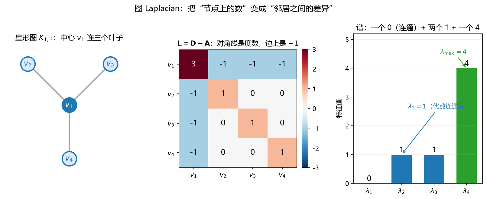

# S010_第04课_图Laplacian与谱

- **日期**：2026-11-02
- **课程**：AISC5020 Mathematics & Statistics for AI
- **范围**：L3 pp.66–93（pp.86–93 了解）
- **时长**：45 分钟
- **概念**：`graph_laplacian`、`normalized_laplacian`
- **作业来源**：A1 Q4 同型

---

## 0. 本课目标

1. 会由邻接矩阵 $\mathbf A$、度矩阵 $\mathbf D$ 写出 Laplacian $\mathbf L=\mathbf D-\mathbf A$。
2. 理解 $\mathbf L$ 是“邻居差异算子”，半正定。
3. 会用特征值判断连通分量数、代数连通度、最大特征值。

---

## 1. 引入：四个人合租，谁和谁熟？

四个室友 $v_1,v_2,v_3,v_4$，认识就用一条边连起来。

- 如果图分成两堆、彼此不连，说明“社群”分成两块；
- 想找“最少切几条边就能分成两派”的切法——这就是**谱聚类**；
- 用一个矩阵把“谁和谁相连”编码进去，这个矩阵就是 **Laplacian**。

生活场景：社交网络分圈、图像分割、推荐系统找社区、GNN 做平滑。

---

## 2. 直觉与几何

### 2.1 三个矩阵

- 邻接矩阵 $\mathbf A$：$A_{ij}=1$ 若 $i,j$ 有边，否则 $0$；
- 度矩阵 $\mathbf D$：对角矩阵，$D_{ii}=\deg(i)$；
- Laplacian：

$$
\mathbf L=\mathbf D-\mathbf A.
$$

### 2.2 $\mathbf L\mathbf x$ 在算什么？

对节点 $i$：

$$
(\mathbf L\mathbf x)_i
=\deg(i)x_i-\sum_{j\sim i}x_j
=\sum_{j\sim i}(x_i-x_j).
$$

**一句话**：$\mathbf L\mathbf x$ 的第 $i$ 个分量 = “我和所有邻居的差异之和”。

### 2.3 二次型：差异的平方和

$$
\mathbf x^\top\mathbf L\mathbf x
=\sum_{(i,j)\in E}(x_i-x_j)^2\ge0.
$$

所以 $\mathbf L$ **半正定**，特征值全部 $\ge0$。

### 2.4 谱：特征值在说什么

$$
0=\lambda_1\le\lambda_2\le\cdots\le\lambda_n.
$$

- $\mathbf L\mathbf 1=\mathbf 0$：常数向量永远是特征值 $0$ 的特征向量（每个人“一样”时没有差异）；
- **零特征值的个数 = 连通分量数**；
- $\lambda_2$（第二个最小特征值）= **代数连通度**：越小越容易切成两半；$\lambda_2=0$ 当且仅当图不连通；
- $\lambda_n$ = 最大特征值，衡量图的“二分性/振动幅度”，有上界 $\lambda_n\le2\max_i\deg(i)$。

**看图**：

- 左：星形图 $K_{1,3}$，中心 $v_1$ 连三个叶子；
- 中：$\mathbf L$ 的对角线是度数 $(3,1,1,1)$，每条边对应两个 $-1$；
- 右：特征值 $0,1,1,4$。只有一个 $0$，说明图连通；$\lambda_2=1$ 是代数连通度；$\lambda_4=4$ 是最大特征值。

---

## 3. 公式卡

### 3.1 Laplacian 矩阵（graph Laplacian）

$$
\mathbf L=\mathbf D-\mathbf A,
\qquad
L_{ij}=
\begin{cases}
\deg(i), & i=j,\\
-1, & i\ne j\ \text{且}\ (i,j)\in E,\\
0, & \text{其他}.
\end{cases}
$$

- **符号**：$\mathbf D$ 是度矩阵（对角）；$\mathbf A$ 是邻接矩阵；$E$ 是边集。
- **意义与场景**：把“图结构”变成矩阵，之后就能用线代工具（特征值、二次型）分析它。谱聚类、图神经网络、图像分割都用它。
- **例**：
  - **背景**：三角形图 $K_3$，三个节点两两相连。
  - **解**：
    - Step 1：$\mathbf A=\begin{bmatrix}0&1&1\\1&0&1\\1&1&0\end{bmatrix}$。
    - Step 2：每个节点度数为 $2$，$\mathbf D=2\mathbf I_3$。
    - Step 3：$\mathbf L=2\mathbf I_3-\mathbf A=\begin{bmatrix}2&-1&-1\\-1&2&-1\\-1&-1&2\end{bmatrix}$。
    - 检查：每行加起来都是 $0$，所以 $\mathbf L\mathbf 1=\mathbf 0$。
  - **解读**：三角形最“紧密”，代数连通度是 $3$，切一刀至少要断开两条边。

### 3.2 Laplacian 二次型（quadratic form）

$$
\mathbf x^\top\mathbf L\mathbf x
=\sum_{(i,j)\in E}(x_i-x_j)^2.
$$

- **符号**：$x_i$ 是节点 $i$ 上的数值（温度、标签、信号）。
- **意义与场景**：它衡量“整张图上相邻节点的差异总能量”。差异大 → 能量大；所有节点一样 → 能量 $0$。图上的平滑、去噪、半监督学习都在最小化它。
- **例**：
  - **背景**：路径图 $1-2-3$，节点值 $\mathbf x=(1,2,3)^\top$。
  - **解**：
    - Step 1：$\mathbf L=\begin{bmatrix}1&-1&0\\-1&2&-1\\0&-1&1\end{bmatrix}$。
    - Step 2：$\mathbf L\mathbf x=(-1,0,1)^\top$。
    - Step 3：$\mathbf x^\top\mathbf L\mathbf x=1\times(-1)+2\times0+3\times1=2$。
    - 检查：按边算 $(1-2)^2+(2-3)^2=1+1=2$，一致。
  - **解读**：两条边的差值都是 $1$，总能量 $2$。

### 3.3 谱性质（spectral properties）

$$
0=\lambda_1\le\lambda_2\le\cdots\le\lambda_n,
\qquad
\#\{i:\lambda_i=0\}=\text{连通分量数},
\qquad
\lambda_n\le2\max_i\deg(i).
$$

- **符号**：$\lambda_2$ 是代数连通度（algebraic connectivity，也叫 Fiedler value）。
- **意义与场景**：不用画图，只看特征值就知道图连不连通、好不好切。谱聚类就是拿 $\lambda_2$ 的特征向量（Fiedler vector）给节点排序，再切成两半。
- **例**：
  - **背景**：路径图 $1-2-3$。
  - **解**：
    - Step 1：$\mathbf L=\begin{bmatrix}1&-1&0\\-1&2&-1\\0&-1&1\end{bmatrix}$。
    - Step 2：特征多项式给 $\lambda=0,1,3$。
    - Step 3：只有一个 $0$ → 连通；$\lambda_2=1$；$\lambda_n=3\le2\times2=4$。
    - 检查：$\mathbf L(1,1,1)^\top=\mathbf 0$，常数向量对应 $\lambda=0$。
  - **解读**：$\lambda_2=1$ 说明断开中间那条边就能分成两半。

### 3.4 归一化 Laplacian（normalized Laplacian，了解）

$$
\mathbf L_{\mathrm{sym}}
=\mathbf I-\mathbf D^{-1/2}\mathbf A\mathbf D^{-1/2},
\qquad
0\le\lambda_i\le2.
$$

- **符号**：$\mathbf D^{-1/2}$ 是对角元 $1/\sqrt{\deg(i)}$ 的对角矩阵（孤立点需单独处理）。
- **意义与场景**：度差异很大时，普通 $\mathbf L$ 会被“大度节点”主导；归一化后每个节点的影响力更均衡，谱聚类通常更稳。
- **例**：
  - **背景**：路径图 $1-2-3$。
  - **解**：
    - Step 1：$\mathbf D^{-1/2}=\operatorname{diag}(1,\frac{1}{\sqrt2},1)$。
    - Step 2：$\mathbf L_{\mathrm{sym}}=\begin{bmatrix}1&-\frac{1}{\sqrt2}&0\\-\frac{1}{\sqrt2}&1&-\frac{1}{\sqrt2}\\0&-\frac{1}{\sqrt2}&1\end{bmatrix}$。
    - Step 3：特征值 $0,1,2$。
    - 检查：全部落在 $[0,2]$，符合归一化 Laplacian 的谱范围。
  - **解读**：归一化把谱“压”回 $[0,2]$，不同图之间更好比较。

---

## 4. 完整手算：A1 Q4 原题

图：节点 $\{v_1,v_2,v_3,v_4\}$，边 $\{v_1,v_2\},\{v_1,v_3\},\{v_1,v_4\}$（星形 $K_{1,3}$）。

### 4.1 写邻接矩阵与度矩阵

$$
\mathbf A=
\begin{bmatrix}
0&1&1&1\\
1&0&0&0\\
1&0&0&0\\
1&0&0&0
\end{bmatrix}.
$$

度数：$v_1$ 连 3 个，$v_2,v_3,v_4$ 各连 1 个：

$$
\mathbf D=
\begin{bmatrix}
3&0&0&0\\
0&1&0&0\\
0&0&1&0\\
0&0&0&1
\end{bmatrix}.
$$

### 4.2 算 Laplacian

$$
\mathbf L=\mathbf D-\mathbf A=
\begin{bmatrix}
3&-1&-1&-1\\
-1&1&0&0\\
-1&0&1&0\\
-1&0&0&1
\end{bmatrix}.
$$

**检查**：每一行加起来都是 $0$：

- 第 1 行：$3-1-1-1=0$；
- 第 2 行：$-1+1=0$；第 3、4 行同理。

所以 $\mathbf L\mathbf 1=\mathbf 0$，常数向量对应 $\lambda=0$。

### 4.3 验证特征值 $0,1,1,4$

**$\lambda=0$：**

$$
\mathbf L(1,1,1,1)^\top=\mathbf 0.
$$

**$\lambda=1$：** 取 $\mathbf u=(0,1,-1,0)^\top$。

$$
\mathbf L\mathbf u=
\begin{bmatrix}
3&-1&-1&-1\\
-1&1&0&0\\
-1&0&1&0\\
-1&0&0&1
\end{bmatrix}
\begin{bmatrix}0\\1\\-1\\0\end{bmatrix}
=
\begin{bmatrix}0\\1\\-1\\0\end{bmatrix}
=1\cdot\mathbf u.
$$

同理 $\mathbf w=(0,1,0,-1)^\top$ 也对应 $\lambda=1$。所以 $\lambda=1$ 的重数是 $2$。

**$\lambda=4$：** 取 $\mathbf z=(3,-1,-1,-1)^\top$。

$$
\mathbf L\mathbf z=
\begin{bmatrix}
3&-1&-1&-1\\
-1&1&0&0\\
-1&0&1&0\\
-1&0&0&1
\end{bmatrix}
\begin{bmatrix}3\\-1\\-1\\-1\end{bmatrix}
=
\begin{bmatrix}12\\-4\\-4\\-4\end{bmatrix}
=4\mathbf z.
$$

所以四个特征值是

$$
0,\ 1,\ 1,\ 4.
$$

### 4.4 回答题目

1. **代数连通度**：$\lambda_2=1$。
2. **最大 Laplacian 特征值**：$\lambda_4=4$。
3. **是否连通**：连通。因为零特征值只有一个；若分成 $k$ 个连通分量，就会有 $k$ 个零特征值。
4. **零特征值个数与连通分量的关系**：零特征值的重数 = 连通分量数。每个分量上的指示向量（该分量内为 $1$、其余为 $0$）都是 $\mathbf L$ 的零特征向量。

**Fiedler vector**：$\lambda_2=1$ 的特征向量可取 $(0,1,-1,0)^\top$，它把 $v_2$ 与 $v_3$ 分开，正好提示“切一条边就能分两派”。

---

## 5. 机器学习里的用途

1. **谱聚类（spectral clustering）**：算 $\mathbf L$ 的前 $k$ 个特征向量，把节点嵌入到低维，再跑 k-means。$\lambda_2$ 的特征向量常用来二分。
2. **图像分割**：像素当节点，相似度当边；Laplacian 特征向量把前景/背景分开。
3. **图神经网络（GNN）**：图卷积可以看成“用 Laplacian 做平滑”；$\mathbf L$ 的二次型越小，邻居表示越接近。
4. **半监督学习**：已知标签的节点固定，最小化 $\mathbf x^\top\mathbf L\mathbf x$ 把标签扩散到邻居。
5. **社群发现**：零特征值个数数连通分量；$\lambda_2$ 小说明社群之间“桥”少。

---

## 6. 常见易错点

1. **$\mathbf D$ 是对角矩阵**，不是度向量；写的时候别漏零。
2. **$\mathbf L$ 每行和为 $0$**，所以 $\mathbf 1$ 一定是零特征向量；这是检查算错的最快方法。
3. **零特征值个数 = 连通分量数**，不是“永远 1 个”；不连通时会有多个 $0$。
4. **$\lambda_2=0$ 当且仅当图不连通**；$\lambda_2>0$ 才连通。
5. **$\lambda_2$ 小 ≠ 图一定不连通**：它衡量“多难切”，可能是两个社群只有一条桥。
6. **归一化 Laplacian 的谱在 $[0,2]$**，普通 $\mathbf L$ 的谱可以到 $2\max\deg$，两者不要混。
7. **孤立节点**：度为 $0$，$\mathbf D^{-1/2}$ 无定义；归一化时要单独处理。
8. **特征值重数**：星形图的 $1$ 是二重，不是算错。

---

## 7. 与已学 / 后续的关系

- **L03 特征分解**：$\mathbf L$ 是对称半正定矩阵，所以特征值全实、特征向量正交，可正交对角化。
- **L02 零空间**：零特征值对应的特征向量就是 $\operatorname{Null}(\mathbf L)$；重数 = 连通分量数。
- **L05 梯度/Hessian**：图上的能量 $\frac12\mathbf x^\top\mathbf L\mathbf x$ 的梯度是 $\mathbf L\mathbf x$，Hessian 是 $\mathbf L$；Laplacian 就是一个“图上的二阶差分”。
- **后续**：谱聚类、GNN、Cheeger 不等式（了解）。

---

## 8. 作业

> 先自己做，答案在最后；默认不批改。

1. **星形图 $K_{1,4}$**  
   5 个节点，中心 $v_1$ 连 $v_2,v_3,v_4,v_5$，没有其他边。  
   (a) 写 $\mathbf A,\mathbf D,\mathbf L$；  
   (b) 已知特征值为 $0,1,1,1,5$，求代数连通度、最大特征值；  
   (c) 判断是否连通，并说明零特征值个数。

2. **三角形 + 孤立点**  
   节点 $v_1,v_2,v_3$ 两两相连，$v_4$ 孤立。  
   (a) 写 $\mathbf L$；  
   (b) 求特征值；  
   (c) 有几个连通分量？$\lambda_2$ 是多少？

3. **二次型**  
   路径图 $1-2-3-4$，节点值 $\mathbf x=(1,2,0,3)^\top$。  
   (a) 写 $\mathbf L$；  
   (b) 直接算 $\mathbf x^\top\mathbf L\mathbf x$；  
   (c) 用边差异平方和验算。

4. **机器学习联系**  
   (a) 谱聚类为什么要用 $\mathbf L$ 的特征向量，而不是原始邻接矩阵？  
   (b) 归一化 Laplacian 解决什么问题？  
   (c) 如果 $\lambda_2$ 非常接近 $0$，说明图可能是什么结构？

---

## 9. 作业答案（先自己做完再看）

### 9.1 第 1 题

**(a)**

$$
\mathbf A=
\begin{bmatrix}
0&1&1&1&1\\
1&0&0&0&0\\
1&0&0&0&0\\
1&0&0&0&0\\
1&0&0&0&0
\end{bmatrix},
\qquad
\mathbf D=\operatorname{diag}(4,1,1,1,1),
$$

$$
\mathbf L=
\begin{bmatrix}
4&-1&-1&-1&-1\\
-1&1&0&0&0\\
-1&0&1&0&0\\
-1&0&0&1&0\\
-1&0&0&0&1
\end{bmatrix}.
$$

**(b)** 代数连通度 $\lambda_2=1$；最大特征值 $\lambda_5=5$。

**(c)** 连通。零特征值只有一个；若分成 $k$ 个分量，零特征值就有 $k$ 个。

### 9.2 第 2 题

**(a)** 三角形部分每个节点度为 $2$；$v_4$ 度为 $0$：

$$
\mathbf L=
\begin{bmatrix}
2&-1&-1&0\\
-1&2&-1&0\\
-1&-1&2&0\\
0&0&0&0
\end{bmatrix}.
$$

**(b)** 三角形块的 Laplacian 特征值是 $0,3,3$；孤立点给一个 $0$。所以整体特征值：

$$
0,\ 0,\ 3,\ 3.
$$

**(c)** 两个连通分量；$\lambda_2=0$。

**说明**：零特征值重数 $2$ = 分量数 $2$；$\lambda_2=0$ 正是不连通的标志。

### 9.3 第 3 题

**(a)**

$$
\mathbf L=
\begin{bmatrix}
1&-1&0&0\\
-1&2&-1&0\\
0&-1&2&-1\\
0&0&-1&1
\end{bmatrix}.
$$

**(b)**

$$
\mathbf L\mathbf x=
\begin{bmatrix}
1-2\\
-1+4-0\\
-2+0-3\\
0-0+3
\end{bmatrix}
=
\begin{bmatrix}
-1\\
3\\
-5\\
3
\end{bmatrix}.
$$

$$
\mathbf x^\top\mathbf L\mathbf x
=1(-1)+2(3)+0(1)+3(3)
=-1+6+0+9=14.
$$

**(c)** 三条边的差异：

$$
(1-2)^2+(2-0)^2+(0-3)^2=1+4+9=14.
$$

一致。

### 9.4 第 4 题

**(a)** 邻接矩阵只记录“直接相连”，噪声大、度差异大时不稳定；Laplacian 的特征向量给出“全局的、平滑的分割方向”，$\lambda_2$ 的特征向量（Fiedler vector）尤其适合二分。

**(b)** 归一化 Laplacian 降低了“大度节点”的主导作用，使不同度的节点影响力更均衡，谱落在 $[0,2]$，便于跨图比较和选阈值。

**(c)** $\lambda_2$ 非常接近 $0$（但非 $0$）说明图几乎分成两个社群，中间只有很少的“桥”边；谱聚类很容易切开。

---

## 修订记录

- 2026-11-02：创建（S010 第 04 课）；新增 `fig_graph_laplacian.png`。
