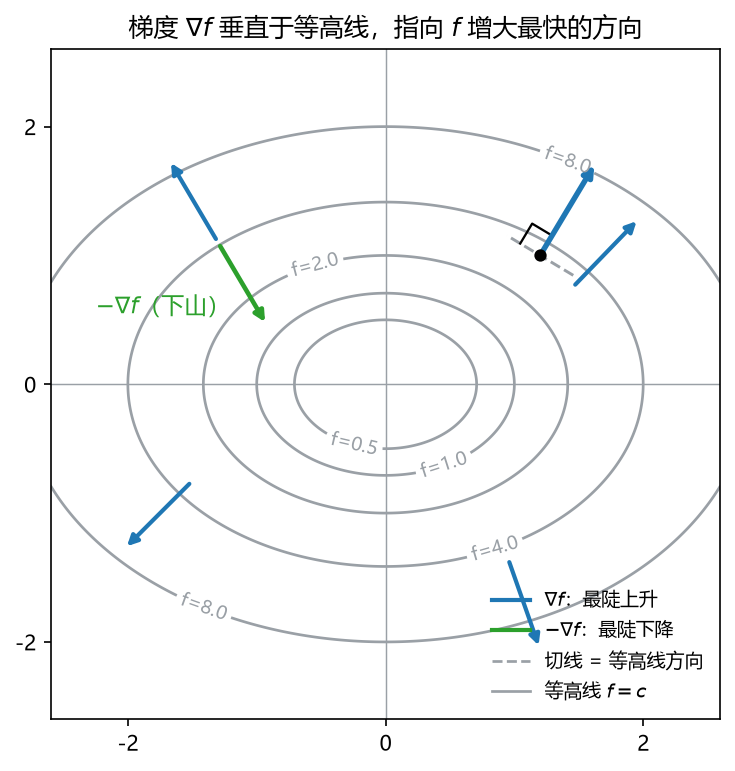
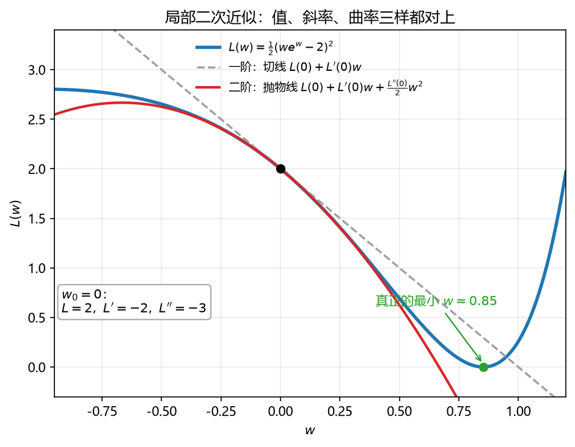

# S010_第05课_梯度·Hessian·Taylor·Jacobian

- **日期**：2026-11-02
- **课程**：AISC5020 Mathematics & Statistics for AI
- **范围**：L4 pp.20–66
- **时长**：75 分钟
- **概念**：`gradient_hessian`、`jacobian_taylor`
- **作业来源**：A1 Q5 同型

---

## 0. 本课目标

1. 会求梯度、Hessian、Jacobian。
2. 会写一阶/二阶 Taylor 近似。
3. 知道 Hessian 正定与极小值、凸性的关系。

---

## 1. 引入：蒙眼下山

你站在山坡上，眼睛蒙住，只能用手摸脚下的坡度：

- **梯度**：最陡的上坡方向，以及有多陡；
- **Hessian**：坡度本身怎么变化——前面是越来越陡，还是快到谷底了；
- **Taylor**：用“当前位置 + 斜率 + 曲率”近似附近地形；
- **Jacobian**：当你同时输出多个量时，每个输入对每个输出的影响。

---

## 2. 直觉与几何

### 2.1 梯度：最陡上升方向

$$
\nabla f(x,y)=\begin{bmatrix}f_x\\f_y\end{bmatrix}.
$$

- 方向：函数增长最快的方向；
- 长度：那个方向上的斜率；
- $-\nabla f$：下降最快，梯度下降就走它。

**看图**：蓝色箭头是 $\nabla f$，始终垂直于等高线，指向 $f$ 增大的方向；绿色是 $-\nabla f$，指向山下。

### 2.2 Hessian：曲率矩阵

$$
H_f(x,y)=
\begin{bmatrix}
f_{xx}&f_{xy}\\
f_{yx}&f_{yy}
\end{bmatrix}.
$$

- 对称：$f_{xy}=f_{yx}$（二阶偏导连续时）；
- 正定 → 碗口向上；负定 → 碗口向下；不定 → 马鞍；
- 在临界点（$\nabla f=0$）处，Hessian 正定 ⇒ 局部极小。

### 2.3 Taylor：用多项式贴住函数

一阶：

$$
f(\mathbf x_0+\mathbf h)\approx f(\mathbf x_0)+\nabla f(\mathbf x_0)^\top\mathbf h.
$$

二阶：

$$
f(\mathbf x_0+\mathbf h)\approx f(\mathbf x_0)+\nabla f(\mathbf x_0)^\top\mathbf h+\frac12\mathbf h^\top H_f(\mathbf x_0)\mathbf h.
$$

**看图**：蓝线是原函数，灰色虚线是一阶切线，红色虚线是二阶抛物线；二阶近似把“弯曲程度”也对上了。

### 2.4 Jacobian：向量函数的导数

若 $\mathbf F:\mathbb R^n\to\mathbb R^m$，则

$$
J_{\mathbf F}(\mathbf x)=
\begin{bmatrix}
\dfrac{\partial F_1}{\partial x_1}&\cdots&\dfrac{\partial F_1}{\partial x_n}\\
\vdots&&\vdots\\
\dfrac{\partial F_m}{\partial x_1}&\cdots&\dfrac{\partial F_m}{\partial x_n}
\end{bmatrix}.
$$

- 形状 $m\times n$；
- 第 $i$ 行是 $F_i$ 的梯度；
- 链式法则：$J_{\mathbf g\circ\mathbf f}=J_{\mathbf g}J_{\mathbf f}$。

---

## 3. 公式卡

### 3.1 梯度与方向导数

$$
\nabla f=\begin{bmatrix}f_{x_1}\\\vdots\\f_{x_n}\end{bmatrix},
\qquad
D_{\mathbf u}f=\nabla f\cdot\mathbf u
\quad(\|\mathbf u\|=1).
$$

- **符号**：$f_{x_i}$ 是偏导；$\mathbf u$ 是单位方向。
- **意义**：梯度给最陡方向；方向导数给“沿某个方向走，函数变化多快”。
- **例**：$f(x,y)=x^2y+y^3$，在 $(1,2)$，$\mathbf u=(\frac35,\frac45)$。
  - Step 1：$f_x=2xy=4$，$f_y=x^2+3y^2=1+12=13$。
  - Step 2：$\nabla f=(4,13)$。
  - Step 3：$D_{\mathbf u}f=4\cdot\frac35+13\cdot\frac45=\frac{12+52}{5}=\frac{64}{5}=12.8$。
  - 检查：$\|\mathbf u\|=1$。
- **解读**：沿这个方向走，函数大约每单位长度上升 $12.8$。

### 3.2 Hessian

$$
H_f=\begin{bmatrix}
f_{x_1x_1}&\cdots&f_{x_1x_n}\\
\vdots&&\vdots\\
f_{x_nx_1}&\cdots&f_{x_nx_n}
\end{bmatrix}.
$$

- **符号**：$f_{x_ix_j}$ 是二阶偏导。
- **意义**：描述曲率；判断极小/极大/鞍点；牛顿法用它。
- **例**：接 3.1，$f=x^2y+y^3$。
  - Step 1：$f_{xx}=2y=4$，$f_{xy}=2x=2$。
  - Step 2：$f_{yx}=2x=2$，$f_{yy}=6y=12$。
  - Step 3：$H=\begin{bmatrix}4&2\\2&12\end{bmatrix}$。
  - 检查：$4>0$，$\det=48-4=44>0$，正定。
- **解读**：在 $(1,2)$ 附近是碗形，梯度为零时会是极小。

### 3.3 二阶 Taylor

$$
f(\mathbf x_0+\mathbf h)\approx f(\mathbf x_0)+\nabla f(\mathbf x_0)^\top\mathbf h+\frac12\mathbf h^\top H_f(\mathbf x_0)\mathbf h.
$$

- **符号**：$\mathbf h$ 是离展开点的小位移。
- **意义**：局部用二次函数代替原函数；优化、误差分析、牛顿法都靠它。
- **例**：$f(x,y)=e^x\sin y$，在 $(0,0)$。
  - Step 1：$f(0,0)=0$；$\nabla f=(e^x\sin y,e^x\cos y)=(0,1)$。
  - Step 2：$H=\begin{bmatrix}e^x\sin y&e^x\cos y\\e^x\cos y&-e^x\sin y\end{bmatrix}=\begin{bmatrix}0&1\\1&0\end{bmatrix}$。
  - Step 3：$f\approx 0+0\cdot x+1\cdot y+\frac12(2xy)=y+xy$。
  - 检查：$f(0,0)=0$，一阶项只有 $y$，与 $\nabla f$ 一致。
- **解读**：在原点附近，$e^x\sin y$ 主要由 $y$ 和 $xy$ 决定。

### 3.4 Jacobian 与链式法则

$$
J_{\mathbf F}=\begin{bmatrix}\nabla F_1^\top\\\vdots\\\nabla F_m^\top\end{bmatrix},
\qquad
J_{\mathbf g\circ\mathbf f}=J_{\mathbf g}J_{\mathbf f}.
$$

- **符号**：$F_i$ 是第 $i$ 个输出。
- **意义**：多输出函数的“导数表”；反向传播就是不断乘 Jacobian（或它的转置）。
- **例**：$\mathbf F(x,y)=(x^2y,\ x+y^2)$，在 $(1,2)$。
  - Step 1：$\partial F_1/\partial x=2xy=4$，$\partial F_1/\partial y=x^2=1$。
  - Step 2：$\partial F_2/\partial x=1$，$\partial F_2/\partial y=2y=4$。
  - Step 3：$J=\begin{bmatrix}4&1\\1&4\end{bmatrix}$。
  - 检查：形状 $2\times2$，行数是输出个数。
- **解读**：输入动一点点，两个输出分别怎么变，全在这张表里。

---

## 4. 完整手算：A1 Q5 原题

### 4.1 (a) 梯度与 Hessian

$$
f(x,y,z)=x^2+\sin(xy)+2x+\cos z+3.
$$

**第 1 步：一阶偏导。**

$$
f_x=2x+y\cos(xy)+2,
$$

$$
f_y=x\cos(xy),
\qquad
f_z=-\sin z.
$$

在 $(0,0,0)$：

$$
\nabla f(0,0,0)=(2,0,0)^\top.
$$

**第 2 步：二阶偏导。**

$$
f_{xx}=2-y^2\sin(xy),
$$

$$
f_{xy}=\cos(xy)-xy\sin(xy),
$$

$$
f_{xz}=0,
$$

$$
f_{yy}=-x^2\sin(xy),
\qquad
f_{yz}=0,
\qquad
f_{zz}=-\cos z.
$$

在 $(0,0,0)$：

$$
H_f(0,0,0)=
\begin{bmatrix}
2&1&0\\
1&0&0\\
0&0&-1
\end{bmatrix}.
$$

**第 3 步：二阶 Taylor。**

$$
f(0,0,0)=0+0+0+1+3=4.
$$

$$
f\approx 4+2x+\frac12\left(2x^2+2xy-z^2\right)
=4+2x+x^2+xy-\frac12z^2.
$$

### 4.2 (b) Jacobian

$$
\mathbf F(x,y,z)=\begin{bmatrix}x+y+z\\xyz\end{bmatrix}.
$$

**第 1 步：逐行求偏导。**

$$
J_{\mathbf F}=
\begin{bmatrix}
1&1&1\\
yz&xz&xy
\end{bmatrix}.
$$

**第 2 步：代入 $(1,2,3)$。**

$$
J_{\mathbf F}(1,2,3)=
\begin{bmatrix}
1&1&1\\
6&3&2
\end{bmatrix}.
$$

**检查**：形状 $2\times3$，与“2 个输出、3 个输入”一致。

---

## 5. 机器学习里的用途

1. **梯度下降**：$\boldsymbol\theta\leftarrow\boldsymbol\theta-\eta\nabla L$。
2. **Hessian 与凸性**：$H$ 正定 → 局部凸；牛顿法用 $H^{-1}\nabla L$。
3. **Taylor**：分析损失面、学习率稳定性、二阶优化。
4. **Jacobian**：反向传播的链式法则；归一化流、ODE、灵敏度分析。
5. **鞍点**：Hessian 不定时，梯度为零也可能是鞍点，不是极小。

---

## 6. 常见易错点

1. **梯度是向量，Hessian 是矩阵**，别混。
2. **Hessian 对称**：$f_{xy}=f_{yx}$（连续时）。
3. **Taylor 的 $\frac12$ 别丢**：$\frac12\mathbf h^\top H\mathbf h$。
4. **Jacobian 形状是“输出 $\times$ 输入”**。
5. **梯度为零只是必要条件**，还要看 Hessian 才知极小/极大/鞍点。
6. **方向导数要用单位向量**，否则差一个长度因子。

---

## 7. 与已学 / 后续

- **L02 矩阵-向量乘法**：$H\mathbf h$ 就是 Hessian 作用于位移向量。
- **L03 特征值**：Hessian 正定 $\iff$ 特征值全正。
- **L06 反向传播**：Jacobian 的链式乘法。
- **L01 最小二乘**：$H=2\mathbf X^\top\mathbf X$。

---

## 8. 作业

1. $f(x,y,z)=x^2y+yz^2+e^z$，求 $\nabla f(1,0,0)$、$H_f(1,0,0)$，并写二阶 Taylor。
2. $\mathbf F(x,y,z)=(x\sin y,\ y\cos z,\ xz)$，求 $J_{\mathbf F}(1,\frac\pi2,\frac\pi2)$。
3. $f(x,y)=\ln(1+x)+y^2$，在 $(0,0)$ 写二阶 Taylor。
4. 判断：Hessian 在临界点正定 ⇒ 局部极小；不定 ⇒ 鞍点。说明理由。
5. 机器学习：写出梯度下降更新式，并说明 Hessian 在牛顿法中的作用。

---

## 9. 作业答案（先自己做完再看）

### 9.1 第 1 题

$$
f_x=2xy,\quad f_y=x^2+z^2,\quad f_z=2yz+e^z.
$$

在 $(1,0,0)$：

$$
\nabla f=(0,1,1)^\top.
$$

二阶偏导：

$$
f_{xx}=2y=0,\quad f_{xy}=2x=2,\quad f_{xz}=0,
$$

$$
f_{yy}=0,\quad f_{yz}=2z=0,\quad f_{zz}=2y+e^z=1.
$$

$$
H=\begin{bmatrix}0&2&0\\2&0&0\\0&0&1\end{bmatrix}.
$$

$f(1,0,0)=0$，所以

$$
f\approx dy+dz+2\,dx\,dy+\frac12 dz^2.
$$

### 9.2 第 2 题

$$
J=
\begin{bmatrix}
\sin y&x\cos y&0\\
0&\cos z&-y\sin z\\
z&0&x
\end{bmatrix}.
$$

在 $(1,\frac\pi2,\frac\pi2)$：

$$
J=\begin{bmatrix}
1&0&0\\
0&0&-\frac\pi2\\
\frac\pi2&0&1
\end{bmatrix}.
$$

### 9.3 第 3 题

$f(0,0)=0$，$\nabla f=(1,0)$，

$$
H=\begin{bmatrix}-1&0\\0&2\end{bmatrix},
$$

所以

$$
f\approx x+y^2-\frac12x^2.
$$

### 9.4 第 4 题

对。临界点处一阶项为零，二阶 Taylor 主导：$H$ 正定 ⇒ 各方向都向上弯 ⇒ 局部极小；不定 ⇒ 有上有下 ⇒ 鞍点。

### 9.5 第 5 题

$$
\boldsymbol\theta_{t+1}=\boldsymbol\theta_t-\eta\nabla L(\boldsymbol\theta_t).
$$

牛顿法：

$$
\boldsymbol\theta_{t+1}=\boldsymbol\theta_t-H_L^{-1}\nabla L.
$$

Hessian 提供曲率信息，收敛更快，但计算/求逆代价高。

---

## 修订记录

- 2026-11-02：创建（S010 第 05 课）。
