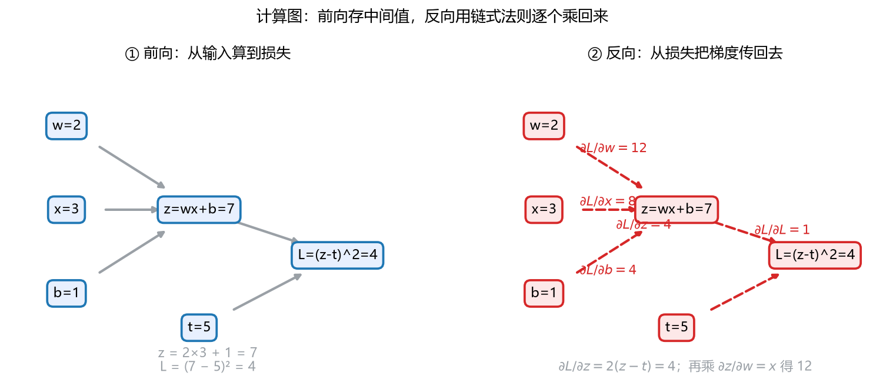

# S010_第06课_计算图与反向传播

- **日期**：2026-11-02
- **课程**：AISC5020 Mathematics & Statistics for AI
- **范围**：L4 pp.67–81
- **时长**：45 分钟
- **概念**：`autodiff`
- **作业来源**：A1 Q6 同型

---

## 0. 本课目标

1. 看懂计算图的前向与反向。
2. 会用链式法则手算 adjoint。
3. 知道反向传播为什么比“逐个参数重新求导”便宜。

---

## 1. 引入：工厂流水线

一个零件经过几道工序：

- **前向**：原料 → 半成品 → 成品，记下每道工序的中间尺寸；
- **反向**：成品不合格，沿流水线倒着追“哪道工序该负多少责任”；
- 每道工序的“责任” = 后面传回来的责任 × 这道工序自己的局部导数。

这就是**反向传播（backpropagation）**。

---

## 2. 直觉与几何

### 2.1 计算图

把每个运算画成节点：

$$
z=wx+b,
\qquad
L=(z-t)^2.
$$

- 叶子：$w,x,b,t$；
- 中间：$z$；
- 输出：$L$。

**看图**：

- 左：$w=2,x=3,b=1\Rightarrow z=7$；$t=5\Rightarrow L=(7-5)^2=4$；
- 右：红色箭头是反向。$\partial L/\partial z=2(z-t)=4$；再乘局部导数 $\partial z/\partial w=x=3$，得 $\partial L/\partial w=12$。

### 2.2 adjoint：每个节点“欠多少”

定义

$$
\bar v=\frac{\partial L}{\partial v}.
$$

反向规则：

$$
\bar v=\sum_{u:\ v\to u}\bar u\frac{\partial u}{\partial v}.
$$

**一句话**：一个节点如果影响多个下游节点，就把各条路径的“责任”**加起来**。

### 2.3 为什么反向便宜

- 前向一次：$O(\text{节点数})$；
- 反向一次：每个节点只算一次局部导数，$O(\text{节点数})$；
- 一次反向就得到**所有参数**的梯度；若逐个参数做数值差分，要 $O(\text{参数数})$ 次前向。

---

## 3. 公式卡

### 3.1 链式法则（单路径）

$$
\frac{dL}{dx}=\frac{dL}{dz}\frac{dz}{dx}.
$$

- **符号**：$z$ 是中间变量，$x$ 是上游输入。
- **意义**：把“最终损失对中间量的敏感度”乘上“中间量对输入的敏感度”。
- **例**：$z=3x$，$L=z^2$，在 $x=2$。
  - Step 1：$z=6$。
  - Step 2：$dL/dz=2z=12$。
  - Step 3：$dz/dx=3$，所以 $dL/dx=12\times3=36$。
  - 检查：$L=9x^2$，$dL/dx=18x=36$。
- **解读**：链式法则就是“逐段放大敏感度”。

### 3.2 反向传播的 adjoint 规则

$$
\bar v=\sum_{u}\bar u\frac{\partial u}{\partial v}.
$$

- **符号**：$\bar v=\partial L/\partial v$；$u$ 是 $v$ 的下游节点。
- **意义**：从输出往输入走，每个节点收集所有下游传来的责任。
- **例**：$z=wx+b$，$L=(z-t)^2$。
  - Step 1：$\bar L=1$。
  - Step 2：$\bar z=2(z-t)$。
  - Step 3：$\bar w=\bar z\,x$，$\bar b=\bar z$，$\bar x=\bar z\,w$。
  - 检查：量纲/形状对；标量情形都是数。
- **解读**：乘法节点把对方的数值“交换”给对方的梯度。

### 3.3 向量情形的链式法则

$$
\bar{\mathbf x}=J_{\mathbf z}(\mathbf x)^\top\bar{\mathbf z}.
$$

- **符号**：$J_{\mathbf z}$ 是 $\mathbf z$ 对 $\mathbf x$ 的 Jacobian。
- **意义**：反向传播传的是“Jacobian 转置乘以上游梯度”，不需要显式构造大矩阵。
- **例**：$\mathbf z=\mathbf W\mathbf x$，$\mathbf W$ 是 $2\times3$。
  - Step 1：$J_{\mathbf z}=\mathbf W$。
  - Step 2：$\bar{\mathbf x}=\mathbf W^\top\bar{\mathbf z}$。
  - Step 3：$\bar{\mathbf W}=\bar{\mathbf z}\mathbf x^\top$（外积）。
  - 检查：$\bar{\mathbf x}$ 是 $3$ 维，$\bar{\mathbf W}$ 是 $2\times3$。
- **解读**：矩阵乘法的反向就是“转置乘”。

---

## 4. 完整手算：A1 Q6 原题

$$
z=wx+b,
\qquad
L=(z-t)^2,
$$

$$
w=2,\quad x=3,\quad b=1,\quad t=5.
$$

### 4.1 前向

$$
z=2\times3+1=7,
$$

$$
L=(7-5)^2=2^2=4.
$$

### 4.2 反向

**第 1 步：损失对 $z$。**

$$
\frac{\partial L}{\partial z}=2(z-t)=2(7-5)=4.
$$

**第 2 步：对 $w$。**

$$
\frac{\partial z}{\partial w}=x=3,
$$

$$
\frac{\partial L}{\partial w}
=\frac{\partial L}{\partial z}\frac{\partial z}{\partial w}
=4\times3=12.
$$

**第 3 步：对 $b$。**

$$
\frac{\partial z}{\partial b}=1,
\qquad
\frac{\partial L}{\partial b}=4\times1=4.
$$

**第 4 步（顺带）：对 $x$。**

$$
\frac{\partial L}{\partial x}=4\times w=8.
$$

### 4.3 结果

$$
\boxed{\frac{\partial L}{\partial z}=4,\quad
\frac{\partial L}{\partial w}=12,\quad
\frac{\partial L}{\partial b}=4.}
$$

**检查**：把 $L=(wx+b-t)^2$ 直接展开求导：

$$
\frac{\partial L}{\partial w}=2(wx+b-t)x=2(2\times3+1-5)\times3=12.
$$

一致。

---

## 5. 机器学习里的用途

1. **神经网络训练**：一次反向得到所有层、所有参数的梯度。
2. **自动微分（autograd）**：PyTorch/TensorFlow 的 `backward()` 就是反向模式。
3. **内存换计算**：前向存中间值，反向复用； checkpointing 进一步省内存。
4. **批量**：对 mini-batch 的损失取平均，梯度也取平均。
5. **梯度检查**：用数值差分验证反向实现。

---

## 6. 常见易错点

1. **忘记累加**：一个节点被多条路径使用时，梯度要相加。
2. **局部导数用错点**：要在**前向时的那个值**处求导（如 $2(z-t)$ 用 $z=7$）。
3. **矩阵反向要转置**：$\bar{\mathbf x}=\mathbf W^\top\bar{\mathbf z}$。
4. **损失取平均时梯度要除以 batch size**。
5. **原地修改**会破坏前向存的中间值，导致反向错误。
6. **数值稳定性**：softmax/CE 要配合 log-sum-exp，避免溢出。

---

## 7. 与已学 / 后续

- **L05 链式法则/Jacobian**：反向传播就是链式法则的系统化。
- **L02 矩阵乘法**：矩阵节点的反向是转置乘。
- **L07 概率**：最大似然损失的反向。
- **L13 MLE**：对数似然的梯度。

---

## 8. 作业

1. 同样的图 $z=wx+b$、$L=(z-t)^2$，取 $w=-1,x=2,b=0.5,t=1$。求前向 $z,L$ 与 $\partial L/\partial w,\partial L/\partial b$。
2. 图：$z_1=w_1x$，$z_2=z_1+w_2$，$L=(z_2-t)^2$。取 $w_1=2,x=1,w_2=3,t=6$，求所有梯度。
3. 概念：为什么反向模式对“标量损失、很多参数”特别划算？
4. 机器学习：若损失是 batch 平均 $L=\frac1B\sum_i L_i$，梯度与单样本梯度是什么关系？

---

## 9. 作业答案（先自己做完再看）

### 9.1 第 1 题

$$
z=(-1)\times2+0.5=-1.5,
\qquad
L=(-1.5-1)^2=6.25.
$$

$$
\frac{\partial L}{\partial z}=2(-1.5-1)=-5,
$$

$$
\frac{\partial L}{\partial w}=-5\times2=-10,
\qquad
\frac{\partial L}{\partial b}=-5.
$$

### 9.2 第 2 题

前向：

$$
z_1=2\times1=2,
\qquad
z_2=2+3=5,
\qquad
L=(5-6)^2=1.
$$

反向：

$$
\frac{\partial L}{\partial z_2}=2(5-6)=-2,
$$

$$
\frac{\partial L}{\partial w_2}=-2,
\qquad
\frac{\partial L}{\partial z_1}=-2,
$$

$$
\frac{\partial L}{\partial w_1}=-2\times x=-2,
\qquad
\frac{\partial L}{\partial x}=-2\times w_1=-4.
$$

### 9.3 第 3 题

反向模式一次遍历就得到所有参数的梯度，代价约等于一次前向；若逐个参数做数值差分，参数有 $P$ 个就要 $P$ 次前向。深度网络 $P$ 很大，所以反向模式划算。

### 9.4 第 4 题

$$
\nabla L=\frac1B\sum_{i=1}^{B}\nabla L_i.
$$

即 mini-batch 梯度是单样本梯度的平均；这也降低了方差。

---

## 修订记录

- 2026-11-02：创建（S010 第 06 课）；新增 `fig_computation_graph.png`。
