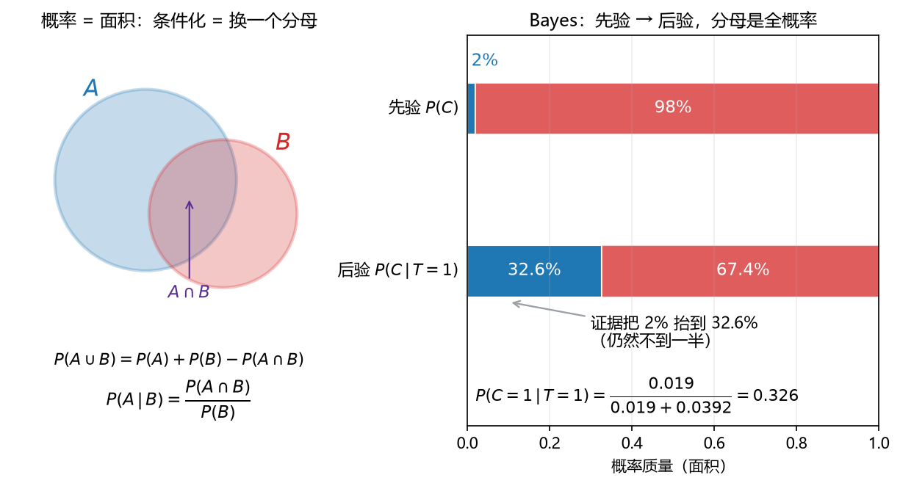

# S010_第07课_概率语言·随机变量·常见分布

- **日期**：2026-11-02
- **课程**：AISC5020 Mathematics & Statistics for AI
- **范围**：W5 pp.3–23, 38–48
- **时长**：90 分钟
- **概念**：`prob_axioms`、`bayes_rule`、`random_variable`、`common_distributions`、`expectation_variance`
- **作业来源**：A2 Q1 预备 + 分布计算

---

## 0. 本课目标

1. 会用概率公理、条件概率、独立性、Bayes。
2. 认识常见离散/连续分布，记住期望与方差。
3. 会用 CDF/PDF/PMF 算概率与分位数。

---

## 1. 引入：一次体检的误报

某种病患病率 $1\%$。检测：

- 有病时 $99\%$ 阳性；
- 没病时 $5\%$ 误报阳性。

你阳性了，真的有病的概率是多少？

直觉会说“$99\%$ 吧？”——其实只有约 $16.7\%$。这就是 Bayes 要纠正的**基率谬误**。

---

## 2. 直觉与几何

### 2.1 概率 = 面积

- 样本空间 $\Omega$：所有可能结果；
- 事件 $A$：$\Omega$ 的子集；
- $P(A)$：$A$ 的“面积”占总面积的比例。

**看图**：左边两个圆，$A\cup B$ 要减去重叠 $A\cap B$；右边 Bayes 把先验面积按证据重新分配，分母是全概率。

### 2.2 随机变量与 CDF/PDF

随机变量 $X:\Omega\to\mathbb R$ 把结果映射成数。

- CDF：$F_X(x)=P(X\le x)$；
- 离散：PMF $p_X(x)=P(X=x)$；
- 连续：PDF $f_X(x)$，$P(a<X<b)=\int_a^b f_X(x)\,dx$。

**看图**：左边 $p(x)=2x$，阴影面积是 $P(X<1/2)=1/4$；右边 CDF 从左往右累积面积，$F(0.5)=0.25$。

### 2.3 常见分布

| 分布 | 参数 | PMF/PDF | 期望 | 方差 |
|---|---|---|---|---|
| Bernoulli | $p$ | $p^x(1-p)^{1-x}$ | $p$ | $p(1-p)$ |
| Binomial | $n,p$ | $\binom nk p^k(1-p)^{n-k}$ | $np$ | $np(1-p)$ |
| Geometric（A2 版） | $\pi$ | $(1-\pi)\pi^k,\ k=0,1,\dots$ | $\dfrac{\pi}{1-\pi}$ | $\dfrac{\pi}{(1-\pi)^2}$ |
| Poisson | $\lambda$ | $e^{-\lambda}\lambda^k/k!$ | $\lambda$ | $\lambda$ |
| Uniform | $a,b$ | $1/(b-a)$ | $(a+b)/2$ | $(b-a)^2/12$ |
| Normal | $\mu,\sigma^2$ | $\frac{1}{\sqrt{2\pi\sigma^2}}e^{-\frac{(x-\mu)^2}{2\sigma^2}}$ | $\mu$ | $\sigma^2$ |
| Exponential | $\beta$（率） | $\beta e^{-\beta x}$ | $1/\beta$ | $1/\beta^2$ |

> **Geometric 有两套约定**：
> - 课件 $G_1(p)$：$f(k)=p(1-p)^{k-1}$，$k=1,2,\dots$（第几次成功），$E=1/p$；
> - A2 Q1：$p(k)=(1-\pi)\pi^k$，$k=0,1,\dots$（成功前的失败次数），$E=\pi/(1-\pi)$。
> 两者差 $1$：A2 的 $K$ 等于课件版减 $1$。做题先看题目用哪套。

### 2.4 期望与方差

- 期望 = 重心；
- 方差 = 到重心的平均平方距离；
- 线性性：$E[aX+bY]=aE[X]+bE[Y]$，不需要独立；
- 方差**不是**线性：$\operatorname{Var}(aX+b)=a^2\operatorname{Var}(X)$；独立时才可加。

---

## 3. 公式卡

### 3.1 条件概率与加法公式（conditional probability, addition rule）

$$
P(A\cup B)=P(A)+P(B)-P(A\cap B),
\qquad
P(A\mid B)=\frac{P(A\cap B)}{P(B)}.
$$

- **符号**：$A,B$ 是事件；$P(B)>0$。
- **意义**：条件化 = 把样本空间缩到 $B$，再重新归一化。
- **例**：掷一枚公平骰子，$A=\{2\}$，$B=\{2,4,6\}$。
  - Step 1：$P(A\cap B)=P(\{2\})=1/6$。
  - Step 2：$P(B)=3/6=1/2$。
  - Step 3：$P(A\mid B)=(1/6)/(1/2)=1/3$。
  - 检查：在偶数里，$2$ 占 $1/3$。
- **解读**：已知是偶数后，样本空间从 6 个缩成 3 个。

### 3.2 Bayes 公式

$$
P(A_i\mid B)=\frac{P(B\mid A_i)P(A_i)}{\sum_j P(B\mid A_j)P(A_j)}.
$$

- **符号**：$A_i$ 是划分；$P(A_i)$ 先验；$P(B\mid A_i)$ 似然；分母是全概率。
- **意义**：用证据 $B$ 更新对 $A_i$ 的信念。
- **例**：患病率 $1\%$，灵敏度 $99\%$，误报 $5\%$。
  - Step 1：$P(+)=0.99\times0.01+0.05\times0.99=0.0099+0.0495=0.0594$。
  - Step 2：$P(D\mid +)=0.0099/0.0594$。
  - Step 3：$\approx0.1667$。
  - 检查：阳性里大多数是误报，因为健康人基数大。
- **解读**：阳性后患病概率约 $16.7\%$，远低于 $99\%$。

### 3.3 期望与方差

$$
E[X]=\sum_x xp(x)\ \text{或}\ \int xf(x)\,dx,
\qquad
\operatorname{Var}(X)=E[X^2]-E[X]^2.
$$

- **符号**：离散用求和，连续用积分。
- **意义**：期望是中心，方差是离散程度；$E[X^2]$ 是二阶矩。
- **例**：$X$ 取 $0,1,2$，概率 $0.2,0.5,0.3$。
  - Step 1：$E[X]=0\times0.2+1\times0.5+2\times0.3=1.1$。
  - Step 2：$E[X^2]=0+0.5+4\times0.3=1.7$。
  - Step 3：$\operatorname{Var}=1.7-1.21=0.49$。
  - 检查：方差非负。
- **解读**：中心 $1.1$，标准差约 $0.7$。

### 3.4 离散分布（Bernoulli / Binomial / Geometric / Poisson）

$$
P(X=k)=\binom nk p^k(1-p)^{n-k},
\qquad
P(X=k)=e^{-\lambda}\frac{\lambda^k}{k!}.
$$

- **符号**：$n$ 试验次数，$p$ 成功概率，$\lambda$ 单位时间平均次数。
- **意义**：计数型数据的三大模型：固定次数成功数（Binomial）、等待时间（Geometric）、稀有事件计数（Poisson）。
- **例**：$X\sim\mathrm{Binomial}(10,0.2)$。
  - Step 1：$E[X]=10\times0.2=2$。
  - Step 2：$\operatorname{Var}=10\times0.2\times0.8=1.6$。
  - Step 3：$P(X=0)=0.8^{10}\approx0.1074$。
  - 检查：$P(X=0)$ 小于 $P(X=2)$，符合 $E=2$。
- **解读**：平均 2 次成功，0 次成功的概率约 $10.7\%$。

### 3.5 连续分布（Uniform / Normal / Exponential）

$$
Z=\frac{X-\mu}{\sigma}\sim N(0,1),
\qquad
P(a<X<b)=\Phi\!\left(\frac{b-\mu}{\sigma}\right)-\Phi\!\left(\frac{a-\mu}{\sigma}\right).
$$

- **符号**：$\Phi$ 是标准正态 CDF。
- **意义**：连续分布用面积算概率；正态标准化后查表。
- **例**：$X\sim N(70,10^2)$。
  - Step 1：$P(X>85)=P(Z>1.5)$。
  - Step 2：$=1-\Phi(1.5)$。
  - Step 3：$\approx1-0.9332=0.0668$。
  - 检查：$85$ 在均值右侧 $1.5$ 个标准差，尾部应较小。
- **解读**：约 $6.7\%$ 的人超过 $85$。

### 3.6 概率公理、补集与可加性（axioms, complement, additivity）

$$
P(A)\ge0,
\qquad
P(\Omega)=1,
\qquad
P(A^c)=1-P(A),
\qquad
P(\varnothing)=0.
$$

- **符号**：$\Omega$ 是样本空间（所有可能结果）；$A^c$ 是 $A$ 的补集；$\varnothing$ 是不可能事件。
- **意义与场景**：这三条公理是所有概率计算的起点。补集公式常用于“至少一个”的反面：“至少一个发生” $=1-P(\text{一个都不发生})$。
- **可加性**：若 $A_1,\dots,A_k$ 两两互斥（$A_i\cap A_j=\varnothing$），则
  $$
  P\left(\bigcup_{i=1}^{k}A_i\right)=\sum_{i=1}^{k}P(A_i).
  $$
- **例**：
  - **背景**：掷一枚公平骰子，$A=\{2,4,6\}$，求 $P(A)$ 与 $P(A^c)$。
  - **解**：
    - Step 1：$A$ 有 $3$ 个等可能结果，每个概率 $1/6$，所以 $P(A)=3/6=1/2$。
    - Step 2：$P(A^c)=1-P(A)=1/2$。
    - Step 3：$A^c=\{1,3,5\}$，直接数也是 $3/6=1/2$。
    - 检查：$P(A)+P(A^c)=1$。
  - **解读**：补集不是“另一个事件”，而是“$A$ 不发生”；用 $1$ 减去它往往比直接算简单。

### 3.7 独立性、乘法公式与全概率（independence, product rule, total probability）

$$
P(A\cap B)=P(A\mid B)P(B)=P(B\mid A)P(A),
\qquad
A\perp B\iff P(A\cap B)=P(A)P(B).
$$

$$
P(B)=\sum_{i=1}^{k}P(B\mid A_i)P(A_i)
\qquad(\{A_i\}\ \text{是}\ \Omega\ \text{的划分}).
$$

- **符号**：$A\perp B$ 表示独立；$\{A_i\}$ 是互斥且并起来为 $\Omega$ 的一组事件（划分）；$P(A_i)$ 是先验权重。
- **意义与场景**：乘法公式把“联合概率”拆成“条件 × 边缘”；全概率公式把“结果 $B$”按原因 $A_i$ 分层加权。Bayes 的分母就是全概率。考试里“先分类、再加权”几乎都用它。
- **例**：
  - **背景**：两个盒子：盒 1 有 $2$ 红 $3$ 蓝，盒 2 有 $4$ 红 $1$ 蓝；随机选一个盒子（各 $1/2$），再摸一个球，求摸到红球的概率。
  - **解**：
    - Step 1：$P(R\mid B_1)=2/5$，$P(R\mid B_2)=4/5$。
    - Step 2：$P(B_1)=P(B_2)=1/2$。
    - Step 3：$P(R)=\frac12\cdot\frac25+\frac12\cdot\frac45=\frac15+\frac25=\frac35$。
    - 检查：总红球 $2+4=6$，总球 $5+5=10$，但两盒等概率且球数相同，$6/10=3/5$，一致。
  - **解读**：全概率不是“把概率平均”，而是“按每个原因的概率加权”。

### 3.8 PMF/PDF/CDF 的性质（properties）

$$
\sum_x p_X(x)=1,
\qquad
p_X(x)\ge0,
\qquad
\int_{-\infty}^{\infty}f_X(x)\,dx=1,
\qquad
f_X(x)\ge0.
$$

$$
F_X(x)=P(X\le x),
\qquad
F_X(-\infty)=0,
\qquad
F_X(+\infty)=1,
\qquad
F_X\ \text{单调不减}.
$$

- **符号**：$p_X$ 是离散 PMF；$f_X$ 是连续 PDF；$F_X$ 是 CDF。
- **意义与场景**：PMF/PDF 必须归一化，否则不是概率分布；CDF 是“累积到 $x$ 的概率”，从 $0$ 涨到 $1$。连续情形 $P(X=x)=0$，所以 $P(a<X<b)=F(b)-F(a)$。
- **例**：
  - **背景**：$f(x)=cx$，$0\le x\le1$，求 $c$ 与 $P(0.2<X<0.5)$。
  - **解**：
    - Step 1：归一化 $\int_0^1 cx\,dx=c/2=1$，所以 $c=2$。
    - Step 2：$F(x)=\int_0^x 2t\,dt=x^2$（$0\le x\le1$）。
    - Step 3：$P(0.2<X<0.5)=F(0.5)-F(0.2)=0.25-0.04=0.21$。
    - 检查：$F$ 从 $0$ 单调升到 $1$。
  - **解读**：先归一化求常数，再用 CDF 相减算区间概率；不要直接对 PDF 代两个点相减。

### 3.9 期望的 LOTUS、协方差与相关系数（LOTUS, covariance, correlation）

$$
E[g(X)]=\sum_x g(x)p_X(x)
\quad\text{或}\quad
E[g(X)]=\int_{-\infty}^{\infty}g(x)f_X(x)\,dx.
$$

$$
\operatorname{Cov}(X,Y)=E[(X-\mu_X)(Y-\mu_Y)]=E[XY]-E[X]E[Y],
\qquad
\rho_{X,Y}=\frac{\operatorname{Cov}(X,Y)}{\sigma_X\sigma_Y}.
$$

- **符号**：$g$ 是任意函数；$\mu_X=E[X]$；$\sigma_X=\sqrt{\operatorname{Var}(X)}$；$\rho\in[-1,1]$。
- **意义与场景**：LOTUS 让你不用先求 $g(X)$ 的分布就能算期望；协方差衡量“同向/反向变化”，相关系数是去量纲版本。注意：$\operatorname{Cov}=0$ 只说明**线性**不相关，不一定独立（除非联合高斯）。
- **例**：
  - **背景**：$X$ 取 $0,1$，概率各 $1/2$；$Y=X^2$。求 $\operatorname{Cov}(X,Y)$ 与 $\rho$。
  - **解**：
    - Step 1：$E[X]=1/2$，$E[Y]=E[X^2]=1/2$。
    - Step 2：$E[XY]=E[X^3]=1/2$（因为 $X^3=X$ 对 $0/1$ 成立）。
    - Step 3：$\operatorname{Cov}=1/2-(1/2)(1/2)=1/4$。
    - Step 4：$\operatorname{Var}(X)=1/4$，$\operatorname{Var}(Y)=1/4$，所以 $\rho=(1/4)/(1/4)=1$。
    - 检查：$Y=X^2=X$（在 $0/1$ 上），完全正相关，$\rho=1$，合理。
  - **解读**：协方差有单位、受尺度影响；相关系数把它压到 $[-1,1]$，更好比较。

### 3.10 分布家族补充（Multinomial, Gamma, Beta, $\chi^2$, $t$, Cauchy）

| 分布 | 参数 | PMF/PDF（核心） | 期望 | 方差 |
|---|---|---|---|---|
| Multinomial | $n,\mathbf p=(p_1,\dots,p_K)$ | $\dfrac{n!}{x_1!\cdots x_K!}p_1^{x_1}\cdots p_K^{x_K}$ | $np_i$ | $np_i(1-p_i)$ |
| Gamma | $\alpha,\beta$（形状、率） | $\dfrac{\beta^\alpha}{\Gamma(\alpha)}x^{\alpha-1}e^{-\beta x}$ | $\alpha/\beta$ | $\alpha/\beta^2$ |
| Beta | $\alpha,\beta$ | $\dfrac{x^{\alpha-1}(1-x)^{\beta-1}}{B(\alpha,\beta)}$ | $\dfrac{\alpha}{\alpha+\beta}$ | $\dfrac{\alpha\beta}{(\alpha+\beta)^2(\alpha+\beta+1)}$ |
| $\chi^2_k$ | $k$ | $\dfrac{1}{2^{k/2}\Gamma(k/2)}x^{k/2-1}e^{-x/2}$ | $k$ | $2k$ |
| $t_\nu$ | $\nu$ | （密度对称，尾部比正态厚） | $0$（$\nu>1$） | $\dfrac{\nu}{\nu-2}$（$\nu>2$） |
| Cauchy | 位置 $x_0$、尺度 $\gamma$ | $\dfrac{1}{\pi\gamma\left[1+\left(\frac{x-x_0}{\gamma}\right)^2\right]}$ | 不存在 | 不存在 |

- **符号**：$\Gamma$ 是 Gamma 函数；$B$ 是 Beta 函数；$\mathbf p$ 是各类概率，$\sum_i p_i=1$；$\nu$ 是自由度。
- **意义与场景**：Multinomial 是“多分类的 Binomial”，分类模型、词袋模型常用；Gamma/Beta 是共轭先验的主角；$\chi^2$、$t$ 用于统计检验；Cauchy 是“没有均值和方差”的反例。
- **例**：
  - **背景**：掷 $3$ 次公平骰子，统计 $1$ 点和非 $1$ 点的次数，求“$1$ 点出现 $2$ 次”的概率。
  - **解**：
    - Step 1：看成 Binomial$(3,1/6)$，不是 Multinomial 的 $6$ 类版本。
    - Step 2：$P(X=2)=\binom32(1/6)^2(5/6)=3\cdot\frac{1}{36}\cdot\frac56=\frac{5}{72}$。
    - Step 3：若真用 $6$ 类 Multinomial，则要指定三类计数，不能只问“$1$ 点两次”。
    - 检查：$\frac{5}{72}\approx0.0694$，量级合理。
  - **解读**：Multinomial 是“多个类别各自的计数”，不是“某个类别出现几次”；后者用 Binomial。

### 3.11 样本均值与样本方差（sample mean and variance，了解）

$$
\bar X_n=\frac1n\sum_{i=1}^{n}X_i,
\qquad
S_n^2=\frac{1}{n-1}\sum_{i=1}^{n}(X_i-\bar X_n)^2,
\qquad
E[\bar X_n]=\mu,
\qquad
\operatorname{Var}(\bar X_n)=\frac{\sigma^2}{n}.
$$

- **符号**：$X_1,\dots,X_n$ 是 IID 样本，均值 $\mu$、方差 $\sigma^2$；分母 $n-1$ 是为了无偏。
- **意义与场景**：样本均值估计总体均值，样本方差估计总体方差；$n-1$ 叫 Bessel 校正。标准差随 $\sqrt n$ 缩小，这是“样本越多越准”的数学版本。
- **例**：
  - **背景**：样本 $1,2,3,4$，求 $\bar X$ 与 $S^2$。
  - **解**：
    - Step 1：$\bar X=(1+2+3+4)/4=2.5$。
    - Step 2：偏差平方和 $(1-2.5)^2+(2-2.5)^2+(3-2.5)^2+(4-2.5)^2=2.25+0.25+0.25+2.25=5$。
    - Step 3：$S^2=5/(4-1)=5/3\approx1.667$。
    - 检查：若除以 $n=4$ 得 $1.25$，会系统性偏小；$n-1$ 才是无偏。
  - **解读**：分母是 $n-1$ 不是 $n$；考试写“样本方差”默认无偏版本。

---

## 4. 完整手算

### 4.1 Bayes：体检

设 $D$ 患病，$+$ 阳性。

$$
P(D)=0.01,\quad P(+\mid D)=0.99,\quad P(+\mid D^c)=0.05.
$$

**第 1 步：全概率。**

$$
P(+)=P(+\mid D)P(D)+P(+\mid D^c)P(D^c)
=0.99\times0.01+0.05\times0.99
=0.0099+0.0495=0.0594.
$$

**第 2 步：Bayes。**

$$
P(D\mid +)=\frac{0.0099}{0.0594}\approx0.1667.
$$

**第 3 步：解读。**

阳性者中约 $16.7\%$ 真患病；其余 $83.3\%$ 是误报。

### 4.2 Geometric：等待时间

A2 约定：$K$ 是第一次成功前的失败次数，

$$
P(K=k)=(1-\pi)\pi^k,\qquad k=0,1,2,\dots
$$

**第 1 步：归一化。**

$$
\sum_{k=0}^{\infty}(1-\pi)\pi^k=(1-\pi)\frac{1}{1-\pi}=1.
$$

**第 2 步：期望。**

$$
E[K]=(1-\pi)\sum_{k=0}^{\infty}k\pi^k
=(1-\pi)\frac{\pi}{(1-\pi)^2}
=\frac{\pi}{1-\pi}.
$$

**第 3 步：方差。**

$$
\operatorname{Var}(K)=\frac{\pi}{(1-\pi)^2}.
$$

**检查**：$\pi=0.5$ 时 $E=1$，$\operatorname{Var}=2$；几何分布比 Poisson 更“长尾”。

**第 4 步：尾概率。**

$$
P(K\ge k)=\pi^k.
$$

---

## 5. 机器学习里的用途

1. **似然建模**：分类用 Bernoulli/Categorical，计数用 Poisson，回归噪声用 Normal。
2. **损失函数**：Bernoulli 负对数似然 = 交叉熵；Normal 负对数似然 = MSE。
3. **Bayes**：先验 + 似然 → 后验；朴素 Bayes 分类器。
4. **生成模型**：$p(x)=\sum_z p(x\mid z)p(z)$，混合分布。
5. **A/B 测试**：比例的置信区间、假设检验。

---

## 6. 常见易错点

1. **PDF 可以大于 1**：它是密度，不是概率；概率是面积。
2. **连续型 $P(X=x)=0$**，只能算区间概率。
3. **Geometric 约定**：先看 $k$ 从 $0$ 还是 $1$ 开始，期望差 $1$。
4. **方差不可加**：除非独立；$\operatorname{Var}(X+Y)=\operatorname{Var}X+\operatorname{Var}Y+2\operatorname{Cov}$。
5. **互斥 ≠ 独立**：互斥事件（非零概率）一定不独立。
6. **Exponential 参数是率**：$f(x)=\beta e^{-\beta x}$，均值 $1/\beta$，不是 $\beta$。
7. **Bayes 分母别漏**：全概率是所有类的加权和。

---

## 7. 与已学 / 后续

- **L02 向量**：概率向量、one-hot。
- **L08 联合/条件**：今天的条件概率升级到随机变量。
- **L09 全期望/全方差**：条件期望的期望。
- **L10 熵/KL**：分布的“不确定性”和“距离”。
- **L11–L13**：Fano、MLE、共轭先验。

---

## 8. 作业

1. 患病率 $2\%$，灵敏度 $95\%$，误报 $10\%$。求 $P(D\mid +)$。
2. A2 版 Geometric，$\pi=0.3$：求 $E[K]$、$\operatorname{Var}(K)$、$P(K\ge2)$。
3. $X\sim\mathrm{Binomial}(10,0.2)$：求 $E[X]$、$\operatorname{Var}(X)$、$P(X=0)$。
4. $X\sim\mathrm{Poisson}(3)$：求 $E[X]$、$\operatorname{Var}(X)$、$P(X=0)$。
5. $X\sim N(70,10^2)$：求 $P(X>85)$、$P(60<X<80)$。
6. 机器学习：写出 Bernoulli 的对数似然，并说明为什么用 log。

---

## 9. 作业答案（先自己做完再看）

### 9.1 第 1 题

$$
P(+)=0.95\times0.02+0.10\times0.98=0.019+0.098=0.117,
$$

$$
P(D\mid +)=\frac{0.019}{0.117}\approx0.1624.
$$

### 9.2 第 2 题

$$
E[K]=\frac{0.3}{0.7}=\frac37\approx0.4286,
$$

$$
\operatorname{Var}(K)=\frac{0.3}{0.49}=\frac{30}{49}\approx0.6122,
$$

$$
P(K\ge2)=0.3^2=0.09.
$$

### 9.3 第 3 题

$$
E[X]=2,\quad \operatorname{Var}(X)=1.6,\quad P(X=0)=0.8^{10}\approx0.1074.
$$

### 9.4 第 4 题

$$
E[X]=3,\quad \operatorname{Var}(X)=3,\quad P(X=0)=e^{-3}\approx0.0498.
$$

### 9.5 第 5 题

$$
P(X>85)=P(Z>1.5)=1-\Phi(1.5)\approx0.0668,
$$

$$
P(60<X<80)=P(-1<Z<1)=2\Phi(1)-1\approx0.6826.
$$

### 9.6 第 6 题

$$
\ell(p)=\sum_{i=1}^{n}\left[x_i\ln p+(1-x_i)\ln(1-p)\right].
$$

用 log 的理由：把乘积变成求和，数值更稳（避免下溢），求导更方便；而且 log 单调，不改变最大值位置。

---

## 修订记录

- 2026-11-02：创建（S010 第 07 课）。
- 2026-11-02：补充概率公理/补集/可加性、乘法公式与全概率、PMF/PDF/CDF 性质、LOTUS/协方差/相关系数、Multinomial/Gamma/Beta/$\chi^2$/$t$/Cauchy、样本均值与样本方差。
