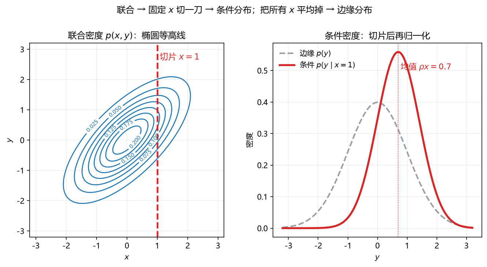

# S010_第08课_联合·条件·次序统计量与Poisson thinning

- **日期**：2026-11-02
- **课程**：AISC5020 Mathematics & Statistics for AI
- **范围**：W5 pp.24–37, 53–55；A2 Q2/Q4 补充
- **时长**：75 分钟
- **概念**：`joint_conditional`、`multivariate_normal`、`order_statistics`
- **作业来源**：A2 Q1/Q2/Q4 同型

---

## 0. 本课目标

1. 会从联合分布求边缘、条件分布。
2. 会判断独立与条件独立。
3. 会算次序统计量（min/max）的分布与期望。
4. 掌握 Poisson thinning：$X\mid X+Y=n\sim\mathrm{Binomial}(n,\frac12)$。

---

## 1. 引入：两个人的身高

一个班级里，身高 $X$ 和体重 $Y$ 不是独立的：

- 只看 $X$：身高分布（边缘）；
- 已知身高 $X=170$：体重的分布（条件）；
- 把所有身高平均掉：体重的边缘。

联合分布是“全景图”，边缘是“投影”，条件是“切一刀”。

---

## 2. 直觉与几何

### 2.1 联合、边缘、条件

- 联合：$p(x,y)$，二维平面上的密度；
- 边缘：$p(x)=\int p(x,y)\,dy$，把 $y$ 方向“压扁”；
- 条件：$p(y\mid x)=\dfrac{p(x,y)}{p(x)}$，固定 $x$ 切一刀再归一化。

**看图**：左边是联合密度的椭圆等高线，红虚线是切片 $x=1$；右边红线是条件密度 $p(y\mid x=1)$，灰虚线是边缘 $p(y)$。条件分布更窄、中心偏移，说明 $X,Y$ 相关。

### 2.2 独立与条件独立

- 独立：$p(x,y)=p(x)p(y)$；
- 条件独立：$p(x,y\mid z)=p(x\mid z)p(y\mid z)$。

独立 ⇒ 条件独立？不一定。条件独立 ⇒ 独立？也不一定。

### 2.3 次序统计量

$X_1,\dots,X_n$ iid，分布 $F$：

$$
F_{\min}(t)=1-[1-F(t)]^n,
\qquad
F_{\max}(t)=[F(t)]^n.
$$

两个 Uniform$(0,1)$ 的最小值：

$$
f_{\min}(t)=2(1-t),\quad 0<t<1,
\qquad
E[\min]=\int_0^1 2t(1-t)\,dt=\frac13.
$$

### 2.4 Poisson thinning

$X,Y\mid\Lambda=\lambda$ 独立同分布 $\mathrm{Poisson}(\lambda)$，$\Lambda\sim\mathrm{Exp}(\theta)$。

给定 $X+Y=n$ 后，$X$ 的分布**与 $\lambda$ 的先验无关**：

$$
X\mid X+Y=n\sim\mathrm{Binomial}\left(n,\frac12\right).
$$

直觉：每个事件独立地以 $1/2$ 概率被归到 $X$ 流，$n$ 个事件里有多少个归 $X$，就是二项分布。

---

## 3. 公式卡

### 3.1 联合与边缘

$$
p(x,y)=P(X=x,Y=y),
\qquad
p(x)=\sum_y p(x,y)
\qquad
f(x)=\int f(x,y)\,dy.
$$

- **符号**：离散用求和，连续用积分。
- **意义**：联合描述两个变量一起怎么变；边缘只看其中一个。
- **例**：联合表

| $X\backslash Y$ | 0 | 1 |
|---|---|---|
| 0 | 0.3 | 0.2 |
| 1 | 0.1 | 0.4 |

  - Step 1：$p_X(0)=0.3+0.2=0.5$。
  - Step 2：$p_X(1)=0.1+0.4=0.5$。
  - Step 3：$p_Y(0)=0.3+0.1=0.4$，$p_Y(1)=0.2+0.4=0.6$。
  - 检查：两个边缘各自求和为 $1$。
- **解读**：把行或列加起来，就是边缘。

### 3.2 条件分布

$$
p(y\mid x)=\frac{p(x,y)}{p(x)},
\qquad
p(x\mid y)=\frac{p(x,y)}{p(y)}.
$$

- **符号**：分母必须 $>0$。
- **意义**：已知一个变量后，另一个变量的分布；Bayes、回归、生成模型都用它。
- **例**：接 3.1，求 $p(Y=1\mid X=0)$。
  - Step 1：$p(X=0,Y=1)=0.2$。
  - Step 2：$p_X(0)=0.5$。
  - Step 3：$p(Y=1\mid X=0)=0.2/0.5=0.4$。
  - 检查：$p(Y=0\mid X=0)=0.3/0.5=0.6$，两者和为 $1$。
- **解读**：$X=0$ 这一行里，$Y=1$ 占 $40\%$。

### 3.3 独立与条件独立

$$
X\perp Y
\iff
p(x,y)=p(x)p(y)
\iff
p(y\mid x)=p(y).
$$

- **符号**：$\perp$ 表示独立。
- **意义**：知道一个变量不改变另一个的分布。
- **例**：接 3.1，判断独立。
  - Step 1：$p(X=0,Y=0)=0.3$。
  - Step 2：$p_X(0)p_Y(0)=0.5\times0.4=0.2$。
  - Step 3：$0.3\ne0.2$，不独立。
  - 检查：$p(Y=1\mid X=0)=0.4\ne p_Y(1)=0.6$。
- **解读**：$X$ 和 $Y$ 有关联。

### 3.4 二元正态的条件分布

$$
\begin{bmatrix}X\\Y\end{bmatrix}\sim N\left(\begin{bmatrix}\mu_X\\\mu_Y\end{bmatrix},
\begin{bmatrix}\sigma_X^2&\rho\sigma_X\sigma_Y\\
\rho\sigma_X\sigma_Y&\sigma_Y^2\end{bmatrix}\right),
$$

$$
E[Y\mid X=x]=\mu_Y+\rho\frac{\sigma_Y}{\sigma_X}(x-\mu_X),
\qquad
\operatorname{Var}(Y\mid X=x)=\sigma_Y^2(1-\rho^2).
$$

- **符号**：$\rho$ 是相关系数。
- **意义**：条件期望是 $x$ 的线性函数；条件方差比边缘方差小（知道 $X$ 后不确定性下降）。
- **例**：$X,Y$ 标准正态，$\rho=0.7$，$x=1$。
  - Step 1：$E[Y\mid X=1]=0.7\times1=0.7$。
  - Step 2：$\operatorname{Var}(Y\mid X=1)=1-0.49=0.51$。
  - Step 3：标准差 $\sqrt{0.51}\approx0.714$。
  - 检查：$0.714<1$，条件方差确实更小。
- **解读**：知道 $X$ 偏大后，$Y$ 的预测也偏大，但不确定性仍存在。

### 3.5 次序统计量

$$
F_{\min}(t)=1-[1-F(t)]^n,
\qquad
F_{\max}(t)=[F(t)]^n.
$$

- **符号**：$F$ 是单个变量的 CDF；$n$ 是样本数。
- **意义**：最小值、最大值的分布；可靠性、拍卖、极值理论都用。
- **例**：两个 Uniform$(0,1)$。
  - Step 1：$F(t)=t$。
  - Step 2：$F_{\min}(t)=1-(1-t)^2$。
  - Step 3：$f_{\min}(t)=2(1-t)$，$E[\min]=\int_0^1 2t(1-t)dt=1/3$。
  - 检查：最小值应偏向 $0$，$1/3<1/2$。
- **解读**：两个随机点里，左边那个平均在 $1/3$ 处。

---

## 4. 完整手算

### 4.1 Poisson thinning（A2 Q2）

设 $\Lambda\sim\mathrm{Exp}(\theta)$，密度

$$
f_\Lambda(\lambda)=\theta e^{-\theta\lambda},\quad \lambda>0.
$$

给定 $\Lambda=\lambda$，$X,Y$ 独立同分布 $\mathrm{Poisson}(\lambda)$。

**第 1 步：联合条件概率。**

$$
P(X=x,Y=n-x\mid\Lambda=\lambda)
=e^{-\lambda}\frac{\lambda^x}{x!}\cdot e^{-\lambda}\frac{\lambda^{n-x}}{(n-x)!}
=e^{-2\lambda}\frac{\lambda^n}{x!(n-x)!}.
$$

**第 2 步：对 $\lambda$ 积分。**

$$
P(X=x,X+Y=n)
=\int_0^\infty e^{-2\lambda}\frac{\lambda^n}{x!(n-x)!}\theta e^{-\theta\lambda}\,d\lambda
$$

$$
=\frac{\theta}{x!(n-x)!}\int_0^\infty \lambda^n e^{-(2+\theta)\lambda}\,d\lambda.
$$

用 $\int_0^\infty \lambda^n e^{-a\lambda}d\lambda=n!/a^{n+1}$：

$$
P(X=x,X+Y=n)=\frac{\theta\,n!}{x!(n-x)!(2+\theta)^{n+1}}.
$$

**第 3 步：求 $P(X+Y=n)$。**

$$
P(X+Y=n)=\sum_{x=0}^{n}\frac{\theta\,n!}{x!(n-x)!(2+\theta)^{n+1}}
=\frac{\theta\,2^n}{(2+\theta)^{n+1}}.
$$

**第 4 步：相除。**

$$
P(X=x\mid X+Y=n)
=\frac{\frac{\theta n!}{x!(n-x)!(2+\theta)^{n+1}}}{\frac{\theta 2^n}{(2+\theta)^{n+1}}}
=\frac{n!}{x!(n-x)!2^n}
=\binom nx\left(\frac12\right)^n.
$$

所以

$$
X\mid X+Y=n\sim\mathrm{Binomial}\left(n,\frac12\right).
$$

**解读**：先验 $\theta$ 完全消掉了；给定总数 $n$，每个事件独立地以 $1/2$ 概率属于 $X$。

### 4.2 次序统计量（A2 Q4）

$X,Y$ iid Uniform$(0,1)$，求 $E[\min(X,Y)]$。

**第 1 步：尾概率。**

$$
P(\min>t)=P(X>t,Y>t)=(1-t)^2,\quad 0<t<1.
$$

**第 2 步：CDF 与密度。**

$$
F_{\min}(t)=1-(1-t)^2,
\qquad
f_{\min}(t)=2(1-t).
$$

**第 3 步：期望。**

$$
E[\min]=\int_0^1 t\cdot2(1-t)\,dt
=2\left[\frac{t^2}{2}-\frac{t^3}{3}\right]_0^1
=2\left(\frac12-\frac13\right)=\frac13.
$$

**检查**：$\frac13<\frac12$，最小值偏向左边，合理。

---

## 5. 机器学习里的用途

1. **朴素 Bayes / 生成模型**：联合 = 类条件 × 先验；条件 = 后验。
2. **高斯模型**：条件高斯给线性回归/高斯过程；$E[Y\mid X]$ 是线性预测。
3. **EM 与混合模型**：隐变量下的条件期望。
4. **Poisson thinning**：计数数据的分配、泊松过程拆分。
5. **次序统计量**：极值、Top-k、拍卖、可靠性。

---

## 6. 常见易错点

1. **边缘不是条件**：$p(x)$ 和 $p(y\mid x)$ 是两回事。
2. **独立要看联合是否等于乘积**，不能只看协方差为 $0$（除非高斯）。
3. **条件独立不等于独立**。
4. **Poisson thinning 的 $1/2$ 来自两流同率**；若率不同，比例会变。
5. **次序统计量的密度有 $n$ 倍**：$f_{\min}=n f(1-F)^{n-1}$。
6. **连续型 $P(X=x)=0$**，条件密度要用极限定义。
7. **二元正态条件方差**是 $\sigma_Y^2(1-\rho^2)$，不是 $\sigma_Y^2-\rho$。

---

## 7. 与已学 / 后续

- **L07 概率基础**：条件概率升级为条件分布。
- **L09 全期望/全方差**：对条件期望再取期望。
- **L10 互信息**：$I(X,Y)$ 衡量联合与独立的差距。
- **L13 共轭先验**：后验 = 条件分布。
- **L18 BN**：条件独立与 d-separation。

---

## 8. 作业

1. **A2 Q1 同型**：$X,Y$ iid，$P(K=k)=(1-\pi)\pi^k$，$k=0,1,\dots$。令 $U=\min(X,Y)$，$W=\max(X,Y)-\min(X,Y)$。求 $P(U=u,W=w)$，并证明 $U\perp W$。
2. **二元正态**：$X,Y$ 标准正态，$\rho=0.5$。求 $E[Y\mid X=2]$ 与 $\operatorname{Var}(Y\mid X=2)$。
3. **Poisson thinning 变体**：$X\mid\Lambda\sim\mathrm{Poisson}(a\Lambda)$，$Y\mid\Lambda\sim\mathrm{Poisson}(b\Lambda)$，$\Lambda\sim\mathrm{Exp}(\theta)$。求 $X\mid X+Y=n$ 的分布。
4. **次序统计量**：$X,Y$ iid Uniform$(0,1)$，求 $E[\max(X,Y)]$。
5. **概念**：独立与条件独立的区别，各举一个例子。

---

## 9. 作业答案（先自己做完再看）

### 9.1 第 1 题

对 $u\ge0$，$w\ge0$：

- 当 $w>0$：$(X,Y)=(u,u+w)$ 或 $(u+w,u)$，两种互斥：

$$
P(U=u,W=w)=2(1-\pi)^2\pi^{2u+w}.
$$

- 当 $w=0$：只有 $(X,Y)=(u,u)$：

$$
P(U=u,W=0)=(1-\pi)^2\pi^{2u}.
$$

边缘：

$$
P(U=u)=(1-\pi^2)\pi^{2u},
$$

$$
P(W=0)=\frac{1-\pi}{1+\pi},
\qquad
P(W=w)=\frac{2(1-\pi)}{1+\pi}\pi^w\ (w\ge1).
$$

验证：

- $w>0$：$P(U=u)P(W=w)=(1-\pi^2)\pi^{2u}\cdot\frac{2(1-\pi)}{1+\pi}\pi^w=2(1-\pi)^2\pi^{2u+w}$，等于联合；
- $w=0$：$(1-\pi^2)\pi^{2u}\cdot\frac{1-\pi}{1+\pi}=(1-\pi)^2\pi^{2u}$，也等于联合。

所以 $U\perp W$。

### 9.2 第 2 题

$$
E[Y\mid X=2]=0.5\times2=1,
$$

$$
\operatorname{Var}(Y\mid X=2)=1-0.25=0.75.
$$

### 9.3 第 3 题

给定 $\Lambda=\lambda$：

$$
P(X=x,Y=n-x\mid\lambda)=e^{-a\lambda}\frac{(a\lambda)^x}{x!}\cdot e^{-b\lambda}\frac{(b\lambda)^{n-x}}{(n-x)!}.
$$

对 $\lambda$ 积分后，$X\mid X+Y=n$ 的分布为

$$
\mathrm{Binomial}\left(n,\frac{a}{a+b}\right).
$$

先验 $\theta$ 仍然消掉；每个事件归 $X$ 的概率是 $a/(a+b)$。

### 9.4 第 4 题

$$
F_{\max}(t)=t^2,
\qquad
f_{\max}(t)=2t,
\qquad
E[\max]=\int_0^1 2t^2\,dt=\frac23.
$$

### 9.5 第 5 题

独立：$p(x,y)=p(x)p(y)$，例如两次独立掷骰子。  
条件独立：给定 $Z$ 后 $X,Y$ 独立，但边缘可能相关；例如 $X=Z+\epsilon_1$，$Y=Z+\epsilon_2$，给定 $Z$ 后独立，但 $X,Y$ 本身相关。

---

## 修订记录

- 2026-11-02：创建（S010 第 08 课）；新增 `fig_joint_conditional.png`。
