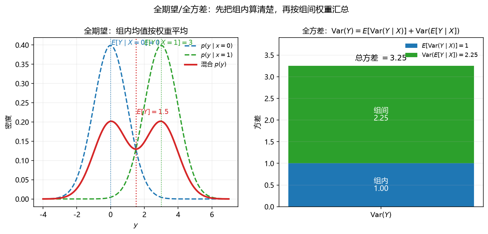

# S010_第09课_全期望与全方差（Hint 1/2）

- **日期**：2026-11-02
- **课程**：AISC5020 Mathematics & Statistics for AI
- **范围**：W5 pp.49–52（教师 Hint：TLE p.50，TLV p.51）
- **时长**：90 分钟
- **概念**：`total_expectation`、`total_variance`
- **性质**：Hint 1 + Hint 2 专课

---

## 0. 本课目标

1. 理解 $E[Y\mid X]$ 是随机变量。
2. 会证明并使用全期望公式 $E[Y]=E[E[Y\mid X]]$。
3. 会证明并使用全方差公式 $\operatorname{Var}(Y)=E[\operatorname{Var}(Y\mid X)]+\operatorname{Var}(E[Y\mid X])$。
4. 会做分层/混合模型的计算。

---

## 1. 引入：先分组，再汇总

学校要算平均身高：

- 先按年级分组，算每个年级的平均身高；
- 再按各年级人数加权，得到全校平均。

这就是**全期望**：组内均值 → 按组权重平均。

方差也一样：

- 组内方差（同年级内部差异）；
- 组间方差（年级平均之间的差异）；
- 总方差 = 组内 + 组间。

---

## 2. 直觉与几何

### 2.1 条件期望是一个随机变量

$E[Y\mid X]$ 不是数，而是 $X$ 的函数：

- 给定 $X=x$，$E[Y\mid X=x]$ 是数；
- 没给定 $X$ 时，$E[Y\mid X]$ 随 $X$ 变，是随机变量。

### 2.2 全期望：塔性质

$$
E[Y]=E\bigl[E[Y\mid X]\bigr].
$$

“先算每组的平均，再按组概率加权”。

**看图**：左边两组条件分布（蓝、绿），均值 $0$ 和 $3$；红线是混合分布，均值 $1.5$，正好是两组均值按 $0.5:0.5$ 加权。右边方差分解：组内 $1.00$ + 组间 $2.25$ = 总方差 $3.25$。

### 2.3 全方差：组内 + 组间

$$
\operatorname{Var}(Y)
=\underbrace{E[\operatorname{Var}(Y\mid X)]}_{\text{组内}}
+\underbrace{\operatorname{Var}(E[Y\mid X])}_{\text{组间}}.
$$

- 组内：同一组里 $Y$ 的波动；
- 组间：组均值之间的波动；
- 总波动 = 两者之和。

### 2.4 证明思路

**TLE（离散）：**

$$
E[E[Y\mid X]]
=\sum_x P(X=x)E[Y\mid X=x]
=\sum_x\sum_y yP(Y=y\mid X=x)P(X=x)
=\sum_y yP(Y=y)=E[Y].
$$

**TLV（一步一步展开）：**

第 1 步：写出方差的二阶矩形式：
$$
\operatorname{Var}(Y)=E[Y^2]-(E[Y])^2.
$$

第 2 步：对 $Y^2$ 用全期望（把 $X$ 当分层变量）：
$$
E[Y^2]=E\bigl[E[Y^2\mid X]\bigr].
$$

第 3 步：对每个 $X=x$，用“方差 = 二阶矩 − 均值平方”：
$$
E[Y^2\mid X]
=\operatorname{Var}(Y\mid X)+\bigl(E[Y\mid X]\bigr)^2.
$$

第 4 步：代回并利用期望的线性：
$$
E[Y^2]
=E[\operatorname{Var}(Y\mid X)]
+E\bigl[(E[Y\mid X])^2\bigr].
$$

第 5 步：对 $E[Y]$ 用全期望，$E[Y]=E[E[Y\mid X]]$，所以
$$
(E[Y])^2
=\bigl(E[E[Y\mid X]]\bigr)^2.
$$

第 6 步：相减，并把最后一项凑成“组间方差”：
$$
\operatorname{Var}(Y)
=E[\operatorname{Var}(Y\mid X)]
+\underbrace{E\bigl[(E[Y\mid X])^2\bigr]-\bigl(E[E[Y\mid X]]\bigr)^2}
_{\operatorname{Var}(E[Y\mid X])}.
$$

所以
$$
\operatorname{Var}(Y)=E[\operatorname{Var}(Y\mid X)]+\operatorname{Var}(E[Y\mid X]).
$$

---

## 3. 公式卡

### 3.1 条件期望

$$
E[Y\mid X=x]=
\begin{cases}
\sum_y y\,p(y\mid x), & \text{离散},\\[4pt]
\int y\,f(y\mid x)\,dy, & \text{连续}.
\end{cases}
$$

- **符号**：$p(y\mid x)$ 是条件 PMF/PDF。
- **意义**：给定 $X=x$ 后 $Y$ 的平均；是回归函数 $m(x)$。
- **例**：$Y\mid X=x\sim\mathrm{Uniform}(x,1)$。
  - Step 1：区间长度 $1-x$。
  - Step 2：均值是中点 $\frac{x+1}{2}$。
  - Step 3：$E[Y\mid X]=\frac{1+X}{2}$。
  - 检查：$x=0$ 时均值 $1/2$，$x=1$ 时均值 $1$。
- **解读**：$X$ 越大，$Y$ 的条件均值越大。

### 3.2 全期望公式（Law of Total Expectation）

$$
E[Y]=E\bigl[E[Y\mid X]\bigr].
$$

- **符号**：外层 $E$ 对 $X$ 的分布取期望。
- **意义**：分层计算期望；混合模型、层级模型、EM 都用。
- **例**：$X\sim\mathrm{Bernoulli}(0.5)$，$Y\mid X=0\sim N(0,1)$，$Y\mid X=1\sim N(3,1)$。
  - Step 1：$E[Y\mid X=0]=0$，$E[Y\mid X=1]=3$。
  - Step 2：$E[Y]=0.5\times0+0.5\times3=1.5$。
  - Step 3：检查：混合分布对称中心在 $1.5$。
  - 检查：直接对混合密度积分也得 $1.5$。
- **解读**：总均值是组均值按组概率加权。

### 3.3 全方差公式（Law of Total Variance）

$$
\operatorname{Var}(Y)
=E[\operatorname{Var}(Y\mid X)]
+\operatorname{Var}(E[Y\mid X]).
$$

- **符号**：第一项组内，第二项组间。
- **意义**：把总波动拆成“组内差异”和“组间差异”；ANOVA、混合模型、偏差-方差分解都用。
- **例**：接 3.2，两组各 $0.5$，组内方差都是 $1$。
  - Step 1：$E[\operatorname{Var}(Y\mid X)]=0.5\times1+0.5\times1=1$。
  - Step 2：组均值 $0,3$，均值 $1.5$，组间方差 $0.5(0-1.5)^2+0.5(3-1.5)^2=2.25$。
  - Step 3：总方差 $=1+2.25=3.25$。
  - 检查：直接算混合分布方差也得 $3.25$。
- **解读**：总波动中，$1/3.25\approx30.8\%$ 来自组内，$69.2\%$ 来自组间。

### 3.4 全协方差（了解）

$$
\operatorname{Cov}(X,Y)=E[\operatorname{Cov}(X,Y\mid Z)]
+\operatorname{Cov}(E[X\mid Z],E[Y\mid Z]).
$$

- **符号**：$\operatorname{Cov}(\cdot,\cdot\mid Z)$ 是条件协方差。
- **意义**：协方差也能按分层拆；因果分析、混杂因素分解用。
- **例**：
  - **背景**：$Z\sim\mathrm{Bernoulli}(0.5)$，$X=Z+\epsilon_1$、$Y=Z+\epsilon_2$，其中 $\epsilon_1,\epsilon_2\sim N(0,1)$ 且与 $Z$ 独立。求 $\operatorname{Cov}(X,Y)$ 并验证全协方差公式。
  - **解**：
    - Step 1：$E[X\mid Z]=Z$，$E[Y\mid Z]=Z$。
    - Step 2：条件协方差 $\operatorname{Cov}(X,Y\mid Z)=\operatorname{Cov}(\epsilon_1,\epsilon_2)=0$。
    - Step 3：组间协方差 $\operatorname{Cov}(E[X\mid Z],E[Y\mid Z])=\operatorname{Cov}(Z,Z)=\operatorname{Var}(Z)=0.25$。
    - Step 4：直接算 $\operatorname{Cov}(X,Y)=\operatorname{Cov}(Z+\epsilon_1,Z+\epsilon_2)=\operatorname{Var}(Z)=0.25$。
    - 检查：$0+0.25=0.25$，公式成立。
  - **解读**：给定共同原因 $Z$ 后，$X,Y$ 的剩余部分独立（条件协方差为 $0$）；全部的协方差都来自“组间”共同原因。这就是“控制 $Z$ 后相关消失”的数学版本。

### 3.5 条件方差（conditional variance）

$$
\operatorname{Var}(Y\mid X)=E[Y^2\mid X]-\bigl(E[Y\mid X]\bigr)^2,
\qquad
E[\operatorname{Var}(Y\mid X)]=E[Y^2]-E\bigl[(E[Y\mid X])^2\bigr].
$$

- **符号**：$\operatorname{Var}(Y\mid X)$ 是“给定 $X$ 后 $Y$ 的方差”，它随 $X$ 变，是随机变量；$E[\operatorname{Var}(Y\mid X)]$ 是它的平均值，即 TLV 的组内项。
- **意义与场景**：条件方差衡量“同一组内部”的波动；如果每组内部方差不同（异方差），就不能用一个常数代替。回归、混合模型、ANOVA 都拆这一项。
- **例**：
  - **背景**：$X\sim\mathrm{Bernoulli}(0.5)$，$Y\mid X=0\sim N(0,1)$，$Y\mid X=1\sim N(3,1)$。
  - **解**：
    - Step 1：两组条件方差都是 $1$，所以 $\operatorname{Var}(Y\mid X)=1$（常数随机变量）。
    - Step 2：$E[\operatorname{Var}(Y\mid X)]=0.5\cdot1+0.5\cdot1=1$。
    - Step 3：组均值 $0,3$ 的方差为 $2.25$，所以总方差 $1+2.25=3.25$。
    - 检查：与 3.3 的结果一致。
  - **解读**：条件方差是“组内”，组均值的方差是“组间”；两者相加才是总方差。

---

## 4. 完整手算

### 4.1 W5 p.50：Uniform 嵌套

$X\sim\mathrm{Uniform}(0,1)$，$Y\mid X=x\sim\mathrm{Uniform}(x,1)$。

**第 1 步：条件期望。**

$$
E[Y\mid X=x]=\frac{x+1}{2}
\quad\Rightarrow\quad
E[Y\mid X]=\frac{1+X}{2}.
$$

**第 2 步：全期望。**

$$
E[Y]=E\left[\frac{1+X}{2}\right]
=\frac{1+E[X]}{2}
=\frac{1+1/2}{2}
=\frac34.
$$

**第 3 步：条件方差。**

$$
\operatorname{Var}(Y\mid X=x)=\frac{(1-x)^2}{12}.
$$

**第 4 步：全方差。**

$$
E[\operatorname{Var}(Y\mid X)]
=\frac1{12}E[(1-X)^2]
=\frac1{12}\cdot\frac13
=\frac1{36}.
$$

$$
\operatorname{Var}(E[Y\mid X])
=\operatorname{Var}\left(\frac{1+X}{2}\right)
=\frac14\operatorname{Var}(X)
=\frac14\cdot\frac1{12}
=\frac1{48}.
$$

$$
\operatorname{Var}(Y)=\frac1{36}+\frac1{48}
=\frac{4+3}{144}
=\frac7{144}\approx0.0486.
$$

### 4.2 W5 p.52：Binomial 混合

$Q\sim\mathrm{Uniform}(0,1)$，$X\mid Q=q\sim\mathrm{Binomial}(n,q)$。

**第 1 步：条件期望。**

$$
E[X\mid Q]=nQ.
$$

**第 2 步：全期望。**

$$
E[X]=E[nQ]=nE[Q]=\frac n2.
$$

**第 3 步：条件方差。**

$$
\operatorname{Var}(X\mid Q)=nQ(1-Q).
$$

**第 4 步：全方差。**

$$
E[\operatorname{Var}(X\mid Q)]
=nE[Q(1-Q)]
=n\left(\frac12-\frac13\right)
=\frac n6.
$$

$$
\operatorname{Var}(E[X\mid Q])
=\operatorname{Var}(nQ)
=n^2\operatorname{Var}(Q)
=\frac{n^2}{12}.
$$

$$
\operatorname{Var}(X)=\frac n6+\frac{n^2}{12}.
$$

**检查**：$n=1$ 时，$X\mid Q\sim\mathrm{Bernoulli}(Q)$，$E[X]=1/2$，$\operatorname{Var}(X)=1/6+1/12=1/4$；与直接积分 $\int_0^1 q(1-q)\,dq+\int_0^1(q-\frac12)^2dq=1/6+1/12=1/4$ 一致。

---

## 5. 机器学习里的用途

1. **混合模型（GMM）**：$p(x)=\sum_k \pi_k p(x\mid k)$；均值/方差按分量加权。
2. **EM 算法**：E 步算条件期望，M 步最大化。
3. **层级 Bayes**：先验超参数随机；全期望/全方差做边际化。
4. **偏差-方差分解**：$\text{Error}=\text{Bias}^2+\text{Var}+\text{Noise}$，本质是全方差。
5. **因果/混杂**：全协方差公式解释“控制变量后相关消失”。

---

## 6. 常见易错点

1. **$E[Y\mid X]$ 是随机变量**，不是常数；$E[Y\mid X=x]$ 才是数。
2. **外层期望对 $X$ 取**，不是对 $Y$。
3. **TLV 的两项都是非负的**，别漏掉组间项。
4. **条件方差不是常数**时，要先算 $E[\operatorname{Var}(Y\mid X)]$，不能直接把某个条件方差当答案。
5. **$E[Y\mid X]$ 与 $E[Y]$ 不同**：前者随 $X$ 变。
6. **离散/连续公式别混**：离散求和，连续积分。
7. **$X,Y$ 独立时**：$E[Y\mid X]=E[Y]$ 是常数，所以组间项 $\operatorname{Var}(E[Y\mid X])=0$，组内项 $E[\operatorname{Var}(Y\mid X)]=\operatorname{Var}(Y)$；TLV 变成“全部波动来自组内”，不是“没有波动”。

---

## 7. 与已学 / 后续

- **L07 期望/方差**：今天把“条件”加进去。
- **L08 条件分布**：条件期望是条件分布的中心。
- **L10 互信息**：$I(X,Y)=H(Y)-H(Y\mid X)$，与条件期望同源。
- **L13 共轭先验**：后验均值常写成先验与数据的加权。
- **L18 BN**：条件独立下做边际化。

---

## 8. 作业

1. $X\sim\mathrm{Bernoulli}(0.3)$，$Y\mid X=0\sim N(0,1)$，$Y\mid X=1\sim N(4,4)$。求 $E[Y]$、$\operatorname{Var}(Y)$。
2. $Q\sim\mathrm{Uniform}(0,1)$，$X\mid Q\sim\mathrm{Binomial}(5,Q)$。求 $E[X]$、$\operatorname{Var}(X)$。
3. $\Lambda\sim\mathrm{Exp}(2)$（率参数 $2$），$X\mid\Lambda\sim\mathrm{Poisson}(\Lambda)$。求 $E[X]$、$\operatorname{Var}(X)$。
4. 用离散情形证明 $E[Y]=E[E[Y\mid X]]$。
5. 概念：为什么说 $E[Y\mid X]$ 是随机变量？举一个具体例子。

---

## 9. 作业答案（先自己做完再看）

### 9.1 第 1 题

$$
E[Y]=0.7\times0+0.3\times4=1.2.
$$

$$
E[\operatorname{Var}(Y\mid X)]=0.7\times1+0.3\times4=1.9.
$$

组均值 $0,4$，总均值 $1.2$：

$$
\operatorname{Var}(E[Y\mid X])=0.7(0-1.2)^2+0.3(4-1.2)^2
=1.008+2.352=3.36.
$$

$$
\operatorname{Var}(Y)=1.9+3.36=5.26.
$$

### 9.2 第 2 题

$$
E[X]=5\times\frac12=2.5.
$$

$$
\operatorname{Var}(X)=\frac56+\frac{25}{12}
=\frac{10}{12}+\frac{25}{12}
=\frac{35}{12}\approx2.9167.
$$

### 9.3 第 3 题

$\Lambda\sim\mathrm{Exp}(2)$：$E[\Lambda]=1/2$，$\operatorname{Var}(\Lambda)=1/4$。

$$
E[X]=E[\Lambda]=\frac12.
$$

$$
\operatorname{Var}(X)=E[\Lambda]+\operatorname{Var}(\Lambda)
=\frac12+\frac14=\frac34.
$$

### 9.4 第 4 题

$$
E[E[Y\mid X]]
=\sum_x P(X=x)E[Y\mid X=x]
=\sum_x P(X=x)\sum_y yP(Y=y\mid X=x)
$$

$$
=\sum_y y\sum_x P(Y=y\mid X=x)P(X=x)
=\sum_y yP(Y=y)=E[Y].
$$

### 9.5 第 5 题

因为 $E[Y\mid X]$ 的取值依赖 $X$，所以它是 $X$ 的函数，而 $X$ 是随机的，因此 $E[Y\mid X]$ 也是随机变量。

例：$X\sim\mathrm{Bernoulli}(0.5)$，$Y\mid X=0\sim N(0,1)$，$Y\mid X=1\sim N(3,1)$。则

$$
E[Y\mid X]=
\begin{cases}
0, & X=0,\\
3, & X=1.
\end{cases}
$$

它以 $0.5$ 概率取 $0$、$0.5$ 概率取 $3$，本身是一个随机变量。

---

## 修订记录

- 2026-11-02：创建（S010 第 09 课，Hint 1/2 合并专课）；新增 `fig_total_expectation_variance.png`。
- 2026-11-02：把 TLV 证明展开成六步；新增条件方差卡；把“全协方差例：略”替换为可核算例；修正独立时 TLV 的表述。
