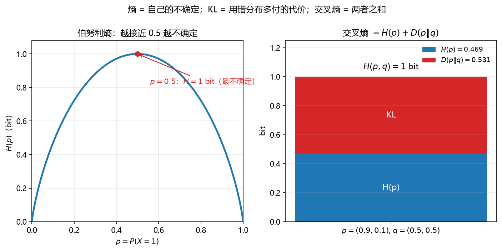

# S010_第10课_熵·互信息·交叉熵·KL

- **日期**：2026-11-02
- **课程**：AISC5020 Mathematics & Statistics for AI
- **范围**：W6 pp.3–23
- **时长**：90 分钟
- **概念**：`entropy`、`mutual_information`、`cross_entropy_kl`
- **作业来源**：A2 Q3 同型

---

## 0. 本课目标

1. 会算熵、联合熵、条件熵。
2. 会算互信息，知道 $I(X,Y)=H(X)-H(X\mid Y)$。
3. 会算交叉熵与 KL，理解 $\text{CE}=H+\text{KL}$。
4. 会推导二元正态的互信息（A2 Q3）。

---

## 1. 引入：猜词游戏

Bob 只会说四种动物：狗、猫、鱼、鸟。

- 如果四种等可能，最少要 2 bit 编码；
- 如果狗占 $50\%$，猫 $25\%$，鱼/鸟各 $12.5\%$，可以用更短的码给狗；
- **熵**就是“平均最少需要多少 bit”；
- **交叉熵**是“你用错编码方案，多付的 bit”；
- **KL**是“多付的部分”。

---

## 2. 直觉与几何

### 2.1 熵：不确定性

$$
H(X)=-\sum_x p(x)\log_2 p(x).
$$

- 均匀分布熵最大；
- 确定性分布熵为 $0$；
- 单位是 bit。

**看图**：左边 $H(p)$ 在 $p=0.5$ 达到 $1$ bit，两端趋于 $0$；右边 $p=(0.9,0.1)$ 的熵是 $0.469$，用 $q=(0.5,0.5)$ 编码的交叉熵是 $1$，多出来的 $0.531$ 就是 KL。

### 2.2 联合熵、条件熵、链式法则

$$
H(X,Y)=H(X)+H(Y\mid X).
$$

- 联合熵：一对变量的总不确定性；
- 条件熵：知道 $X$ 后，$Y$ 还剩多少不确定性；
- 链式法则：先描述 $X$，再描述“给定 $X$ 后的 $Y$”。

### 2.3 互信息：知道一个能减少多少不确定性

$$
I(X,Y)=H(X)-H(X\mid Y)=H(X)+H(Y)-H(X,Y).
$$

- $I=0$：独立；
- $I$ 越大：关联越强；
- 对称：$I(X,Y)=I(Y,X)$。

### 2.4 交叉熵与 KL

$$
H(p,q)=-\sum_x p(x)\log_2 q(x),
$$

$$
D(p\|q)=\sum_x p(x)\log_2\frac{p(x)}{q(x)}.
$$

$$
H(p,q)=H(p)+D(p\|q).
$$

- 交叉熵：用 $q$ 编码来自 $p$ 的数据，平均要多少 bit；
- KL：多付的 bit，永远 $\ge0$；
- 当 $q=p$ 时，KL $=0$，交叉熵 = 熵。

---

## 3. 公式卡

### 3.1 熵

$$
H(X)=-\sum_x p(x)\log_2 p(x).
$$

- **符号**：$p(x)$ 是 PMF；$0\log0=0$。
- **意义**：平均编码长度下界；不确定性度量。
- **例**：$p=(0.5,0.5)$。
  - Step 1：$-0.5\log_2 0.5=0.5$。
  - Step 2：两项相加 $=1$。
  - Step 3：$H=1$ bit。
  - 检查：两种等可能，正好 1 bit。
- **解读**：公平硬币最不确定，1 bit。

### 3.2 联合熵与条件熵

$$
H(X,Y)=-\sum_{x,y}p(x,y)\log_2 p(x,y),
\qquad
H(X,Y)=H(X)+H(Y\mid X).
$$

- **符号**：$p(x,y)$ 是联合 PMF。
- **意义**：联合不确定性 = 先描述 $X$ + 给定 $X$ 后描述 $Y$。
- **例**：联合表

| $X\backslash Y$ | 0 | 1 |
|---|---|---|
| 0 | 0.4 | 0.1 |
| 1 | 0.1 | 0.4 |

  - Step 1：$H(X,Y)=-2(0.4\log_2 0.4)-2(0.1\log_2 0.1)$。
  - Step 2：$=2(0.5288)+2(0.3322)=1.722$。
  - Step 3：$H(X)=1$，所以 $H(Y\mid X)=1.722-1=0.722$。
  - 检查：$H(Y\mid X)\le H(Y)=1$。
- **解读**：知道 $X$ 后，$Y$ 的不确定性从 $1$ 降到 $0.722$。

### 3.3 互信息

$$
I(X,Y)=H(X)-H(X\mid Y)=H(X)+H(Y)-H(X,Y).
$$

- **符号**：$I\ge0$。
- **意义**：两个变量的共享信息；特征选择、独立性检验、信道容量。
- **例**：接 3.2。
  - Step 1：$H(X)=H(Y)=1$。
  - Step 2：$H(X,Y)=1.722$。
  - Step 3：$I=1+1-1.722=0.278$ bit。
  - 检查：$I=H(X)-H(X\mid Y)=1-0.722=0.278$。
- **解读**：知道一个变量，平均减少 $0.278$ bit 的不确定性。

### 3.4 交叉熵与 KL

$$
H(p,q)=-\sum_x p(x)\log_2 q(x),
\qquad
D(p\|q)=\sum_x p(x)\log_2\frac{p(x)}{q(x)}.
$$

- **符号**：$p$ 是真实分布，$q$ 是模型分布。
- **意义**：分类损失、变分推断、模型比较；KL 非负。
- **例**：$p=(0.9,0.1)$，$q=(0.5,0.5)$。
  - Step 1：$H(p)=0.469$ bit。
  - Step 2：$H(p,q)=-0.9\log_2 0.5-0.1\log_2 0.5=1$ bit。
  - Step 3：$D(p\|q)=1-0.469=0.531$ bit。
  - 检查：$D\ge0$，且 $q=p$ 时为 $0$。
- **解读**：用错模型多付 $0.531$ bit。

### 3.5 二元正态的互信息

$$
I(X_1,X_2)=-\frac12\log_2(1-\rho^2).
$$

- **符号**：$\rho$ 是相关系数。
- **意义**：高斯变量间的互信息只由相关系数决定；$\rho=0$ 时 $I=0$。
- **例**：$\rho=0.7$。
  - Step 1：$1-\rho^2=1-0.49=0.51$。
  - Step 2：$\log_2 0.51\approx-0.971$。
  - Step 3：$I=-\frac12(-0.971)\approx0.486$ bit。
  - 检查：$\rho=0$ 时 $I=0$。
- **解读**：相关性越强，共享信息越多。

### 3.6 条件熵的展开式（conditional entropy, explicit form）

$$
H(Y\mid X)
=\sum_{x}p(x)H(Y\mid X=x)
=-\sum_{x,y}p(x,y)\log_2 p(y\mid x).
$$

- **符号**：$p(x)$ 是 $X$ 的边缘；$p(y\mid x)$ 是条件概率；$p(x,y)$ 是联合概率。
- **意义与场景**：条件熵是“知道 $X$ 后，$Y$ 还剩多少不确定性”。它不是 $H(Y)-H(X)$；正确关系是
  $$
  H(Y\mid X)=H(X,Y)-H(X).
  $$
- **例**：
  - **背景**：联合表如下，求 $H(Y\mid X)$。

| $X\backslash Y$ | 0 | 1 |
|---|---|---|
| 0 | 0.4 | 0.1 |
| 1 | 0.1 | 0.4 |

  - **解**：
    - Step 1：$p_X(0)=0.5$，$p_X(1)=0.5$。
    - Step 2：$p(y=0\mid x=0)=0.4/0.5=0.8$，$p(y=1\mid x=0)=0.2$；$x=1$ 时同样 $0.2,0.8$。
    - Step 3：$H(Y\mid X=0)=-0.8\log_2 0.8-0.2\log_2 0.2\approx0.722$；$x=1$ 相同。
    - Step 4：$H(Y\mid X)=0.5(0.722)+0.5(0.722)=0.722$ bit。
    - 检查：$H(X,Y)=1.722$，$H(X)=1$，相减得 $0.722$，一致。
  - **解读**：已知 $X$ 后，$Y$ 的不确定性从 $1$ bit 降到 $0.722$ bit；减少的 $0.278$ bit 就是互信息。

### 3.7 微分熵与高斯熵（differential entropy, Gaussian）

$$
h(X)=-\int f(x)\log_2 f(x)\,dx,
\qquad
X\sim N(\mu,\sigma^2)\ \Rightarrow\ h(X)=\frac12\log_2(2\pi e\sigma^2).
$$

$$
\mathbf X\sim N(\boldsymbol\mu,\boldsymbol\Sigma)
\ \Rightarrow\
h(\mathbf X)=\frac12\log_2\left((2\pi e)^n\det\boldsymbol\Sigma\right).
$$

- **符号**：$h$ 是连续变量的微分熵（单位 bit；用 $\ln$ 则单位 nat）；$n$ 是维数；$\det\boldsymbol\Sigma$ 是协方差行列式。
- **意义与场景**：离散熵算“编码长度”，微分熵算“密度的集中程度”；高斯在所有同方差分布中微分熵最大。A2 Q3 的二元正态互信息就是用这两个公式相减得到的。
- **例**：
  - **背景**：$X\sim N(0,1)$，求 $h(X)$。
  - **解**：
    - Step 1：$2\pi e\sigma^2=2\pi e$。
    - Step 2：$h(X)=\frac12\log_2(2\pi e)$。
    - Step 3：$\ln(2\pi e)\approx2.8379$，换成 bit 除以 $\ln2$，得约 $4.094/2=2.047$ bit。
    - 检查：$2\pi e\approx17.08$，$\log_2 17.08\approx4.094$，一半约 $2.047$。
  - **解读**：微分熵可以为负（方差很小时），不要把它当成“概率”或“离散熵”直接比较。

### 3.8 KL 非负性：为什么 $D(p\|q)\ge0$（Gibbs' inequality）

$$
D(p\|q)=\sum_x p(x)\log_2\frac{p(x)}{q(x)}\ge0,
\qquad
D(p\|q)=0\iff p=q.
$$

- **证明（用 $\ln t\le t-1$）**：
  $$
  -D(p\|q)\ln2
  =\sum_x p(x)\ln\frac{q(x)}{p(x)}
  \le\sum_x p(x)\left(\frac{q(x)}{p(x)}-1\right)
  =\sum_x q(x)-\sum_x p(x)=1-1=0.
  $$
  所以 $D(p\|q)\ge0$；等号成立当且仅当 $q(x)/p(x)=1$ 对所有 $p(x)>0$ 成立。
- **意义与场景**：KL 不是距离（不对称、不满足三角不等式），但它是“用 $q$ 代替 $p$ 的额外编码成本”，永远非负。交叉熵 ≥ 熵、MLE = 最小化 KL 都靠它。
- **例**：
  - **背景**：$p=(0.9,0.1)$，$q=(0.5,0.5)$，验证 $D\ge0$。
  - **解**：
    - Step 1：$D=0.9\log_2(0.9/0.5)+0.1\log_2(0.1/0.5)$。
    - Step 2：$=0.9(0.848)+0.1(-2.322)=0.763-0.232=0.531$ bit。
    - Step 3：$0.531>0$，且 $q\ne p$。
    - 检查：$H(p,q)=1$，$H(p)=0.469$，相减 $0.531$，一致。
  - **解读**：KL 大不大取决于“哪个方向”：$D(p\|q)\ne D(q\|p)$，所以不能当普通距离用。

### 3.9 交叉熵与 one-hot 标签（cross-entropy loss）

$$
H(p,q)=-\sum_{k=1}^{K}p_k\log_2 q_k,
\qquad
p=\text{one-hot}(y)
\ \Rightarrow\
H(p,q)=-\log_2 q_y.
$$

- **符号**：$K$ 是类别数；$y$ 是真实类别；$q_y$ 是模型给真实类别的预测概率；$p$ 是 one-hot 向量。
- **意义与场景**：多分类交叉熵损失通常写成 $-\frac1N\sum_i\log q_{y_i}$（自然对数）；它只惩罚“给真实类别的概率太低”，其他类通过归一化间接受影响。
- **例**：
  - **背景**：三类分类，真实类别是第 $2$ 类，模型预测 $q=(0.1,0.7,0.2)$，求交叉熵损失（bit）。
  - **解**：
    - Step 1：one-hot $p=(0,1,0)$。
    - Step 2：$H(p,q)=-\log_2 0.7$。
    - Step 3：$\log_2 0.7\approx-0.515$，所以损失 $\approx0.515$ bit。
    - 检查：若 $q_y=1$，损失为 $0$；若 $q_y\to0$，损失 $\to\infty$。
  - **解读**：交叉熵只关心真实类别的概率；预测得越自信且越错，惩罚越大。

### 3.10 变分信息、链式法则与条件互信息（了解）

$$
\mathrm{VI}(X,Y)=H(X,Y)-I(X,Y)=H(X\mid Y)+H(Y\mid X)\ge0.
$$

$$
H(X_1,\dots,X_n)=\sum_{i=1}^{n}H(X_i\mid X_{i-1},\dots,X_1).
$$

$$
I(X_1,\dots,X_n;Y)=\sum_{i=1}^{n}I(X_i;Y\mid X_{i-1},\dots,X_1).
$$

$$
I(X,Y\mid Z)=H(X\mid Z)-H(X\mid Y,Z).
$$

- **符号**：$\mathrm{VI}$ 是 variation of information；$I(\cdot;\cdot\mid Z)$ 是条件互信息；链式法则把高维联合量拆成一系列条件量。
- **意义与场景**：VI 是真正的“距离感”度量（满足三角不等式），用于聚类比较；链式法则用于多变量信息分解、特征选择、因果分析。考试若只考 A2 Q3，记住定义与 MI 公式即可。
- **例**：
  - **背景**：$Z\sim\mathrm{Bernoulli}(0.5)$，$X=Z+\epsilon_1$、$Y=Z+\epsilon_2$，$\epsilon_1,\epsilon_2$ 独立。求 $I(X,Y\mid Z)$ 与 $I(X,Y)$ 的关系。
  - **解**：
    - Step 1：给定 $Z$ 后，$X,Y$ 只由独立的 $\epsilon_1,\epsilon_2$ 决定，所以条件独立，$I(X,Y\mid Z)=0$。
    - Step 2：不看 $Z$ 时，$X,Y$ 都受共同原因 $Z$ 影响，通常 $I(X,Y)>0$。
    - Step 3：所以 $I(X,Y\mid Z)<I(X,Y)$，条件化减少了互信息。
    - 检查：若 $Z$ 是常数，则 $I(X,Y)=0$，两边都为 $0$。
  - **解读**：条件互信息可以比互信息小（共同原因）也可以大（对撞变量，如 $Z=X+Y$）；不要以为“给定 $Z$ 一定减少信息”。

### 3.11 条件 KL 与 KL 链式法则（了解）

$$
D\bigl(p(y\mid x)\|q(y\mid x)\bigr)
=\sum_x p(x)\sum_y p(y\mid x)\log_2\frac{p(y\mid x)}{q(y\mid x)}.
$$

$$
D\bigl(p(x,y)\|q(x,y)\bigr)
=D\bigl(p(x)\|q(x)\bigr)+D\bigl(p(y\mid x)\|q(y\mid x)\bigr).
$$

- **符号**：$p,q$ 是两个联合分布；条件 KL 是“在每个 $x$ 切片上”的 KL，再按 $p(x)$ 加权。
- **意义与场景**：变分推断的 ELBO、序列模型、条件生成模型都用条件 KL；链式法则把联合分布的 KL 拆成“边缘 + 条件”。
- **例**：
  - **背景**：$p(x)$ 与 $q(x)$ 相同，但 $p(y\mid x)\ne q(y\mid x)$，问联合 KL 是多少。
  - **解**：
    - Step 1：第一项 $D(p(x)\|q(x))=0$。
    - Step 2：联合 KL 等于条件 KL。
    - Step 3：所以差异完全来自“给定 $x$ 后 $y$ 的预测”。
    - 检查：若条件也相同，联合 KL 为 $0$。
  - **解读**：KL 链式法则告诉你“误差来自哪里”：先看输入分布，再看条件模型。

---

## 4. 完整手算

### 4.1 熵：伯努利与均匀分布

**伯努利 $p=0.9$：**

$$
H=-0.9\log_2 0.9-0.1\log_2 0.1
\approx0.9\times0.152+0.1\times3.322
=0.1368+0.3322=0.469\text{ bit}.
$$

**32 个等可能结果：**

$$
H=-\sum_{i=1}^{32}\frac1{32}\log_2\frac1{32}
=\log_2 32=5\text{ bit}.
$$

### 4.2 联合表：熵与互信息

| $X\backslash Y$ | 0 | 1 |
|---|---|---|
| 0 | 0.4 | 0.1 |
| 1 | 0.1 | 0.4 |

**第 1 步：边缘。**

$$
p_X=(0.5,0.5),\qquad p_Y=(0.5,0.5).
$$

**第 2 步：熵。**

$$
H(X)=H(Y)=1\text{ bit}.
$$

$$
H(X,Y)=-2(0.4\log_2 0.4)-2(0.1\log_2 0.1)
\approx1.722\text{ bit}.
$$

**第 3 步：互信息。**

$$
I(X,Y)=1+1-1.722=0.278\text{ bit}.
$$

**第 4 步：条件熵。**

$$
H(X\mid Y)=H(X,Y)-H(Y)=1.722-1=0.722\text{ bit}.
$$

### 4.3 A2 Q3：二元正态的互信息

设

$$
\begin{bmatrix}X_1\\X_2\end{bmatrix}\sim N\left(\mathbf 0,
\begin{bmatrix}\sigma^2&\rho\sigma^2\\
\rho\sigma^2&\sigma^2\end{bmatrix}\right).
$$

**第 1 步：边缘熵。**

每个边缘是 $N(0,\sigma^2)$：

$$
H(X_1)=H(X_2)=\frac12\log_2(2\pi e\sigma^2).
$$

**第 2 步：联合熵。**

协方差行列式：

$$
\det\boldsymbol\Sigma=\sigma^4(1-\rho^2).
$$

$$
H(X_1,X_2)=\frac12\log_2\left((2\pi e)^2\sigma^4(1-\rho^2)\right).
$$

**第 3 步：相减。**

$$
I=H(X_1)+H(X_2)-H(X_1,X_2)
$$

$$
=\frac12\log_2\frac{(2\pi e\sigma^2)^2}{(2\pi e)^2\sigma^4(1-\rho^2)}
=-\frac12\log_2(1-\rho^2).
$$

**检查**：$\rho=0$ 时 $I=0$；$|\rho|\to1$ 时 $I\to\infty$，完全相关。

---

## 5. 机器学习里的用途

1. **分类损失**：交叉熵 $H(p,q)$；one-hot 时就是 $-\log q_y$。
2. **MLE = 最小化 KL**：$\arg\min_q D(p_{\text{emp}}\|q)=\arg\max_q\sum\log q(x_i)$。
3. **特征选择**：互信息挑与标签最相关的特征。
4. **决策树**：信息增益 = $H(Y)-H(Y\mid X)$。
5. **变分推断**：ELBO = 重建项 - KL。
6. **高斯模型**：互信息由相关系数决定，A2 Q3。

---

## 6. 常见易错点

1. **熵的底**：题目说 bit 就用 $\log_2$；用 $\ln$ 要说明 nat。
2. **$0\log0=0$**，不是未定义。
3. **$H(X\mid Y)$ 不是 $H(X)-H(Y)$**：是 $H(X,Y)-H(Y)$。
4. **互信息对称**，但条件熵不对称。
5. **KL 不对称**：$D(p\|q)\ne D(q\|p)$。
6. **交叉熵 ≥ 熵**，等号当 $q=p$。
7. **独立 ⇔ $I=0$**（对任意分布），但协方差为 $0$ 不一定独立。
8. **高斯 MI 是 bit**：用 $\log_2$；用 $\ln$ 则是 nat。

---

## 7. 与已学 / 后续

- **L07 概率**：熵是分布的泛函。
- **L08 联合/条件**：联合熵、条件熵、互信息。
- **L09 全期望**：$H(Y\mid X)=E[-\log p(Y\mid X)]$，也是“条件期望的期望”。
- **L11 Fano**：用 $H(X\mid Y)$ 给错误率下界。
- **L12 MLE**：最小化 KL = 最大化似然。
- **L15 共轭先验**：后验熵、KL。

---

## 8. 作业

1. $p=(0.5,0.3,0.2)$，求 $H(p)$（bit）。
2. 联合表

| $X\backslash Y$ | 0 | 1 |
|---|---|---|
| 0 | 0.4 | 0.1 |
| 1 | 0.1 | 0.4 |

求 $H(X,Y)$、$H(X\mid Y)$、$I(X,Y)$。

3. $p=(0.8,0.2)$，$q=(0.5,0.5)$，求 $H(p)$、$H(p,q)$、$D(p\|q)$。
4. 二元正态，$\rho=0.6$，求 $I(X_1,X_2)$（bit）。
5. 概念：为什么最小化交叉熵等价于最小化 KL？与 MLE 什么关系？
6. 证明链式法则 $H(X,Y)=H(X)+H(Y\mid X)$。

---

## 9. 作业答案（先自己做完再看）

### 9.1 第 1 题

$$
H=0.5\log_2 2+0.3\log_2\frac1{0.3}+0.2\log_2\frac1{0.2}
$$

$$
=0.5+0.3\times1.737+0.2\times2.322
=0.5+0.521+0.464=1.485\text{ bit}.
$$

### 9.2 第 2 题

边缘都是 $(0.5,0.5)$，所以 $H(X)=H(Y)=1$。

$$
H(X,Y)=-2(0.4\log_2 0.4)-2(0.1\log_2 0.1)\approx1.722.
$$

$$
H(X\mid Y)=H(X,Y)-H(Y)=0.722.
$$

$$
I(X,Y)=1+1-1.722=0.278\text{ bit}.
$$

### 9.3 第 3 题

$$
H(p)=-0.8\log_2 0.8-0.2\log_2 0.2
\approx0.258+0.464=0.722.
$$

$$
H(p,q)=-0.8\log_2 0.5-0.2\log_2 0.5=1.
$$

$$
D(p\|q)=1-0.722=0.278\text{ bit}.
$$

### 9.4 第 4 题

$$
I=-\frac12\log_2(1-0.36)
=-\frac12\log_2 0.64
\approx-\frac12(-0.644)=0.322\text{ bit}.
$$

### 9.5 第 5 题

$$
H(p,q)=H(p)+D(p\|q).
$$

$H(p)$ 与模型 $q$ 无关，所以最小化交叉熵等价于最小化 $D(p\|q)$。

MLE：

$$
\hat\theta=\arg\max_\theta\sum_i\log q(x_i\mid\theta)
=\arg\min_\theta\left[-\frac1N\sum_i\log q(x_i\mid\theta)\right],
$$

右边正是经验分布与模型的交叉熵；所以 MLE = 最小化 CE = 最小化 KL。

### 9.6 第 6 题

$$
H(X,Y)=-\sum_{x,y}p(x,y)\log_2 p(x,y)
=-\sum_{x,y}p(x,y)\log_2\left[p(x)p(y\mid x)\right]
$$

$$
=-\sum_{x,y}p(x,y)\log_2 p(x)-\sum_{x,y}p(x,y)\log_2 p(y\mid x)
=H(X)+H(Y\mid X).
$$

---

## 修订记录

- 2026-11-02：创建（S010 第 10 课）；新增 `fig_entropy_kl.png`。
- 2026-11-02：补充条件熵展开式、微分熵/高斯熵、KL 非负性证明、one-hot 交叉熵、变分信息/链式法则/条件互信息、条件 KL 链式法则。
