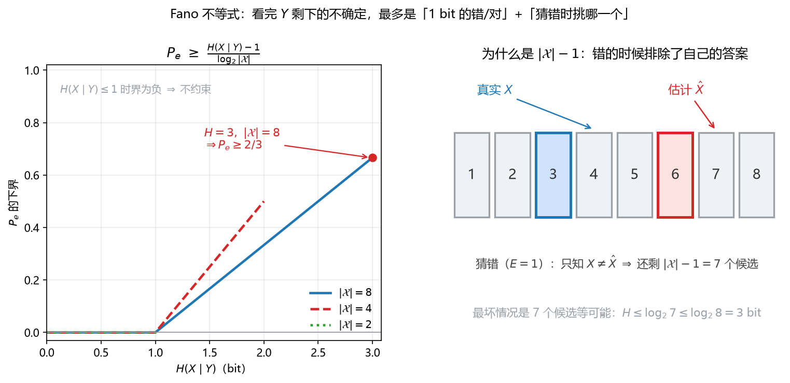

# 第 11 课　Fano 不等式（Fano's Inequality）

> 会话：S011｜日期：2026-11-04｜时长：约 60 分钟
> 对应概念：`fano`（必学）｜来源：Week 6 pp.38–43（Hint 5）
> 前置：第 07 课（条件概率、Bayes）、第 10 课（熵、条件熵、互信息、链式法则）

## 修订记录

- 2026-11-04 初版（S011）。

---

## 1. 引入：蒙对一道 8 选 1，最少会错多少？

想象你在做一道 **8 选 1** 的选择题，题目你完全没看，只听到旁边人含糊地说了一句提示。

- 如果那句提示什么信息都没有，你只能瞎猜，错率 $7/8=87.5\%$。
- 如果提示很有用，你几乎全对，错率接近 $0$。

**Fano 不等式（Fano's inequality）** 回答的就是这件事：

> 看完观测 $Y$ 之后，**不管你多聪明、用什么算法**，猜 $X$ 的错误率 $P_e$ 都有一个**地板**；
> 这个地板只由「$Y$ 里还剩多少关于 $X$ 的信息」决定。

它把两个平时分开说的量接在一起：

- **信息**：条件熵 $H(X\mid Y)$，单位 bit；
- **误差**：错误率 $P_e$，一个 $[0,1]$ 里的数。

一句话版本：**剩下的不确定越多，误差就压不下去。**

---

## 2. 直觉：误差的两个来源

先把「猜错」这件事拆开看。

设：

- $X$：真实答案（比如真实类别）；
- $Y$：你看到的东西（特征、化验单、提示）；
- $\hat X$：你的估计（模型输出、你的答案）。

定义错误指示变量（error indicator）：

$$
E=\begin{cases}1, & X\neq \hat X\\[2pt] 0, & X=\hat X\end{cases}
$$

于是 $P(E=1)=P_e$，$P(E=0)=1-P_e$。

现在问：**看完 $\hat X$ 之后，关于 $X$ 还剩多少不确定**，也就是 $H(X\mid \hat X)$？

它只可能来自两块：

1. **「到底错没错」这件事本身**——这是一个二元随机变量，最多贡献 $1$ bit；
2. **「如果错了，错成了哪一个」**——错了就排除了正确答案，还剩 $|\mathcal{X}|-1$ 个候选，最多贡献 $\log_2(|\mathcal{X}|-1)$ bit；而这件事只在概率 $P_e$ 的时候发生。

所以：

$$
H(X\mid \hat X)\;\le\; \underbrace{H(P_e)}_{\le\,1\text{ bit}}+\underbrace{P_e\log_2|\mathcal{X}|}_{\text{错的时候才付}}
$$

而 $Y$ 是 $\hat X$ 的「原料」，处理数据只会丢信息，不会凭空造信息，所以 $H(X\mid Y)\le H(X\mid \hat X)$。合起来就是 Fano。

> 直觉记法：**「1 bit 的错/对」+「猜错时挑哪一个」= 误差的地板。**

---

## 3. 几何视角：一条误差地板线，一排候选格子

**看图**：

- **左图**：横轴是「看完 $Y$ 还剩多少 bit」，纵轴是「错误率的地板」。三条线对应 $|\mathcal{X}|=2,4,8$。
  - 当 $H(X\mid Y)\le 1$ 时，地板是负的，等于没有约束——信息太少时 Fano 不说话。
  - 当 $H$ 超过 $1$ bit，地板开始线性上升；$|\mathcal{X}|$ 越大，同样的信息量对应的地板越低（候选多，但每个候选分到的概率也小）。
  - 红点：$|\mathcal{X}|=8$、$H(X\mid Y)=3$ bit 时，地板是 $2/3$。
- **右图**：为什么是 $|\mathcal{X}|-1$。真实答案 $X=3$，你猜 $\hat X=6$。一旦知道「猜错了」，正确答案就被排除，只剩 $7$ 个格子；最坏情况是这 $7$ 个等可能，不确定度 $\log_2 7\le\log_2 8=3$ bit。**所以错误带来的额外不确定，天花板是 $\log_2|\mathcal{X}|$，而不是更多。**

> 关键画面：**错误不是「多了一个 bit」，而是「把正确答案从候选里划掉，然后在剩下的格子里重新犯迷糊」。**

---

## 4. 计算与公式（公式卡）

### 11.1 二元熵（binary entropy）

$$
H(P_e)=-P_e\log_2 P_e-(1-P_e)\log_2(1-P_e)
$$

- **符号**：$P_e\in[0,1]$ 是错误率（一个标量）；$\log_2$ 表示以 $2$ 为底，单位是 bit；$H(P_e)$ 是把「错/对」看成一次伯努利试验后的熵，范围 $[0,1]$。
- **意义与场景**：它衡量「你到底是错还是对」这件事有多难猜。$P_e=0$（从不犯错）或 $P_e=1$（永远错）时它都是 $0$——因为结果完全确定；$P_e=0.5$ 时最迷茫，等于 $1$ bit。它就是 Fano 里那个「最多 1 bit」的项。
- **例**：
  - 背景：某分类器在测试集上错率 $P_e=0.26$，想知道「错/对」本身贡献多少不确定。
  - 解：第 1 步，算 $P_e\log_2 P_e=0.26\times\log_2 0.26=0.26\times(-1.9434)=-0.5053$；第 2 步，算 $(1-P_e)\log_2(1-P_e)=0.74\times\log_2 0.74=0.74\times(-0.4344)=-0.3215$；第 3 步，相加取负：$H(0.26)=0.5053+0.3215=0.8268$ bit。
  - 解读：约 $0.83$ bit，离上限 $1$ bit 不远——因为 $0.26$ 离 $0.5$ 不算太远；这也说明「错/对」这一项不能忽略。

### 11.2 马尔可夫链与数据处理（data processing）

$$
X\longrightarrow Y\longrightarrow \hat X \quad\Longrightarrow\quad H(X\mid Y)\le H(X\mid \hat X)
$$

- **符号**：箭头表示「只依赖」——$\hat X$ 只能由 $Y$ 算出来，不能偷看 $X$；$H(X\mid Y)$ 是看完 $Y$ 后关于 $X$ 的剩余不确定；$H(X\mid \hat X)$ 是看完估计值后的剩余不确定。
- **意义与场景**：信息处理不会凭空长出新信息。$\hat X$ 是 $Y$ 加工出来的，所以它关于 $X$ 的信息不可能比 $Y$ 更多。这条是 Fano 链条里「$H(X\mid \hat X)\ge H(X\mid Y)$」的来源，也是「特征决定上限」的数学版本。
- **例**：
  - 背景：把一张 $1000$ 维特征压成 $2$ 维再分类，想知道信息会不会变多。
  - 解：第 1 步，记原始特征 $Y$、压缩后特征 $Z$、预测 $\hat X$，链条是 $X\to Y\to Z\to\hat X$；第 2 步，由数据处理不等式，$H(X\mid Z)\ge H(X\mid Y)$；第 3 步，再套一次，$H(X\mid\hat X)\ge H(X\mid Z)$。
  - 解读：压缩只会让剩余不确定变大或不变；如果压缩丢掉了关键信息，误差地板会**升高**，换更复杂的分类器也救不回来。

### 11.3 条件熵的链式法则（chain rule）

$$
H(U,V\mid W)=H(U\mid W)+H(V\mid U,W)
$$

- **符号**：$U,V,W$ 是任意随机变量；$H(U,V\mid W)$ 是在已知 $W$ 时 $(U,V)$ 的联合不确定；右边第一项是「先解决 $U$」，第二项是「知道 $U$ 之后再解决 $V$」。
- **意义与场景**：把「两个未知量」拆成「一个一个解决」。Fano 的证明就是用它把 $H(E,X\mid\hat X)$ 拆成「先看错没错」+「再看在错没错的前提下是哪一个」。
- **例**：
  - 背景：$U$ 是「是否下雨」，$V$ 是「是否带伞」，$W$ 是「天气预报」。
  - 解：第 1 步，$H(U,V\mid W)$ 是看完预报后「下不下雨 + 带不带伞」的总不确定；第 2 步，先算 $H(U\mid W)$（看完预报还拿不准下不下雨）；第 3 步，再算 $H(V\mid U,W)$（知道下不下雨、也知道预报后，对带不带伞还剩多少不确定）；第 4 步，两者相加等于总不确定。
  - 解读：顺序可以换（先 $V$ 后 $U$），结果一样；这就是链式法则的「怎么拆都行」。

### 11.4 Fano 不等式（强形式）

$$
H(P_e)+P_e\log_2|\mathcal{X}|\;\ge\;H(X\mid \hat X)\;\ge\;H(X\mid Y)
$$

- **符号**：$\mathcal{X}$ 是 $X$ 的取值集合（有限支撑），$|\mathcal{X}|$ 是**类别数**；$P_e=P(\hat X\neq X)$；$H(P_e)$ 见 11.1；$H(X\mid\hat X)$ 是「看完估计值后还剩多少不确定」；$H(X\mid Y)$ 是「看完原始观测后还剩多少不确定」。
- **意义与场景**：这是 Fano 的完整形态：**左边的两个项，是误差能解释的全部不确定**。它同时给了两个方向的约束：误差大，左边就大，于是剩余不确定可以大；反过来，剩余不确定大，误差就必须大。它是「信息 → 误差」的桥。
- **例**：
  - 背景：$|\mathcal{X}|=8$，某估计器 $P_e=0.26$，问它能「解释」多少剩余不确定。
  - 解：第 1 步，$H(0.26)=0.8268$ bit（11.1）；第 2 步，$P_e\log_2 8=0.26\times 3=0.78$；第 3 步，相加得 $1.6068$ bit。
  - 解读：这个估计器允许 $H(X\mid\hat X)\le 1.6068$ bit；如果实际算出来超过它，说明 $P_e$ 或类别数记错了——可以当自检。

### 11.5 弱化形式与误差下界（weakened form）

$$
1+P_e\log_2|\mathcal{X}|\;\ge\;H(X\mid Y)
\qquad\Longrightarrow\qquad
P_e\;\ge\;\frac{H(X\mid Y)-1}{\log_2|\mathcal{X}|}
$$

- **符号**：同 11.4；左边把 $H(P_e)$ 放大成 $1$（因为二元熵最大是 $1$ bit），所以界变松但更好用；右边是「误差地板」的显式公式。
- **意义与场景**：考场最常写的就是这一条：只要知道条件熵和类别数，就能立刻报出一个误差下界。注意它是**下界**，不是「一定能达到」；Fano 通常偏松（见 §5 例题 1 的检查）。
- **例**：
  - 背景：$|\mathcal{X}|=8$，$H(X\mid Y)=3$ bit，求误差地板。
  - 解：第 1 步，$\log_2 8=3$；第 2 步，$H-1=2$；第 3 步，$2/3=0.6667$。
  - 解读：任何估计器的错误率都不低于 $66.67\%$；如果有人在同样的 $H$ 下报告 $50\%$，那一定有问题（详见 §5）。

### 11.6 无信息时的最优猜测（p.43）

$$
H(X)\;\le\;H(P_e)+P_e\log_2(M-1),
\qquad P_e=1-p_1,\quad M=|\mathcal{X}|
$$

- **符号**：$p_1$ 是 $X$ 最大的那个概率；没有任何观测时，最优策略就是「永远猜最可能的那个」，所以错率正好是 $1-p_1$；$M$ 是类别数。
- **意义与场景**：这是 Fano 在没有 $Y$ 时的退化版，也是它的**紧（tight）**情形：当分布是「一个大的 + 剩下 $M-1$ 个均分」时等号成立。它顺便解释了为什么证明里出现的是 $M-1$ 而不是 $M$：猜错时正确答案被排除了。
- **例**：
  - 背景：$X$ 在 $4$ 个类别上均匀，完全没有观测，验证 Fano 的等号。
  - 解：第 1 步，$H(X)=\log_2 4=2$ bit；第 2 步，$p_1=1/4$，$P_e=3/4=0.75$；第 3 步，$H(0.75)=0.8113$ bit；第 4 步，$P_e\log_2(4-1)=0.75\times 1.5850=1.1887$；第 5 步，相加 $0.8113+1.1887=2.0000$ bit，正好等于 $H(X)$。
  - 解读：等号成立，说明 $M-1$ 这个写法是「刚刚好」的；若写成 $\log_2 M=2$，右边会变成 $0.8113+1.5=2.3113>2$，界就松了。

---

## 5. 完整手算（中文，不跳步）

### 例题 1：$|\mathcal{X}|=8$，$H(X\mid Y)=3$ bit，误差地板是多少？

**背景**：8 类分类任务，特征 $Y$ 看完后还剩 $3$ bit 不确定（相当于完全没帮上忙）。问：任何模型的错误率最低能到多少？

**解**：

- **第 1 步**：算 $\log_2|\mathcal{X}|$。
  $$
  \log_2 8=3
  $$
- **第 2 步**：套弱化形式。
  $$
  P_e\;\ge\;\frac{H(X\mid Y)-1}{\log_2|\mathcal{X}|}
  =\frac{3-1}{3}
  $$
- **第 3 步**：算数。
  $$
  \frac{2}{3}=0.6667
  $$
- **第 4 步**：写成百分比。
  $$
  P_e\ge 66.67\%
  $$

**检查（极端情形）**：如果 $Y$ 真的什么信息都没有，$X$ 在 $8$ 类上均匀，那么最优策略是瞎猜一个，真实错误率是

$$
1-\frac18=\frac78=87.5\%
$$

它确实 $\ge 66.67\%$，所以 Fano 没有说错——但它比真实最优值**松**了 $20.83$ 个百分点。结论：**Fano 是地板，不是精确答案。**

**解读**：$66.67\%$ 这个数在说「这 3 bit 的信息量，撑不起一个低于三分之二错误率的模型」。如果某天你在这组数据上训出 $50\%$ 错误率，先别高兴——大概率是 $H(X\mid Y)$ 估错了，或者测试集泄漏了。

### 例题 2：均匀 4 类、没有观测，验证等号

**背景**：$X$ 在 $\{1,2,3,4\}$ 上均匀，没有任何特征。想验证 Fano 的 $M-1$ 形式确实取到等号。

**解**：

- **第 1 步**：算真实熵。
  $$
  H(X)=\log_2 4=2\ \text{bit}
  $$
- **第 2 步**：最优策略是固定猜一个，错率
  $$
  P_e=1-\frac14=\frac34=0.75
  $$
- **第 3 步**：算二元熵。
  $$
  H(0.75)=-0.75\log_2 0.75-0.25\log_2 0.25
  $$
  其中
  $$
  \log_2 0.75=-0.4150,\qquad \log_2 0.25=-2
  $$
  所以
  $$
  H(0.75)=0.75\times 0.4150+0.25\times 2=0.3113+0.5=0.8113\ \text{bit}
  $$
- **第 4 步**：算第二项。
  $$
  P_e\log_2(M-1)=0.75\times\log_2 3=0.75\times 1.5850=1.1887
  $$
- **第 5 步**：相加。
  $$
  0.8113+1.1887=2.0000=H(X)
  $$

**检查（换写法对照）**：若把 $M-1$ 写成 $M$，右边是

$$
0.8113+0.75\times 2=0.8113+1.5=2.3113>2
$$

界仍然成立，但不再取等——说明 $M-1$ 是更紧的版本。

**解读**：等号出现在「一个类别拿 $1-P_e$、剩下 $M-1$ 个平分 $P_e$」这种分布上；这也是 Fano 证明里「错误时候选等可能」那一步的现实对应。

---

## 6. 机器学习里到底用在哪

1. **标签噪声 / 贝叶斯误差地板（Bayes error floor）**
   如果特征里关于标签的信息只有 $H(Y\mid \mathbf{x})$，那么任何模型（包括无限大的神经网络）的平均错误率都不可能低于 Fano 给的地板。**特征不够，换模型没用，该换特征。**

2. **模型结果的 sanity check**
   验证集错误率**低于** Fano 下界，几乎一定有问题：数据泄漏、评估脚本 bug、训练/测试分布不一致、或者 $H$ 估错。这比「准确率又涨了」更值得警惕。

3. **判断「还要不要继续调模型」**
   当模型误差已经接近地板，继续堆层数、调学习率的收益很小；应该去做特征工程或补充数据。

4. **和交叉熵的关系**
   训练时最小化交叉熵 $H(p,q)$，它的下界是真实条件熵 $H(Y\mid \mathbf{x})$。Fano 把这个「信息下界」翻译成「误差下界」，于是你可以在不看模型结构的情况下，先估一个「这类任务最好能做到多少」。

5. **主动学习 / 特征选择**
   互信息 $I(X;Y)=H(X)-H(X\mid Y)$ 衡量特征能消掉多少不确定；Fano 告诉你这些 bit 能换来多少错误率的下降空间。

---

## 7. 常见易错点

1. **$\log_2$ 还是 $\ln$**：Fano 的经典形式用 bit（$\log_2$）。换成 nat 要整体换底，数值会变；题目没写清楚时，按 bit 写并注明。
2. **$|\mathcal{X}|$ 是类别数，不是样本量**：$|\mathcal{X}|=8$ 表示 8 个可能的取值，不是 8 个训练样本。
3. **下界不是可达值**：Fano 通常很松；只能用来「排除不可能」，不能用来「预测准确率」。
4. **$P_e=0$ 与 $H(X\mid Y)=0$**：$P_e=0$ 一定推出 $H(X\mid Y)=0$；反过来，$H(X\mid Y)=0$ 表示存在一个确定性估计（在有限支撑下），所以两者在「存在完美估计」这个意义下等价。但注意「存在」不等于「你的模型找到了」。
5. **别把 $H(X)$ 当下界**：链条是 $H(X\mid Y)\le H(X\mid\hat X)$，不是 $H(X)$。$H(X)$ 是无观测时的不确定，通常更大。
6. **马尔可夫链不能省**：$\hat X$ 只能由 $Y$ 算；如果估计器偷看了 $X$（比如用了标签），Fano 不成立。
7. **$H(P_e)$ 不是 $H(X)$**：它是二元熵，最大 $1$ bit；把它当成任务熵会算错量级。
8. **负下界不是「负误差」**：$H(X\mid Y)<1$ 时公式给出负数，含义是「Fano 在这个区间没有约束力」，不是错误率可以为负。

---

## 8. 和已学概念的关系

| 已学 | 在 Fano 里的角色 |
|---|---|
| 第 07 课：条件概率、Bayes | 定义 $P_e$、马尔可夫链 $X\to Y\to\hat X$ 的语言 |
| 第 09 课：全期望（tower property） | 证明里 $H(X\mid E,\hat X)=P_eH(\cdot\mid E=1)+(1-P_e)H(\cdot\mid E=0)$ 就是按 $E$ 加权平均 |
| 第 10 课：熵、条件熵、链式法则 | $H(X\mid Y)$、$H(U,V\mid W)=H(U\mid W)+H(V\mid U,W)$ 直接拿来用 |
| 第 10 课：互信息 | $I(X;Y)=H(X)-H(X\mid Y)$，决定 Fano 地板能降多低 |
| 第 12 课：MLE | MLE 只是众多估计器之一；Fano 给的是「所有估计器」的共同地板 |

**一句话串起来**：第 10 课学会「怎么量信息」，这一课学会「信息量怎么变成误差的地板」。

---

## 9. 作业（先自己做，答案在最后）

> 默认中文题干；考试若为英文，按英文术语作答即可。共 5 题。
> **先自己做完再看 §10 的答案。**

**Q1（概念判断）** 判断对错，并各用一句话说明理由。

(a) $|\mathcal{X}|=8$，$H(X\mid Y)=3$ bit，则任何估计器的 $P_e\ge 2/3$。
(b) 若 $P_e=0$，则 $H(X\mid Y)=0$；反之，若 $H(X\mid Y)=0$，则存在一个 $P_e=0$ 的估计器。
(c) $|\mathcal{X}|=16$，$H(X\mid Y)=0.5$ bit，Fano 弱化形式给出 $P_e\ge -0.125$。

**Q2（手算）** $|\mathcal{X}|=16$，$H(X\mid Y)=3$ bit。

(a) 用弱化形式求 $P_e$ 的下界。
(b) 某同学在验证集上报告 $P_e=0.40$。在 (a) 的前提下，这可能吗？给出两种合理解释。

**Q3（手算 + 等号）** $X$ 在 $4$ 个类别上均匀，完全没有观测。

(a) 写出最优估计器与 $P_e$。
(b) 用 $H(X)\le H(P_e)+P_e\log_2(M-1)$ 验证等号。
(c) 解释为什么是 $M-1$ 而不是 $M$。

**Q4（证明 / 几何）** 证明：当 $E=1$ 时，

$$
H(X\mid E=1,\hat X)\le \log_2(|\mathcal{X}|-1)
$$

并用「候选格子」的图像解释这一步。

**Q5（机器学习联系）** 一个 $10$ 类分类任务，估计 $H(Y\mid \mathbf{x})=2.5$ bit。

(a) 求误差地板（保留两位小数）。
(b) 若验证集错误率是 $0.30$，说明什么？
(c) 若另一个任务 $H(Y\mid \mathbf{x})=0.8$ bit，Fano 还能给出有用的约束吗？

---

## 10. 作业答案（先自己做完再看）

> 答案与题目分区。默认不批改；你主动提交后我再逐题批改、指出踩分点。

### A1

(a) **对**。代入弱化形式：
$$
P_e\ge\frac{3-1}{\log_2 8}=\frac{2}{3}
$$
(b) **对**。$P_e=0$ 意味着 $\hat X=X$ 几乎必然，所以 $H(X\mid\hat X)=0$，再由 $H(X\mid Y)\le H(X\mid\hat X)$ 得 $H(X\mid Y)=0$；反过来 $H(X\mid Y)=0$ 表示 $X$ 由 $Y$ 确定，存在确定性估计。
(c) **对，但要注意含义**。计算得
$$
\frac{0.5-1}{\log_2 16}=\frac{-0.5}{4}=-0.125
$$
因为 $P_e\ge 0$ 自动成立，所以这个负下界**不提供任何约束**；不是「误差可以为负」。

### A2

(a)
$$
\log_2 16=4,\qquad P_e\ge\frac{3-1}{4}=0.50
$$
(b) **不可能**（在 $H$ 估计正确的前提下）。$0.40<0.50$，与地板矛盾。两种解释：
1. $H(X\mid Y)$ 被高估了——真实条件熵更小（特征其实更有信息）；
2. 评估有问题：测试集泄漏、训练集与测试集分布不一致、或错误率算法写错（比如把 batch 平均算错）。
> 考场提醒：这类「低于下界」的结果，先怀疑数据和代码，再怀疑「我的模型特别强」。

### A3

(a) 最优估计器：固定猜任意一个类别（对称，猜哪个都一样）。错率
$$
P_e=1-\frac14=\frac34=0.75
$$
(b)
$$
H(X)=\log_2 4=2
$$
$$
H(0.75)=0.8113,\qquad P_e\log_2(4-1)=0.75\times 1.5850=1.1887
$$
$$
0.8113+1.1887=2.0000=H(X)
$$
等号成立。
(c) 因为一旦猜错，正确答案就被排除，$X$ 只能在剩下的 $|\mathcal{X}|-1$ 个值里；熵在「这 $|\mathcal{X}|-1$ 个值等可能」时最大，为 $\log_2(|\mathcal{X}|-1)$。用 $\log_2|\mathcal{X}|$ 会把「自己的答案」也算进候选，界偏松。

### A4

证明：已知 $E=1$ 即 $X\neq\hat X$，所以 $X$ 只能取 $\mathcal{X}\setminus\{\hat X\}$ 中的值，共 $|\mathcal{X}|-1$ 个。

对任意分布，熵不超过「同样候选数下均匀分布」的熵：

$$
H(X\mid E=1,\hat X)\le \log_2(|\mathcal{X}|-1)
$$

理由：$N$ 个取值的均匀分布熵为

$$
\sum_{j=1}^{N}\frac1N\log_2 N=\log_2 N
$$

而均匀分布是离散分布中熵最大的。

**图像解释**：右图里真实值 $X=3$、估计 $\hat X=6$；知道「错了」之后，第 6 格被排除，只剩 $7$ 个格子。最迷茫的情况就是这 $7$ 个格子完全等可能，此时不确定度 $\log_2 7$；它一定不超过 $\log_2 8$。

### A5

(a)
$$
\log_2 10=3.3219,\qquad P_e\ge\frac{2.5-1}{3.3219}=\frac{1.5}{3.3219}=0.4515
$$
即约 $45.15\%$。

(b) $0.30<0.4515$，与地板矛盾。说明三者至少有一个不成立：$H(Y\mid\mathbf{x})$ 估高了、验证集有泄漏/分布不一致、或错误率统计有 bug。**不能**直接得出「模型很好」的结论。

(c) $H=0.8<1$，弱化形式给出
$$
\frac{0.8-1}{\log_2 10}<0
$$
无约束。此时 Fano 的弱化版失效；需要更强的工具（比如直接用强形式 $H(P_e)+P_e\log_2 10\ge 0.8$ 去反解一个非平凡的 $P_e$ 范围，或结合具体分布）。

---

## 11. 本课小结（三句话）

1. **Fano 把「剩余信息」翻译成「误差地板」**：$P_e\ge\big(H(X\mid Y)-1\big)/\log_2|\mathcal{X}|$。
2. **误差的两个来源**：错/对本身（$\le 1$ bit）+ 错时挑哪一个（$\le\log_2|\mathcal{X}|$ bit，且只在概率 $P_e$ 时付）。
3. **它是下界，不是预测**；用它排除不可能、做 sanity check、判断「特征够不够」，而不是估准确率。
