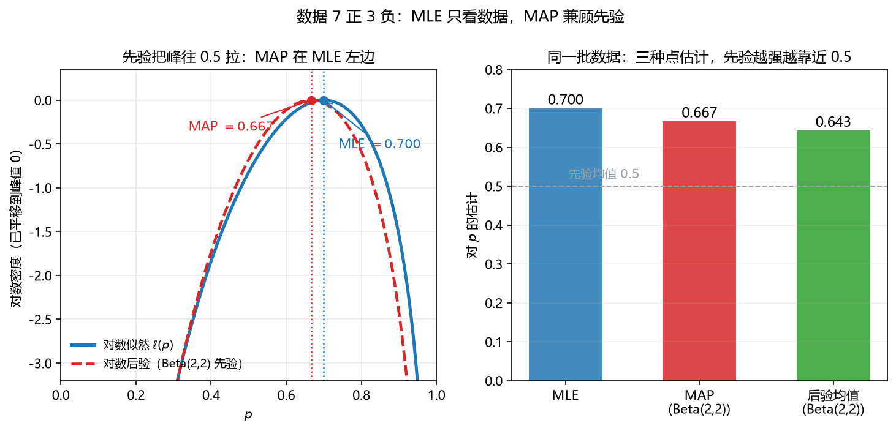

# 第 12 课　最大似然与最大后验（MLE & MAP）

> 会话：S011｜日期：2026-11-04｜时长：约 60 分钟
> 对应概念：`mle`、`map`、`loss_regularization`、`model_selection`
> 来源：Week 7 pp.3–17、44–53；A2 Q6（噪声报告者模型）
> 前置：第 07 课 Bayes、第 10 课 KL、第 05 课梯度、第 02 课最小二乘

## 修订记录

- 2026-11-04 初版（S011）。

---

## 1. 引入：摸出 7 红 3 白，红球比例是多少？

桌上有一袋糖，红球比例 $p$ 未知。你摸了 $10$ 次（每次放回），得到 $7$ 红 $3$ 白。

- 直觉：$p\approx 0.7$。
- 但如果有人告诉你「这种袋子的红球比例通常在 $0.5$ 附近」，你的答案会往 $0.5$ 挪一点。

这就是本课的两个主角：

- **最大似然估计（maximum likelihood estimation, MLE）**：只看数据，选「让这组数据最可能出现」的参数。
- **最大后验估计（maximum a posteriori, MAP）**：数据 + 先验，选「看完数据后最可能」的参数。

---

## 2. 直觉：似然不是「参数的概率」

设数据 $\mathcal{D}=\{x_1,\dots,x_n\}$，模型 $p_\theta(x)$。

- 固定 $\theta$ 看数据：$p_\theta(x)$ 是**概率密度/质量**。
- 固定数据看 $\theta$：同一个式子写成 $L(\theta)=\prod_{i=1}^n p_\theta(x_i)$，叫**似然（likelihood）**。它**不是** $\theta$ 的概率分布，对 $\theta$ 积分不必等于 $1$。

> 比喻：似然是「侦探拿到证据后，评估哪个嫌疑人的作案可能性」。嫌疑人不是随机变量（频率派），所以谈的是「可能性」而不是「概率」。

**MLE**：$\hat\theta_{\mathrm{MLE}}=\arg\max_\theta L(\theta)=\arg\max_\theta \ell(\theta)$，其中 $\ell=\ln L$。
**MAP**：$\hat\theta_{\mathrm{MAP}}=\arg\max_\theta p(\theta\mid\mathcal{D})=\arg\max_\theta\big[\ell(\theta)+\ln p(\theta)\big]$。

两者只差一个 $\ln p(\theta)$：**先验就是给似然加了一项惩罚/偏好**。

---

## 3. 几何视角：先验把峰往中间拉

**看图**：

- 左图蓝线是 $\ell(p)$，数据 $7$ 正 $3$ 负，峰在 $p=0.7$。
- 红线是加了 $\mathrm{Beta}(2,2)$ 先验后的对数后验。先验在 $0.5$ 附近更重，于是峰被拉到 $0.667$。
- 右图三种点估计：MLE $0.700$、MAP $0.667$、后验均值 $0.643$。**先验越强，越靠近先验均值 $0.5$；数据越多，先验越拉不动。**

> 一句话：**MLE 是「数据说什么就是什么」，MAP 是「数据 + 常识各让一步」。**

---

## 4. 计算与公式（公式卡）

### 12.1 似然与对数似然（likelihood / log-likelihood）

$$
L(\theta)=\prod_{i=1}^{n}p_\theta(x_i),
\qquad
\ell(\theta)=\ln L(\theta)=\sum_{i=1}^{n}\ln p_\theta(x_i)
$$

- **符号**：$\theta$ 是参数（标量或向量）；$x_i$ 是第 $i$ 个观测；$L$ 是似然，$\ell$ 是对数似然；$\ln$ 单调递增，所以最大化 $L$ 与最大化 $\ell$ 等价。
- **意义与场景**：把「连乘」变成「连加」，既好求导又防下溢。深度学习里每个 batch 的 loss 求和，本质就是对数似然。
- **例**：
  - 背景：抛硬币 $10$ 次，$7$ 正 $3$ 反，$p$ 未知。
  - 解：第 1 步，写出 $L(p)=p^7(1-p)^3$；第 2 步，取对数 $\ell(p)=7\ln p+3\ln(1-p)$；第 3 步，代 $p=0.7$：$7\ln 0.7+3\ln 0.3=7\times(-0.3567)+3\times(-1.2040)=-2.4969-3.6120=-6.1089$。
  - 解读：$\ell$ 是负数很正常；它的大小只在**比较不同 $\theta$**时有意义，单独看没有单位含义。

### 12.2 最大似然估计（MLE）

$$
\hat\theta_{\mathrm{MLE}}=\arg\max_{\theta\in\Omega}\ell(\theta)
$$

- **符号**：$\Omega$ 是允许的参数空间（如 $p\in(0,1)$、$\sigma^2>0$）；$\arg\max$ 返回使目标最大的参数值。
- **意义与场景**：只要写出似然，就能「训练」一个模型。线性回归的最小二乘、逻辑回归的交叉熵、语言模型的下一个 token 预测，都是 MLE 的特例。
- **例**：
  - 背景：上例 $7$ 正 $3$ 反，求 MLE。
  - 解：第 1 步，$\ell'(p)=7/p-3/(1-p)$；第 2 步，令其为 $0$：$7(1-p)=3p$；第 3 步，$7=10p$，得 $\hat p=0.7$。
  - 解读：MLE 就是样本频率；但样本少时它可能很极端（$1$ 正 $0$ 反会给出 $\hat p=1$）。

### 12.3 伯努利 MLE（Bernoulli MLE）

$$
\ell(p)=k\ln p+(n-k)\ln(1-p)
\quad\Longrightarrow\quad
\hat p_{\mathrm{MLE}}=\frac{k}{n}
$$

- **符号**：$n$ 是试验次数，$k$ 是成功次数（$1$ 的个数）；$p$ 是单次成功概率。
- **意义与场景**：最简单的「频率即估计」。它也是后面 Beta-Binomial 共轭的起点。
- **例**：
  - 背景：$n=20$，$k=13$。
  - 解：第 1 步，$\ell'=13/p-7/(1-p)$；第 2 步，$13(1-p)=7p$；第 3 步，$13=20p$，$\hat p=0.65$。
  - 解读：$0.65$ 就是 $13/20$；注意它不是「$p$ 有 $65\%$ 的概率等于某个值」。

### 12.4 正态 MLE（Gaussian MLE）

$$
\hat\mu=\bar x=\frac1n\sum_{i=1}^{n}x_i,
\qquad
\hat\sigma^2_{\mathrm{MLE}}=\frac1n\sum_{i=1}^{n}(x_i-\bar x)^2
$$

- **符号**：$\bar x$ 样本均值；$\hat\sigma^2_{\mathrm{MLE}}$ 是除以 $n$ 的版本（有偏）；无偏版本除以 $n-1$。
- **意义与场景**：均值估计就是「重心」；方差 MLE 系统性地偏小，因为是用样本均值（而非真实均值）去量离散度。考试常考「MLE 与无偏估计差一个 $n/(n-1)$」。
- **例**：
  - 背景：数据 $2,4,6,8$。
  - 解：第 1 步，$\bar x=(2+4+6+8)/4=5$；第 2 步，偏差平方和 $9+1+1+9=20$；第 3 步，$\hat\sigma^2_{\mathrm{MLE}}=20/4=5$；无偏 $=20/3\approx6.667$。
  - 解读：$5$ 是 MLE，$6.667$ 才是无偏；题目问 MLE 就写 $5$。

### 12.5 条件似然与最小二乘（conditional likelihood / least squares）

$$
\hat\beta=\arg\max_\beta\sum_{i=1}^{n}\ln p_\theta(y_i\mid x_i)
=\arg\min_\beta\sum_{i=1}^{n}\big(y_i-x_i^\top\beta\big)^2
=\big(\mathbf X^\top\mathbf X\big)^{-1}\mathbf X^\top\mathbf y
$$

- **符号**：$x_i\in\mathbb R^{k+1}$ 是特征（含截距），$\beta$ 是系数；$\mathbf X$ 是设计矩阵（每行一个样本），$\mathbf y$ 是标签向量；假设 $y_i=x_i^\top\beta+\varepsilon_i$、$\varepsilon_i\sim\mathcal N(0,\sigma^2)$。
- **意义与场景**：高斯噪声假设下，MLE 退化成最小二乘。这解释了「为什么回归用 MSE」——不是随便选的，是似然推出来的。
- **例**：
  - 背景：三点 $(1,2),(2,4),(3,5)$，拟合 $y=\beta_0+\beta_1x$。
  - 解：第 1 步，$\mathbf X^\top\mathbf X=\begin{bmatrix}3&6\\6&14\end{bmatrix}$；第 2 步，$\mathbf X^\top\mathbf y=\begin{bmatrix}11\\25\end{bmatrix}$；第 3 步，解方程得 $\beta_0=2/3$、$\beta_1=3/2$。
  - 解读：这与第 01 课正规方程的结果一致；MLE 视角说明它依赖「噪声正态」这个假设。

### 12.6 最大后验估计（MAP）

$$
\hat\theta_{\mathrm{MAP}}
=\arg\max_\theta p(\theta\mid\mathcal{D})
=\arg\max_\theta\big[\ell(\theta)+\ln p(\theta)\big]
$$

- **符号**：$p(\theta)$ 是先验；$p(\theta\mid\mathcal{D})\propto p(\mathcal{D}\mid\theta)p(\theta)$；$\ln p(\theta)$ 就是「惩罚项」。
- **意义与场景**：MAP = MLE + 先验。数据少时先验管用；数据多时似然压倒先验。注意 MAP 是**后验的众数**，不是后验均值。
- **例**：
  - 背景：$7$ 正 $3$ 反，先验 $\mathrm{Beta}(2,2)$，求 MAP。
  - 解：第 1 步，后验 $\propto p^7(1-p)^3\cdot p^{1}(1-p)^{1}=p^{8}(1-p)^{4}$；第 2 步，这是 $\mathrm{Beta}(9,5)$；第 3 步，众数 $=(9-1)/(9+5-2)=8/12=0.6667$。
  - 解读：比 MLE 的 $0.7$ 更靠近 $0.5$；若先验换成 $\mathrm{Beta}(1,1)$（均匀），MAP 就退回 MLE。

### 12.7 正则化 = 先验（regularization as prior）

$$
\text{Ridge: }\hat\beta=\arg\min_\beta\|\mathbf y-\mathbf X\beta\|^2+\lambda\|\beta\|^2
\quad\Longleftarrow\quad
\beta_j\sim\mathcal N(0,\tau^2),\ \lambda=\frac{\sigma^2}{\tau^2}
$$

$$
\text{Lasso: }\hat\beta=\arg\min_\beta\|\mathbf y-\mathbf X\beta\|^2+\lambda\|\beta\|_1
\quad\Longleftarrow\quad
p(\beta_j)\propto e^{-|\beta_j|/b}
$$

- **符号**：$\lambda\ge0$ 控制惩罚强度；$\tau^2$ 是先验方差；$b$ 是 Laplace 尺度；$\|\beta\|_1=\sum_j|\beta_j|$。
- **意义与场景**：L2 对应高斯先验，把权重「压小但不压没」；L1 对应 Laplace 先验，能把部分权重压到**恰好 $0$**，自动做特征选择。正则化不是玄学，是「相信参数不该太大」的先验。
- **例**：
  - 背景：$\sigma^2=1$，先验 $\tau^2=4$，问 Ridge 的 $\lambda$。
  - 解：第 1 步，$\lambda=\sigma^2/\tau^2$；第 2 步，$=1/4=0.25$。
  - 解读：先验越宽（$\tau^2$ 大），$\lambda$ 越小、惩罚越弱；先验越窄，越强行把权重拉向 $0$。

### 12.8 模型选择：BIC（Bayesian information criterion）

$$
\mathrm{BIC}(M)=\ell(\hat\theta_{\mathrm{MLE}})-\frac{d}{2}\ln N
$$

- **符号**：$d$ 是模型自由参数个数；$N$ 是样本量；$\ell(\hat\theta)$ 是最大对数似然；**越大越好**。
- **意义与场景**：BIC = 「拟合好」减去「复杂度罚分」。它近似「模型的后验概率」，用于在 $M_2$ 与 $M_4$ 这类模型间选。与交叉验证相比，BIC 不用反复训练，但假设更强。
- **例**：
  - 背景：$N=7$，$M_2$ 的 $\ell=-9.5607$、$d=2$；$M_4$ 的 $\ell=-9.4625$、$d=4$。
  - 解：第 1 步，$\ln 7=1.9459$；第 2 步，$\mathrm{BIC}_2=-9.5607-1\times1.9459=-11.5066$；第 3 步，$\mathrm{BIC}_4=-9.4625-2\times1.9459=-13.3543$。
  - 解读：$\mathrm{BIC}_2>\mathrm{BIC}_4$，选 $M_2$；虽然 $M_4$ 拟合略好，但多两个参数不值。

---

## 5. 完整手算：A2 Q6 噪声报告者（MLE / M4 / BIC）

**背景**：硬币正面概率 $\theta_1$；报告者只有概率 $\theta_2$ 报对。数据 $x=(1,1,0,1,1,0,0)$、$y=(1,0,0,0,1,0,1)$。

### 第 1 步：列 $2\times2$ 联合表

$$
p(x,y)=p(x)p(y\mid x):
\quad
\begin{array}{c|cc}
 & y=0 & y=1\\\hline
x=0 & (1-\theta_1)\theta_2 & (1-\theta_1)(1-\theta_2)\\
x=1 & \theta_1(1-\theta_2) & \theta_1\theta_2
\end{array}
$$

### 第 2 步：数频数

- $x=1$：$4$ 次；$x=0$：$3$ 次。
- 报对（$y=x$）：$4$ 次；报错（$y\neq x$）：$3$ 次。

### 第 3 步：写对数似然

$$
\ell(\theta_1,\theta_2)=4\ln\theta_1+3\ln(1-\theta_1)+4\ln\theta_2+3\ln(1-\theta_2)
$$

### 第 4 步：分别求导（两个参数可分离）

$$
\frac{\partial\ell}{\partial\theta_1}=\frac{4}{\theta_1}-\frac{3}{1-\theta_1}=0
\;\Longrightarrow\;
4(1-\theta_1)=3\theta_1
\;\Longrightarrow\;
\hat\theta_1=\frac47
$$

$$
\frac{\partial\ell}{\partial\theta_2}=\frac{4}{\theta_2}-\frac{3}{1-\theta_2}=0
\;\Longrightarrow\;
\hat\theta_2=\frac47
$$

### 第 5 步：算最大似然

$$
L_2=\left(\frac47\right)^8\left(\frac37\right)^6
$$

取对数：

$$
\ell_2=8\ln\frac47+6\ln\frac37
=8\times(-0.5596)+6\times(-0.8473)
=-4.4769-5.0838=-9.5607
$$

$$
L_2=e^{-9.5607}\approx7.04\times10^{-5}
$$

### 第 6 步：$M_4$（四个自由参数）

频数：$n_{00}=2$、$n_{01}=1$、$n_{10}=2$、$n_{11}=2$，总数 $7$。MLE 就是频率：

$$
\hat\theta_{00}=\frac27,\quad \hat\theta_{01}=\frac17,\quad
\hat\theta_{10}=\frac27,\quad \hat\theta_{11}=\frac27
$$

$$
L_4=\left(\frac27\right)^6\left(\frac17\right)
\;\Longrightarrow\;
\ell_4=6\ln\frac27+\ln\frac17
=6\times(-1.2528)+(-1.9459)=-9.4625
$$

$$
L_4=e^{-9.4625}\approx7.78\times10^{-5}
$$

### 第 7 步：BIC

$$
\mathrm{BIC}_2=-9.5607-\frac22\ln 7=-9.5607-1.9459=-11.5066
$$

$$
\mathrm{BIC}_4=-9.4625-\frac42\ln 7=-9.4625-3.8918=-13.3543
$$

**结论**：$\mathrm{BIC}_2>\mathrm{BIC}_4$，选两参数模型 $M_2$。$M_4$ 虽然似然略高，但多两个参数、罚分更重。

**检查（为什么 CV 也选 $M_2$）**：留一法中，把「$n_{01}=1$」那一行拿掉后，$M_4$ 对该格的估计变成 $0$，对数似然为 $-\infty$；CV 直接判死。$M_2$ 因为有参数共享，不会出现 $0$。

**解读**：这是「过拟合」的最干净例子——参数越多，训练似然越高，但泛化/惩罚后反而更差。

---

## 6. 机器学习里用在哪

1. **训练目标**：分类的交叉熵、回归的 MSE、语言模型的 next-token NLL，都是负对数似然。
2. **正则化**：weight decay = 高斯先验 MAP；L1 = Laplace 先验 MAP。
3. **模型选择**：BIC、AIC、交叉验证；A2 Q6(d)(e) 正是这条线。
4. **生成模型**：VAE/GAN 的似然（或 ELBO）与 MLE 的关系。
5. **MLE = 最小 KL**：$\arg\min_\theta D(p_{\text{data}}\|p_\theta)=\arg\max_\theta E_{\text{data}}\ln p_\theta$，所以「训练」就是让模型分布逼近数据分布。

---

## 7. 常见易错点

1. **似然不是概率**：$L(\theta)$ 对 $\theta$ 不归一；不能写 $P(\theta\mid\mathcal{D})=L(\theta)$（还差先验与归一化）。
2. **取对数不改变极值点**，但会改变数值；比较模型时用对数似然即可。
3. **$\sigma^2$ 的 MLE 除以 $n$**，无偏估计除以 $n-1$；题目问哪个要看清。
4. **MAP 是众数，不是均值**：Beta 后验不对称时两者不同。
5. **均匀先验 ⇒ MAP = MLE**；但「均匀先验」在变换后不一定还是均匀（见第 13 课 Jeffreys）。
6. **正则化系数与先验方差成反比**：$\lambda=\sigma^2/\tau^2$，先验越窄 $\lambda$ 越大。
7. **BIC 越大越好**，且罚分是 $\frac d2\ln N$，不是 $d\ln N$。
8. **参数可分离时分别求导**：A2 Q6 的 $\theta_1,\theta_2$ 没有交叉项，可以拆开。

---

## 8. 和已学概念的关系

| 已学 | 关系 |
|---|---|
| 第 02 课 最小二乘 | 高斯噪声下的 MLE |
| 第 05 课 梯度/Hessian | 求 MLE 就是解 $\nabla\ell=0$，Hessian 判极大 |
| 第 07 课 Bayes | MAP 的分子 $p(y\mid\theta)p(\theta)$ |
| 第 10 课 KL/交叉熵 | MLE = 最小化 $D(p_{\text{data}}\|p_\theta)$；分类 NLL = 交叉熵 |
| 第 13 课 共轭先验 | 把 MAP 升级成完整后验 |

---

## 9. 作业（先做，答案在最后）

**Q1（概念判断）**
(a) 似然 $L(\theta)$ 是 $\theta$ 的概率密度，所以 $\int L(\theta)\,d\theta=1$。
(b) 先验取均匀分布时，MAP 与 MLE 相同。
(c) 高斯方差的 MLE 是无偏估计。

**Q2（手算）** 抛硬币 $12$ 次，$8$ 正 $4$ 反。
(a) 求 $p$ 的 MLE。
(b) 先验 $\mathrm{Beta}(3,3)$，求 MAP 与后验均值。
(c) 若先验换成 $\mathrm{Beta}(1,1)$，MAP 变成多少？

**Q3（手算）** 数据 $2,4,6,8$。
(a) 求 $\mu$ 与 $\sigma^2$ 的 MLE。
(b) 求 $\sigma^2$ 的无偏估计。
(c) 说明两者为什么不同。

**Q4（A2 Q6 同型）** 联合频数：$n_{00}=3$、$n_{01}=1$、$n_{10}=1$、$n_{11}=5$，总数 $10$。
(a) 求 $\theta_1,\theta_2$ 的 MLE。
(b) 求 $M_2$ 的最大对数似然。
(c) 求 $M_4$ 的最大对数似然，并用 BIC 判断选哪个（$N=10$）。

**Q5（正则化）** 线性回归噪声方差 $\sigma^2=2$，参数先验 $\beta_j\sim\mathcal N(0,9)$。
(a) 写出对应的 Ridge 目标与 $\lambda$。
(b) 若把先验方差改成 $1$，$\lambda$ 怎么变？惩罚变强还是变弱？

---

## 10. 作业答案（先自己做完再看）

### A1

(a) **错**。似然是「固定数据、看参数」的函数，对 $\theta$ 不归一。
(b) **对**。均匀先验 $\ln p(\theta)$ 是常数，$\arg\max[\ell+\text{const}]=\arg\max\ell$。
(c) **错**。MLE 除以 $n$，期望偏小；无偏版本除以 $n-1$。

### A2

(a)
$$
\ell(p)=8\ln p+4\ln(1-p),\qquad
\frac{8}{p}=\frac{4}{1-p}
\;\Longrightarrow\;
8-8p=4p
\;\Longrightarrow\;
\hat p=\frac{8}{12}=\frac23
$$
(b) 后验 $\propto p^8(1-p)^4\cdot p^{2}(1-p)^{2}=p^{10}(1-p)^{6}$，即 $\mathrm{Beta}(11,7)$。
$$
\text{MAP}=\frac{11-1}{11+7-2}=\frac{10}{16}=0.625,
\qquad
\text{后验均值}=\frac{11}{18}\approx0.6111
$$
(c) $\mathrm{Beta}(1,1)$ 是均匀先验，后验 $\mathrm{Beta}(9,5)$，MAP $=\frac{8}{12}=\frac23$，回到 MLE。

### A3

(a) $\bar x=5$；偏差平方和 $9+1+1+9=20$；$\hat\sigma^2_{\mathrm{MLE}}=20/4=5$。
(b) $s^2=20/3\approx6.667$。
(c) MLE 用 $\bar x$ 代替真实 $\mu$，少了一个自由度，系统偏小；乘以 $n/(n-1)=4/3$ 修正。

### A4

总数 $10$：$x=1$ 出现 $1+5=6$ 次；报对 $3+5=8$ 次。

(a)
$$
\hat\theta_1=\frac6{10}=0.6,\qquad \hat\theta_2=\frac8{10}=0.8
$$
(b)
$$
\ell_2=6\ln0.6+4\ln0.4+8\ln0.8+2\ln0.2
$$
$$
=6(-0.5108)+4(-0.9163)+8(-0.2231)+2(-1.6094)
=-3.0649-3.6652-1.7851-3.2189=-11.7341
$$
(c) $M_4$：
$$
\ell_4=3\ln0.3+\ln0.1+\ln0.1+5\ln0.5
=3(-1.2040)+2(-2.3026)+5(-0.6931)
=-3.6120-4.6052-3.4657=-11.6829
$$
$$
\mathrm{BIC}_2=-11.7341-\frac22\ln10=-11.7341-2.3026=-14.0367
$$
$$
\mathrm{BIC}_4=-11.6829-\frac42\ln10=-11.6829-4.6052=-16.2881
$$
$\mathrm{BIC}_2>\mathrm{BIC}_4$，选 $M_2$。

### A5

(a)
$$
\hat\beta=\arg\min_\beta\|\mathbf y-\mathbf X\beta\|^2+\lambda\|\beta\|^2,
\qquad
\lambda=\frac{\sigma^2}{\tau^2}=\frac{2}{9}\approx0.2222
$$
(b) $\lambda=2/1=2$，惩罚变强（先验更窄，更相信 $\beta$ 接近 $0$）。

---

## 11. 本课小结

1. **MLE = 让数据最可能**；**MAP = MLE + 先验**。
2. 高斯噪声下 MLE = 最小二乘；分类 NLL = 交叉熵；**训练就是 MLE**。
3. **正则化就是 MAP**：L2 ↔ 高斯先验，L1 ↔ Laplace 先验。
4. 参数多不一定好：BIC/CV 用「拟合 − 复杂度」来选模型。
