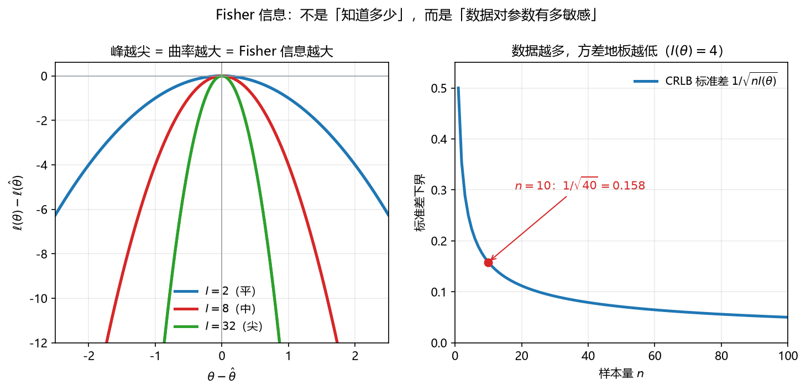

# 第 13 课　Fisher 信息、Jeffreys 先验与共轭先验

> 会话：S011｜日期：2026-11-04｜时长：约 120 分钟
> 对应概念：`fisher_information`、`conjugate_prior`、`asymptotic_mle`（了解）
> 来源：Week 8 pp.5–17（教师 Hint 指定页段）
> 前置：第 07 课 Bayes、第 10 课 KL、第 12 课 MLE/MAP

## 修订记录

- 2026-11-04 初版（S011）。

---

## 1. 引入：两台都「准」的秤，哪台更值钱？

两台秤称同一袋糖，读数都没有系统偏差（无偏），但：

- A 台每次读数在真值附近大幅晃动；
- B 台每次读数几乎一样。

你更信哪台？显然是 B。**「无偏」只保证平均对，没保证每次都对。**

Fisher 信息（Fisher information）量的就是这件事：**数据对参数有多敏感**。敏感度高 → 参数一偏，似然就掉得厉害 → 估计自然更稳。

而 **Jeffreys 先验**回答另一个问题：如果我想「不偏不倚」，先验该怎么选，才能在换参数化（比如 $p$ 换成 $p^2$）时结论不变？

**共轭先验**则回答：先验怎么选，才能让后验「长得跟先验一样」，从而有闭式解？

---

## 2. 直觉：Fisher 信息 = 对数似然的曲率

把对数似然 $\ell(\theta)$ 想成一座山：

- 山顶是 MLE $\hat\theta$；
- 山顶越**尖**，说明 $\theta$ 稍微偏离，数据就变得「很不像」，于是估计越准；
- 山顶越**平**，说明很多 $\theta$ 都能解释数据，估计越飘。

数学上，「尖不尖」就是二阶导数（曲率）。Fisher 信息定义为

$$
I(\theta)=E\left[\left(\frac{\partial\ln p(Y\mid\theta)}{\partial\theta}\right)^2\right]
=-E\left[\frac{\partial^2\ln p(Y\mid\theta)}{\partial\theta^2}\right]
$$

第一个等号是「score 的方差」，第二个等号是「负曲率」。两者相等，是因为 score 的均值为 $0$。

> 直观：**Fisher 信息不是「我知道多少」，而是「数据对参数有多挑」**。

---

## 3. 几何视角：峰越尖，方差地板越低

**看图**：

- 左图三条抛物线是同一真值附近的对数似然，曲率 $I=2,8,32$。绿线最尖 → 参数稍微偏一点，似然就暴跌 → 数据「很挑」。
- 右图是 Cramér–Rao 下界（CRLB）的标准差 $1/\sqrt{nI(\theta)}$。样本越多，地板越低；但**永远大于 $0$**——这就是「无偏也不能保证零误差」。

> 一句话：**Fisher 信息是「曲率」，CRLB 是「曲率决定的最低方差」。**

---

## 4. 计算与公式（公式卡）

### 13.1 Score 与 Fisher 信息（score / Fisher information）

$$
s(\theta)=\frac{\partial\ln p(Y\mid\theta)}{\partial\theta},
\qquad
I(\theta)=E\big[s(\theta)^2\big]=-E\left[\frac{\partial^2\ln p(Y\mid\theta)}{\partial\theta^2}\right]
$$

- **符号**：$Y$ 是单个观测（随机变量）；$p(y\mid\theta)$ 是采样分布；$s(\theta)$ 叫 score；$I(\theta)$ 是单次观测的 Fisher 信息；期望对 $Y\sim p(\cdot\mid\theta)$ 取。
- **意义与场景**：它衡量「数据对参数变化的敏感度」。深度学习里的 Fisher 矩阵、自然梯度、Laplace 近似，都从这里来。
- **例**：
  - 背景：$Y\sim\mathrm{Bernoulli}(\theta)$，求 $I(\theta)$。
  - 解：第 1 步，$\ell=y\ln\theta+(1-y)\ln(1-\theta)$；第 2 步，$\ell'=y/\theta-(1-y)/(1-\theta)$；第 3 步，$\ell''=-y/\theta^2-(1-y)/(1-\theta)^2$；第 4 步，取负期望：$I(\theta)=\theta/\theta^2+(1-\theta)/(1-\theta)^2=1/\theta+1/(1-\theta)=1/[\theta(1-\theta)]$。
  - 解读：$\theta=0.5$ 时 $I=4$（最敏感）；$\theta\to0$ 或 $1$ 时 $I\to\infty$（极端概率很容易判断）。

### 13.2 可加性与 Cramér–Rao 下界（additivity / CRLB）

$$
I_n(\theta)=nI(\theta),
\qquad
\mathrm{Var}(\hat\theta)\ge\frac{1}{nI(\theta)}
$$

- **符号**：$I_n$ 是 $n$ 个独立同分布样本的总信息；$\hat\theta$ 是任意**无偏**估计；右边是方差下界（CRLB）。
- **意义与场景**：样本量每翻一倍，标准差下界缩小 $\sqrt2$ 倍。它告诉你「再努力也不能低于这条线」，也是实验设计的依据。
- **例**：
  - 背景：$Y\sim\mathrm{Bernoulli}(0.6)$，$n=10$，求无偏估计的标准差下界。
  - 解：第 1 步，$I(0.6)=1/(0.6\times0.4)=4.1667$；第 2 步，$nI=41.667$；第 3 步，$\mathrm{Var}\ge0.024$；第 4 步，标准差 $\ge\sqrt{0.024}=0.1549$。
  - 解读：即使无偏，$10$ 次抛硬币对 $p$ 的估计也不可能比 $\pm0.155$ 更稳。

### 13.3 Jeffreys 先验（Jeffreys prior）

$$
p(\theta)\propto\sqrt{I(\theta)}
$$

- **符号**：$I(\theta)$ 是单次观测的 Fisher 信息；$\propto$ 表示只关心形状，常数由归一化决定。
- **意义与场景**：普通均匀先验在换参数后不再是均匀（$p$ 均匀 ⇒ $p^2$ 不均匀），会导致「同一个人换个说法就得出不同结论」。Jeffreys 先验用 $\sqrt{I}$ 做「体积修正」，在重参数化下保持不变，是最常用的无信息先验。
- **例**：
  - 背景：$Y\sim\mathrm{Bernoulli}(\theta)$，求 Jeffreys 先验。
  - 解：第 1 步，$I(\theta)=1/[\theta(1-\theta)]$；第 2 步，$\sqrt{I}=\theta^{-1/2}(1-\theta)^{-1/2}$；第 3 步，这正是 $\mathrm{Beta}(1/2,1/2)$ 的核。
  - 解读：所以 Bernoulli 的 Jeffreys 先验是 $\mathrm{Beta}(0.5,0.5)$，不是 $\mathrm{Beta}(1,1)$。

### 13.4 共轭先验（conjugate prior）

$$
p(\theta\mid y)\propto p(y\mid\theta)p(\theta),
\qquad
p(\theta\mid y)\in\mathcal P\ \text{当}\ p(\theta)\in\mathcal P
$$

- **符号**：$\mathcal P$ 是某个先验族；共轭的意思是「后验仍属于同一族」。
- **意义与场景**：有闭式解、可解释、可递推（今天的后验是明天的先验）。它是贝叶斯推断的「乐高积木」。
- **常见配对**：

| 似然 | 先验 | 后验 |
|---|---|---|
| Bernoulli / Binomial | $\mathrm{Beta}(a,b)$ | $\mathrm{Beta}(a+k,\ b+n-k)$ |
| Poisson | $\mathrm{Gamma}(\alpha,\beta)$ | $\mathrm{Gamma}(\alpha+S,\ \beta+n)$ |
| Normal（已知 $\sigma^2$） | $\mathcal N(\mu_0,\tau_0^2)$ | $\mathcal N(\mu_1,\tau_1^2)$ |
| Multinomial | $\mathrm{Dirichlet}(\alpha)$ | $\mathrm{Dirichlet}(\alpha+n)$ |

- **例**：
  - 背景：Beta-Binomial，先验 $\mathrm{Beta}(2,3)$，观测 $7$ 正 $3$ 反。
  - 解：第 1 步，后验参数 $a'=2+7=9$；第 2 步，$b'=3+3=6$；第 3 步，后验 $\mathrm{Beta}(9,6)$。
  - 解读：参数就是「先验伪计数 + 实际计数」，非常好记。

### 13.5 Beta-Binomial 后验与预测（Beta-Binomial）

$$
\theta\mid y\sim\mathrm{Beta}(a+k,\ b+n-k)
$$

$$
E[\theta\mid y]=\frac{a+k}{a+b+n},
\qquad
\text{mode}=\frac{a+k-1}{a+b+n-2},
\qquad
P(y^*=1\mid y)=\frac{a+k}{a+b+n}
$$

- **符号**：$a,b$ 是先验伪计数；$k$ 是成功数；$n$ 是总试验数；mode 要求 $a+k>1,\ b+n-k>1$。
- **意义与场景**：后验均值 = 「伪计数 + 观测」的比例；预测概率与后验均值相同（Bernoulli 的线性性质）。它是 Thompson sampling、A/B 测试的标准工具。
- **例**：
  - 背景：先验 $\mathrm{Beta}(2,3)$，数据 $7$ 正 $3$ 反。
  - 解：第 1 步，后验 $\mathrm{Beta}(9,6)$；第 2 步，均值 $9/15=0.6$；第 3 步，众数 $8/13=0.6154$；第 4 步，预测 $P(y^*=1\mid y)=0.6$。
  - 解读：MLE 是 $0.7$，后验均值被先验拉到 $0.6$；数据越多，差距越小。

### 13.6 Normal–Normal（已知方差）

$$
\frac{1}{\tau_1^2}=\frac{1}{\tau_0^2}+\frac{n}{\sigma^2},
\qquad
\mu_1=\frac{\dfrac{\mu_0}{\tau_0^2}+\dfrac{n\bar x}{\sigma^2}}{\dfrac{1}{\tau_0^2}+\dfrac{n}{\sigma^2}}
$$

- **符号**：$\mu_0,\tau_0^2$ 是先验均值/方差；$\bar x$ 是样本均值；$\sigma^2$ 是已知的观测噪声方差；$\mu_1,\tau_1^2$ 是后验。
- **意义与场景**：**精度（方差的倒数）相加**——先验一份精度 + 数据 $n$ 份精度。后验均值是先验均值与样本均值的加权平均，权重就是各自精度。这是卡尔曼滤波的标量版。
- **例**：
  - 背景：先验 $\mathcal N(0,4)$，$n=9$，$\sigma^2=1$，$\bar x=2$。
  - 解：第 1 步，先验精度 $1/4=0.25$；第 2 步，数据精度 $9/1=9$；第 3 步，后验精度 $9.25$，$\tau_1^2=0.1081$；第 4 步，$\mu_1=(0+18)/9.25=1.9459$。
  - 解读：后验几乎完全听数据的（$1.946\approx2$），因为先验方差 $4$ 远大于数据精度对应的方差。

### 13.7 Gamma–Poisson

$$
\lambda\mid y\sim\mathrm{Gamma}\Big(\alpha+\sum_{i=1}^{n}y_i,\ \beta+n\Big)
$$

- **符号**：$\lambda$ 是 Poisson 率；$\mathrm{Gamma}(\alpha,\beta)$ 用**率参数** $\beta$（密度 $\propto\lambda^{\alpha-1}e^{-\beta\lambda}$）；$\sum y_i$ 是总计数。
- **意义与场景**：计数数据的标准共轭对。后验均值 $(\alpha+\sum y_i)/(\beta+n)$ 就是「先验计数 + 实际计数」除以「先验曝光 + 实际曝光」。
- **例**：
  - 背景：先验 $\mathrm{Gamma}(2,3)$，$4$ 个观测总和 $5$。
  - 解：第 1 步，$\alpha'=2+5=7$；第 2 步，$\beta'=3+4=7$；第 3 步，后验 $\mathrm{Gamma}(7,7)$；第 4 步，均值 $7/7=1$。
  - 解读：先验认为率约 $2/3$，数据认为 $5/4=1.25$，后验落在中间 $1$。

### 13.8 Dirichlet–Multinomial

$$
\theta\mid y\sim\mathrm{Dirichlet}(\alpha_1+n_1,\dots,\alpha_K+n_K),
\qquad
P(y^*=k\mid y)=\frac{\alpha_k+n_k}{\sum_j\alpha_j+n}
$$

- **符号**：$K$ 个类别；$n_k$ 是第 $k$ 类计数；$\alpha_k>0$ 是先验伪计数；$n=\sum_k n_k$。
- **意义与场景**：多类别版本的 Beta-Binomial。LDA 主题模型的「文档-主题」分布就用它；也是分类模型做贝叶斯平滑的标准做法。
- **例**：
  - 背景：$K=3$，先验 $\mathrm{Dirichlet}(1,1,1)$，观测计数 $(4,1,0)$。
  - 解：第 1 步，后验参数 $(5,2,1)$；第 2 步，总参数 $8$；第 3 步，预测 $P(y^*=1\mid y)=5/8=0.625$。
  - 解读：没出现过的第 3 类仍有 $1/8=0.125$ 的预测概率——这就是「加一平滑」的贝叶斯解释。

### 13.9 MLE 的渐近正态（了解）

$$
\hat\theta_{\mathrm{MLE}}\ \dot\sim\ \mathcal N\left(\theta,\ \frac{1}{nI(\theta)}\right)
$$

- **符号**：$\dot\sim$ 表示「大样本下近似服从」；$I(\theta)$ 是单次观测信息。
- **意义与场景**：大样本下 MLE 达到 CRLB，所以「MLE + Fisher 信息」可以直接给置信区间：$\hat\theta\pm1.96/\sqrt{nI(\hat\theta)}$。
- **例**：
  - 背景：$n=100$，$\hat\theta=0.6$，Bernoulli。
  - 解：第 1 步，$I(0.6)=4.1667$；第 2 步，标准误 $1/\sqrt{416.67}=0.0490$；第 3 步，$95\%$ 区间约 $0.6\pm0.096$。
  - 解读：这就是「$\pm1.96$ 标准误」的来源，不是拍脑袋。

---

## 5. 完整手算：Beta 先验、Fisher 与 Jeffreys

**背景**：硬币 $10$ 次，$7$ 正 $3$ 反；先验 $\mathrm{Beta}(2,3)$。

### 第 1 步：后验

$$
p(\theta\mid y)\propto \theta^{7}(1-\theta)^{3}\cdot\theta^{2-1}(1-\theta)^{3-1}
=\theta^{8}(1-\theta)^{5}
$$

所以

$$
\theta\mid y\sim\mathrm{Beta}(9,6)
$$

### 第 2 步：三种点估计

$$
\hat\theta_{\mathrm{MLE}}=\frac{7}{10}=0.7
$$

$$
\text{后验均值}=\frac{9}{9+6}=\frac{9}{15}=0.6
$$

$$
\text{后验众数（MAP）}=\frac{9-1}{9+6-2}=\frac{8}{13}\approx0.6154
$$

### 第 3 步：后验预测

$$
P(y^*=1\mid y)=\frac{9}{15}=0.6
$$

### 第 4 步：Fisher 信息与 CRLB（在 $\theta=0.6$）

$$
I(0.6)=\frac{1}{0.6\times0.4}=\frac{1}{0.24}=4.1667
$$

$$
nI=10\times4.1667=41.667
$$

$$
\mathrm{Var}(\hat\theta)\ge\frac{1}{41.667}=0.024,
\qquad
\text{sd}\ge\sqrt{0.024}=0.1549
$$

### 第 5 步：Jeffreys 先验

$$
p(\theta)\propto\sqrt{\frac{1}{\theta(1-\theta)}}=\theta^{-1/2}(1-\theta)^{-1/2}
\;\Longrightarrow\;
\mathrm{Beta}\Big(\frac12,\frac12\Big)
$$

后验：

$$
\mathrm{Beta}\Big(\frac12+7,\ \frac12+3\Big)=\mathrm{Beta}(7.5,3.5)
$$

$$
\text{后验均值}=\frac{7.5}{7.5+3.5}=\frac{7.5}{11}\approx0.6818
$$

**检查（先验强度）**：$\mathrm{Beta}(2,3)$ 的「总伪计数」是 $5$，$\mathrm{Beta}(0.5,0.5)$ 只有 $1$，所以 Jeffreys 的后验（$0.682$）比 $\mathrm{Beta}(2,3)$ 的后验（$0.6$）更靠近 MLE（$0.7$）。先验越弱，越听数据。

**解读**：同一组数据，四种答案——MLE $0.700$、MAP $0.615$、后验均值 $0.600$、Jeffreys 后验均值 $0.682$。**没有哪个「绝对正确」，取决于你愿意把多少权重给先验。**

---

## 6. 机器学习里用在哪

1. **LDA / 主题模型**：Dirichlet 先验 + 多项似然，主题分布有闭式更新。
2. **Thompson sampling / A/B 测试**：Beta-Binomial 后验直接采样做决策。
3. **贝叶斯平滑**：类别计数加伪计数，避免零概率（$P=0$ 会让对数似然爆炸）。
4. **卡尔曼滤波**：Normal-Normal 的「精度相加」，一步步更新状态。
5. **自然梯度 / Fisher 矩阵**：用 $I(\theta)$ 做预条件，让参数空间「按信息量」走。
6. **Laplace 近似**：后验在 MAP 处用高斯近似，协方差就是 Fisher 信息的逆。
7. **Jeffreys 先验**：贝叶斯深度学习里做「无信息」先验的默认选择之一。

---

## 7. 常见易错点

1. **Fisher 信息是 $\theta$ 的函数**，不是数据的函数；不同 $\theta$ 有不同信息量。
2. **$I_n=nI$ 只对 iid 成立**；相关样本要加协方差项。
3. **CRLB 是无偏估计的下界**；有偏估计可以「低于」它（用偏差换方差）。
4. **Bernoulli 的 Jeffreys 是 $\mathrm{Beta}(0.5,0.5)$**，不是 $\mathrm{Beta}(1,1)$。
5. **共轭 ≠ 先验正确**：它只是「数学上方便」，不代表你的信念合理。
6. **后验均值 ≠ MAP**：Beta 不对称时两者不同；报告时要写清是哪个。
7. **Dirichlet 参数是伪计数**：$\alpha_k$ 不是概率，$\sum\alpha_k$ 才是先验强度。
8. **Normal-Normal 相加的是精度**（$1/\tau^2$），不是方差；写成方差相加就错了。
9. **Gamma 的参数约定**：有的是率 $\beta$，有的是尺度 $\theta=1/\beta$；题目给哪个就用哪个。

---

## 8. 和已学概念的关系

| 已学 | 关系 |
|---|---|
| 第 07 课 Bayes | 后验 $\propto$ 似然 × 先验 |
| 第 10 课 KL/熵 | Fisher 信息 = 局部 KL 的二阶近似（曲率） |
| 第 12 课 MLE/MAP | MAP 是后验众数；共轭给出完整后验而非一个点 |
| 第 05 课 Hessian | Fisher 是「对数似然 Hessian 的期望」 |
| 第 14 课 贝叶斯网络 | 网络参数的学习同样可用共轭先验 |

---

## 9. 作业（先做，答案在最后）

**Q1（手算）** $Y\sim\mathrm{Poisson}(\lambda)$，求单次观测的 Fisher 信息 $I(\lambda)$。

**Q2（CRLB）** $Y\sim\mathrm{Poisson}(2)$，$n=100$。
(a) 求 $I(2)$ 与 $nI(2)$。
(b) 求无偏估计的方差下界与标准差下界。

**Q3（Beta-Binomial）** 先验 $\mathrm{Beta}(1,1)$，观测 $9$ 正 $3$ 反。
(a) 求后验分布。
(b) 求后验均值与 MAP。
(c) 求 $P(y^*=1\mid y)$。

**Q4（Jeffreys）** Bernoulli 模型，先验取 Jeffreys，观测 $5$ 正 $3$ 反。
(a) 写出先验。
(b) 求后验。
(c) 求后验均值与 MAP。

**Q5（Normal-Normal）** 先验 $\mathcal N(0,4)$，$n=9$，$\sigma^2=1$，$\bar x=2$。
(a) 求后验精度与后验方差。
(b) 求后验均值。
(c) 后验均值离先验近还是离数据近？为什么？

---

## 10. 作业答案（先自己做完再看）

### A1

$$
\ell(\lambda)=y\ln\lambda-\lambda-\ln y!
$$

$$
\ell'(\lambda)=\frac{y}{\lambda}-1,
\qquad
\ell''(\lambda)=-\frac{y}{\lambda^2}
$$

$$
I(\lambda)=-E[\ell''(\lambda)]=\frac{E[Y]}{\lambda^2}=\frac{\lambda}{\lambda^2}=\frac1\lambda
$$

### A2

(a)
$$
I(2)=\frac12=0.5,\qquad nI=100\times0.5=50
$$
(b)
$$
\mathrm{Var}\ge\frac{1}{50}=0.02,
\qquad
\text{sd}\ge\sqrt{0.02}=0.1414
$$

### A3

(a) $\mathrm{Beta}(1+9,\ 1+3)=\mathrm{Beta}(10,4)$。
(b)
$$
\text{均值}=\frac{10}{14}\approx0.7143,
\qquad
\text{MAP}=\frac{10-1}{10+4-2}=\frac{9}{12}=0.75
$$
(c)
$$
P(y^*=1\mid y)=\frac{10}{14}\approx0.7143
$$

### A4

(a)
$$
I(\theta)=\frac{1}{\theta(1-\theta)},
\qquad
p(\theta)\propto\theta^{-1/2}(1-\theta)^{-1/2}
\;\Longrightarrow\;
\mathrm{Beta}\Big(\frac12,\frac12\Big)
$$
(b) $\mathrm{Beta}(0.5+5,\ 0.5+3)=\mathrm{Beta}(5.5,3.5)$。
(c)
$$
\text{均值}=\frac{5.5}{9}\approx0.6111,
\qquad
\text{MAP}=\frac{5.5-1}{9-2}=\frac{4.5}{7}\approx0.6429
$$

### A5

(a)
$$
\frac{1}{\tau_1^2}=\frac14+9=9.25
\;\Longrightarrow\;
\tau_1^2=\frac{1}{9.25}\approx0.1081
$$
(b)
$$
\mu_1=\frac{0/4+9\times2/1}{0.25+9}=\frac{18}{9.25}\approx1.9459
$$
(c) 离数据近（$1.946\approx\bar x=2$）。因为先验方差 $4$ 对应精度 $0.25$，数据精度 $9$，数据权重约为先验的 $36$ 倍。

---

## 11. 本课小结

1. **Fisher 信息 = 对数似然的曲率**：$I(\theta)=E[s^2]=-E[\ell'']$，$I_n=nI$。
2. **CRLB**：无偏估计的方差下界 $1/(nI)$；MLE 大样本达到它。
3. **Jeffreys 先验** $p(\theta)\propto\sqrt{I(\theta)}$，重参数化不变；Bernoulli 对应 $\mathrm{Beta}(0.5,0.5)$。
4. **共轭先验**：后验同族，参数 = 伪计数 + 实际计数；四对标配要背熟。
5. **先验强度决定拉扯**：伪计数越小，后验越靠近 MLE。
