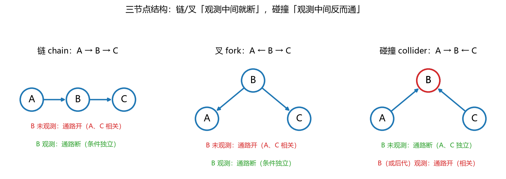

# 第 14 课　贝叶斯网络：结构、d-separation 与推断

> 会话：S011｜日期：2026-11-04｜时长：约 45–60 分钟
> 对应概念：`bayesian_network`、`d_separation`、`bn_inference`
> 来源：Week 8 pp.18–45；A2 Q7/Q8 同型
> 前置：第 07 课条件概率/Bayes、第 08 课联合与条件分布、第 12 课 MLE

## 修订记录

- 2026-11-04 初版（S011）。

---

## 1. 引入：4 个二值变量，16 个数还是 7 个数？

医生诊断：流感（$F$）、发烧（$V$）、咳嗽（$C$）、检测阳性（$T$），都是 $0/1$。

- 直接存联合分布 $P(F,V,C,T)$：$2^4=16$ 个格子（自由参数 $15$ 个）。
- 但医学常识告诉我们：流感会引起发烧、咳嗽、检测阳性；这三个症状之间**在给定流感后**没有直接关系。

于是可以写成

$$
P(F,V,C,T)=P(F)P(V\mid F)P(C\mid F)P(T\mid F)
$$

只需要 $1+2+2+2=7$ 个数。变量越多，省得越夸张：$100$ 个二值变量，全联合要 $2^{100}$，而每个节点最多 $3$ 个父节点时只要 $100\times2^3=800$ 个数。

**贝叶斯网络（Bayesian network）**就是干这个的：用**有向无环图（directed acyclic graph, DAG）**表示变量间的依赖，用**条件概率表（conditional probability table, CPT）**存局部概率。

---

## 2. 直觉：图是「信息高速公路」，条件是「封路」

- 两个变量**相关**，可以理解为信息能在它们之间流动。
- **条件独立（conditional independence）**，就是这条路上有关卡：给定某些变量后，信息流被切断。
- 贝叶斯网络的图，就是一张「哪些路通、哪些路断」的地图。

三种最基本的三节点结构（本课的核心）：

| 结构 | 形状 | 中间节点未观测 | 中间节点观测 |
|---|---|---|---|
| 链 chain | $A\to B\to C$ | 通（$A,C$ 相关） | 断（$A\perp C\mid B$） |
| 叉 fork | $A\leftarrow B\to C$ | 通（$A,C$ 相关） | 断（$A\perp C\mid B$） |
| 碰撞 collider | $A\to B\leftarrow C$ | 断（$A\perp C$） | 通（给定 $B$ 后相关） |

> 记法：**链和叉，观测中间就断；碰撞，观测中间反而通。**

---

## 3. 几何视角：三种结构与「封路/开路」

**看图**：

- 左（链）：$A\to B\to C$。$B$ 没观测时，$A$ 的变化会一路传到 $C$；一旦锁定 $B$，$C$ 只由 $B$ 决定，$A$ 就无关了。
- 中（叉）：$A\leftarrow B\to C$。$B$ 是共同原因；不观测 $B$ 时，$A$ 和 $C$ 会「一起变」；锁定 $B$ 后，两者独立。
- 右（碰撞）：$A\to B\leftarrow C$。$B$ 是共同结果；不观测 $B$ 时，$A$、$C$ 各自独立地影响 $B$；**一旦知道 $B$，$A$ 和 $C$ 反而互相透露信息**。

> 碰撞的例子：两个人独立地决定是否参加聚会（$A,C$），你只知道「聚会很热闹」（$B$）。如果知道 A 没来，你就推断 C 一定来了——本来独立的两个人，因为观测了结果而变得相关。

---

## 4. 计算与公式（公式卡）

### 14.1 因子分解（factorization）

$$
P(X_1,\dots,X_n)=\prod_{j=1}^{n}P\big(X_j\mid \mathrm{Pa}(X_j)\big)
$$

- **符号**：$\mathrm{Pa}(X_j)$ 是 $X_j$ 的父节点集合；每个因子是一张小的 CPT。
- **意义与场景**：这是贝叶斯网络的「定义式」。它把巨大的联合表拆成许多小表，参数量从指数级降到「每个节点 $2^{|\mathrm{Pa}|}$」。
- **例**：
  - 背景：流感网络 $F\to V,F\to C,F\to T$。
  - 解：第 1 步，找每个节点的父节点：$F$ 无、$V$ 是 $F$、$C$ 是 $F$、$T$ 是 $F$；第 2 步，写成 $P(F)P(V\mid F)P(C\mid F)P(T\mid F)$；第 3 步，数参数：$1+2+2+2=7$。
  - 解读：全联合要 $15$ 个自由参数，因子分解只要 $7$ 个——省下的就是「条件独立假设」的功劳。

### 14.2 局部马尔可夫性（local Markov property）

$$
P\big(X_j\mid X_j\text{ 的非后代}\big)=P\big(X_j\mid \mathrm{Pa}(X_j)\big)
$$

- **符号**：非后代（non-descendants）指不是 $X_j$ 子孙的节点；$\mathrm{Pa}(X_j)$ 是直接父节点。
- **意义与场景**：每个节点「只跟爸爸说话」，不跟祖先/旁支直接说话。它是因子分解能成立的理论依据。
- **例**：
  - 背景：$A\to B$、$A\to C$、$B\to D$，问 $B$ 与谁条件独立。
  - 解：第 1 步，$B$ 的父节点是 $A$；第 2 步，$B$ 的后代是 $D$；第 3 步，非后代是 $C$；第 4 步，局部马尔可夫给出 $B\perp C\mid A$。
  - 解读：$B$ 和 $C$ 看起来通过 $A$ 相关，但给定 $A$ 后就断了。

### 14.3 马尔可夫毯（Markov blanket）

$$
X_j\perp \big(\text{其余所有节点}\big)\mid \mathrm{MB}(X_j)
$$

$$
\mathrm{MB}(X_j)=\mathrm{Pa}(X_j)\cup \mathrm{Ch}(X_j)\cup \mathrm{CoPa}(X_j)
$$

- **符号**：$\mathrm{Ch}$ 是子节点，$\mathrm{CoPa}$ 是「孩子的其他父节点」（co-parents）。
- **意义与场景**：想做「只跟邻居有关」的局部计算（如 Gibbs 采样、特征选择）时，马尔可夫毯就是最小充分邻域。
- **例**：
  - 背景：流感网络中 $F$ 的毯子。
  - 解：第 1 步，父节点：无；第 2 步，子节点：$V,C,T$；第 3 步，孩子的其他父节点：无；第 4 步，$\mathrm{MB}(F)=\{V,C,T\}$。
  - 解读：知道 $V,C,T$ 后，$F$ 与网络里其他变量都独立。

### 14.4 d-separation（有向分离）

$$
X\perp Y\mid Z \quad\text{若所有 }X\text{ 到 }Y\text{ 的路径都被 }Z\text{ 阻断}
$$

- **符号**：$Z$ 是已观测变量集合；路径指**忽略箭头方向**后的无向路径；阻断规则见下表。
- **意义与场景**：它是「从图直接读出条件独立」的算法，不用算概率。A2 Q7 的 (a)(b) 就是靠它/贝叶斯公式。
- **三节点判定表**：

| 中间节点 $B$ | 结构 | $B$ 未观测 | $B$ 观测（或后代观测） |
|---|---|---|---|
| 链 $A\to B\to C$ | chain | 通 | 断 |
| 叉 $A\leftarrow B\to C$ | fork | 通 | 断 |
| 碰撞 $A\to B\leftarrow C$ | collider | 断 | 通 |

- **例**：
  - 背景：$A\to B\to C\to D$，问 $A$ 与 $D$ 在给定 $C$ 时是否独立。
  - 解：第 1 步，唯一路径 $A-B-C-D$；第 2 步，拆成三元组 $A-B-C$ 与 $B-C-D$；第 3 步，$C$ 是第二个三元组的中间节点且被观测，链断；第 4 步，整条路径断，故 $A\perp D\mid C$。
  - 解读：$C$ 之后的信息与 $A$ 无关；但若只给 $B$，也断（$B$ 也是链的中间节点）。

### 14.5 d-separation 算法（三步）

1. 把 $Z$ 中所有节点涂灰（观测）。
2. 把边当无向，枚举 $X$ 到 $Y$ 的所有路径；每条路径拆成重叠的三元组。
3. 只要有一条路径的**所有**三元组都「通」，则 $X,Y$ 不是 d-分离；若**每条**路径都至少有一个「断」的三元组，则 $X\perp Y\mid Z$。

- **符号**：涂灰 = 条件化；「通」= active，「断」= blocked。
- **意义与场景**：考试给图让你判断独立/不独立，按这个流程写，步骤分稳拿。
- **例**：
  - 背景：$L\to R\to T\leftarrow B$，且 $T\to T'$。问 $L$ 与 $B$ 在给定 $T'$ 时是否独立。
  - 解：第 1 步，路径 $L-R-T-B$；第 2 步，三元组 $L-R-T$（链，$R$ 未观测 → 通）、$R-T-B$（碰撞，$T$ 未观测但 $T'$ 是 $T$ 的后代且被观测 → 通）；第 3 步，两个都通 → 路径通 → 不独立。
  - 解读：观测碰撞节点的**后代**也会打开路径，这是最容易漏的一条。

### 14.6 推断四步（inference）

1. 删掉「不是查询或证据的祖先」的节点。
2. 把证据节点固定为观测值，改写其子节点的 CPT，然后删掉证据节点。
3. 删掉与查询节点不再连通的节点。
4. 在缩小的图上算条件概率。

- **符号**：查询 $Q$、证据 $E=e$、其余变量求和/积分消掉。
- **意义与场景**：变量消元（variable elimination）的「手工版」。它把 $2^n$ 的枚举压成小图上的求和。
- **例**：
  - 背景：流感网络，证据 $T=1$，查询 $P(F=1\mid T=1)$。
  - 解：第 1 步，$F,T$ 的祖先只有 $F$，删掉 $V,C$；第 2 步，固定 $T=1$；第 3 步，无断连；第 4 步，$P(F=1\mid T=1)=\dfrac{P(F=1)P(T=1\mid F=1)}{\sum_f P(f)P(T=1\mid f)}$。
  - 解读：四步的价值在「删」——把无关变量先扔掉，计算量立刻降下来。

### 14.7 贝叶斯反推（Bayes 在图上）

$$
P(F=1\mid T=1)=\frac{P(T=1\mid F=1)P(F=1)}{P(T=1\mid F=1)P(F=1)+P(T=1\mid F=0)P(F=0)}
$$

- **符号**：$P(F)$ 是先验；$P(T\mid F)$ 是 CPT；分母是全概率。
- **意义与场景**：诊断类网络的标准操作：从「症状」反推「病因」。
- **例**：
  - 背景：$P(F=1)=0.1$，$P(T=1\mid F=1)=0.9$，$P(T=1\mid F=0)=0.05$。
  - 解：第 1 步，分子 $0.9\times0.1=0.09$；第 2 步，分母 $0.09+0.05\times0.9=0.09+0.045=0.135$；第 3 步，$0.09/0.135=0.6667$。
  - 解读：先验 $10\%$ 的流感，检测阳性后升到 $66.7\%$——但仍有 $1/3$ 是假阳性。

---

## 5. 完整手算：联合概率、反推与 d-separation

**网络**：$F\to V$、$F\to C$、$F\to T$。给定

$$
P(F=1)=0.1,\quad P(V=1\mid F=1)=0.8,\quad P(V=1\mid F=0)=0.05
$$

$$
P(C=1\mid F=1)=0.7,\quad P(C=1\mid F=0)=0.1,\quad P(T=1\mid F=1)=0.9,\quad P(T=1\mid F=0)=0.05
$$

### 例题 1：算一个联合概率

求 $P(F=1,V=1,C=0,T=1)$。

- **第 1 步**：因子分解。
  $$
  P=P(F=1)\,P(V=1\mid F=1)\,P(C=0\mid F=1)\,P(T=1\mid F=1)
  $$
- **第 2 步**：算 $P(C=0\mid F=1)=1-0.7=0.3$。
- **第 3 步**：代入。
  $$
  P=0.1\times0.8\times0.3\times0.9
  $$
- **第 4 步**：逐步乘。
  $$
  0.1\times0.8=0.08,\qquad 0.08\times0.3=0.024,\qquad 0.024\times0.9=0.0216
  $$

**结论**：$P=0.0216$。

**检查**：四个因子都 $\le1$，乘积小于每个因子，合理；且 $0.0216<0.1$。

### 例题 2：由症状反推病因

求 $P(F=1\mid T=1)$。

- **第 1 步**：分子。
  $$
  P(F=1,T=1)=P(F=1)P(T=1\mid F=1)=0.1\times0.9=0.09
  $$
- **第 2 步**：另一项。
  $$
  P(F=0,T=1)=P(F=0)P(T=1\mid F=0)=0.9\times0.05=0.045
  $$
- **第 3 步**：全概率。
  $$
  P(T=1)=0.09+0.045=0.135
  $$
- **第 4 步**：相除。
  $$
  P(F=1\mid T=1)=\frac{0.09}{0.135}=0.6667
  $$

**检查（极端情形）**：若 $P(T=1\mid F=0)=0$（检测无假阳性），则后验 $=0.09/0.09=1$；若两个条件概率相等，后验等于先验 $0.1$。公式行为正确。

### 例题 3：判断条件独立

仍用上面的网络。

- $V$ 与 $C$：路径 $V-F-C$ 是**叉**，$F$ 是共同原因。
  - 不给定 $F$：通 → **不独立**（都受流感影响）。
  - 给定 $F$：断 → $V\perp C\mid F$。
- $V$ 与 $T$：同理，$V\perp T\mid F$，但不给定 $F$ 时不独立。
- 若给定 $C$（$F$ 的后代）而不给定 $F$：$V-F-C$ 中的 $F$ 是叉的中间节点、未观测，所以路径仍通 → $V$ 与 $T$ 仍不独立。**观测后代不能替代观测中间节点。**

---

## 6. 机器学习里用在哪

1. **朴素贝叶斯分类**：$Y\to X_1,\dots,X_d$ 的星形图，假设特征在给定类别后独立。
2. **隐马尔可夫模型 / CRF**：链式结构，前向-后向算法就是图上的推断。
3. **LDA 主题模型**：文档-主题-词的层级图，参数用 Dirichlet 共轭更新。
4. **因果推断**：用 DAG 表示因果假设；后门准则就是 d-separation 的应用。
5. **故障诊断 / 医疗决策**：从症状反推病因，算后验。
6. **VAE / 概率编程**：编码器-解码器的图结构，推断用变分近似。

---

## 7. 常见易错点

1. **箭头方向 ≠ 一定因果**：图是条件独立的编码，因果解释是额外假设。
2. **碰撞节点观测后「开路」**：$A\to B\leftarrow C$ 中，$A\perp C$，但 $A\not\perp C\mid B$；观测 $B$ 的后代也一样。
3. **链/叉观测中间才断**：观测**后代**不能替代观测中间节点。
4. **d-连接 ≠ 一定相关**：图只保证「可能相关」；具体数值可能恰好独立。
5. **d-分离 ⇒ 条件独立**：这是图蕴含的；反过来不成立（数值独立不一定 d-分离）。
6. **局部马尔可夫只对非后代**：不是「跟所有其他节点独立」。
7. **CPT 大小随父节点数指数增长**：父节点多时网络也会爆炸，必要时加结构假设。
8. **推断四步删的是「非祖先」**：查询和证据的祖先都要留，别删错。

---

## 8. 和已学概念的关系

| 已学 | 关系 |
|---|---|
| 第 07 课 条件概率/Bayes | 图上的每条边都是条件概率；反推用 Bayes |
| 第 08 课 联合/边缘/条件 | 因子分解就是联合的压缩表示 |
| 第 12 课 MLE | 给数据估 CPT，就是数频数（A2 Q7(c)） |
| 第 13 课 共轭先验 | 网络参数的贝叶斯学习 |
| 第 10 课 互信息 | 两个变量是否相关，可用 $I(X;Y)$ 量化 |

---

## 9. 作业（先做，答案在最后）

**Q1（因子分解）** 图：$A\to B$、$A\to C$、$B\to D$、$C\to D$。
(a) 写出联合分布的因子分解。
(b) 若全是二值变量，全联合有多少自由参数？因子分解后呢？

**Q2（联合概率）** 用本课流感网络，求 $P(F=0,V=0,C=1,T=0)$。

**Q3（d-separation）** 图：$A\to B\to C$、$B\to D$。
(a) $A$ 与 $D$ 在给定 $B$ 时是否独立？
(b) $A$ 与 $C$ 在给定 $B$ 时是否独立？
(c) $A$ 与 $C$ 在给定 $D$ 时是否独立？

**Q4（反推）** 流感网络中，若 $P(F=1)=0.02$（低流行季），其余 CPT 不变，求 $P(F=1\mid T=1)$。

**Q5（碰撞）** 图：$X\to Z\leftarrow Y$，且 $Z\to W$。
(a) $X$ 与 $Y$ 独立吗？
(b) 给定 $Z$ 后呢？
(c) 给定 $W$ 后呢？

---

## 10. 作业答案（先自己做完再看）

### A1

(a)
$$
P(A,B,C,D)=P(A)P(B\mid A)P(C\mid A)P(D\mid B,C)
$$
(b) 全联合 $2^4-1=15$ 个自由参数。因子分解：$A$ 有 $1$ 个，$B$ 有 $2$ 个，$C$ 有 $2$ 个，$D$ 有 $2^2=4$ 个，合计 $1+2+2+4=9$ 个。

### A2

$$
P(F=0)=0.9,\quad P(V=0\mid F=0)=0.95,\quad P(C=1\mid F=0)=0.1,\quad P(T=0\mid F=0)=0.95
$$

$$
P=0.9\times0.95\times0.1\times0.95
=0.855\times0.1\times0.95=0.0855\times0.95=0.081225
$$

### A3

(a) **独立**。路径 $A-B-D$，$B$ 是链的中间节点且被观测 → 断。
(b) **独立**。路径 $A-B-C$，$B$ 被观测 → 断。
(c) **不独立**。路径 $A-B-C$ 上唯一的中间节点是 $B$，而 $B$ 没有被观测，链是通的；$D$ 只是 $B$ 的子节点，不在 $A-B-C$ 这条路径上，观测 $D$ 不能阻断它。

### A4

$$
P(F=1,T=1)=0.02\times0.9=0.018
$$

$$
P(F=0,T=1)=0.98\times0.05=0.049
$$

$$
P(F=1\mid T=1)=\frac{0.018}{0.018+0.049}=\frac{0.018}{0.067}\approx0.2687
$$

先验从 $10\%$ 降到 $2\%$ 后，后验从 $66.7\%$ 降到 $26.9\%$——先验仍然重要。

### A5

(a) **独立**。$X\to Z\leftarrow Y$ 是碰撞结构，$Z$ 未观测 → 路径断。
(b) **不独立**。观测碰撞节点 $Z$ 会打开路径。
(c) **不独立**。$W$ 是 $Z$ 的后代，观测后代同样打开路径。

---

## 11. 本课小结

1. **贝叶斯网络 = DAG + CPT**，用因子分解把联合分布压成小块。
2. **局部马尔可夫 / 马尔可夫毯**：每个节点只跟邻居说话。
3. **三种结构**：链、叉观测中间就断；碰撞观测中间反而通。
4. **d-separation**：所有路径都断，才条件独立。
5. **推断四步**：删非祖先 → 固定证据 → 删断连 → 在小图上算。
