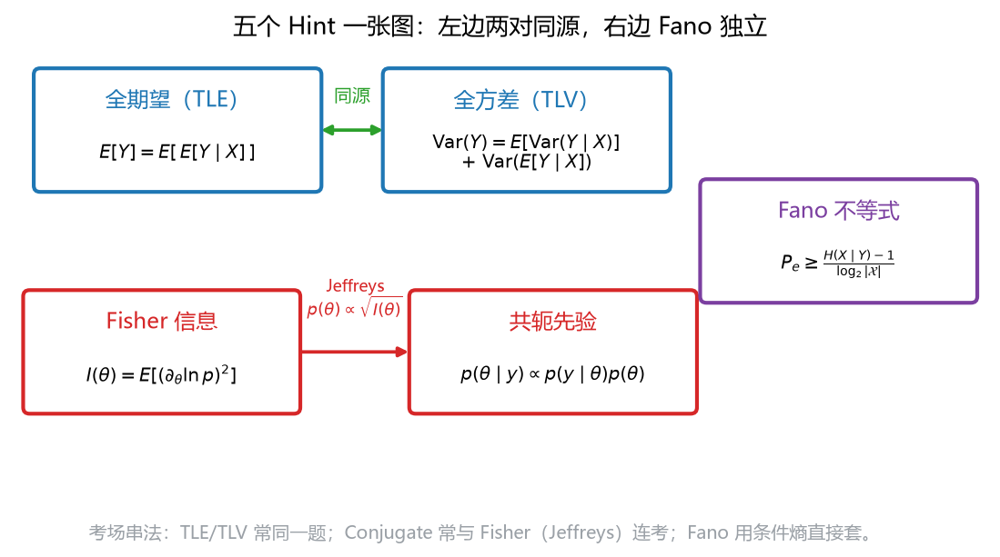

# 第 15 课　五个 Hint 专项二次复习

> 会话：S011｜日期：2026-11-04｜时长：约 90 分钟
> 对应概念：`total_expectation`、`total_variance`、`conjugate_prior`、`fisher_information`、`fano`
> 来源：Week 5 pp.49–52、Week 6 pp.38–43、Week 8 pp.5–17（教师 Hint 页码）
> 定位：考前最后一遍——**默写公式 → 做变式 → 回炉错题**，不学新知识。

## 修订记录

- 2026-11-04 初版（S011）。

---

## 1. 引入：最后 90 分钟，只做三件事

考场上真正会卡住你的，通常不是「没学过」，而是：

1. **公式记混**：把 $\mathrm{Var}(E[Y\mid X])$ 写成 $E[\mathrm{Var}(X\mid Y)]$；
2. **条件漏看**：Fano 忘了 $\log_2$、共轭忘了后验参数怎么加；
3. **会背不会用**：题目换个数字就不知道从哪下手。

所以这节课只做三件事：

- **默写**：五个 Hint 的公式 + 适用条件，每个 30 秒；
- **变式**：每个 Hint 2 道，共 10 道，覆盖最常见的换数字/换问法；
- **回炉**：把之前错过的题再走一遍。

---

## 2. 直觉：五个 Hint 其实只有三条主线

**看图**：

- 左上两个（全期望、全方差）是**同一家人**：都在处理「先分组、再汇总」。全期望汇总均值，全方差把方差拆成「组内 + 组间」。
- 左下两个（Fisher、共轭）也常连在一起：Fisher 信息决定 Jeffreys 先验；共轭先验决定后验好不好算。
- 右边 Fano 独立成线：它把**条件熵**翻译成**误差下限**。

> 考场策略：看到「分组/混合/两步实验」→ TLE/TLV；看到「先验/后验/计数」→ 共轭；看到「信息量/下界/曲率」→ Fisher；看到「误差/熵/猜」→ Fano。

---

## 3. 几何视角：一张图记住五个公式的位置

再强调一次图中的三条连线：

1. **TLE → TLV**：同源。先算条件均值 $E[Y\mid X]$，它的期望是 $E[Y]$，它的方差是「组间方差」。
2. **Fisher → 共轭**：Jeffreys 先验 $p(\theta)\propto\sqrt{I(\theta)}$ 本身就是一种先验；而共轭讲的是「先验选得好，后验同族」。
3. **Fano 单独**：输入是 $H(X\mid Y)$，输出是 $P_e$ 的下界。

> 如果考场上只记得一张图，就记这张：**左边两对、右边一个**。

---

## 4. 计算与公式（五个 Hint 的默写卡）

### H1 全期望（Law of Total Expectation, TLE）

$$
E[Y]=E\big[E[Y\mid X]\big]
$$

- **条件**：$E|Y|<\infty$；$X$ 可以是离散或连续。
- **离散版**：$E[Y]=\sum_x E[Y\mid X=x]\,P(X=x)$。
- **一句话**：先算每组的平均，再按组的权重平均。

### H2 全方差（Law of Total Variance, TLV）

$$
\mathrm{Var}(Y)=E\big[\mathrm{Var}(Y\mid X)\big]+\mathrm{Var}\big(E[Y\mid X]\big)
$$

- **条件**：二阶矩存在。
- **一句话**：总方差 = 组内方差（平均）+ 组间方差（均值的波动）。
- **证明三步**：
  $$
  \mathrm{Var}(Y)=E[Y^2]-(E[Y])^2
  $$
  $$
  E[Y^2]=E\big[E[Y^2\mid X]\big]=E\big[\mathrm{Var}(Y\mid X)+(E[Y\mid X])^2\big]
  $$
  $$
  \mathrm{Var}(Y)=E[\mathrm{Var}(Y\mid X)]+E[(E[Y\mid X])^2]-(E[E[Y\mid X]])^2
  $$
  最后两项就是 $\mathrm{Var}(E[Y\mid X])$。

### H3 共轭先验（Conjugate Prior）

$$
p(\theta\mid y)\propto p(y\mid\theta)p(\theta),
\qquad
p(\theta\mid y)\in\mathcal P\ \text{当}\ p(\theta)\in\mathcal P
$$

- **四对标配**：

| 似然 | 先验 | 后验 |
|---|---|---|
| Binomial$(n,\theta)$ | $\mathrm{Beta}(a,b)$ | $\mathrm{Beta}(a+k,\ b+n-k)$ |
| Poisson$(\lambda)$ | $\mathrm{Gamma}(\alpha,\beta)$ | $\mathrm{Gamma}(\alpha+S,\ \beta+n)$ |
| Normal（已知 $\sigma^2$） | $\mathcal N(\mu_0,\tau_0^2)$ | 精度相加 |
| Multinomial$(K)$ | $\mathrm{Dirichlet}(\alpha)$ | $\mathrm{Dirichlet}(\alpha+n)$ |

- **一句话**：后验参数 = 先验伪计数 + 实际计数；先验越弱，越靠近 MLE。

### H4 Fisher 信息（Fisher Information）

$$
I(\theta)=E\left[\left(\frac{\partial\ln p(Y\mid\theta)}{\partial\theta}\right)^2\right]
=-E\left[\frac{\partial^2\ln p(Y\mid\theta)}{\partial\theta^2}\right]
$$

$$
I_n(\theta)=nI(\theta),
\qquad
\mathrm{Var}(\hat\theta)\ge\frac{1}{nI(\theta)}
$$

- **常用值**：Bernoulli $I=1/[\theta(1-\theta)]$；Poisson $I=1/\lambda$；Normal（已知 $\sigma^2$）$I=1/\sigma^2$。
- **Jeffreys**：$p(\theta)\propto\sqrt{I(\theta)}$；Bernoulli 为 $\mathrm{Beta}(1/2,1/2)$。
- **一句话**：曲率越大，信息越多，方差地板越低。

### H5 Fano 不等式（Fano Inequality）

$$
H(P_e)+P_e\log_2|\mathcal{X}|\ \ge\ H(X\mid\hat X)\ \ge\ H(X\mid Y)
$$

$$
P_e\ \ge\ \frac{H(X\mid Y)-1}{\log_2|\mathcal{X}|}
$$

- **条件**：$X$ 有限支撑；马尔可夫链 $X\to Y\to\hat X$（估计只能用 $Y$）。
- **一句话**：条件熵超过 $1$ bit 的部分，除以 $\log_2|\mathcal{X}|$，就是误差地板。
- **注意**：$H(X\mid Y)\le1$ 时下界为负 → 无约束，不是负误差。

---

## 5. 完整手算：TLV（最容易漏项的一题）

**背景**：某门课的学生分两组：没预习（$X=0$，占 $40\%$）与预习了（$X=1$，占 $60\%$）。两组的考试分数均值分别为 $1$ 和 $3$（已中心化），方差分别为 $1$ 和 $4$。求总方差。

- **第 1 步**：算总均值。
  $$
  E[Y]=0.4\times1+0.6\times3=0.4+1.8=2.2
  $$
- **第 2 步**：算组内方差。
  $$
  E[\mathrm{Var}(Y\mid X)]=0.4\times1+0.6\times4=0.4+2.4=2.8
  $$
- **第 3 步**：算组间方差。
  $$
  E\big[(E[Y\mid X])^2\big]=0.4\times1^2+0.6\times3^2=0.4+5.4=5.8
  $$
  $$
  \mathrm{Var}(E[Y\mid X])=5.8-2.2^2=5.8-4.84=0.96
  $$
- **第 4 步**：相加。
  $$
  \mathrm{Var}(Y)=2.8+0.96=3.76
  $$

**检查**：两项都非负；若两组均值相同（$1$ 和 $1$），组间方差应为 $0$——公式给出 $0.4\times1+0.6\times1-1=0$，正确。

**解读**：总方差 $3.76$ 里，$2.8$（约 $74\%$）来自组内个体差异，$0.96$（约 $26\%$）来自「预习/不预习」的组间差异。

---

## 6. 机器学习 / 考场里怎么用

1. **TLE**：混合模型、EM 的 E 步、分层抽样、缺失数据。
2. **TLV**：偏差-方差分解、混合模型的总方差、实验设计（组间/组内）。
3. **共轭**：贝叶斯平滑、Thompson sampling、LDA、卡尔曼滤波。
4. **Fisher**：置信区间、自然梯度、Laplace 近似、实验所需样本量。
5. **Fano**：标签噪声地板、模型结果 sanity check、特征是否足够。

---

## 7. 常见易错点（考前最后看一遍）

1. **TLV 漏掉组间项**：只写 $E[\mathrm{Var}(Y\mid X)]$ 是错的。
2. **TLE 的嵌套顺序**：$E[E[Y\mid X]]$ 里层是对 $Y$，外层是对 $X$。
3. **共轭参数加错**：Beta 后验是 $(a+k,\ b+n-k)$，不是 $(a+n,\ b+k)$。
4. **Normal–Normal 加的是精度**：$1/\tau_1^2=1/\tau_0^2+n/\sigma^2$。
5. **Fisher 是 $\theta$ 的函数**：代错 $\theta$ 整个数就错。
6. **CRLB 只对无偏估计**：有偏估计可以更低。
7. **Fano 的 $\log_2$**：用 $\ln$ 会得到不同数值；题目按 bit 就写 $\log_2$。
8. **Fano 负下界**：表示「无约束」，不是「负误差」。
9. **$|\mathcal{X}|$ 是类别数**，不是样本量。
10. **先验强度**：伪计数越小，后验越靠近数据；别把 $\mathrm{Beta}(0.5,0.5)$ 当成「没有先验」。

---

## 8. 和已学概念的关系

| 概念 | 来自 | 在本课的角色 |
|---|---|---|
| 条件期望/方差 | 第 07–09 课 | TLE/TLV 的零件 |
| Bayes/后验 | 第 07、12、13 课 | 共轭的框架 |
| 对数似然/曲率 | 第 12、05 课 | Fisher 的定义 |
| 条件熵/互信息 | 第 10 课 | Fano 的输入 |
| 马尔可夫链 | 第 14 课 | Fano 的 $X\to Y\to\hat X$ |

---

## 9. 作业：10 道变式（先做，答案在最后）

> 每个 Hint 2 题。建议限时：每题 5–6 分钟，共 55 分钟；做完再对答案。

### H1 全期望

**V1** $X\sim\mathrm{Bernoulli}(0.3)$；给定 $X=1$ 时 $Y\sim\mathcal N(10,4)$，给定 $X=0$ 时 $Y\sim\mathcal N(0,1)$。求 $E[Y]$。

**V2** $X$ 等可能取 $1,2,3$；$E[Y\mid X=x]=2x+1$。求 $E[Y]$。

### H2 全方差

**V3** 用 V1 的设定，求 $\mathrm{Var}(Y)$。

**V4** $X=0$ 的概率 $0.4$，$E[Y\mid X=0]=1$、$\mathrm{Var}(Y\mid X=0)=1$；$X=1$ 的概率 $0.6$，$E[Y\mid X=1]=3$、$\mathrm{Var}(Y\mid X=1)=4$。求 $\mathrm{Var}(Y)$。

### H3 共轭先验

**V5** 先验 $\mathrm{Beta}(2,2)$，观测 $6$ 正 $4$ 反。求后验、后验均值、MAP、后验预测 $P(y^*=1\mid y)$。

**V6** 先验 $\mathrm{Gamma}(2,3)$（率参数），$5$ 个 Poisson 观测总和 $8$。求后验与后验均值。

### H4 Fisher

**V7** $Y\sim\mathrm{Poisson}(3)$，$n=50$。求 $I(3)$、$nI(3)$、CRLB 的方差与标准差。

**V8** $Y\sim\mathrm{Bernoulli}(0.3)$，$n=20$。求 $I(0.3)$、$nI(0.3)$、CRLB 的标准差。

### H5 Fano

**V9** $|\mathcal{X}|=4$，$H(X\mid Y)=2$ bit。求 $P_e$ 的下界。

**V10** $|\mathcal{X}|=32$，$H(X\mid Y)=4$ bit。求 $P_e$ 的下界；若有人报告 $P_e=0.5$，是否可能？

---

## 10. 作业答案（先自己做完再看）

### A-V1

$$
E[Y]=0.3\times10+0.7\times0=3
$$

### A-V2

$$
E[Y]=E[2X+1]=2E[X]+1=2\times2+1=5
$$

### A-V3

- 组内：
  $$
  E[\mathrm{Var}(Y\mid X)]=0.3\times4+0.7\times1=1.2+0.7=1.9
  $$
- 组间：
  $$
  E\big[(E[Y\mid X])^2\big]=0.3\times100+0.7\times0=30
  $$
  $$
  \mathrm{Var}(E[Y\mid X])=30-3^2=21
  $$
- 总：
  $$
  \mathrm{Var}(Y)=1.9+21=22.9
  $$

### A-V4

$$
E[Y]=0.4\times1+0.6\times3=2.2
$$

$$
E[\mathrm{Var}(Y\mid X)]=0.4\times1+0.6\times4=2.8
$$

$$
E\big[(E[Y\mid X])^2\big]=0.4\times1+0.6\times9=5.8
$$

$$
\mathrm{Var}(E[Y\mid X])=5.8-2.2^2=0.96
$$

$$
\mathrm{Var}(Y)=2.8+0.96=3.76
$$

### A-V5

后验 $\mathrm{Beta}(2+6,\ 2+4)=\mathrm{Beta}(8,6)$。

$$
\text{均值}=\frac{8}{14}=\frac47\approx0.5714,
\qquad
\text{MAP}=\frac{8-1}{8+6-2}=\frac{7}{12}\approx0.5833
$$

$$
P(y^*=1\mid y)=\frac{8}{14}\approx0.5714
$$

### A-V6

后验 $\mathrm{Gamma}(2+8,\ 3+5)=\mathrm{Gamma}(10,8)$。

$$
\text{后验均值}=\frac{10}{8}=1.25
$$

### A-V7

$$
I(3)=\frac13\approx0.3333,
\qquad
nI=50\times\frac13=16.667
$$

$$
\mathrm{Var}\ge\frac{1}{16.667}=0.06,
\qquad
\text{sd}\ge\sqrt{0.06}\approx0.2449
$$

### A-V8

$$
I(0.3)=\frac{1}{0.3\times0.7}=\frac{1}{0.21}\approx4.7619
$$

$$
nI=20\times4.7619=95.238
$$

$$
\mathrm{Var}\ge\frac{1}{95.238}=0.0105,
\qquad
\text{sd}\ge\sqrt{0.0105}\approx0.1025
$$

### A-V9

$$
\log_2 4=2,
\qquad
P_e\ge\frac{2-1}{2}=0.5
$$

### A-V10

$$
\log_2 32=5,
\qquad
P_e\ge\frac{4-1}{5}=0.6
$$

报告 $0.5<0.6$，**不可能**（在 $H$ 估计正确的前提下）。说明 $H(X\mid Y)$ 被高估、评估有泄漏，或错误率算错。

---

## 11. 错题回炉（来自本课程的错题本）

1. **诊断 Q3：求特征值 vs 求行列式**
   - 症状：看错题，把「特征值」算成 $\det(A)$。
   - 对策：开考先圈动词——「求 $\lambda$」「求 $\det$」「求 $\mathrm{rank}$」是三件事。
2. **诊断 Q5：二项分布期望/方差**
   - 症状：只写通用定义，离散用了积分。
   - 对策：离散 $\sum$、连续 $\int$；$\mathrm{Binomial}(n,p)$ 直接写 $np$、$np(1-p)$。
3. **Fano 负下界**
   - 症状：看到 $P_e\ge-0.125$ 以为「误差可以为负」。
   - 对策：负下界 = Fano 无约束；$P_e\ge0$ 自动成立。
4. **共轭参数更新**
   - 症状：Beta 后验写成 $(a+n,\ b+k)$。
   - 对策：只加「成功数」和「失败数」：$(a+k,\ b+n-k)$。
5. **TLV 漏项**
   - 症状：只算组内方差。
   - 对策：写完公式先数项——两项都要有。

---

## 12. 考场检查清单

**开考前 5 分钟（默写）**

- [ ] TLE：$E[Y]=E[E[Y\mid X]]$
- [ ] TLV：$\mathrm{Var}(Y)=E[\mathrm{Var}(Y\mid X)]+\mathrm{Var}(E[Y\mid X])$
- [ ] 共轭四对：Beta-Binomial / Gamma-Poisson / Normal-Normal / Dirichlet-Multinomial
- [ ] Fisher：$I=E[s^2]=-E[\ell'']$，$I_n=nI$，CRLB $=1/(nI)$
- [ ] Fano：$P_e\ge(H(X\mid Y)-1)/\log_2|\mathcal{X}|$

**算完 30 秒自检**

- [ ] 概率/比例是否在 $[0,1]$？
- [ ] 方差是否非负？
- [ ] Fano 下界是否在 $[0,1]$？若为负，是否写了「无约束」？
- [ ] Beta 后验参数是否都 $>0$？总数是否等于 $a+b+n$？
- [ ] Fisher 信息是否为正？CRLB 是否小于你算的方差？
- [ ] 单位：bit 还是 nat？

**时间分配（90 分钟）**

| 环节 | 时间 |
|---|---|
| 五个公式默写 | 15 分钟 |
| 10 道变式 | 55 分钟 |
| 错题回炉 | 15 分钟 |
| 检查清单 | 5 分钟 |

---

## 13. 本课小结

1. **五个 Hint 三条线**：TLE/TLV 同源；Fisher/共轭相连；Fano 独立。
2. **会默写不算会**：每道题先判断「这是哪条线」，再代公式。
3. **自检三问**：范围对不对？单位对不对？极端情形对不对？
