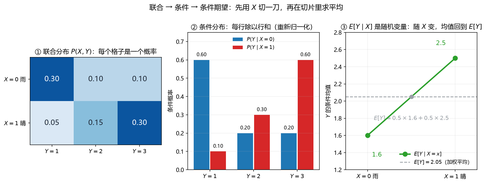

# 第 01 课　联合、条件与条件期望

> 会话：S012｜日期：2026-11-04｜时长：约 90–120 分钟
> 对应概念：`joint_conditional`（地基课）
> 来源：Week 5 pp.24–37（联合/边缘/条件、条件独立）+ p.49（条件期望定义）
> 前置：概率语言、随机变量、常见分布、期望/方差（开课自测范围）
> 后续：第 02 课全期望/全方差；第 03 课 Fano 的 Markov 链也靠这一课打底。

## 修订记录

- 2026-11-04 初版（S012，五 Hint 重学版第 01 课）。

---

## 1. 引入：晴天和雨天，心情的平均分一样吗？

设：

- $X$：天气，$X=0$ 表示雨，$X=1$ 表示晴；
- $Y$：心情评分，$1$ 差、$2$ 一般、$3$ 好。

某段时间的联合概率如下（每格是「天气 + 心情」同时发生的概率）：

| | $Y=1$ | $Y=2$ | $Y=3$ |
|---|---|---|---|
| $X=0$ 雨 | $0.30$ | $0.10$ | $0.10$ |
| $X=1$ 晴 | $0.05$ | $0.15$ | $0.30$ |

三个问题，难度一层层加：

1. 不管天气，平均心情是多少？——**边缘 + 期望**。
2. 已知今天下雨，心情的分布是什么？——**条件分布**。
3. 已知今天下雨，平均心情是多少？晴天的呢？——**条件期望**。

这一课就是把这三个问题拆开讲清楚。

---

## 2. 直觉：联合 → 边缘 → 条件，三层切法

把联合分布想成一张「格子地图」：

- **联合（joint）** $P(X,Y)$：每个格子都有概率，全部加起来是 $1$。
- **边缘（marginal）** $P(X)$ 或 $P(Y)$：把一整个方向「压扁」——按行或按列求和。
- **条件（conditional）** $P(Y\mid X=x)$：只留下 $X=x$ 那一行，然后**重新归一化**（这一行除以行和）。
- **条件期望（conditional expectation）** $E[Y\mid X=x]$：在留下的那一行里，对 $Y$ 求加权平均。

关键的一句话：

> **条件化 = 换一个分母。** 原来除以「全部」，现在除以「这一行」。

而 $E[Y\mid X]$ 之所以是**随机变量**，是因为 $X$ 本身随机：今天下雨就取雨天的均值，今天晴就取晴天的均值。**先随机选一行，再在这一行里求平均。**

---

## 3. 几何视角：切一刀，再在切片里求平均

**看图**：

- **① 联合分布**：六个格子就是六个概率；两行各自加起来都是 $0.5$。
- **② 条件分布**：每一行除以行和。雨天那一行变成 $(0.6,0.2,0.2)$，晴天变成 $(0.1,0.3,0.6)$。**形状变了，因为分母变了。**
- **③ 条件期望**：雨天均值 $1.6$，晴天均值 $2.5$，连成一条「随 $X$ 变」的线；灰色虚线是总均值 $2.05$，正好是两点的加权平均（各 $0.5$）。

> 一句话：**条件期望是一条「按 $X$ 分段的平均线」，不是一条水平线。**

---

## 4. 计算与公式（公式卡）

> 本节卡片统一用下面这个 $2\times2$ 小表，避免和 §5 的天气例子混在一起背答案。

| | $Y=0$ | $Y=1$ |
|---|---|---|
| $X=0$ | $0.1$ | $0.3$ |
| $X=1$ | $0.2$ | $0.4$ |

### 4.1 联合分布与边缘分布（joint / marginal）

$$
P(X=x,Y=y)=p(x,y),
\qquad
P(X=x)=\sum_y p(x,y),
\qquad
P(Y=y)=\sum_x p(x,y)
$$

- **符号**：$p(x,y)$ 是联合概率（离散）；$P(X=x)$ 是把同一行的所有 $y$ 加起来；连续情形把 $\sum$ 换成 $\int$。
- **意义与场景**：联合分布是「完整账本」；边缘分布是「只关心一个变量时，把另一个变量忽略掉」。数据表、混淆矩阵、列联表都是这个结构。
- **例**：
  - 背景：上面的 $2\times2$ 小表。
  - 解：第 1 步，$P(X=0)=0.1+0.3=0.4$；第 2 步，$P(X=1)=0.2+0.4=0.6$；第 3 步，$P(Y=1)=0.3+0.4=0.7$。
  - 解读：两行加起来是 $1$，两列加起来也是 $1$；边缘化就是「按行/按列求和」。

### 4.2 条件分布（conditional distribution）

$$
P(Y=y\mid X=x)=\frac{P(X=x,Y=y)}{P(X=x)}
$$

- **符号**：分母 $P(X=x)$ 必须 $>0$；分子是这一格的联合概率；结果是对 $y$ 归一化的分布。
- **意义与场景**：条件化就是「只看 $X=x$ 这一行」，再把这一行除以行和。它回答「已知 $X$，$Y$ 长什么样」。
- **例**：
  - 背景：上面的 $2\times2$ 小表，求 $P(Y=1\mid X=0)$。
  - 解：第 1 步，分子 $P(X=0,Y=1)=0.3$；第 2 步，分母 $P(X=0)=0.4$；第 3 步，$0.3/0.4=0.75$。
  - 解读：雨天（$X=0$）时，$Y=1$ 的概率从边缘的 $0.7$ 变成 $0.75$；**条件化会改变概率，因为分母换了**。

### 4.3 条件期望（conditional expectation）

$$
E[Y\mid X=x]=\sum_y y\,P(Y=y\mid X=x)
\qquad\text{（离散）}
$$

$$
E[Y\mid X=x]=\int_{-\infty}^{\infty} y\,f_{Y\mid X}(y\mid x)\,dy
\qquad\text{（连续）}
$$

- **符号**：$x$ 是固定的一个值；求和/积分只在 $Y$ 上做；结果是一个**数**（给定 $x$ 后的平均）。
- **意义与场景**：它回答「在 $X=x$ 这群人里，$Y$ 的平均是多少」。回归函数 $f(x)=E[Y\mid X=x]$ 就是它的别名。
- **例**：
  - 背景：$2\times2$ 小表，求 $E[Y\mid X=0]$。
  - 解：第 1 步，条件分布 $(0.25,0.75)$；第 2 步，$0\times0.25+1\times0.75=0.75$。
  - 解读：$0.75$ 是一个**数**；换了 $x$，这个数就变。

### 4.4 条件期望是随机变量（$E[Y\mid X]$）

$$
E[Y\mid X]\ \text{是随机变量}：
\quad
E[Y\mid X](\omega)=E[Y\mid X=X(\omega)]
$$

$$
E\big[E[Y\mid X]\big]=E[Y]
\qquad\text{（塔性质，第 02 课证明）}
$$

- **符号**：$E[Y\mid X]$ 没有指定 $x$，所以它随 $X$ 取值；$E[Y\mid X=x]$ 才是数。塔性质说「先分组平均，再按组权重平均，等于总平均」。
- **意义与场景**：这是全期望公式的种子，也是「分层模型」「混合模型」「EM 算法」的语言。
- **例**：
  - 背景：$2\times2$ 小表。
  - 解：第 1 步，$E[Y\mid X=0]=0.75$、$E[Y\mid X=1]=2/3$；第 2 步，$X$ 取 $0,1$ 的概率是 $0.4,0.6$；第 3 步，$E[E[Y\mid X]]=0.4\times0.75+0.6\times(2/3)=0.3+0.4=0.7$；第 4 步，直接算 $E[Y]=0\times0.3+1\times0.7=0.7$，一致。
  - 解读：$E[Y\mid X]$ 只取两个值，是一个「两点分布」的随机变量；它的期望回到 $E[Y]$。

### 4.5 条件方差（conditional variance）

$$
\mathrm{Var}(Y\mid X=x)=E\big[Y^2\mid X=x\big]-\big(E[Y\mid X=x]\big)^2
$$

- **符号**：先算条件二阶矩，再减去条件均值的平方；结果是一个数（给定 $x$）；$\mathrm{Var}(Y\mid X)$ 则是随机变量。
- **意义与场景**：它量「同一组内部」的波动。第 02 课的全方差公式会把它和「组间波动」拼起来。
- **例**：
  - 背景：$2\times2$ 小表，求 $\mathrm{Var}(Y\mid X=0)$。
  - 解：第 1 步，$E[Y^2\mid X=0]=0^2\times0.25+1^2\times0.75=0.75$；第 2 步，$0.75-0.75^2=0.75-0.5625=0.1875$。
  - 解读：这就是 Bernoulli$(0.75)$ 的方差 $p(1-p)$；组内波动只由这一行决定。

### 4.6 条件独立与 Markov 链（conditional independence）

$$
X\perp Z\mid Y
\quad\Longleftrightarrow\quad
P(X,Z\mid Y)=P(X\mid Y)P(Z\mid Y)
$$

$$
X\longrightarrow Y\longrightarrow Z
\quad\Longrightarrow\quad
X\perp Z\mid Y
$$

- **符号**：$\perp$ 表示独立；竖线后的 $Y$ 是「给定/观测」的变量；箭头表示「只依赖」，即 $Z$ 只通过 $Y$ 与 $X$ 相连。
- **意义与场景**：这是 Fano 不等式里 $X\to Y\to\hat X$ 的假设来源，也是贝叶斯网络、隐马尔可夫模型、朴素贝叶斯的核心。**注意：条件独立不是独立。**
- **例**：
  - 背景：$X$ 是「是否下雨」，$Y$ 是「是否带伞」，$Z$ 是「是否迟到」。假设 $X\to Y\to Z$。
  - 解：第 1 步，$X$ 与 $Z$ 不给定 $Y$ 时通常相关（下雨会影响带伞，带伞会影响迟到）；第 2 步，给定「是否带伞」后，$X$ 对 $Z$ 没有额外信息；第 3 步，所以 $X\perp Z\mid Y$。
  - 解读：**中间变量 $Y$ 是信息通道；一旦观测它，通道就断了。**

---

## 5. 完整手算：天气-心情（中文，不跳步）

数据：

| | $Y=1$ | $Y=2$ | $Y=3$ | 行和 |
|---|---|---|---|---|
| $X=0$ 雨 | $0.30$ | $0.10$ | $0.10$ | $0.5$ |
| $X=1$ 晴 | $0.05$ | $0.15$ | $0.30$ | $0.5$ |
| 列和 | $0.35$ | $0.25$ | $0.40$ | $1$ |

### 第 1 步：边缘分布

$$
P(X=0)=0.5,\qquad P(X=1)=0.5
$$

$$
P(Y=1)=0.35,\qquad P(Y=2)=0.25,\qquad P(Y=3)=0.40
$$

### 第 2 步：条件分布（每行除以行和）

雨天：

$$
P(Y=1\mid X=0)=\frac{0.30}{0.5}=0.6,\quad
P(Y=2\mid X=0)=\frac{0.10}{0.5}=0.2,\quad
P(Y=3\mid X=0)=\frac{0.10}{0.5}=0.2
$$

晴天：

$$
P(Y=1\mid X=1)=\frac{0.05}{0.5}=0.1,\quad
P(Y=2\mid X=1)=\frac{0.15}{0.5}=0.3,\quad
P(Y=3\mid X=1)=\frac{0.30}{0.5}=0.6
$$

### 第 3 步：条件期望

$$
E[Y\mid X=0]=1\times0.6+2\times0.2+3\times0.2
=0.6+0.4+0.6=1.6
$$

$$
E[Y\mid X=1]=1\times0.1+2\times0.3+3\times0.6
=0.1+0.6+1.8=2.5
$$

### 第 4 步：总期望（两种算法互相验证）

用条件期望加权：

$$
E[Y]=0.5\times1.6+0.5\times2.5=0.8+1.25=2.05
$$

用边缘分布直接算：

$$
E[Y]=1\times0.35+2\times0.25+3\times0.40
=0.35+0.5+1.2=2.05
$$

**检查**：两条路都得到 $2.05$，说明条件分布和边缘分布没算错。

### 第 5 步：条件方差

雨天：

$$
E[Y^2\mid X=0]=1^2\times0.6+2^2\times0.2+3^2\times0.2
=0.6+0.8+1.8=3.2
$$

$$
\mathrm{Var}(Y\mid X=0)=3.2-1.6^2=3.2-2.56=0.64
$$

晴天：

$$
E[Y^2\mid X=1]=0.1+4\times0.3+9\times0.6
=0.1+1.2+5.4=6.7
$$

$$
\mathrm{Var}(Y\mid X=1)=6.7-2.5^2=6.7-6.25=0.45
$$

组内平均波动：

$$
E[\mathrm{Var}(Y\mid X)]=0.5\times0.64+0.5\times0.45=0.32+0.225=0.545
$$

### 第 6 步：组间波动（预习第 02 课）

$$
E\big[(E[Y\mid X])^2\big]=0.5\times1.6^2+0.5\times2.5^2
=0.5\times2.56+0.5\times6.25=1.28+3.125=4.405
$$

$$
\mathrm{Var}(E[Y\mid X])=4.405-2.05^2=4.405-4.2025=0.2025
$$

总方差：

$$
\mathrm{Var}(Y)=E[\mathrm{Var}(Y\mid X)]+\mathrm{Var}(E[Y\mid X])
=0.545+0.2025=0.7475
$$

**直接验算**：

$$
E[Y^2]=0.35\times1+0.25\times4+0.40\times9
=0.35+1+3.6=4.95
$$

$$
\mathrm{Var}(Y)=4.95-2.05^2=4.95-4.2025=0.7475
$$

一致。**这就是下一课全方差公式的预演。**

### 例题 2（连续）：$X\sim\mathrm{Uniform}(0,1)$，$Y\mid X=x\sim\mathrm{Uniform}(0,x)$

- **第 1 步**：条件均值。Uniform$(0,x)$ 的均值是中点：
  $$
  E[Y\mid X=x]=\frac{x}{2}
  $$
- **第 2 步**：用塔性质：
  $$
  E[Y]=E\left[\frac{X}{2}\right]=\frac{1}{2}E[X]=\frac{1}{2}\times\frac{1}{2}=\frac14
  $$
- **第 3 步**：直接积分验证：
  $$
  E[Y]=\int_0^1\int_0^x y\cdot\frac{1}{x}\,dy\,dx
  =\int_0^1\frac{1}{x}\cdot\frac{x^2}{2}\,dx
  =\int_0^1\frac{x}{2}\,dx=\frac14
  $$
- **解读**：连续情形和离散完全同构——只是把「按行求和」换成「按 $x$ 积分」，把「行内求和」换成「对 $y$ 积分」。

---

## 6. 机器学习里用在哪

1. **回归函数**：$f(x)=E[Y\mid X=x]$ 是平方损失下的最优预测（作业 Q5 会证）。线性回归、k-NN、神经网络都在估计它。
2. **混合模型 / 潜变量**：$E[Y\mid Z=k]$ 是「第 $k$ 个成分的均值」，EM 的 E 步就是算它。
3. **缺失数据**：观测到 $X$ 后，用 $E[Y\mid X]$ 填补 $Y$，比直接用总均值更准。
4. **条件独立**：朴素贝叶斯的「给定类别后特征独立」、HMM 的「给定状态后观测独立」、Fano 的 $X\to Y\to\hat X$。
5. **分层评估**：整体准确率 = 各层准确率按层权重的加权平均（塔性质）。

---

## 7. 常见易错点

1. **$E[Y\mid X]$ 与 $E[Y\mid X=x]$ 混用**：前者是随机变量，后者是数；考试问「求 $E[Y\mid X]$」要给出分布/分段函数。
2. **条件化忘了换分母**：$P(Y\mid X=x)=P(X=x,Y=y)/P(X=x)$，分母是**行和**，不是 $1$。
3. **连续情形忘记积分限**：$Y\mid X=x$ 的支撑可能依赖 $x$（如 $(0,x)$），积分限要跟着变。
4. **把条件独立当独立**：$X\perp Z\mid Y$ 不代表 $X\perp Z$；链式结构里不观测 $Y$ 时 $X,Z$ 通常相关。
5. **反向也不成立**：$X\perp Z$ 也不代表 $X\perp Z\mid Y$（碰撞结构就是反例，第 03 课会再见）。
6. **条件方差不是常数**：$\mathrm{Var}(Y\mid X)$ 随 $X$ 变，是一个随机变量；只有同方差假设下才是常数。
7. **塔性质的方向**：$E[E[Y\mid X]]=E[Y]$，不是 $E[E[X\mid Y]]=E[Y]$。
8. **边缘化与条件化搞反**：边缘化是「求和消掉一个变量」，条件化是「固定一个变量再归一化」。

---

## 8. 和已学 / 后续的关系

| 内容 | 关系 |
|---|---|
| 概率语言、条件概率、Bayes | 条件分布就是条件概率的「分布版」 |
| 期望、方差 | 条件期望/条件方差是「在切片里」重算一遍 |
| 第 02 课 全期望/全方差 | 塔性质 → TLE；组内+组间 → TLV |
| 第 03 课 Fano | 需要 $X\to Y\to\hat X$ 的 Markov 链与 $H(X\mid Y)$ |
| 第 04 课 似然/MLE | 条件似然 $p(y\mid x;\theta)$ 就是「给定 $x$ 的 $y$ 分布」 |
| 第 06 课 共轭 | 后验 $p(\theta\mid y)$ 是「给定数据后的参数分布」 |

---

## 9. 作业（先做，答案在最后）

**Q1（手算）** 联合表：

| | $Y=0$ | $Y=1$ | $Y=2$ |
|---|---|---|---|
| $X=0$ | $0.1$ | $0.2$ | $0.1$ |
| $X=1$ | $0.2$ | $0.3$ | $0.1$ |

(a) 求 $P(X=0)$、$P(Y=2)$。
(b) 求 $P(Y=1\mid X=0)$ 与 $P(Y=1\mid X=1)$。
(c) 求 $E[Y\mid X=0]$、$E[Y\mid X=1]$、$E[Y]$。
(d) 求 $\mathrm{Var}(Y\mid X=1)$。

**Q2（随机变量）** 已知 $P(X=1)=0.3$，$E[Y\mid X=0]=2$，$E[Y\mid X=1]=5$。
(a) 求 $E[Y]$。
(b) 写出 $E[Y\mid X]$ 的分布（取哪些值、概率各多少）。

**Q3（连续）** $X\sim\mathrm{Uniform}(0,2)$，给定 $X=x$ 时 $Y\sim\mathrm{Uniform}(0,x)$。
(a) 求 $E[Y\mid X=x]$。
(b) 求 $E[Y]$。
(c) 求 $E[\mathrm{Var}(Y\mid X)]$（提示：Uniform$(0,x)$ 的方差是 $x^2/12$）。

**Q4（条件独立）**
(a) 链 $X\to Y\to Z$：$X$ 与 $Z$ 独立吗？给定 $Y$ 呢？
(b) 碰撞 $X\to Y\leftarrow Z$：$X$ 与 $Z$ 独立吗？给定 $Y$ 呢？
(c) 用一句话说明「条件独立」和「独立」的区别。

**Q5（ML 联系）** 证明：对固定的 $x$，
$$
c\mapsto E\big[(Y-c)^2\mid X=x\big]
$$
在 $c=E[Y\mid X=x]$ 处最小。

---

## 10. 作业答案（先自己做完再看）

### A1

(a)
$$
P(X=0)=0.1+0.2+0.1=0.4,\qquad
P(Y=2)=0.1+0.1=0.2
$$
(b) 条件分布：
$$
P(Y=1\mid X=0)=\frac{0.2}{0.4}=0.5,\qquad
P(Y=1\mid X=1)=\frac{0.3}{0.6}=0.5
$$
(c)
$$
E[Y\mid X=0]=0\times0.25+1\times0.5+2\times0.25=1.0
$$
$$
E[Y\mid X=1]=0\times\frac13+1\times0.5+2\times\frac16
=0.5+\frac13=\frac56\approx0.8333
$$
$$
E[Y]=0.4\times1+0.6\times\frac56=0.4+0.5=0.9
$$
(d)
$$
E[Y^2\mid X=1]=0+1\times0.5+4\times\frac16=0.5+\frac23=\frac76
$$
$$
\mathrm{Var}(Y\mid X=1)=\frac76-\left(\frac56\right)^2
=\frac76-\frac{25}{36}=\frac{42-25}{36}=\frac{17}{36}\approx0.4722
$$

### A2

(a)
$$
E[Y]=0.7\times2+0.3\times5=1.4+1.5=2.9
$$
(b)
$$
E[Y\mid X]=
\begin{cases}
2, & \text{概率 }0.7\\
5, & \text{概率 }0.3
\end{cases}
$$

### A3

(a) Uniform$(0,x)$ 的中点是 $x/2$：
$$
E[Y\mid X=x]=\frac{x}{2}
$$
(b)
$$
E[Y]=E\left[\frac{X}{2}\right]=\frac12E[X]=\frac12\times1=\frac12
$$
(c) Uniform$(0,x)$ 的方差是 $x^2/12$，所以
$$
E[\mathrm{Var}(Y\mid X)]=E\left[\frac{X^2}{12}\right]=\frac{1}{12}E[X^2]
$$
$X\sim\mathrm{Uniform}(0,2)$：$E[X^2]=\mathrm{Var}(X)+(E[X])^2=\frac{4}{12}+1=\frac43$，因此
$$
E[\mathrm{Var}(Y\mid X)]=\frac{1}{12}\times\frac43=\frac19\approx0.1111
$$

### A4

(a) **不一定独立**。$Z$ 通过 $Y$ 与 $X$ 相关；但**给定 $Y$ 后独立**，即 $X\perp Z\mid Y$。
(b) **独立**（$X$ 与 $Z$ 是碰撞节点的两个原因，未观测碰撞时独立）；**给定 $Y$ 后反而相关**。
(c) 独立是「完全没有任何信息通道」；条件独立是「在给定某组变量后没有信息通道」，两者不能互相推出。

### A5

对固定的 $x$，记 $\mu=E[Y\mid X=x]$。展开：

$$
E[(Y-c)^2\mid X=x]
=E[Y^2\mid X=x]-2cE[Y\mid X=x]+c^2
$$

这是关于 $c$ 的二次函数，开口向上。对 $c$ 求导：

$$
\frac{d}{dc}\left(\cdot\right)=-2E[Y\mid X=x]+2c
$$

令导数为 $0$：

$$
c=E[Y\mid X=x]
$$

二阶导数为 $2>0$，所以是极小值点。**这就是「回归函数 = 条件期望」的来源。**

---

## 11. 本课小结

1. **联合 → 边缘 → 条件**：按行/列求和是边缘；固定一行再除以行和是条件。
2. **条件期望** $E[Y\mid X=x]$ 是数；$E[Y\mid X]$ 是随机变量。
3. **塔性质** $E[E[Y\mid X]]=E[Y]$：先分组平均，再按组权重平均。
4. **条件方差**量组内波动；下一课把它和组间波动拼成全方差。
5. **条件独立**是「给定中间变量后通道断开」，不是「独立」。
