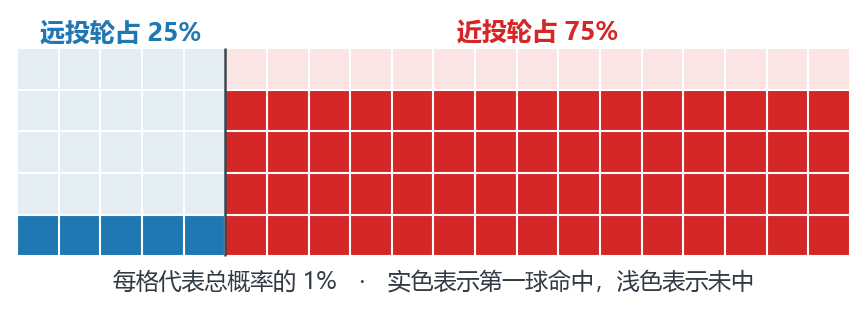
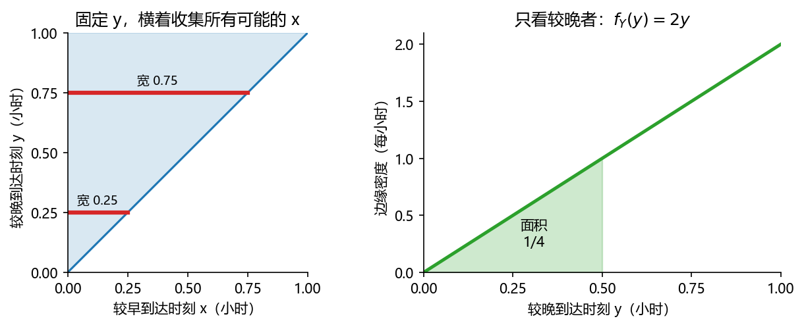
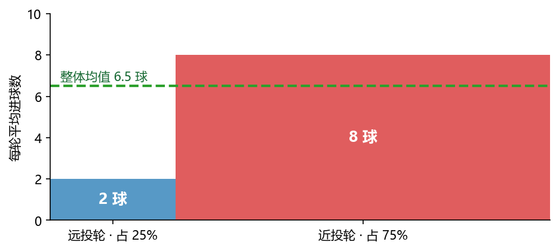

# 第 01 课　从全概率到全期望

> 修订记录 · 2026-11-24 15:20 补入全概率与连续模型的学习安排。2026-11-24 15:48 依照新课表从第一球重新开讲，补上分组图、一般公式及独立复现。
> 2026-11-24 17:03　补入[联合、边缘与条件](#联合边缘与条件)：从投篮概率表读分母，从到达时刻图读积分范围。对应 Week 5 第 26、28 页。
> 2026-11-24 17:23　将这两部分列为本课的必学基础，分别配第 5(a)、5(b) 题随堂复现。
> 2026-11-25 04:28　从每轮的一条记录讲起，用位置占比解释权重，用等人时的一刻钟解释密度。

**本课目标（必学）**　看一张投篮记录表，算出第一球有多大机会进，以及一轮平均能进几球。再读一张到达时间图，算出两个人都在前半小时到达的概率。[本轮课表](../01_学习计划/第01–NN课_课表.md) · [Week 5，第 9–11、26、28、39、49–50、52 页](<../../../AISCI5020/AISC5020 2026 Week 5.pdf>) · [期中卷 Q4(a)，第 4 页](<../../../AISCI5020/Midterm Test Paper.pdf>)

## 1　引入 · 只看第一球

你负责在球场边记成绩。每轮开始时，球员抽一次签，决定站远处还是近处，然后在抽到的位置投 $10$ 球。你先只记两件事：他站在哪里？第一球进了吗？这样，每轮都留下类似“远投，第一球进了”的一条记录。

远投签抽中的机会是四分之一，近投签是四分之三。站远时，第一球命中的机会是 $20\%$；站近时，是 $80\%$。如果已经看到球员站到近处，你就知道该用 $80\%$。现在他还没抽签，你要估计**这一轮第一球进的机会**。两种位置都可能抽到，它们各应该算多少？

## 2　直觉 · 一个命中，两条来路

把很多轮的记录按比例折成 $100$ 轮来想。平均来说，其中约有 $25$ 轮远投、$75$ 轮近投。先翻远投那叠记录，$25$ 轮里大约有 $5$ 轮第一球进了。再翻近投那叠，$75$ 轮里大约有 $60$ 轮第一球进了。

现在把两叠合在一起。这 $5$ 轮和那 $60$ 轮来自不同的记录，可以直接合计。于是每 $100$ 轮大约有 $65$ 轮第一球进了，对应的命中概率就是 $65\%$。近投记录多，所以整体命中率更接近近投的 $80\%$。

这里有个以后常见的说法，叫**按边缘分布加权**。只数投篮位置，把进球和没进的记录都算进去，得到远投占 $25\%$、近投占 $75\%$。这一对比例叫位置的 **marginal distribution（边缘分布）**。拿每个位置的占比乘上它自己的命中率，再加起来，就是 **weighting（加权）**。后面求一轮平均进几球，也用这两个占比，只需把“第一球命中的机会”换成“每组一轮平均进几球”。

## 3　几何 · 看面积

**看图**　把总概率摊成 $100$ 个等大的格子。左侧远投占 $25$ 格，其中五分之一涂实色；右侧近投占 $75$ 格，其中五分之四涂实色。实色总面积就是第一球命中的概率。这些格子表示概率份额。

## 4　公式卡 · 从事件到数值

### 联合、边缘与条件

#### 离散概率表 · 8 分钟

令 $F$ 表示抽到远投，$H$ 表示第一球命中。下表每个百分数的分母都是全部轮次。

| 抽到的位置 | 第一球命中 | 第一球未中 | 合计 |
|---|---:|---:|---:|
| 远投 | $5\%$ | $20\%$ | $25\%$ |
| 近投 | $60\%$ | $15\%$ | $75\%$ |
| 合计 | $65\%$ | $35\%$ | $100\%$ |

- **Joint probability（联合概率）**读一个格子。问“既远投又命中”，两件事要同时发生，所以 $P(F\cap H)=P(F)P(H\mid F)=0.25\times0.20=0.05$。乘法里用的是远投组内的命中率。
- **Marginal probability（边缘概率）**读行或列的合计。问“第一球命中”，远投和近投都要算，$P(H)=0.05+0.60=0.65$。把另一个分类的所有可能加起来，这一步叫边缘化。
- **Conditional probability（条件概率）**先圈定分母。给定远投，只看远投这一行，$P(H\mid F)=P(F\cap H)/P(F)=0.05/0.25=0.20$。一般地，$P(A\mid B)=P(A\cap B)/P(B)$，要求 $P(B)>0$。互换竖线两侧，分母也随之改变。

做[第 5(a) 题](#独立练习)，检查交换条件后应当选哪一列作分母。

#### 连续概率密度 · 10 分钟

先等一位同学。他一定会在 $12$ 点到 $13$ 点之间到达，任何两段一样长的时间，他落在其中的机会都相同。这就叫**均匀**。把这一小时分成四段，每段都是 $15$ 分钟。所以他在第一段到达的概率是四分之一。

把时间画成横轴，用小时做单位。现在画一个长方形，宽是整个 $1$ 小时，面积代表总概率 $1$，所以高度为每小时 $1$。这个表示概率在时间轴上分布得有多密的高度，叫 **probability density（概率密度）**。前 $15$ 分钟宽 $\tfrac14$ 小时，下面的面积就是 $1\times\tfrac14=\tfrac14$。如果曲线有高有低，就把这段时间下方的面积累加起来；这个求面积的运算叫**积分**。单独一个时刻没有宽度，因此在这个模型里恰好那一刻到达的概率为零。

现在等两位同学，每个人都按上面的方式到达，一个人的到达时间不影响另一个人的到达时间，这叫**独立**。一条记录里有两个时刻。先用横、纵轴分别记两人的到达时间，所有可能的位置铺满一个单位正方形。再把每条记录改写成“较早时刻 $X$、较晚时刻 $Y$”（单位为小时）。交换两人的先后顺序会得到同一对早晚时刻，原来正方形的两半就合到 $0<x<y<1$ 的三角形里。

在这张二维图中，**joint probability density（联合概率密度）**告诉我们概率在平面上分布得有多密。这块三角形里面处处一样密，面积是 $\tfrac12$，合计概率是 $1$，所以密度为 $1/(\tfrac12)=2$（每平方小时）。三角形外密度为零。要算两个时刻落在某一片区域的概率，就把这片区域上的密度累加起来，这叫**二重积分**。

**看图**　左图红线固定了较晚时刻 $y$。较早时刻 $x$ 可以从 $0$ 变化到 $y$。这条线越长，在该高度附近的一条窄带中可以容纳的概率就越多。

**边缘概率密度函数（marginal probability density function）。** 只关心较晚者 $Y$ 时，保留 $y$，沿着所有可能的 $x$ 积分：

$$
f_Y(y)=\int_{-\infty}^{\infty} f_{X,Y}(x,y)\,\mathrm dx=\int_0^y 2\,\mathrm dx=2y,\qquad 0<y<1.
$$

区间外密度为零。右图绿线的**高度**是密度，单位为每小时。要求“两人都在前半小时到达”的概率，还要对 $y$ 的区间求**面积**：

$$
P(Y\le 1/2)=\int_0^{1/2}2y\,\mathrm dy=[y^2]_0^{1/2}=\tfrac14.
$$

两位同学各有 $1/2$ 的概率在前半小时到，独立相乘也得到 $1/4$。单点 $Y=3/4$ 的概率为零，而那里密度为 $3/2$ 每小时。

**条件概率密度函数（conditional probability density function）。** 若已经知道较晚者的到达时刻 $y$，只沿对应的水平线看较早者能在何时到达。把线上各处的密度按同一比例调整，让所有可能的较早时刻合计概率为 $1$，这个动作叫**归一化**。只要 $f_Y(y)>0$，就有

$$
f_{X\mid Y}(x\mid y)=\frac{f_{X,Y}(x,y)}{f_Y(y)}=\frac{2}{2y}=\frac1y,\qquad 0<x<y<1.
$$

固定 $y$ 时，$x$ 在 $(0,y)$ 外的条件密度为零。举例来说，若较晚者在第 $45$ 分钟到，较早者在前 $45$ 分钟里均匀分布。于是较早者在前 $15$ 分钟到达的条件概率为 $\int_0^{1/4}(4/3)\,\mathrm dx=1/3$。除法用的是密度 $f_Y(y)$，归一化后整条切片的积分为 $1$。

做[第 5(b) 题](#独立练习)，换一个方向画切片。接着回到投篮表：全概率用各组对同一事件的贡献求列合计，全期望用各组的均值求整体平均。

### 4.1　全概率公式（law of total probability）

$$
P(A)=\sum_{i=1}^{k}P(G_i)\,P(A\mid G_i)
$$

**符号**　$A$ 是关心的事件，$G_i$ 是第 $i$ 组，$k$ 是组数。$P(G_i)$ 是抽中该组的概率。竖线读作“给定”，$P(A\mid G_i)$ 是已知落入该组后 $A$ 发生的概率。$\sum$ 表示把各组贡献相加。各组互斥、合起来覆盖所有情况，计算只纳入概率为正的组。

**意义与场景**　组内命中率的分母只数这一组。乘以组的占比，就把它换成在全部轮次中的份额；这份额也叫 joint probability（联合概率），即 $P(G_i\cap A)$。可以想象先从整块纸上裁出一组，再从这组里裁出命中的一部分。

**例 · 第一球命中。**

- 第 0 步，$A$ 表示“第一球命中”。远投轮占 $25\%$，远投时命中率为 $20\%$，两个百分数的分母不同。
- 第 1 步，从远投这条路命中的概率是 $0.25\times0.20=0.05$。
- 第 2 步，从近投这条路命中的概率是 $0.75\times0.80=0.60$。
- 第 3 步，两条路互斥，相加得 $0.05+0.60=0.65$。
- 检查图上的实色格子，$5+60=65$ 格，占总面积的 $65\%$。

**解读**　随机抽一轮，第一球命中的概率为 $65\%$。这一步只看一次投篮，整轮投几球不影响它。

### 4.2　条件均值（conditional mean）与全期望公式（law of iterated expectations）

$$
\mathbb E[Y]=\mathbb E[m(X)],\qquad m(x)=\mathbb E[Y\mid X=x]
$$

**符号**　$Y$ 是要平均的数值，$X$ 是分组变量，$x$ 是某个具体组值。$m(x)$ 是给定 $X=x$ 后 $Y$ 的平均。$\mathbb E$ 表示按概率取平均。内层先对这组的 $Y$ 平均，外层再按 $X$ 的分布平均。这里假设 $\mathbb E[|Y|]<\infty$。

**意义与场景**　若把第一球命中记为 $1$、未中记为 $0$，得到 indicator（指示变量）$\mathbf 1_A$。它在组内的平均就是该组命中率，整体平均就是 $P(A)$。把得分换成“整轮进球数”，每组仍可先算自己的平均，此时答案的单位变成球。

**例 · 整轮投篮。**

- 第 0 步，令 $X$ 是每轮抽到的命中率，$Y$ 是这一轮进的球数。给定 $X=x$，各球独立且命中率相同。
- 第 1 步，远投组每轮平均进 $10\times0.2=2$ 球。近投组每轮平均进 $10\times0.8=8$ 球。
- 第 2 步，按组的概率加权，两组分别贡献 $0.25\times2=0.5$ 球、$0.75\times8=6$ 球。
- 第 3 步，相加得 $0.5+6=6.5$ 球。检查时也可把每个位置上的一球分别求期望，再将十球相加，得到 $10\times0.65=6.5$ 球。

**看图与解读**　宽度仍是各组占比，高度现在是每组每轮平均进球数。两块面积铺平，绿线的高度就是每轮平均 $6.5$ 球。实际一轮可以进整数个球，跨很多轮的平均可以有小数。

### 4.3　连续分组的加权平均（averaging over a density）

$$
\mathbb E[Y]=\int m(x)\,f_X(x)\,\mathrm dx
$$

**符号**　当 $X$ 有密度时，$f_X(x)$ 是其概率密度，积分范围是 $X$ 的取值范围。$m(x)$ 仍是该组的均值。离散时每组用 $P(X=x)$ 加权；连续时一个小区间的权重约为密度乘区间宽度。

**意义与场景**　同一个投篮位置也可能每天手感不同。若命中率能取整段区间里的值，就沿着区间把每组贡献累加起来。将 $m(x)$ 换成 $P(A\mid X=x)$，积分给出的便是事件 $A$ 的全概率。

**例 · 随机等候。** 公交发车间隔 $X$ 在 $[4,8]$ 分钟上均匀分布。先抽定间隔，再在该间隔中均匀抽一个到站时刻，问平均还要等多久。

- 第 0 步，令 $Y$ 是剩余等待时间。给定间隔 $x$ 分钟，$Y$ 在 $[0,x]$ 上均匀，组内均值 $m(x)=x/2$ 分钟。
- 第 1 步，间隔密度为 $1/(8-4)=1/4$ 每分钟。
- 第 2 步，加权求平均，$\mathbb E[Y]=\int_4^8(x/2)(1/4)\,\mathrm dx=[x^2/16]_4^8=(64-16)/16=3$ 分钟。
- 检查：间隔均值为 $(4+8)/2=6$ 分钟，取一半同样是 $3$ 分钟。

**解读**　等待时间可以取连续值；组内平均由区间的两个端点决定。这个抽样顺序保证外层使用题给的间隔分布。

## 5　完整手算 · 期中 Q4(a) 同型题

每轮投 $10$ 球。先从 $[0.2,0.6]$ 均匀抽一次成功率 $X$，整轮共用。给定成功率后各球独立。求一轮的平均进球数。

1. **固定成功率。** 给定 $X=x$，每球平均贡献 $x$ 个进球，$10$ 球的条件分布为 binomial distribution（二项分布），即 $Y\mid X=x\sim\mathrm{Binomial}(10,x)$，条件均值 $m(x)=10x$ 球。
2. **对成功率取平均。** 由 uniform distribution（均匀分布）的对称性，$\mathbb E[X]=(0.2+0.6)/2=0.4$。
3. **合并两层。** $\mathbb E[Y]=\mathbb E[10X]=10\mathbb E[X]=10\times0.4=4$ 球。组均值在 $2$ 到 $6$ 球之间，结果在此范围内。

## 6　独立复现

先试一个小变化：若远投轮占 $3/4$，近投轮占 $1/4$，两种位置的命中率照旧，第一球命中的概率是多少？先指出两条命中路径，再写一行算式。答案在第 9 节第 1 题。

## 7　易错点

- 把 $20\%$ 和 $80\%$ 直接取平均会得到 $50\%$。这种算法给两组各分了一半权重，适用于远近投等可能的情况。
- $0.65$ 是第一球命中的概率；$6.5$ 是十球一轮的平均进球数。先读题目究竟问“是否发生”还是“有多少”。

## 8　与已学概念和机器学习的关系

乘法公式给出一条路径的联合概率，互斥事件的加法公式把路径合起来，这就得到全概率。例子不限于投篮。一个图像分类器面对手机照片和扫描件时，两类输入的正确率可以不同。知道上线后两类输入的占比，就可以求整体正确率。第 02 课沿用组内与组间的区分，继续问数值会波动多大。

## 9　作业与答案

### 独立练习

1. **分组与看图。** 回到第 6 节互换占比的例子。第一球的整体命中率会向哪一组靠近？计算后，再用一句话说明理由。
2. **期中同型，10 分钟。** 每轮投 $12$ 球，共用的命中率 $X$ 均匀取自 $[0.1,0.5]$。给定 $X$ 后各球独立。写出条件均值和外层期望，求每轮平均进球数，说明每层各对谁平均。
3. **机器学习。** 分类器在手机照片上的正确率为 $0.9$，在扫描件上为 $0.6$。上线后手机照片占 $0.8$，其余为扫描件。指出事件和分组，算整体正确率。
4. **连续模型，5 分钟。** $X$ 在 $(0,1)$ 上均匀分布。给定 $X=x$ 后，$Y$ 在 $(x,1)$ 上均匀分布。由区间中点写出条件均值，再求 $\mathbb E[Y]$。哪一步用到了均匀分布的性质？
5. **基础随堂复现。** (a) 已知第一球命中，来自远投轮的概率是多少？指出分母并写出算式。(b) 在两人到达时刻的三角形中，若只关心较早者 $X$，固定 $0<x<1$ 时，$y$ 从哪里积到哪里？写出边缘密度 $f_X(x)$。

### 参考答案

先自己做完再看

1. 远投轮更多，整体命中率更靠近 $20\%$。远投且命中占 $0.75\times0.20=0.15$，近投且命中占 $0.25\times0.80=0.20$，相加是 $0.35$，即 $35\%$。
2. 固定 $x$ 后，对进球数取平均，$\mathbb E[Y\mid X=x]=12x$。再对各轮的 $X$ 平均，$\mathbb E[X]=(0.1+0.5)/2=0.3$，从而 $\mathbb E[Y]=12\times0.3=3.6$ 球。
3. 事件是“模型答对”，分组是“手机照片”和“扫描件”。两组分别贡献 $0.8\times0.9=0.72$ 和 $(1-0.8)\times0.6=0.12$，相加得 $0.84$，即 $84\%$。
4. 固定 $x$，组内均匀分布的中点给出 $m(x)=(x+1)/2$。外层 $X$ 的密度为 $1$，所以 $\mathbb E[Y]=\int_0^1 (x+1)/2\,\mathrm dx=[x^2/4+x/2]_0^1=3/4$。均匀性分别用在内层取区间中点和外层确定权重。
5. (a) 分母是全部命中的轮次，占总数的 $65\%$。远投且命中占全部轮次的 $5\%$，所以 $P(F\mid H)=5/65=1/13$。(b) 固定 $x$ 后，竖切片上 $x<y<1$。因此 $f_X(x)=\int_x^1 2\,\mathrm dy=2(1-x)$（$0<x<1$），区间外为零。

