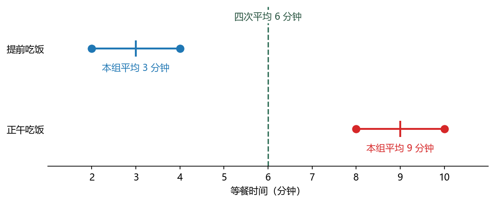
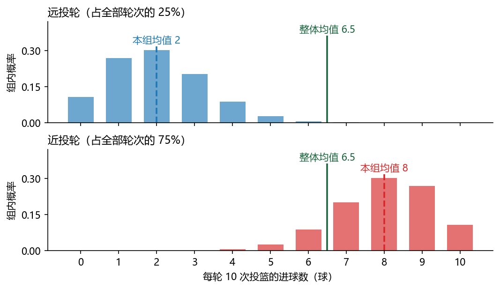

# 第 02 课　全方差：组内波动与组间波动

> 修订记录 · 2026-11-25 04:28　用四次等餐记录重讲引入、直觉和读图，在首次使用处解释方差、组的权重与二阶矩。

**本课目标（必学）**　从四条记录看出等餐时间为什么有长有短，再用同一个方法解释期中题中每轮进球数为什么有多有少。[Week 5 第 19、42、49–52 页](<../../../AISCI5020/AISC5020 2026 Week 5.pdf>) · [期中卷 Q4(b) 第 4–5 页](<../../../AISCI5020/Midterm Test Paper.pdf>)

## 1　引入 · 去同一个窗口，要等几分钟？

想象你在学校食堂吃过四次午饭，每次都去同一个窗口，也都记下了从排进队伍到拿到饭的时间。

| 什么时候去 | 第一次 | 第二次 |
|---|---:|---:|
| 提前去吃 | $2$ 分钟 | $4$ 分钟 |
| 正午去吃 | $8$ 分钟 | $10$ 分钟 |

朋友问“这个窗口要等多久”，你把四次时间加起来再除以四，回答“平均 $6$ 分钟”。朋友又问“我正午才下课，也按 $6$ 分钟留时间吗？”你回头看表，发现正午的两次都比 $6$ 分钟久。整个窗口的平均数算对了，可朋友告诉你的“正午”让你有了更贴近他的估计。

## 2　直觉 · 知道什么时候去，能解释多少差别？

先用手遮住第二行。提前去的两次分别等了 $2$ 和 $4$ 分钟，平均是 $3$ 分钟。即使已经知道你提前去，光凭时段，还是猜不准你当天究竟等了几分钟。**同一时段里，每次记录相对本时段平均时间的差别**，就叫**组内波动**。这里的“一组”就是表里的一行。

现在打开第二行，用同样的方法求平均。正午的两次平均等了 $9$ 分钟。朋友一说正午，你就可以把估计从四次合起来的 $6$ 分钟改为 $9$ 分钟；如果他说提前去，你会改为 $3$ 分钟。**换一组，连你用来估计的平均时间也变了。** 这些组的平均时间相对整体平均时间有多分散，叫**组间波动**。

最后只看正午等了 $10$ 分钟的那次。它比整体平均多等 $4$ 分钟。先从整体平均 $6$ 分钟走到正午平均 $9$ 分钟，多出的 $3$ 分钟和时段有关。再从正午平均 $9$ 分钟走到当天的 $10$ 分钟，又多了 $1$ 分钟。这个例子里的 $3$ 分钟和 $1$ 分钟都是**一次记录的差值**。要给四次记录的总体波动定一个数，还要把每次的差值平方后取平均，这个数叫 **variance（方差）**。用平方是因为多等和少等都代表有波动，取平方可以让它们都贡献正数。

## 3　几何 · 在时间轴上找这两段距离

**看图**　圆点是每一次等餐的时间，同行两个点中间的短竖线标出本组的平均时间。沿着正午这一行，从整体平均的虚线 $6$ 走到短竖线 $9$，你比较了两个平均时间。再从短竖线 $9$ 走到最右边的圆点 $10$，你比较的是这一次记录和正午平均。

## 4　公式卡 · 全方差公式（law of total variance）

从这四条记录中等机会抽一条。$Y$ 表示抽到的等餐时间，$X$ 表示它属于哪个时段。符号 $\mathbb E$ 表示取平均，$\operatorname{Var}$ 表示求方差，竖线 $\mid$ 读作“已知”。$m(X)=\mathbb E[Y\mid X]$ 是已知时段后只在这一组内算的平均时间，称为**条件均值**。$v(X)=\operatorname{Var}(Y\mid X)$ 是只用这一组记录算的方差，称为**条件方差**。

公式要求 $\mathbb E[Y^2]<\infty$。意思是把每个结果平方后取平均，得到一个有限的数。这里一共只有四个有限的等餐时间，自然满足这个条件。

$$
\operatorname{Var}(Y)=
\underbrace{\mathbb E[v(X)]}_{\text{组内方差的平均}}
+\underbrace{\operatorname{Var}(m(X))}_{\text{组均值的方差}}.
$$

第一项回答“知道时段后，等餐时间还会波动多少？”第二项回答“只看两个时段的平均时间，它们离整体平均有多远？”

两项都用到**按 $X$ 的边缘分布加权**。把这句话分开读。先只看时段：四条记录有两条提前、两条正午，各占一半。这组时段占比就是 $X$ 的**边缘分布**。接着，把每个时段算出的量乘上该时段的占比，再相加，这叫**加权**。这里两组碰巧各占一半；如果四条中有三条来自正午，正午那组就占四分之三。

**卡内例 · 算出四次等餐的总方差。**

- **第 0 步，认单位。** 等餐时间和平均时间都用分钟，方差用分钟的平方。
- **第 1 步，算各组自己的方差。** 提前两次离本组平均 $3$ 分钟各差 $1$ 分钟，平方后平均是 $1\ \text{分钟}^2$。正午两次离本组平均 $9$ 分钟也各差 $1$ 分钟，方差同样是 $1\ \text{分钟}^2$。
- **第 2 步，算组内项。** 两组各占一半，组内方差的平均是 $\tfrac12\times1+\tfrac12\times1=1\ \text{分钟}^2$。
- **第 3 步，算组间项。** 两个时段的平均时间分别比整体平均少 $3$ 分钟、多 $3$ 分钟。组均值的方差是 $\tfrac12(3-6)^2+\tfrac12(9-6)^2=9\ \text{分钟}^2$。
- **核对。** 两项相加得 $10\ \text{分钟}^2$。也可以直接把四次时间和整体平均 $6$ 分钟比较，四个差值为 $-4,-2,2,4$ 分钟，平方后取平均得到 $(16+4+4+16)/4=10\ \text{分钟}^2$。这个例子里，两个时段的平均等待时间相差较大，组间项也就较大。

这个公式也适用于组别和结果彼此有关的情况，正如知道用餐时段能帮助估计等多久。组别能逐个列出时，逐组计算贡献再相加。若分组依据在一段范围内连续取值且有概率密度，就按各小段所占的概率合并贡献；小段越来越细，求和就变成积分。下面的期中题会具体算一次。

复习第一课时可展开：换回远投和近投，看看两组占比不同时怎样加权

每轮先抽一个位置，在同一位置独立投 $10$ 球。远投轮占 $25\%$，每球命中率为 $0.2$；近投轮占 $75\%$，每球命中率为 $0.8$。两组均值分别为 $2$ 球和 $8$ 球，整体均值为 $0.25\times2+0.75\times8=6.5$ 球。

**看图**　每排柱子表示该位置上各种进球数出现的概率。绿色整体均值线靠近近投组，因为近投轮出现得更多。

- **第 0 步，认角色。** $X$ 是位置，$Y$ 是一轮进球数。$m(X)$ 的单位是球，$v(X)$ 的单位是 $\text{球}^2$。
- **第 1 步，固定位置。** 用二项方差 $np(1-p)$，其中 $n$ 是投篮次数，$p$ 是该位置的命中率。远投方差为 $10\times0.2\times0.8=1.6\ \text{球}^2$，近投方差为 $10\times0.8\times0.2=1.6\ \text{球}^2$。
- **第 2 步，算组内项。** 按出现比例平均，$0.25\times1.6+0.75\times1.6=1.6\ \text{球}^2$。
- **第 3 步，算组间项。** 两组均值距整体均值分别为 $2-6.5=-4.5$ 球和 $8-6.5=1.5$ 球。把距离平方再加权，得到 $0.25\times20.25+0.75\times2.25=6.75\ \text{球}^2$。
- **第 4 步，相加。** 总方差为 $1.6+6.75=8.35\ \text{球}^2$。这个例子里，位置改变引起的波动较大。
- **检查。** 假设两种位置的命中率都变成 $0.2$，两条组均值线就都在 $2$ 球。组间项降为 $0$，总方差回到 $1.6\ \text{球}^2$。

**为什么两项可以直接相加？** 先把等餐时间平方，再在同一时段里求平均。这个数叫**条件二阶矩**：“二阶”对应平方，“条件”说明只看已知的那一组。它等于本组方差加上本组平均时间的平方。再按时段占比平均，就得到所有记录的平方时间的平均值。这一步用的是上一课的全期望。

$$
\mathbb E[Y^2\mid X]=v(X)+m(X)^2,
\qquad
\mathbb E[Y^2]=\mathbb E[v(X)]+\mathbb E[m(X)^2].
$$

全期望还给出 $\mathbb E[Y]=\mathbb E[m(X)]$。从上式两边减去整体均值的平方，最后两项恰好合成组均值的方差：

$$
\operatorname{Var}(Y)
=\mathbb E[v(X)]+\mathbb E[m(X)^2]-(\mathbb E[m(X)])^2
=\mathbb E[v(X)]+\operatorname{Var}(m(X)).
$$

## 5　完整手算 · 期中 Q4(b) 的随机命中率

每轮先从 $(0,1)$ 均匀抽取一个命中率 $X$，整轮共用它。给定 $X=x$ 后，各球独立。令 $n$ 为固定投篮次数，$Y$ 为进球数。以 $n=6$ 做手算，同时保留试卷的一般结果。

**第 0 步，读出两层随机性。** 外层抽命中率，内层按已经抽到的命中率投球。因此 $X\sim\mathrm{Uniform}(0,1)$，而 $Y\mid X=x\sim\mathrm{Binomial}(n,x)$。

**第 1 步，固定命中率。** 二项分布给出 $m(x)=nx$ 球和 $v(x)=nx(1-x)\ \text{球}^2$。例如本轮抽到 $x=0.5$，投 $6$ 球的条件均值为 $3$ 球，条件方差为 $1.5\ \text{球}^2$。换一轮就会抽到新的 $x$。

**第 2 步，把所有可能的命中率考虑进来。** $X$ 在 $(0,1)$ 上均匀，意思是同样长的两段命中率区间有相同的机会。把概率画成面积，总宽为 $1$，总面积为 $1$，所以整段的高度为 $1$。这个高度叫**概率密度**。例如抽到 $0.2$ 至 $0.3$ 之间的命中率，概率为 $1\times(0.3-0.2)=0.1$。此处求平均，是沿着所有可能的 $x$ 把贡献累加起来，写成积分就是

$$
\mathbb E[X]=\int_0^1 x\,dx=\frac12,\qquad
\mathbb E[X^2]=\int_0^1 x^2\,dx=\frac13.
$$

于是 $\operatorname{Var}(X)=\tfrac13-(\tfrac12)^2=\tfrac1{12}$。这里 $\mathbb E[X^2]$ 是先平方再平均，$(\mathbb E[X])^2$ 是先平均再平方。

**第 3 步，算组内项。** 先展开 $X(1-X)=X-X^2$，外层期望便能用上刚才的两个数：

$$
\mathbb E[v(X)]=n\bigl(\mathbb E[X]-\mathbb E[X^2]\bigr)
=n\left(\frac12-\frac13\right)=\frac n6.
$$

投 $6$ 球时，这部分为 $1\ \text{球}^2$。

**第 4 步，算组间项。** 各组中心是 $nX$。把命中率放大 $n$ 倍，离均值的距离也放大 $n$ 倍，平方距离就放大 $n^2$ 倍：

$$
\operatorname{Var}(m(X))=n^2\operatorname{Var}(X)=\frac{n^2}{12}.
$$

投 $6$ 球时，这部分为 $36/12=3\ \text{球}^2$。

**第 5 步，合并并解读。** 试卷写的 **marginal variance（边缘方差）**，是把所有轮次放在一起算进球数的方差。它包含轮内投球的随机性，也包含各轮抽到不同命中率带来的波动。

$$
\operatorname{Var}(Y)=\frac n6+\frac{n^2}{12}=\frac{n(n+2)}{12}.
$$

投 $6$ 球时，总方差为 $1+3=4\ \text{球}^2$。对应的标准差（standard deviation）是 $\sqrt4=2$ 球。由上一课可知，平均每轮进 $6/2=3$ 球。

**检查。** 只投一球时，边缘命中率为 $\tfrac12$，这一球的方差为 $\tfrac12(1-\tfrac12)=\tfrac14$。代入一般式也得到 $1(1+2)/12=\tfrac14$。

## 6　独立复现 · 先写这两行

把投篮次数换成 $4$，其余条件照第 5 节。遮住例题，用自己的式子填「组内项 = …」「组间项 = …」，再相加。对应下方第 2 题。能指出外层平均是对哪个变量做的，就抓住了本题的结构。

## 7　易错点 · 为什么不能直接用平均命中率

投 $6$ 球时，把每球命中率直接固定为 $\tfrac12$，会算出 $6\times\tfrac12\times\tfrac12=1.5\ \text{球}^2$。这个计算描述的是每轮都固定同一命中率的游戏。试题里，同一轮的各球共用一次抽到的 $X$。抽到高命中率时，整轮都更容易进球。题目给出的独立性带有「给定 $X$」这个条件。

## 8　与上一课及机器学习的联系

全期望把各组中心合成一个整体中心。全方差沿用这些中心，进一步比较组内成绩和组间中心的波动。[第 01 课板书](S014_第01课_全期望.md)

设一棵回归树（regression tree）用商圈预测门店单小时客流，$X$ 是客流记录落入的叶节点，$Y$ 是这一小时的来客数。如果每个叶节点都用本组真实均值预测，那么一条记录的预测误差就是它相对本组均值的偏差。全体记录的平均平方误差等于组内项。与始终报整体均值相比，这次分组减少的平均平方误差等于组间项。

## 独立练习

课末 $15$ 分钟留给第 2 题（$10$ 分钟）与第 3 题（$5$ 分钟）。第 1、4 题用于口头自测。

1. **读图。** 假如两个时段的平均时间相同，但每个时段里两次等餐的时间仍不同，哪一项为零？哪一项还能为正？
2. **二项手算。** 每轮从 $(0,1)$ 均匀抽一次命中率，给定它后独立投 $4$ 球。分别求条件均值、条件方差、组内项、组间项和总方差。
3. **泊松迁移。** 随机选一小时，两类时段各占一半。来客数在两类时段分别服从参数为 $2$ 和 $6$ 的泊松分布（Poisson distribution）。已知泊松计数的均值和方差在数值上都等于参数。分别求平均来客数、组内项、组间项和总方差。哪一步用到了泊松分布的性质？
4. **回归树。** 两家店的客流均值相同，各店内部客流都有波动。一棵树把两家店分到不同的叶节点，两片叶子都用本店真实均值做预测。与直接报整体均值相比，平均平方误差会减少吗？用全方差中的一项解释。

## 参考答案（先自己做完再看）

1. 两个时段的平均时间都等于整体平均，组间项为零。每个时段内仍有等得久和等得短的记录，所以组内项为正。
2. 固定命中率 $x$，条件均值为 $4x$ 球，条件方差为 $4x(1-x)\ \text{球}^2$。组内项为 $4(\tfrac12-\tfrac13)=\tfrac23\ \text{球}^2$。组间项为 $4^2(\tfrac13-\tfrac14)=\tfrac43\ \text{球}^2$。总方差为 $\tfrac23+\tfrac43=2\ \text{球}^2$。
3. 固定时段时，由泊松性质读出两组的均值为 $2$、$6$ 人，方差为 $2$、$6\ \text{人}^2$。平均来客数为 $(2+6)/2=4$ 人。组内项为 $(2+6)/2=4\ \text{人}^2$。组间项为 $\tfrac12(2-4)^2+\tfrac12(6-4)^2=4\ \text{人}^2$。总方差为 $4+4=8\ \text{人}^2$。选定时段后用到了泊松性质；随后三次按组计算对其他分布也适用。
4. 减少量为零。两片叶子的预测值一样，它们的方差（组间项）为零。各时段自身的波动仍计入组内项。
