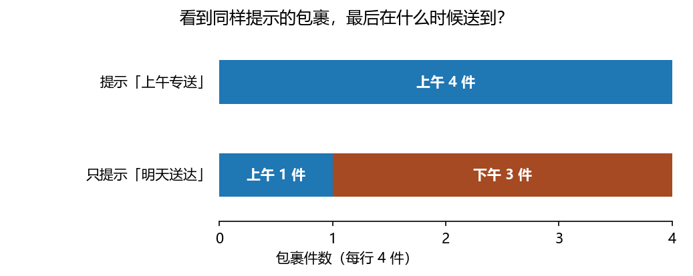

# 第 03 课　熵、条件熵与分类错误率

**本课目标（必学）**　能读一张配送记录表，解释一条提示能帮你猜到什么；能算出看到提示后还剩多少不确定性，以及照指定规则猜会错多少。对照期中 Q5 认清各个符号。[Week 6，第 3–7、13–20、32–37 页](<../../../AISCI5020/AISC5020 2026 Week 6.pdf>) · [期中卷 Q5，第 6 页](<../../../AISCI5020/Midterm Test Paper.pdf>)

## 1　引入 · 明天该留哪个半天在家？

你明天有个快递要当面签收，只能留半天在家。包裹一定会到，难的是决定留上午还是下午。如果手机明确写着“上午专送”，而你也知道这项服务总在上午送到，今晚就能排好明天的行程。可如果它只写“明天送达”，上午和下午都还说得通。

为了弄清第二条提示到底有多少用，我们做个小游戏。桌上有八张配送卡，每张正面写着前一天的提示，背面写着实际送到的时段。八张卡等机会抽取。你可以先看全部记录，之后把卡混匀，抽出一张，只看正面，猜背面。这里把这八张卡当作游戏的全部可能，下面的概率都能直接数出来。

## 2　直觉 · 只看和你收到同样提示的卡

四张卡的正面写着“上午专送”，翻过来四张都是上午。如果抽到这样的卡，你已经能确定背面写着什么。另四张卡的正面只写“明天送达”，翻过来有一张上午、三张下午。这时猜下午有依据，但四张里仍有一张会让你猜错。

你现在可以问两个问题。第一个是**看到提示后，背面的答案还有多难猜？** 第二个是**如果我每次都选比较常出现的那个时段，八张里会猜错几张？** 前者要看每个可能结果有多常见，后者要先定一条猜测规则，再逐张核对。

数学上把真实结果所属的类别叫 **class label（类别标签）**。这里的标签 $Y$ 就是实际上午到或下午到。猜之前能看到的内容叫 **observation（观测）**，也就是提示 $X$。把图想成你面前的那堆卡。

## 3　几何 · 一行就代表一种提示

**看图**　先遮住下排，只看上排，颜色只有一种。再遮住上排，下排有两种颜色，但棕色占了四分之三。两排包裹一样多，所以随机抽一件时，有一半的机会遇到上排那样确定的情形，另一半遇到下排那样仍需猜的情形。

## 4　公式卡 · 给“还要猜多少”一个数

### 熵（entropy）

如果一张卡背面一定写着上午，翻开时你没有得到新消息。如果上午、下午各一半，翻开卡就解决了一次恰好二选一的悬念。信息论把这种等可能二选一完全揭晓所给的信息量叫 **1 bit（比特）**。在看答案之前，各种可能的结果平均会带来多少新消息，就叫这个结果的**熵**。

$$
H(Y)=\sum_{y:\,p_y>0}p_y\log_2\frac1{p_y}.
$$

$H$ 表示熵。小写 $y$ 是某一个可能答案，$p_y$ 是它出现的概率，$\sum$ 表示把各答案的贡献加起来。$\log_2$ 叫**以 2 为底的对数**，它问“2 的多少次方等于眼前的数？”例如概率为 $\tfrac14$ 时，倒数为 $4$，而 $2^2=4$，所以这个结果揭晓时带来 $2$ bit。求平均时，用每种结果的出现概率作权重。概率为零的结果贡献按零处理。

**卡内例。** 若上午、下午各占一半，每种结果揭晓都带来 $\log_2 2=1$ bit。按各自出现的概率取平均，熵为 $\tfrac12\times1+\tfrac12\times1=1$ bit。如果肯定上午到，唯一可能结果的概率为 $1$，熵就是 $\log_2 1=0$ bit。二分类的熵就在 $0$ 到 $1$ bit 之间。

### 条件熵（conditional entropy）

$$
H(Y\mid X)=\sum_{x:\,P(X=x)>0}P(X=x)\,H(Y\mid X=x).
$$

竖线读作“已知”。先固定一个具体提示 $x$，只看这一组里的真实时段，用上一张公式卡求熵，得到 $H(Y\mid X=x)$。再用每组在全部包裹中所占的比例 $P(X=x)$ 求平均。这才得到 $H(Y\mid X)$，即**看到提示之后，真实时段平均还剩多少不确定性**。

**卡内例。** 假如某配送服务有四分之三的包裹收到准确时段，剩下四分之一只收到日期，这后一组中上午下午各半。两组分别剩 $0$ 和 $1$ bit，整项服务的条件熵就是 $\tfrac34\times0+\tfrac14\times1=0.25$ bit。准确提示如果覆盖所有包裹，两项合起来就降到 $0$ bit。

### 分类错误率（classification error probability）

$$
\widehat Y=g(X),\qquad P_e=P(\widehat Y\ne Y).
$$

$g$ 是从提示选一个答案的规则，叫 **classifier（分类器）**。带帽子的 $\widehat Y$ 是规则猜的答案，$Y$ 是翻卡后看到的真实答案。两者不同就算猜错，$P_e$ 表示这种情况的概率。它是一个比例，可以写成百分数。

**卡内例。** 某规则在十张等机会抽到的卡上猜错两张，错误率为 $2/10=20\%$。用同样十张卡，如果改规则后十张都猜对，错误率就变为 $0$。换规则时，这些卡的提示和真实时段仍是原来的记录。

## 5　完整手算 · 回到桌上的八张卡

| 卡片正面的提示 $X$ | 实际上午到 | 实际下午到 | 本组共计 |
|---|---:|---:|---:|
| 上午专送 | $4$ | $0$ | $4$ |
| 只写明天送达 | $1$ | $3$ | $4$ |
| 两组合计 | $5$ | $3$ | $8$ |

**第 0 步，认角色。** 行是猜之前能看到的提示，列是要猜的真实结果。两行各有四张，所以两组的权重都是 $\tfrac12$。规则定为“上午专送猜上午，只写日期猜下午”。

**第 1 步，先盖住提示。** 八张里有五张上午、三张下午。按总数 $8$ 作分母，得到两个答案的概率 $\tfrac58$ 和 $\tfrac38$。它们的熵是

$$
H(Y)=\tfrac58\log_2(8/5)+\tfrac38\log_2(8/3)
\approx \tfrac58\times0.678+\tfrac38\times1.415\approx0.954\ \mathrm{bit}.
$$

**第 2 步，只看第一行。** 已知是“上午专送”，四张中有四张上午，答案已确定。所以这组的熵是 $0$ bit。

**第 3 步，只看第二行。** 分母是本行的四张。上午的概率为 $\tfrac14$，揭晓“上午”带来 $\log_2 4=2$ bit。下午的概率为 $\tfrac34$，揭晓“下午”带来 $\log_2(4/3)\approx0.415$ bit。取平均得

$$
H(Y\mid X=\text{只写日期})
=\tfrac14\times2+\tfrac34\times0.415\approx0.811\ \mathrm{bit}.
$$

**第 4 步，合并两行。** 一半包裹落在第一行，一半落在第二行，所以全体包裹的条件熵为

$$
H(Y\mid X)\approx\tfrac12\times0+\tfrac12\times0.811\approx0.406\ \mathrm{bit}.
$$

与盖住提示时的 $0.954$ bit 相比，看提示确实让送达时段更容易猜。

**第 5 步，核对猜错的卡。** 第一行全部猜上午，错零张。第二行全部猜下午，唯一错误是那张实际在上午到的卡。八张中只有这一张猜错，所以 $P_e=1/8=12.5\%$。另一种检查方法是先分组：两行的错误率分别为 $0$ 和 $\tfrac14$，各占一半，加权后同样是 $\tfrac18$。

## 6　独立复现

换一批八张卡。“上午专送”有两张，都是上午到。“只写日期”有六张，其中三张上午到，三张下午到。沿用“上午专送猜上午，只写日期猜下午”的规则。先自己画出两行，再做第 9 节第 2、3 题。

## 7　易错点 · 竖线右边写的是已经知道的事

- $H(Y\mid X=x)$ 只看一行。求 $H(Y\mid X)$ 时，还要把各行的熵按行所占的比例平均。
- $H(X\mid Y)$ 是另一个问题。它问“已经知道送到的时段，原提示还要猜多少？”现在要固定一列，看这一列来自哪几行。期中题要根据观测猜真实类别，所以它用 $H(Y\mid X)$。
- 条件熵的单位是 bit。错误率是错误发生的概率。要把 $P_e$ 写出来，必须说明分类器怎么猜，或给出足够确定错误率的信息。

## 8　与机器学习、期中 Q5 的联系

一棵 **decision tree（决策树）**按照问题的答案把记录分开。比如第一步问“有没有上午专送提示？”，就得到图上的两行。每行选较常出现的真实时段作为预测，便是第 5 节的规则。树可以用分组前后的熵评估一个问题能帮助分清多少记录。这沿用了第一课的两个动作：固定一个条件看组内，再按组占比取平均。[第 01 课板书](S014_第01课_全期望.md)

期中卷 Q5(b) 给出 $M=4$ 和 $H(Y\mid X)=1.6$ bits。$M$ 是真实类别的个数，这里有四类。$1.6$ bits 说的是看到观测后平均还剩多少不确定性。题目要求的是错误率的**下界**，也就是错误率至少有多大。下一课再用弱式 Fano 不等式把这两个概念连起来。[期中卷第 6 页](<../../../AISCI5020/Midterm Test Paper.pdf>)

## 9　分层自测

### 独立练习

课内独练约 10 分钟，优先做第 2、3 题。

1. **读图。** 原八张卡中，为什么上排的熵是零？如果下排改成两张上午、两张下午，它的熵会变大还是变小？
2. **换数手算。** 用第 6 节的新卡，分别写出两行各自的熵和各自的权重，再求 $H(Y\mid X)$ 和指定规则的 $P_e$。
3. **换方向读表。** 仍用新卡。现在有人告诉你“这件是上午到的”，你要反猜它的提示。该在哪一组卡里数？其中原提示为“上午专送”的概率是多少？再写出期中题真正用的条件熵、类别数和错误率的符号及单位。
4. **换一条预测规则。** 回到第 5 节原来的记录。一个分类器每次都猜“上午”，它的错误率是多少？如果提示和真实结果的记录都留着，只更换猜法，$H(Y\mid X)$ 会变吗？

### 参考答案（先自己做完再看）

1. 上排背面只有一个可能答案，已知提示后熵为 $0$ bit。下排若各占一半，熵从约 $0.811$ bit 增至 $1$ bit，因为现在两种结果同样有可能。
2. 第一行都是上午，熵为 $0$ bit，权重为 $\tfrac28$。第二行上午下午各半，熵为 $1$ bit，权重为 $\tfrac68$。所以 $H(Y\mid X)=\tfrac28\times0+\tfrac68\times1=0.75$ bit。第一行都猜对，第二行猜错三张上午到的，$P_e=3/8=37.5\%$。
3. 固定“实际上午到”这一列，五张卡中两张标上午专送，所以概率为 $2/5$。这里是在根据 $Y$ 反猜 $X$。试卷的方向是从 $X$ 猜 $Y$，条件熵记为 $H(Y\mid X)$，单位 bit；$M$ 是类别的个数，$P_e$ 是错误概率，可写成百分数。
4. 总共三张实际在下午到，所以始终猜上午错 $3/8=37.5\%$。$H(Y\mid X)$ 仍约为 $0.406$ bit，因为各组的真实时段比例和组权重都一样。
