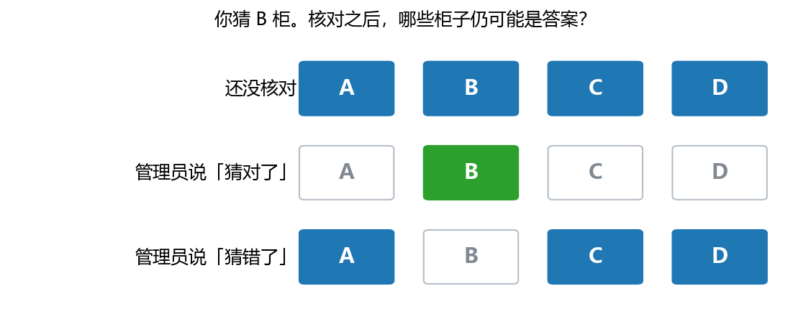

# 第 04 课　弱式 Fano 不等式与分类错误率下界

**本课目标（必学）**　读懂题目给了什么线索、要猜什么，能写出期中 Q5(a) 的弱式，算出 Q5(b) 中错误率至少有多高，并说明这个百分数的含义。[Week 6，第 38–43 页](<../../../AISCI5020/AISC5020 2026 Week 6.pdf>) · [期中卷 Q5，第 6 页](<../../../AISCI5020/Midterm Test Paper.pdf>)

## 1　引入 · 一条取件短信够不够用？

想象快递站有 A、B、C、D 四个柜子。我们玩一个猜柜号的游戏：工作人员等机会选一个柜子放包裹，你只能看取件短信，猜一次。先设短信每次都只写“已入柜”。即使你把这三个字读上十遍，你还是分不出今天放的是哪个柜子。

假如你决定每次都猜 B，四个等可能的答案里，有一个能猜对，另外三个会猜错。错误率是 $3/4=75\%$。改成每次猜 C，仍然只能猜中四种情况中的一种。如果短信改成直接给出正确柜号，你照着短信就能次次猜对。同样是四个柜子，结果可以差这么多，因为你看到的线索不同。

## 2　直觉 · 看看一次错误留下了什么

现在想象短信偶尔能帮上忙。你想知道这套短信究竟能让猜柜号的程序做得多好。可这次你手里只有一个汇总数字：看完短信后，柜号平均还剩多少不确定性。你没有每一条短信对应的真实柜号，没法像上一课那样逐条数错了几次。还能对错误率说些什么？

先跟着一次猜测走。你看完短信，猜 B。管理员知道正确答案，但只肯回答你“对”或“错”。他说“对”，你立刻就知道包裹在 B。他说“错”，你排除了 B，却还得在 A、C、D 中继续分辨。**只有猜错的轮次，在听完“对或错”之后才可能还需要额外提示。**

现在倒过来想：如果一个程序几乎次次猜对，管理员只需很少几次帮它在剩下的柜子中再作区分。反过来，如果看完短信后平均仍有很多信息要补，程序的错误就不可能少到任意程度。Fano 不等式把这段推理写成了一个能计算的限制。

## 3　几何 · 先遮住答案，再看管理员的反馈

**看图**　有颜色的柜子仍可能是答案。中间一行只剩 B；最下面一行剩下 A、C、D。管理员的反馈只是帮我们解释公式的想象步骤。程序作出预测时，能用的线索只有短信。

## 4　公式卡 · 弱式 Fano 不等式（weak Fano’s inequality）

用**期中卷**的记号。$Y$ 是真实类别（实际柜号），$X$ 是观测（猜之前能看到的短信），$M\ge2$ 是可能类别的个数。只用 $X$ 给出一个类别的规则叫分类器，猜的答案记为 $\widehat Y$。它的错误概率为 $P_e=P(\widehat Y\ne Y)$。条件熵 $H(Y\mid X)$ 是看完线索后，真实答案平均还剩多少不确定性，单位是 bit。

$$
P_e\ \ge\ \frac{H(Y\mid X)-1}{\log_2 M}.
$$

**怎么读。** 符号 $\ge$ 是“大于或等于”。右边提供错误率的 **lower bound（下界）**，意思是实际错误率至少有这么高。“弱式”表示在推导时把上限取得宽松一些，得到一个容易代入、对所有只用这些线索的分类器都成立的结论。Week 6 用 $X$ 表示真值、$Y$ 表示线索。读不同材料时，竖线左边始终放**要猜的真值**。

**为什么要减 $1$，又为什么要除？**

1. 要补全正确答案，先告诉你“猜对还是猜错”。这个问题只有两种答案，平均最多提供 $1$ bit 的信息。这里的 $1$ 是信息量。
2. 猜对时，正确答案已经确定。猜错时，最多还剩 $M-1$ 个候选。知道候选有多少后，最难分辨的是它们全都等可能的情形。要区分 $M$ 个等可能答案，信息量是 $\log_2 M$ bit，所以就算按全部 $M$ 个候选来估计，猜错时额外要补的信息也至多是 $\log_2 M$ bit。
3. 错误发生的比例是 $P_e$。把两步所需的信息按发生概率平均，便得到 $H(Y\mid X)\le 1+P_e\log_2 M$。两边减去 $1$，再除以正数 $\log_2 M$，就得到公式卡上的弱式。

**卡内例 · 短信每次只写“已入柜”。** 四个柜子等可能，短信又提供相同的消息。

- **第 0 步，认量。** 要猜四个柜号，$M=4$。四个等可能答案在看过短信后仍然等可能。
- **第 1 步，算剩余信息。** 区分四个等可能选项需要 $\log_2 4=2$ bit，因为 $2^2=4$。因此 $H(Y\mid X)=2$ bit。
- **第 2 步，求下界。** 代入得到 $P_e\ge(2-1)/2=1/2$，即错误概率至少 $50\%$。
- **第 3 步，换方法核对。** 每次猜 B，实际错误率是 $75\%$，满足 $75\%\ge50\%$。这个游戏使我们能直接数出实际值；弱式用较少的信息就能保证一个下限。

## 5　完整手算 · 期中 Q5(a,b)

**题意。** 试卷给出 $M=4$ 个类别。看到观测 $X$ 后，真实类别 $Y$ 的条件熵是 $1.6$ bit。题面已经给了这个值，直接用它就可以。

**第 0 步，区分已知和所求。** $4$ 是类别数，$1.6$ 是剩余的信息量。题目求的是 $P_e$ 的下界。这里的观测与引入中毫无区分力的短信是两种设定。

**第 1 步，答 (a)。** 对只用 $X$ 预测 $Y$ 的分类器，写出 $P_e=P(\widehat Y\ne Y)\ge[H(Y\mid X)-1]/\log_2 M$，对数以 $2$ 为底。

**第 2 步，算 (b) 的分母。** $\log_2 4$ 问“$2$ 的几次方等于 $4$？”因为 $2^2=4$，分母是 $2$。

**第 3 步，算分子。** 从题给的 $1.6$ bit 里减去“对或错”最多可提供的 $1$ bit，得到 $0.6$ bit。

**第 4 步，算比例并读结论。**

$$
P_e\ge\frac{1.6-1}{\log_2 4}=\frac{0.6}{2}=0.30=30\%.
$$

在题设的数据分布下，任何只使用观测 $X$ 的分类器，错误概率都至少为 $30\%$。检查方向时可以把一个声称的错误率代回去：若某人声称只有 $20\%$，则 $1+0.20\times2=1.4$ bit，装不下题给的 $1.6$ bit，因此这个声称与题设冲突。

## 6　独立复现

合上第 5 节，写出弱式。把类别数换成 $8$、条件熵换成 $2.2$ bit。按“类别数取对数 → 条件熵减一 → 相除 → 写出解释”做第 9 节的第 2 题。

## 7　易错点 · 什么时候只能写零？

- 题目问“至少”，答案要保留 $\ge$。只知道条件熵和类别数时，算出的界本身不能保证存在一个刚好达到它的模型。
- 当 $H(Y\mid X)\le1$ bit，弱式的右边小于或等于零。因为概率总是非负，把两条信息合起来，这个弱式只能给出 $P_e\ge0$。实际错误率仍可能很高。例如上课的配送卡里，给定规则确实会猜错。
- 如果只知道类别数，连观测提供多少信息都没规定，可以设 $X$ 就是正确柜号，此时照着读就能做到 $P_e=0$。所以仅凭类别数推不出一个对所有情况都成立的正下界。

## 8　与机器学习及上一课的联系

假设一棵**决策树**（decision tree，即通过一串问题逐步选出类别的程序）只读取短信文字来猜柜号。把树换成更复杂的神经网络，若输入仍只有同样的 $X$，两种模型都要遵守同一个下界。如果加入柜号条形码，程序能看到的线索变了，应当用包含条形码的新观测重新计算条件熵。[第 03 课板书](S016_第03课_熵与条件熵.md)

## 9　分层自测

### 独立练习

本课独练约 $15$ 分钟。先遮住公式和答案，优先做第 2、3 题。

1. **看图说理由。** 猜 B 之后听见“对”，为什么不需要再问柜号？听见“错”还剩几个柜子？公式中的 $1$ 与哪个问题有关？
2. **期中同型。** 有 $8$ 个类别，$H(Y\mid X)=2.2$ bit。闭卷写弱式，算出错误率下界，再用一句话解释。如果一个模型声称错误率是 $25\%$，它与题设相容吗？
3. **检查条件。** 四个类别，给定 $H(Y\mid X)=0.8$ bit，弱式能给出的非负下界是多少？若连条件熵也没给，仅凭“四个类别”，能保证错误率严格大于零吗？给一个情境说明。
4. **联系模型。** 某棵决策树与神经网络使用同样的输入。已知由弱式算出的错误率下界为 $30\%$。能否据此说“两种模型都会错 $30\%$”？如果新加一个能直接读出正确类别的传感器，应该用哪个观测来判断下界？

### 参考答案（先自己做完再看）

1. “对”说明正确柜号就是 B。听见“错”可排除 B，A、C、D 三个仍是候选。“对或错”是一个二选一的问题，平均最多提供 $1$ bit。
2. $P_e\ge[H(Y\mid X)-1]/\log_2 M$。分母 $\log_2 8=3$，分子 $2.2-1=1.2$，所以 $P_e\ge1.2/3=40\%$。只用 $X$ 的任何分类器，错误概率至少为 $40\%$。声称的 $25\%$ 低于该界，与题设冲突。
3. 代入得 $(0.8-1)/2=-0.1$。与概率非负合并，得到 $P_e\ge0$，无法由这个弱式确定实际错误率。只给类别数时，可以让短信直接写正确柜号，这时错误率可以恰好为零。
4. 两者的错误概率都至少为 $30\%$，实际值取决于各自的预测规则。加入传感器后，观测是“原输入和传感器读数”这一整体。若新读数能完全确定类别，剩余条件熵是零，照读便可全对。
