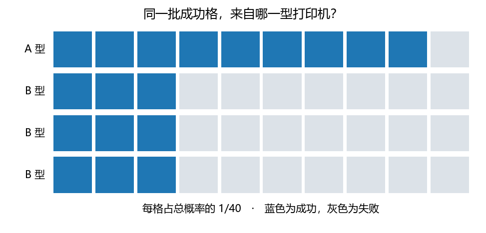

# 第 05 课　Bernoulli 似然与贝叶斯更新

**本课目标（必学）**　看到一张纸打印成功，能说清“假定机器是哪一型，这个结果多常见”和“已知这个结果，机器是哪一型的机会有多大”。能写出期中 Q6 用到的单次对数似然和整份样本的似然。[Week 5，第 11–12 页](<../../../AISCI5020/AISC5020 2026 Week 5.pdf>) · [Week 7，第 3–12 页](<../../../AISCI5020/AISC5020 2026 Week 7.pdf>) · [Week 8，第 3–5 页](<../../../AISCI5020/AISC5020 2026 Week 8.pdf>) · [期中卷 Q6，第 7 页](<../../../AISCI5020/Midterm Test Paper.pdf>)

## 1　引入 · 屏幕上只写着“打印成功”

你在图书馆上传了一页文件。后台从四台机器里等机会选一台，屏幕只报告是否成功。为了能把每步都算清，假设管理员告诉你：四台中有一台是 A 型，每次成功的机会为 $90\%$；另三台是 B 型，每台成功的机会为 $30\%$。

还没按下打印键时，机器被选中的机会很好数。四台里只有一台 A，所以这份任务发给 A 的机会是四分之一。现在你按下按钮，屏幕显示“成功”。这条新消息应该让你怎样修改刚才的四分之一？

## 2　直觉 · 先看机器，再看成功任务

如果提前告诉你任务交给了 A，你会很容易预料它能成功。如果告诉你交给了 B，成功仍然可能，只是出现得少一些。现在确实看见了成功，这条消息自然让 A 显得比刚才更可信。

但还有另一件事要考虑：被选到的 B 型机器本来就多。有些成功任务来自一台很可靠的 A，有些来自三台偶尔也能成功的 B。要知道成功之后该给 A 多大机会，可以把所有成功的任务放在一起，看看其中有多少来自 A。这一步把第一课学过的“该用谁作分母”用回来了。

## 3　几何 · 用同一张图换两次分母

**看图**　每行代表一台机器，每格占总概率的 $\tfrac1{40}$。先用纸盖住下面三行：已知 A，看上行十格，其中九格成功，所以 $P(\text{成功}\mid A)=9/10$。现在放开三行，只看所有蓝格：A 贡献九格，三台 B 合计也贡献九格，所以 $P(A\mid\text{成功})=9/18=1/2$。竖线读作“已知”，它右侧的条件决定你数哪些格。

## 4　公式卡 · 从一个观测到一串观测

### 4.1　伯努利模型与似然（Bernoulli model and likelihood）

某一页成功记为 $1$，失败记为 $0$。一次试验只有这两种结果，成功机会为 $\theta$，这叫**伯努利模型**。$\theta$ 读作 theta，是描述机器成功率的**参数**。大写 $X$ 表示还没揭晓的结果，小写 $x$ 表示实际记下的 $0$ 或 $1$。对 $0<\theta<1$，

$$
p(x\mid\theta)=\theta^x(1-\theta)^{1-x},\qquad x\in\{0,1\}.
$$

这个给每个离散结果分配概率的规则，叫**概率质量函数**。式中的指数只负责选项：$x=1$ 时得到 $\theta$，$x=0$ 时得到 $1-\theta$。现在把观测 $x$ 固定，逐个代入候选成功率，看谁更容易产生手里的记录。同一个表达式从这个角度使用，就叫**似然**，记作 $L(\theta;x)$。

**小例。** 如果手里的记录是一次失败，代入 $x=0$，有 $L(\theta;0)=1-\theta$。A 的似然是 $1-0.9=0.1$，B 的似然是 $1-0.3=0.7$。这次失败在 B 上出现的机会是 A 的七倍。检查同一台 B 的两种结果，$0.3+0.7=1$。拿不同机器来比较时，两个似然值相加可以与 $1$ 不同。

### 4.2　单个观测的对数似然（log-likelihood）

$$
\ell(\theta;x)=\ln L(\theta;x)=x\ln\theta+(1-x)\ln(1-\theta).
$$

$\ell$ 是对数似然，$\ln$ 是**自然对数**，底数为 $e\approx2.718$。它问“$e$ 的几次方等于这个数？”上一课量信息用以 $2$ 为底的对数，这里沿用试卷的自然对数。取对数后，乘积能写成和，幂次能移到前面；$\ln$ 随输入增大而增大，两个候选值的大小顺序也保留。

**小例。** 假设某台机器的成功率是 $0.5$，这次确实成功。先记 $x=1$，得到似然 $0.5$，再取自然对数 $\ell=\ln(0.5)\approx-0.693$。用 $e^{-0.693}\approx0.5$ 可以核对。负号很自然，介于零与一之间的数取自然对数就得到负数。期中 Q6(a) 从这一张公式卡起笔。

### 4.3　多次观测的样本似然（sample likelihood）

$$
L(\theta;x_1,\ldots,x_n)
=\prod_{i=1}^n\theta^{x_i}(1-\theta)^{1-x_i}
=\theta^k(1-\theta)^{n-k},\qquad k=\sum_{i=1}^n x_i.
$$

$n$ 是页数，$x_i$ 是第 $i$ 页的记录，$k$ 是成功页数，$n-k$ 是失败页数。$\prod$ 表示逐项相乘，$\sum$ 表示逐项相加。题面写 **i.i.d.（独立同分布）**，在这里指给定同一个成功率 $\theta$，各页互不影响、每页的成功概率相同。因此每个成功贡献一个 $\theta$，每个失败贡献一个 $1-\theta$。整份样本的对数似然也就等于 $k\ln\theta+(n-k)\ln(1-\theta)$。

**小例。** 一次选定机器，在同一台上连续试三页，记录依次为“成功、失败、成功”。有 $n=3$、$k=2$，所以似然为 $\theta(1-\theta)\theta=\theta^2(1-\theta)$。例如 $\theta=0.5$ 时，这个指定顺序的概率为 $0.5^3=1/8$。若问题改问“三页中恰有两页成功”，还要数哪一页失败，共三种排列；此时概率为 $3/8$。两者间的排列数与 $\theta$ 无关。

### 4.4　贝叶斯公式（Bayes’ rule）

设成功率只有两个候选值，各自对应一种机型。用 $\Theta$ 表示尚未知晓的成功率，用 $\theta_j$ 表示其中一个候选值，$j$ 是给候选值编的号。记 $\pi_j=P(\Theta=\theta_j)$。只要观测 $x$ 有正概率，就有

$$
P(\Theta=\theta_j\mid X=x)
=\frac{\pi_j L(\theta_j;x)}{\sum_r\pi_r L(\theta_r;x)}.
$$

**先验（prior）**是看记录之前分给各候选值的概率 $\pi_j$。先验乘似然，是“选中这一型且看见这条记录”的**联合概率**。分母按所有候选值把这些联合概率加起来，就是**证据（evidence）**，即本来有多大机会看见这条记录。除以同一个分母，各候选值的新概率之和就等于 $1$；这个动作叫**归一化**。更新后的概率叫**后验（posterior）**。

**小例。** 假设另外一个机房只有 A、B 各一台，仍等机会选机。这次观察到成功。A 的联合概率为 $0.5\times0.9=0.45$，B 的为 $0.5\times0.3=0.15$。证据为 $0.45+0.15=0.60$，A 的后验为 $0.45/0.60=0.75$，B 的后验为 $0.25$。相加回到 $1$。换了机房，观察到的都是成功，起初两型机器的占比会影响更新结果。

## 5　完整手算 · 回到图书馆的一次成功

**第 0 步，圈出已知。** 已知 $x=1$，候选成功率为 $0.9$（A）和 $0.3$（B）。按选机规则，A 的先验是 $1/4$，B 的先验是 $3/4$。

| 机型 | 先验 | 看到这次成功的似然 | 选中该型且成功的概率 |
|---|---:|---:|---:|
| A | $1/4$ | $9/10$ | $9/40$ |
| B | $3/4$ | $3/10$ | $9/40$ |

**第 1 步，算分子。** A 这条路径的概率为 $(1/4)(9/10)=9/40$。B 这条路径为 $(3/4)(3/10)=9/40$。

**第 2 步，用全概率求证据。** 两种机型覆盖所有选机情况，一次任务只由其中一台执行。将两条成功路径相加，$P(X=1)=9/40+9/40=18/40=0.45$。

**第 3 步，换分母。** 已知成功，只在总量为 $18/40$ 的成功任务中算比例。A 的后验为 $(9/40)/(18/40)=1/2$，B 的同样为 $1/2$。

**第 4 步，对照图解读。** 看见成功前，A 只占四行中的一行；看见成功后，A 占十八个蓝格中的九格。于是对“选中 A”的判断从 $25\%$ 升至 $50\%$。机型自身的成功率仍由题设给定。

## 6　独立复现

遮住第 4 节，先用一次失败写出似然，再为一串有成功也有失败的记录写似然。最后单独做一题更新：当机器的初始占比和成功率都换了，已知打印失败，应当把哪两条路径放进分母？数据在第 9 节第 2、3 题。

## 7　容易混淆的三处

- **读条件方向。** $P(X=1\mid A)$ 的分母是所有 A 型任务，$P(A\mid X=1)$ 的分母是所有成功任务。
- **认清哪个量在变。** 写 $L(\theta;x_1,\ldots,x_n)$ 时，记录、总页数和成功次数已经确定。把不同的 $\theta$ 代入，两个因子 $\theta^k$ 和 $(1-\theta)^{n-k}$ 都可能随之变化。
- **看清记录方式。** 试卷 Q6 写出的是观测序列，直接把各次的概率相乘。若只记录了成功总数，把所有符合计数的排列合并时才出现组合数。[期中卷第 7 页](<../../../AISCI5020/Midterm Test Paper.pdf>)

## 8　与第一课、机器学习和期中题的联系

第一课先分组、再把各组对同一事件的贡献相加。这里“事件”就是打印成功，两个组就是 A 和 B，全概率给出贝叶斯公式的分母。[第 01 课板书](S014_第01课_全期望.md)

例如，一个邮件过滤器用 **logistic regression（逻辑回归）**根据每封邮件的内容给出“垃圾邮件”的概率。真实标签为 $1$ 的邮件贡献模型给它的成功概率，真实标签为 $0$ 的邮件贡献对应的失败概率。训练时可把这些概率的自然对数相加。各邮件的预测概率可以不同，每封邮件使用的都是本课的单次伯努利公式。

期中 Q6(a) 从单个观测的对数似然出发，第 06 课会对它求导。Q6(c) 用整串观测的似然更新成功率，第 07 课会将今天的两个候选值推广到一整段连续取值。

## 9　分层自测

### 独立练习

课内独练约 $15$ 分钟，优先做第 2、3 题。

1. **读图。** 同样是九个 A 型成功格，$9/10$ 和 $9/18$ 分别回答什么问题？如果只知道 A 的成功率很高，还需要什么信息才能求成功后的机型概率？
2. **期中记号。** 单次观察到失败，写出 $L(\theta;0)$ 与 $\ell(\theta;0)$。另一次在同一台机器上得到序列 $(0,1,0,1,0)$；给定 $\theta$ 时各次独立。写出乘积、合并后的似然及对数似然，指出哪些量已固定。
3. **换数做更新。** 一次任务有 $1/3$ 的机会发给成功率 $0.8$ 的 A 型，有 $2/3$ 的机会发给成功率 $0.2$ 的 B 型。现在看到**失败**。用两条失败路径求证据，再求 A、B 的后验概率。
4. **联系模型。** 一封邮件实际为普通邮件，标签为 $0$。模型给它的垃圾邮件概率是 $0.8$。这封邮件的似然和对数似然分别是多少？若模型改报 $0.3$，哪次预测更符合记录？

### 参考答案（先自己做完再看）

1. $9/10$ 是已知选中 A 后打印成功的概率。$9/18$ 是已知成功后选中 A 的概率。还要知道各型被选中的概率，以及其他机型成功的概率，才能算出所有成功任务所占的份额。
2. 一次失败给 $L=1-\theta$、$\ell=\ln(1-\theta)$。序列的似然为 $(1-\theta)\theta(1-\theta)\theta(1-\theta)=\theta^2(1-\theta)^3$，其对数为 $2\ln\theta+3\ln(1-\theta)$。$n=5$、$k=2$、$n-k=3$ 和观测顺序已固定；式中待比较的量是 $\theta$。
3. A 的失败似然为 $0.2=1/5$，B 的为 $0.8=4/5$。两条失败路径的概率为 $(1/3)(1/5)=1/15$ 与 $(2/3)(4/5)=8/15$。证据是 $9/15=3/5$。A 的后验是 $(1/15)/(9/15)=1/9$，B 的是 $8/9$，合计为 $1$。
4. 标签为 $0$，所以应取 $1-0.8=0.2$，对数似然是 $\ln0.2\approx-1.609$。改报 $0.3$ 后，普通邮件的概率为 $0.7$，对数似然 $\ln0.7\approx-0.357$ 更大。第二次预测给真实标签分配了更高概率。
