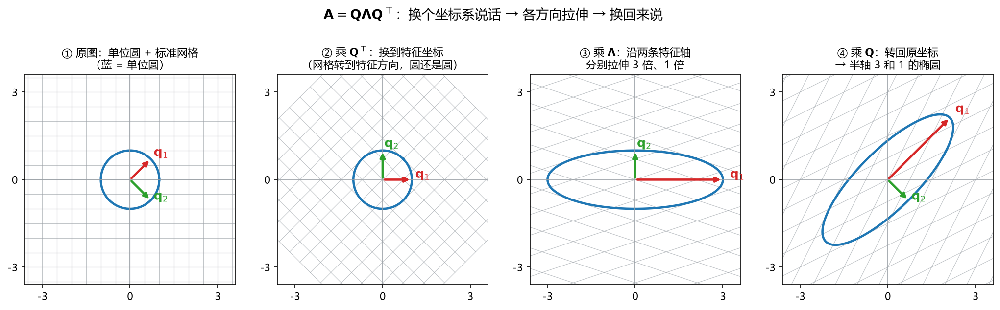

# 板书 · S005 · 第 05 课：迹、行列式、对称与正定

- 会话ID：`S005`
- 日期：2026-10-26
- 对应：L05 / M1
- 修订记录：（初版）2026-10-26；（v2）2026-10-26 5.5 补「$\operatorname{diag}$ 记号」说明（英文全称、两种用法、$2\times2$ 展开例）；（v3）2026-10-26 5.4 补「实对称 vs 对称」的区别与复数反例；（v4）2026-10-26 5.4 扩写为 5.4.1：定义、对比表、复数反例推导、Hermitian、对称≠正定；（v5）2026-10-27 5.5 补 5.5.1「从 $\mathbf{A}$ 算 $\mathbf{Q}$、$\boldsymbol{\Lambda}$ 的四步 + 验算」与 5.5.2「题型表」；（v6）2026-10-27 5.5 补 5.5.3「$\mathbf{Q}^\top\mathbf{Q}=\mathbf{I}$ 的来历（内积表、谱定理两行证明、重根、方阵逆、几何意义）」；（v7）2026-10-27 5.5 补 5.5.4「换坐标 → 拉伸 → 换回来」+ 新图 `图片/fig_spectral_steps.png`（四格：圆／换网格／拉伸／转回）；（v8）2026-10-27 5.6 扩写为 5.6.1「四种求法：代入／交叉项对半分／化标准形／配方」、5.6.2「四个视角：代数打包／瑞利商／曲率／对称部分」、5.6.3「四种问法」+ 新图 `图片/fig_quadratic_contours.png`；（v9）2026-10-27 5.6 再扩写为 5.6.4–5.6.10「直觉三层（投影/加权平方/‖Bx‖²）/ 几何（半轴 √(c/λ)、κ 与长短轴）/ 四个计算案例（三变量反推、配方+合同变换、正交对角化+瑞利商、带参数判正定）/ ML 六场景（岭回归、PCA、高斯-马氏、牛顿、SVM、Gauss–Newton）/ 与正交对角化（相似 vs 合同、惯性定律）/ 与 Hessian（∇²q=2A、Taylor、主曲率、κ 与 GD 收敛）/ 主线图+速查+易错 5 条+三题自测」

---

## 0. 生活化引入

体检报告不会只给你一个数字：身高、体重、血压各管一件事。

矩阵也是这样：**迹（trace）**和**行列式（determinant）**是两个“总指标”，
而**特征值（eigenvalue）**是分项指标。今天要学的，就是这三者怎么对得上，
以及怎么用它们判断一个矩阵是不是**正定（positive definite）**——也就是“往哪个方向走都上坡”的那种矩阵。

---

## 1. 直觉

| 对象                                 | 一句话直觉                                                                            |
| ------------------------------------ | ------------------------------------------------------------------------------------- |
| 迹 $\operatorname{tr}(\mathbf{A})$ | 主对角线加起来；等于所有特征值之和                                                    |
| 行列式 $\det(\mathbf{A})$          | 面积/体积缩放倍数；等于所有特征值之积                                                 |
| 对称矩阵（symmetric matrix）         | 沿主对角线翻面不变；特征方向互相垂直                                                  |
| 正定（positive definite）            | 对任何非零 $\mathbf{x}$，二次型 $\mathbf{x}^\top\mathbf{A}\mathbf{x}>0$：碗底朝上 |
| 半正定（positive semidefinite）      | 允许某些方向“平”，但绝不下坡：$\ge 0$                                             |
| 不定（indefinite）                   | 有的方向上坡、有的方向下坡：马鞍面                                                    |

---

## 2. 几何


**看图**：

- 蓝色单位圆被对称矩阵 $\mathbf{A}=\begin{bmatrix}2&1\\1&2\end{bmatrix}$ 拉成椭圆，红、绿两条轴就是特征方向。
- 因为 $\mathbf{A}$ 对称，这两条特征方向**互相垂直**；这正是 $A=QDQ^\top$ 里 $Q$ 能取成正交矩阵的几何原因。
- 两个特征值 $3,1$ 都为正，椭圆没有被“翻转”，二次型 $\mathbf{x}^\top\mathbf{A}\mathbf{x}$ 的等高线是一圈圈**椭圆**，
  中心最低——像一只碗。
- 若一个特征值为正、一个为负（如 $\begin{bmatrix}1&2\\2&1\end{bmatrix}$，$\lambda=3,-1$），
  等高线就变成**双曲线**，原点变成**马鞍点（saddle point）**：沿一个方向上坡，沿另一个方向下坡。

> 一句话：**特征值定“每个方向是上坡还是下坡”，对称性保证这些方向互相垂直。**

---

## 3. 计算（公式卡片）

> 统一用 $\mathbf{A}=\begin{bmatrix}2&1\\1&2\end{bmatrix}$ 当例子；
> 对照矩阵 $\mathbf{B}=\begin{bmatrix}1&2\\2&1\end{bmatrix}$、$\mathbf{C}=\begin{bmatrix}1&1\\1&1\end{bmatrix}$。

### 5.1 迹的定义（trace）

$$
\operatorname{tr}(\mathbf{A})=\sum_{i=1}^{n}a_{ii}
$$

- **符号**：$a_{ii}$ 是主对角线元素（第 $i$ 行第 $i$ 列）；结果是一个**数**，不是矩阵。
- **含义**：对角线上的“拉伸总量”的粗略汇总。
- **例**：$\mathbf{A}=\begin{bmatrix}2&1\\1&2\end{bmatrix}$，$\operatorname{tr}(\mathbf{A})=2+2=4$。

### 5.2 迹等于特征值之和（trace = sum of eigenvalues）

$$
\operatorname{tr}(\mathbf{A})=\sum_{i=1}^{n}\lambda_i
$$

- **符号**：$\lambda_i$ 是第 $i$ 个特征值，按重数计（重根算两次）。
- **用途**：算完特征值后，用这一条**快速验算**。
- **例**：L04 已算出 $\lambda_1=3,\lambda_2=1$，$3+1=4=\operatorname{tr}(\mathbf{A})$ ✓。

### 5.3 行列式等于特征值之积（determinant = product of eigenvalues）

$$
\det(\mathbf{A})=\prod_{i=1}^{n}\lambda_i
$$

- **符号**：$\prod$ 是连乘；$n\times n$ 矩阵有 $n$ 个特征值（含重根、复根）。
- **用途**：第二条验算；也能立刻看出“有没有 $0$ 特征值”。
- **例**：$3\times1=3$；直接算 $\det(\mathbf{A})=2\cdot2-1\cdot1=3$ ✓。
- **推论**：$\det(\mathbf{A})=0\iff$ 某个 $\lambda_i=0\iff\mathbf{A}$ 不可逆。

### 5.4 对称矩阵（symmetric matrix）

$$
\mathbf{A}=\mathbf{A}^\top
\quad\Longleftrightarrow\quad
a_{ij}=a_{ji}\ \text{对所有 }i,j
$$

- **符号**：$\mathbf{A}^\top$ 是转置；条件就是“关于主对角线镜像对称”。
- **性质**：实对称矩阵的特征值全是实数，且不同特征值的特征向量互相正交。
- **例**：$\mathbf{A}=\begin{bmatrix}2&1\\1&2\end{bmatrix}$ 对称；
  $\mathbf{R}=\begin{bmatrix}0&-1\\1&0\end{bmatrix}$ 不对称（$a_{12}=-1\ne1=a_{21}$），它的特征值是 $\pm i$。

> **“实对称”与“对称”的区别**：**对称**只要求 $\mathbf{A}=\mathbf{A}^\top$，元素可以是复数；
> **实对称（real symmetric）**在此基础上再要求**所有元素都是实数**。所以“实对称”是“对称”的子集。
> 本课程默认矩阵元素为实数，因此平时说“对称矩阵”通常就是指实对称；
> 但一旦要引用“特征值为实、特征向量正交、$\mathbf{A}=\mathbf{Q}\boldsymbol{\Lambda}\mathbf{Q}^\top$”这条谱定理，
> 前提必须写清楚是**实对称**。
> 复数矩阵的正确推广不是普通对称，而是 **Hermitian（共轭对称）**：$\mathbf{A}=\mathbf{A}^H$（转置再取共轭）。
> 反例：$\begin{bmatrix}1&i\\i&1\end{bmatrix}$ 满足 $\mathbf{A}=\mathbf{A}^\top$，但它不是实矩阵，
> 特征值是 $1\pm i$，并不都是实数。

#### 5.4.1 “对称”与“实对称”的完整对比（symmetric vs real symmetric）

**定义拆开看**

- **对称矩阵（symmetric matrix）**：只要求 $\mathbf{A}=\mathbf{A}^\top$，即 $a_{ij}=a_{ji}$；
  元素可以是实数，也可以是复数。定义里**没有**“元素是实数”这一条。
- **实对称矩阵（real symmetric matrix）**：在 $\mathbf{A}=\mathbf{A}^\top$ 之外，再要求**每个元素都是实数**，
  即 $a_{ij}\in\mathbb{R}$。

所以：

$$
\text{实对称矩阵}\ \subset\ \text{对称矩阵}
$$

| 对比项     | 对称矩阵                       | 实对称矩阵                                                                      |
| ---------- | ------------------------------ | ------------------------------------------------------------------------------- |
| 元素       | 可为复数                       | 必须全为实数                                                                    |
| 条件       | $\mathbf{A}=\mathbf{A}^\top$ | $\mathbf{A}=\mathbf{A}^\top$ 且 $a_{ij}\in\mathbb{R}$                       |
| 特征值     | 不保证是实数                   | **一定是实数**                                                            |
| 特征向量   | 不保证正交                     | **可选成一组正交单位向量**                                                |
| 正交对角化 | 不一定存在                     | **一定存在** $\mathbf{A}=\mathbf{Q}\boldsymbol{\Lambda}\mathbf{Q}^\top$ |

**为什么“实”这个字不能省：一个复数反例**

$$
\mathbf{A}=\begin{bmatrix}1&i\\i&1\end{bmatrix}
$$

它满足 $\mathbf{A}^\top=\mathbf{A}$（$a_{12}=a_{21}=i$），所以它确实是“对称矩阵”。

但它的特征多项式是

$$
\det(\mathbf{A}-\lambda\mathbf{I})
=(1-\lambda)^2-i^2
=(1-\lambda)^2+1
=\lambda^2-2\lambda+2
$$

求根：

$$
\lambda=\frac{2\pm\sqrt{4-8}}{2}
=\frac{2\pm2i}{2}
=1\pm i
$$

**特征值不是实数**。所以“对称”本身不能保证谱定理的那些好性质；必须是**实**对称。

**复数矩阵的正确推广：Hermitian（共轭对称）**

$$
\mathbf{A}=\mathbf{A}^H
$$

其中 $\mathbf{A}^H$ 表示“先转置、再取共轭”。Hermitian 矩阵才有
“特征值为实、可酉对角化 $\mathbf{A}=\mathbf{U}\boldsymbol{\Lambda}\mathbf{U}^H$”这些性质。
实对称矩阵是 Hermitian 矩阵在实数域上的特例。

**对称 ≠ 正定**

“对称”描述的是**形状**（关于主对角线镜像）；“正定”描述的是**二次型的符号**（每个方向是否上坡）。
同一个对称矩阵，可以是正定、半正定或不定：

$$
\begin{bmatrix}2&1\\1&2\end{bmatrix}\ \text{正定},
\qquad
\begin{bmatrix}1&1\\1&1\end{bmatrix}\ \text{半正定},
\qquad
\begin{bmatrix}1&2\\2&1\end{bmatrix}\ \text{不定}
$$

> 考试写法：要引用谱定理时写 **“$\mathbf{A}$ 是实对称矩阵”**；
> 只写“对称”在实数矩阵的语境下通常也能被接受，但不严谨。

### 5.5 正交对角化 / 谱分解（orthogonal diagonalization / spectral decomposition）

$$
\mathbf{A}=\mathbf{Q}\boldsymbol{\Lambda}\mathbf{Q}^\top,
\qquad
\mathbf{Q}^\top\mathbf{Q}=\mathbf{I},
\qquad
\boldsymbol{\Lambda}=\operatorname{diag}(\lambda_1,\dots,\lambda_n)
$$

- **符号**：$\mathbf{Q}$ 的每一列是一个**单位**特征向量，且列与列正交；$\boldsymbol{\Lambda}$ 是对角矩阵，对角线上放特征值。
- **适用**：$\mathbf{A}$ 是**实对称**矩阵。非对称矩阵一般不能这样正交分解。
- **含义**：先转到特征方向（$\mathbf{Q}^\top$），在各方向分别拉伸（$\boldsymbol{\Lambda}$），再转回来（$\mathbf{Q}$）。
- **例**：$\mathbf{Q}=\dfrac{1}{\sqrt2}\begin{bmatrix}1&1\\1&-1\end{bmatrix}$，
  $\boldsymbol{\Lambda}=\begin{bmatrix}3&0\\0&1\end{bmatrix}$，可验证 $\mathbf{Q}\boldsymbol{\Lambda}\mathbf{Q}^\top=\mathbf{A}$。

> **记号 $\operatorname{diag}$ 怎么读**：$\operatorname{diag}$ 是 **diagonal（对角）** 的缩写，
> 意思是“把括号里的数按顺序放到主对角线上，其余位置全填 $0$”。所以
> $\boldsymbol{\Lambda}=\operatorname{diag}(\lambda_1,\dots,\lambda_n)$ 就是
> $\begin{bmatrix}\lambda_1&0&\cdots&0\\0&\lambda_2&\cdots&0\\\vdots&\vdots&\ddots&\vdots\\0&0&\cdots&\lambda_n\end{bmatrix}$。
> $n=2$ 时：$\operatorname{diag}(3,1)=\begin{bmatrix}3&0\\0&1\end{bmatrix}$。
> 注意 $\operatorname{diag}$ 有两种常见用法：`diag(向量)` 把向量变成对角矩阵；
> `diag(矩阵)` 取出矩阵的主对角线元素组成向量。这里用的是第一种。
> 大写 $\boldsymbol{\Lambda}$ 只是“对角矩阵”的专用符号，读作 Lambda；小写 $\lambda_i$ 才是特征值本身。

#### 5.5.1 从 $\mathbf{A}$ 算出 $\mathbf{Q}$ 和 $\boldsymbol{\Lambda}$（四步 + 一步验算）

> **前提**：$\mathbf{A}$ 必须是**实对称**矩阵。非对称矩阵一般写不出 $\mathbf{Q}\boldsymbol{\Lambda}\mathbf{Q}^\top$
> （只能写 $\mathbf{A}=\mathbf{P}\boldsymbol{\Lambda}\mathbf{P}^{-1}$，此时 $\mathbf{P}^\top\mathbf{P}\ne\mathbf{I}$）。

**第 0 步：确认对称。** 检查 $a_{12}=a_{21}$。不对称就停，别硬套公式。

**第 1 步：用 $\operatorname{tr}$、$\det$ 解特征方程，得特征值。**

$$
\lambda^2-\operatorname{tr}(\mathbf{A})\lambda+\det(\mathbf{A})=0
$$

以 $\mathbf{A}=\begin{bmatrix}2&1\\1&2\end{bmatrix}$ 为例：$\operatorname{tr}=4$、$\det=3$，

$$
\lambda^2-4\lambda+3=0
\quad\Longrightarrow\quad
(\lambda-3)(\lambda-1)=0
\quad\Longrightarrow\quad
\lambda_1=3,\ \lambda_2=1
$$

**第 2 步：对每个 $\lambda$ 解 $(\mathbf{A}-\lambda\mathbf{I})\mathbf{v}=\mathbf{0}$。**

$$
\lambda_1=3:\quad
\mathbf{A}-3\mathbf{I}=\begin{bmatrix}-1&1\\1&-1\end{bmatrix}
\ \Rightarrow\ -x+y=0
\ \Rightarrow\ \mathbf{v}_1=\begin{bmatrix}1\\1\end{bmatrix}
$$

$$
\lambda_2=1:\quad
\mathbf{A}-\mathbf{I}=\begin{bmatrix}1&1\\1&1\end{bmatrix}
\ \Rightarrow\ x+y=0
\ \Rightarrow\ \mathbf{v}_2=\begin{bmatrix}1\\-1\end{bmatrix}
$$

> **$2\times2$ 速算**：若 $\mathbf{A}=\begin{bmatrix}a&b\\b&d\end{bmatrix}$ 且 $b\ne0$，
> 则对应特征值 $\lambda$ 的特征向量可直接取 $\mathbf{v}=\begin{bmatrix}b\\\lambda-a\end{bmatrix}$。
> 本题 $\lambda=3$ 给 $(1,1)$、$\lambda=1$ 给 $(1,-1)$，与上面一致。

**第 3 步：单位化（除以自己的长度）。**

$$
\|\mathbf{v}_1\|=\sqrt{1^2+1^2}=\sqrt2,\quad
\mathbf{q}_1=\frac{1}{\sqrt2}\begin{bmatrix}1\\1\end{bmatrix};
\qquad
\|\mathbf{v}_2\|=\sqrt2,\quad
\mathbf{q}_2=\frac{1}{\sqrt2}\begin{bmatrix}1\\-1\end{bmatrix}
$$

**第 4 步：$\mathbf{q}$ 按列排成 $\mathbf{Q}$，$\lambda$ 按同一顺序排成 $\boldsymbol{\Lambda}$。**

$$
\mathbf{Q}=\begin{bmatrix}\mathbf{q}_1&\mathbf{q}_2\end{bmatrix}
=\frac{1}{\sqrt2}\begin{bmatrix}1&1\\1&-1\end{bmatrix},
\qquad
\boldsymbol{\Lambda}=\begin{bmatrix}\lambda_1&0\\0&\lambda_2\end{bmatrix}
=\begin{bmatrix}3&0\\0&1\end{bmatrix}
$$

> **顺序必须对得上**：第 1 列 $\mathbf{q}_1$ 配 $\Lambda_{11}=3$，第 2 列 $\mathbf{q}_2$ 配 $\Lambda_{22}=1$。
> 交换两列就必须同时交换两个特征值；只换一个，等式立刻不成立。

**第 5 步：验算。** 最省力的是逐列验 $\mathbf{A}\mathbf{Q}=\mathbf{Q}\boldsymbol{\Lambda}$：

$$
\mathbf{A}\mathbf{Q}
=\frac{1}{\sqrt2}\begin{bmatrix}2&1\\1&2\end{bmatrix}\begin{bmatrix}1&1\\1&-1\end{bmatrix}
=\frac{1}{\sqrt2}\begin{bmatrix}3&1\\3&-1\end{bmatrix}
=\mathbf{Q}\boldsymbol{\Lambda}
$$

因为 $\mathbf{Q}^\top\mathbf{Q}=\mathbf{I}$ 即 $\mathbf{Q}^{-1}=\mathbf{Q}^\top$，两边右乘 $\mathbf{Q}^\top$ 就得

$$
\mathbf{A}=\mathbf{Q}\boldsymbol{\Lambda}\mathbf{Q}^\top
=\frac12\begin{bmatrix}3&1\\3&-1\end{bmatrix}\begin{bmatrix}1&1\\1&-1\end{bmatrix}
=\frac12\begin{bmatrix}4&2\\2&4\end{bmatrix}
=\begin{bmatrix}2&1\\1&2\end{bmatrix}\ \checkmark
$$

**三个“自由度”与三条红线**

| 项目 | 可以变                                                                                               | 不能变                                             |
| ---- | ---------------------------------------------------------------------------------------------------- | -------------------------------------------------- |
| 符号 | $\mathbf{q}$ 换成 $-\mathbf{q}$ 仍合法（$\mathbf{Q}\boldsymbol{\Lambda}\mathbf{Q}^\top$ 不变） | ——                                               |
| 顺序 | 两列一起换、两个 $\lambda$ 一起换                                                                  | 只换一边                                           |
| 长度 | 用 $\mathbf{v}$ 算也行                                                                             | 最后放进 $\mathbf{Q}$ 的必须是**单位**向量 |

**两个特殊情况**

- **重根**（$\lambda_1=\lambda_2$）：该特征空间是一整个平面，要在这个平面里**自己挑两个互相垂直的单位向量**
  （Gram–Schmidt），否则 $\mathbf{Q}$ 不正交。例如 $\mathbf{A}=2\mathbf{I}$：任取一组正交单位向量都行。
- **非对称**：$\mathbf{Q}^\top\ne\mathbf{Q}^{-1}$，$A=Q\Lambda Q^\top$ 直接失效——这是最常见的前提错误。

#### 5.5.2 这类题通常怎么出

| 题型                   | 问法                                                                                                                             | 要写什么                                                                              | 本课程优先级 |
| ---------------------- | -------------------------------------------------------------------------------------------------------------------------------- | ------------------------------------------------------------------------------------- | ------------ |
| ① 标准型              | “求正交矩阵 $\mathbf{Q}$ 与对角阵 $\boldsymbol{\Lambda}$，使 $\mathbf{A}=\mathbf{Q}\boldsymbol{\Lambda}\mathbf{Q}^\top$” | 四步全写 + $\mathbf{Q}^\top\mathbf{Q}=\mathbf{I}$                                   | **P0** |
| ② 只要特征值/向量     | “求 $\mathbf{A}$ 的全部特征值与特征向量”                                                                                     | 特征方程 + $(\mathbf{A}-\lambda\mathbf{I})\mathbf{v}=0$                             | **P0** |
| ③ 验算型              | “用 $\operatorname{tr}$、$\det$ 验证你算出的特征值”                                                                        | $\sum\lambda_i=\operatorname{tr}$、$\prod\lambda_i=\det$                          | **P0** |
| ④ 判正定              | “判断 $\mathbf{A}$ 是否正定”                                                                                                 | $\lambda_i>0$，或 $a>0$ 且 $\det>0$                                             | **P0** |
| ⑤ 反推 $\mathbf{A}$ | 给 $\lambda_i$ 和 $\mathbf{q}_i$，求 $\mathbf{A}$                                                                          | 谱分解 $\mathbf{A}=\sum_i\lambda_i\mathbf{q}_i\mathbf{q}_i^\top$                    | P1           |
| ⑥ 化简二次型          | “把 $\mathbf{x}^\top\mathbf{A}\mathbf{x}$ 化成标准形”                                                                        | 令 $\mathbf{y}=\mathbf{Q}^\top\mathbf{x}$，得 $\lambda_1y_1^2+\lambda_2y_2^2$     | P1           |
| ⑦ 求幂/逆             | “求 $\mathbf{A}^{10}$ 或 $\mathbf{A}^{-1}$”                                                                                | $\mathbf{A}^k=\mathbf{Q}\boldsymbol{\Lambda}^k\mathbf{Q}^\top$                      | P1           |
| ⑧ 极值/条件数         | “$\mathbf{x}^\top\mathbf{A}\mathbf{x}$ 在 $\|\mathbf{x}\|=1$ 上的最大/最小值”                                              | 就是 $\lambda_{\max}$、$\lambda_{\min}$；$\kappa=\lambda_{\max}/\lambda_{\min}$ | P2           |

> **陷阱选项**（选择题常见）：给一个非对称矩阵问“能否正交对角化”；给 $\det>0$ 但负定的 $-\mathbf{I}$；
> 给重根矩阵要求 $\mathbf{Q}$ 却不给正交化步骤。

#### 5.5.3 为什么 $\mathbf{Q}^\top\mathbf{Q}=\mathbf{I}$

**直觉**：$\mathbf{Q}^\top\mathbf{Q}$ 就是一张“**所有列两两做内积**的表格”。
对角线是“自己和自己内积”（长度平方），非对角线是“不同列的内积”（夹角信息）。

把 $\mathbf{Q}=\begin{bmatrix}\mathbf{q}_1&\mathbf{q}_2\end{bmatrix}$ 按列拆开：

$$
\mathbf{Q}^\top\mathbf{Q}
=\begin{bmatrix}\mathbf{q}_1^\top\\ \mathbf{q}_2^\top\end{bmatrix}
\begin{bmatrix}\mathbf{q}_1&\mathbf{q}_2\end{bmatrix}
=\begin{bmatrix}
\mathbf{q}_1^\top\mathbf{q}_1 & \mathbf{q}_1^\top\mathbf{q}_2\\
\mathbf{q}_2^\top\mathbf{q}_1 & \mathbf{q}_2^\top\mathbf{q}_2
\end{bmatrix}
$$

要它等于 $\mathbf{I}$，等价于两个条件：

$$
\|\mathbf{q}_1\|=\|\mathbf{q}_2\|=1
\quad\text{（对角线 = 1，单位长度）},
\qquad
\mathbf{q}_1^\top\mathbf{q}_2=0
\quad\text{（非对角线 = 0，互相垂直）}
$$

合起来就是：**$\mathbf{Q}$ 的列是一组正交单位向量（orthonormal columns）**。

**这两个条件分别从哪来？**

1. **单位长度——是我们自己做的**。第 3 步除以 $\|\mathbf{v}\|$ 就是为了这个。不是定理，是操作。
2. **互相垂直——是实对称矩阵给的**（谱定理）。证明只需两行：

   设 $\mathbf{A}\mathbf{q}_1=\lambda_1\mathbf{q}_1$、$\mathbf{A}\mathbf{q}_2=\lambda_2\mathbf{q}_2$，且 $\lambda_1\ne\lambda_2$。考察 $\mathbf{q}_1^\top\mathbf{A}\mathbf{q}_2$：

   $$
   \mathbf{q}_1^\top\mathbf{A}\mathbf{q}_2
   =\mathbf{q}_1^\top(\lambda_2\mathbf{q}_2)=\lambda_2\,\mathbf{q}_1^\top\mathbf{q}_2
   $$

   另一方面，用 $\mathbf{A}=\mathbf{A}^\top$ 把 $\mathbf{A}$ 挪到左边：

   $$
   \mathbf{q}_1^\top\mathbf{A}\mathbf{q}_2
   =(\mathbf{A}\mathbf{q}_1)^\top\mathbf{q}_2
   =\lambda_1\,\mathbf{q}_1^\top\mathbf{q}_2
   $$

   两式相减：

   $$
   (\lambda_1-\lambda_2)\,\mathbf{q}_1^\top\mathbf{q}_2=0
   \quad\xRightarrow{\ \lambda_1\ne\lambda_2\ }\quad
   \mathbf{q}_1^\top\mathbf{q}_2=0
   $$

   > 关键就在 $\mathbf{A}=\mathbf{A}^\top$：**非对称矩阵这一步过不去**，因为 $(\mathbf{A}\mathbf{q}_1)^\top=\mathbf{q}_1^\top\mathbf{A}^\top\ne\mathbf{q}_1^\top\mathbf{A}$。

3. **重根怎么办**：$\lambda_1=\lambda_2$ 时上式不给出结论（两边都等于 $0$）。但同一个特征值的特征向量全体构成一个平面，
   在这个平面里可以任取一组正交单位向量（Gram–Schmidt）——谱定理保证“一定**选**得出来”。

**具体验算（本题）**

$$
\mathbf{Q}^\top\mathbf{Q}
=\frac12\begin{bmatrix}1&1\\1&-1\end{bmatrix}\begin{bmatrix}1&1\\1&-1\end{bmatrix}
=\frac12\begin{bmatrix}1+1 & 1-1\\ 1-1 & 1+1\end{bmatrix}
=\frac12\begin{bmatrix}2&0\\0&2\end{bmatrix}
=\mathbf{I}
$$

那个 $\frac{1}{\sqrt2}$ 的作用正是在这里显现：**它把对角线从 $2$ 拉回 $1$**。

**忘了单位化会怎样**：取 $\tilde{\mathbf{Q}}=\begin{bmatrix}1&1\\1&-1\end{bmatrix}$，则 $\tilde{\mathbf{Q}}^\top\tilde{\mathbf{Q}}=2\mathbf{I}$。
公式得改成 $\mathbf{A}=\tilde{\mathbf{Q}}\left(\frac12\boldsymbol{\Lambda}\right)\tilde{\mathbf{Q}}^\top$——
归一化常数最终是“摊”到 $\boldsymbol{\Lambda}$ 上去的。所以 $\mathbf{Q}$ 带 $\frac{1}{\sqrt2}$ 而 $\boldsymbol{\Lambda}$ 是干净的 $3,1$，两者是配套的。

**推论：$\mathbf{Q}^{-1}=\mathbf{Q}^\top$**

$\mathbf{Q}$ 是方阵且 $\mathbf{Q}^\top\mathbf{Q}=\mathbf{I}$ ⇒ $\mathbf{Q}$ 可逆、逆就是 $\mathbf{Q}^\top$。
于是 $\mathbf{A}=\mathbf{Q}\boldsymbol{\Lambda}\mathbf{Q}^{-1}$ 才能写成漂亮的 $\mathbf{Q}\boldsymbol{\Lambda}\mathbf{Q}^\top$。

> 注意方阵才有 $\mathbf{Q}\mathbf{Q}^\top=\mathbf{I}$。若 $\mathbf{Q}$ 是 $m\times n$（$m>n$，列正交但不满秩），
> 只有 $\mathbf{Q}^\top\mathbf{Q}=\mathbf{I}_n$，而 $\mathbf{Q}\mathbf{Q}^\top$ 是投影矩阵，不是单位阵。

**几何意义**：$\mathbf{Q}^\top\mathbf{Q}=\mathbf{I}$ ⇔ $\|\mathbf{Q}\mathbf{x}\|=\|\mathbf{x}\|$ 且 $(\mathbf{Q}\mathbf{x})\cdot(\mathbf{Q}\mathbf{y})=\mathbf{x}\cdot\mathbf{y}$ ⇔
$\mathbf{Q}$ 是**旋转或反射**（刚体变换）：不拉伸、不剪切，只换坐标系。本题 $\det\mathbf{Q}=-1$，是反射。

#### 5.5.4 “先转到特征方向，再拉伸，再转回来”到底在干什么



**看图**：

- ① 原坐标：标准网格 + 单位圆，红箭头 $\mathbf{q}_1$、绿箭头 $\mathbf{q}_2$ 是两条特征方向（夹角 $90^\circ$）。
- ② 乘 $\mathbf{Q}^\top$：**圆没动，动的是网格**。网格转成沿 $\mathbf{q}_1,\mathbf{q}_2$ 的方向，而 $\mathbf{q}_1$ 恰好落到横轴、$\mathbf{q}_2$ 落到纵轴——
  这就是“换到特征坐标系”的字面意思：**特征方向变成了坐标轴**。
- ③ 乘 $\boldsymbol{\Lambda}$：现在轴对齐了，只需要**横着乘 3、竖着乘 1**。圆被拉成轴对齐的椭圆。
- ④ 乘 $\mathbf{Q}$：把坐标系转回去，椭圆跟着倾斜 $45^\circ$——这正是 $\mathbf{A}$ 把单位圆拉成的样子（半轴 $3$ 和 $1$）。

> 关键：$A$ 本来是个“又转又拉”的复杂动作；在特征坐标系里它退化成“**只拉不转**”。
> 三个因子就是把复杂动作拆成“换尺子 → 简单拉伸 → 换回尺子”。

**逐步拆开（矩阵乘法从右往左作用）**

$$
\mathbf{A}\mathbf{x}=\mathbf{Q}\,\big(\boldsymbol{\Lambda}\,(\mathbf{Q}^\top\mathbf{x})\big)
$$

| 步 | 式子 | 在做什么 | 形状 |
|---|---|---|---|
| 1 | $\mathbf{y}=\mathbf{Q}^\top\mathbf{x}$ | 把 $\mathbf{x}$ 翻译成“特征坐标”：$y_i=\mathbf{q}_i^\top\mathbf{x}$ 是 $\mathbf{x}$ 在 $\mathbf{q}_i$ 上的投影长度 | 还是 $2\times1$ 向量 |
| 2 | $\mathbf{z}=\boldsymbol{\Lambda}\mathbf{y}$ | 每个坐标单独乘 $\lambda_i$：$z_i=\lambda_i y_i$ | 还是 $2\times1$ 向量 |
| 3 | $\mathbf{Q}\mathbf{z}=z_1\mathbf{q}_1+z_2\mathbf{q}_2$ | 把拉伸后的坐标“拼”回原坐标系 | 还是 $2\times1$ 向量 |

**手算一个具体向量**：$\mathbf{x}=\begin{bmatrix}1\\0\end{bmatrix}$（横轴上的单位向量）。

$$
\mathbf{y}=\mathbf{Q}^\top\mathbf{x}
=\frac{1}{\sqrt2}\begin{bmatrix}1&1\\1&-1\end{bmatrix}\begin{bmatrix}1\\0\end{bmatrix}
=\frac{1}{\sqrt2}\begin{bmatrix}1\\1\end{bmatrix}
=\begin{bmatrix}0.707\\0.707\end{bmatrix}
$$

含义：$\mathbf{x}$ 在两条特征方向上**各占一半**（$\mathbf{x}=0.707\mathbf{q}_1+0.707\mathbf{q}_2$）。

$$
\mathbf{z}=\boldsymbol{\Lambda}\mathbf{y}
=\begin{bmatrix}3&0\\0&1\end{bmatrix}\begin{bmatrix}0.707\\0.707\end{bmatrix}
=\begin{bmatrix}2.121\\0.707\end{bmatrix}
$$

$$
\mathbf{Q}\mathbf{z}
=\frac{1}{\sqrt2}\begin{bmatrix}1&1\\1&-1\end{bmatrix}\begin{bmatrix}2.121\\0.707\end{bmatrix}
=\frac{1}{\sqrt2}\begin{bmatrix}2.828\\1.414\end{bmatrix}
=\begin{bmatrix}2\\1\end{bmatrix}
$$

与直接算 $\mathbf{A}\mathbf{x}=\begin{bmatrix}2&1\\1&2\end{bmatrix}\begin{bmatrix}1\\0\end{bmatrix}=\begin{bmatrix}2\\1\end{bmatrix}$ 一致 ✓

**两个“不转”的验证**（这正是“特征”二字的含义）：

$$
\mathbf{x}=\mathbf{q}_1:\ \mathbf{Q}^\top\mathbf{q}_1=\begin{bmatrix}1\\0\end{bmatrix}
\ \xrightarrow{\ \boldsymbol{\Lambda}\ }\ \begin{bmatrix}3\\0\end{bmatrix}
\ \xrightarrow{\ \mathbf{Q}\ }\ 3\mathbf{q}_1=\mathbf{A}\mathbf{q}_1
$$

$$
\mathbf{x}=\mathbf{q}_2:\ \mathbf{Q}^\top\mathbf{q}_2=\begin{bmatrix}0\\1\end{bmatrix}
\ \xrightarrow{\ \boldsymbol{\Lambda}\ }\ \begin{bmatrix}0\\1\end{bmatrix}
\ \xrightarrow{\ \mathbf{Q}\ }\ \mathbf{q}_2=\mathbf{A}\mathbf{q}_2
$$

特征方向上的向量，中间那步只是“变长/不变”，方向从头到尾没动。

**为什么必须是正交的“转”**：$\mathbf{Q}^\top$ 能被解释成“换坐标系”，前提是它**保长度、保夹角**（5.5.3）。
若换成一般可逆矩阵 $\mathbf{P}^{-1}$，它会把直角揉成斜角，“各方向分别拉伸”这句话就不成立了——
所以只有实对称矩阵才有这套干净的三步图景。

**ML 用途**：PCA 就是把协方差矩阵 $\boldsymbol{\Sigma}=\mathbf{Q}\boldsymbol{\Lambda}\mathbf{Q}^\top$ 这样拆开——
$\mathbf{Q}$ 是主成分方向，$\boldsymbol{\Lambda}$ 是各方向的方差；换到主成分坐标后数据“去相关”，
原本斜的椭圆变成对齐的椭圆。梯度下降里，Hessian 对角化后 $\lambda_{\max}/\lambda_{\min}$ 就是条件数，
决定误差面是“圆碗”还是“细长峡谷”。

### 5.6 二次型（quadratic form）

$$
q(\mathbf{x})=\mathbf{x}^\top\mathbf{A}\mathbf{x}
=\sum_{i=1}^{n}\sum_{j=1}^{n}a_{ij}x_ix_j
$$

- **符号**：$\mathbf{x}\in\mathbb{R}^n$ 是自变量；$\mathbf{A}$ 是 $n\times n$ 矩阵；结果是**一个数**。
- **注意**：只有 $\mathbf{A}$ 的对称部分 $\frac12(\mathbf{A}+\mathbf{A}^\top)$ 真正影响 $q$；
  所以讨论正定时，默认 $\mathbf{A}$ 已对称。
- **例**：$\mathbf{A}=\begin{bmatrix}2&1\\1&2\end{bmatrix}$，
  $q=2x_1^2+x_1x_2+x_2x_1+2x_2^2=2x_1^2+2x_1x_2+2x_2^2$。


**看图**：三张图是同一个二次型公式、三个不同矩阵的等高线（蓝 = $q>0$ 的等值线，红虚线 = $q<0$）。

- ① 正定：等高线是一圈圈**椭圆**（在特征坐标下就是 $\lambda_1y_1^2+\lambda_2y_2^2=c$），原点是最低点，像碗底。
- ② 不定：等高线是**双曲线**，两支之间夹着 $q=0$ 的两条渐近线；原点既不是最高也不是最低，是**马鞍点**。
- ③ 半正定：等高线是**平行直线**，沿某个方向 $q$ 恒为 $0$（那条谷底线），所以永远不下坡但也上不去。

> 一句话：**$q$ 的正负号决定了“碗 / 鞍 / 谷”三种地形，而符号由特征值决定。**

#### 5.6.1 “求”二次型的四种常见操作

**（a）给 $\mathbf{A}$ 和 $\mathbf{x}$，直接算数值。** 最稳的算法是“先乘 $\mathbf{A}$，再做内积”：

$$
q(\mathbf{x})=\mathbf{x}^\top(\mathbf{A}\mathbf{x})
$$

例：$\mathbf{A}=\begin{bmatrix}2&1\\1&2\end{bmatrix}$、$\mathbf{x}=\begin{bmatrix}1\\2\end{bmatrix}$：

$$
\mathbf{A}\mathbf{x}=\begin{bmatrix}2+2\\1+4\end{bmatrix}=\begin{bmatrix}4\\5\end{bmatrix},
\qquad
q=\mathbf{x}^\top(\mathbf{A}\mathbf{x})=1\cdot4+2\cdot5=14
$$

用展开式复核：$2x_1^2+2x_1x_2+2x_2^2=2\cdot1+2\cdot2+2\cdot4=2+4+8=14$ ✓

**（b）给标量表达式，反推 $\mathbf{A}$——“交叉项对半分”。**

$$
q=a_{11}x_1^2+2a_{12}x_1x_2+a_{22}x_2^2
\quad\Longrightarrow\quad
\mathbf{A}=\begin{bmatrix}a_{11}&a_{12}\\a_{12}&a_{22}\end{bmatrix}
$$

例：$q=2x_1^2+6x_1x_2+5x_2^2$。交叉项系数是 $6$，它等于 $2a_{12}$，所以 $a_{12}=3$：

$$
\mathbf{A}=\begin{bmatrix}2&3\\3&5\end{bmatrix}
$$

> **最常见的错**：把 $\mathbf{A}$ 写成 $\begin{bmatrix}2&6\\0&5\end{bmatrix}$。那样只有对称部分
> $\frac12(\mathbf{A}+\mathbf{A}^\top)=\begin{bmatrix}2&3\\3&5\end{bmatrix}$ 起作用，交叉项会变成 $3x_1x_2+3x_2x_1=6x_1x_2$——
> 数值碰巧对，但后面的特征值全错。

**（c）给 $\mathbf{A}$，化成标准形（用 5.5 的 $\mathbf{Q}$）。** 令 $\mathbf{x}=\mathbf{Q}\mathbf{y}$：

$$
q=\mathbf{x}^\top\mathbf{A}\mathbf{x}
=\mathbf{y}^\top\mathbf{Q}^\top\mathbf{A}\mathbf{Q}\mathbf{y}
=\mathbf{y}^\top\boldsymbol{\Lambda}\mathbf{y}
=\lambda_1y_1^2+\lambda_2y_2^2
$$

**交叉项被彻底消掉**——这就是“化标准形”的全部意义。本题 $q=3y_1^2+1y_2^2$。

**（d）配方法（不用求特征值也能判号）。**

$$
q=2x_1^2+6x_1x_2+5x_2^2
=2\left(x_1+\tfrac32x_2\right)^2+\tfrac12x_2^2
$$

两个平方项系数 $2>0$、$\tfrac12>0$ ⇒ 正定。
（注意 $2$ 和 $\tfrac12$ 乘积 $=1=\det\mathbf{A}$，但它们**不是**特征值；特征值是 $\frac{7\pm\sqrt{45}}{2}$。）

#### 5.6.2 它的意义（四个视角）

**视角 1（代数）：把“一堆交叉项”打包成一个矩阵。**
任何二次齐次多项式都能写成 $\mathbf{x}^\top\mathbf{A}\mathbf{x}$（$\mathbf{A}$ 取对称），
于是判断符号这件事就从“看多项式”升级成“看 $\mathbf{A}$ 的特征值/顺序主子式”。**这是把一个烦人的代数式变成可计算对象。**

**视角 2（几何）：$q(\mathbf{x})$ 是“$\mathbf{A}$ 把 $\mathbf{x}$ 拉长后，再和原方向对一下”。**

$$
q=\mathbf{x}^\top\mathbf{A}\mathbf{x}=\mathbf{x}\cdot(\mathbf{A}\mathbf{x})
=\|\mathbf{x}\|\,\|\mathbf{A}\mathbf{x}\|\cos\theta
$$

- 沿特征方向：$\mathbf{x}=\mathbf{q}_i$ ⇒ $q=\mathbf{q}_i^\top\lambda_i\mathbf{q}_i=\lambda_i$。
  **特征值就是二次型在特征方向上的取值**。
- 代入 $\mathbf{x}=\mathbf{Q}\mathbf{y}$ 并设 $\|\mathbf{x}\|=1$：

$$
q=\sum_{i}\lambda_i y_i^2,\qquad \sum_i y_i^2=\|\mathbf{y}\|^2=\|\mathbf{x}\|^2=1
$$

  ⇒ $q$ 是特征值的**加权平均**，权重 $y_i^2\ge0$ 且和为 $1$。于是

$$
\lambda_{\min}\le\frac{\mathbf{x}^\top\mathbf{A}\mathbf{x}}{\mathbf{x}^\top\mathbf{x}}\le\lambda_{\max}
$$

  这个比值叫**瑞利商（Rayleigh quotient）**；最大值在 $\mathbf{x}=\mathbf{q}_{\max}$ 处取到。

**视角 3（微积分）：二次型是“曲率”的标准模型。**

$$
\nabla q=2\mathbf{A}\mathbf{x},
\qquad
\nabla^2 q=2\mathbf{A}\ (\text{常数})
$$

它的梯度是线性的、Hessian 是常矩阵——所以二阶 Taylor 展开

$$
f(\mathbf{x}_0+\mathbf{d})\approx f(\mathbf{x}_0)+\mathbf{g}^\top\mathbf{d}+\tfrac12\mathbf{d}^\top\mathbf{H}\mathbf{d}
$$

的最后一项就是一个二次型。**“Hessian 正定 ⇒ 局部最小”本质上是“这个二次型是碗”。**

**视角 4：为什么只有对称部分说得上话。**

$$
\mathbf{x}^\top\mathbf{A}\mathbf{x}=\mathbf{x}^\top\mathbf{S}\mathbf{x},
\qquad
\mathbf{S}=\frac{\mathbf{A}+\mathbf{A}^\top}{2}
$$

理由（一行）：$\mathbf{x}^\top\mathbf{A}\mathbf{x}$ 是**标量**，等于自己的转置：

$$
\mathbf{x}^\top\mathbf{A}\mathbf{x}=(\mathbf{x}^\top\mathbf{A}\mathbf{x})^\top=\mathbf{x}^\top\mathbf{A}^\top\mathbf{x}
\ \Longrightarrow\
\mathbf{x}^\top(\mathbf{A}-\mathbf{A}^\top)\mathbf{x}=0
$$

所以反对称部分怎么填都不影响 $q$——这就是“讨论正定时默认 $\mathbf{A}$ 已对称”的原因。

#### 5.6.3 这类题的四种问法

| 问法 | 要做什么 | 优先级 |
|---|---|---|
| 给 $\mathbf{A}$、$\mathbf{x}$，求 $q(\mathbf{x})$ | 先 $\mathbf{A}\mathbf{x}$，再内积 | **P0** |
| 给 $q$ 的展开式，写出 $\mathbf{A}$ | 交叉项**对半分** | **P0** |
| 给 $\mathbf{A}$，判断正定/化标准形 | 特征值，或 $a>0$ 且 $\det>0$，或配方 | **P0** |
| 求 $q$ 在 $\|\mathbf{x}\|=1$ 上的最大/最小值 | $\lambda_{\max}$、$\lambda_{\min}$，方向是对应特征向量 | P1 |

#### 5.6.4 直觉：二次型到底在量什么（三层，从浅到深）

**第一层（一句话）：$\mathbf{A}$ 把 $\mathbf{x}$ 拉长，再看拉长后的向量和原方向“对不对得上”。**

$$
q=\mathbf{x}^\top\mathbf{A}\mathbf{x}=\mathbf{x}\cdot(\mathbf{A}\mathbf{x})
=\|\mathbf{x}\|\,\|\mathbf{A}\mathbf{x}\|\cos\theta
$$

- 符号看夹角：$\theta<90^\circ$（同向）为正，$\theta>90^\circ$（反向）为负；
- 大小看两个长度的乘积。所以 $q$ 同时编码了“拉伸多少”和“有没有掉头”。

**第二层（最有用）：把 $\mathbf{x}$ 拆到 $\mathbf{A}$ 的正交特征方向上，$q$ 就是“各方向投影长度的平方，按特征值加权”。**

设 $\mathbf{A}=\mathbf{A}^\top=\mathbf{Q}\boldsymbol{\Lambda}\mathbf{Q}^\top$，$\mathbf{q}_i$ 是第 $i$ 列，则

$$
q(\mathbf{x})=\sum_{i=1}^{n}\lambda_i\,(\mathbf{q}_i^\top\mathbf{x})^2
$$

一行证明：$\mathbf{x}=\sum_i y_i\mathbf{q}_i$（$y_i=\mathbf{q}_i^\top\mathbf{x}$ 就是投影长度），
代入 $\mathbf{x}^\top\mathbf{A}\mathbf{x}$ 并利用 $\mathbf{q}_i^\top\mathbf{A}\mathbf{q}_j=\lambda_i\delta_{ij}$ 即可。

> **记住这句话**：$\lambda_i$ 不是“第 $i$ 个方向上的长度”，而是**那个方向上的“陡峭程度”**；
> $(\mathbf{q}_i^\top\mathbf{x})^2$ 才是长度平方。方向陡 + 走得远 = 贡献大。

**第三层：$q$ 常常就是“某个线性变换之后长度的平方”。**

若 $\mathbf{A}=\mathbf{B}^\top\mathbf{B}$（等价于 $\mathbf{A}$ 半正定），则

$$
q=\mathbf{x}^\top\mathbf{B}^\top\mathbf{B}\mathbf{x}=\|\mathbf{B}\mathbf{x}\|^2\ \ge 0
$$

- 取 $\mathbf{B}=\mathbf{I}$：$q=\|\mathbf{x}\|^2$，最普通的“到原点距离平方”；
- 取 $\mathbf{B}=\mathbf{L}$ 为 Cholesky 因子：$q$ 是“加权距离平方”，高斯分布里的马氏距离就是这个形状（见 5.6.7）；
- 反过来，$q\ge0$ 恒成立 $\Longleftrightarrow$ 存在 $\mathbf{B}$ 使 $\mathbf{A}=\mathbf{B}^\top\mathbf{B}$。这是“半正定”最实用的等价说法。

**“二次”两个字从哪来：齐次性。** 对任何常数 $c$，

$$
q(c\mathbf{x})=(c\mathbf{x})^\top\mathbf{A}(c\mathbf{x})=c^2\,q(\mathbf{x})
$$

- 所以 $q$ 的等高线是**同形状、按 $\sqrt{c}$ 缩放**的一族（相似图形），只看 $q=1$ 就够；
- 也所以 $q$ 里**没有一次项、没有常数项**。一旦有了，那就叫二次函数（quadratic function），
  二次部分才是二次型：$f(\mathbf{x})=\tfrac12\mathbf{x}^\top\mathbf{A}\mathbf{x}-\mathbf{b}^\top\mathbf{x}+c$。
  二阶 Taylor 展开里的 $\tfrac12\mathbf{d}^\top\mathbf{H}\mathbf{d}$ 就是二次型，线性项来自梯度。

---

#### 5.6.5 几何：等高线是椭圆、双曲线还是平行线

在特征坐标 $\mathbf{y}=\mathbf{Q}^\top\mathbf{x}$ 下，$q=c$ 就是

$$
\lambda_1y_1^2+\lambda_2y_2^2=c
\quad\Longleftrightarrow\quad
\frac{y_1^2}{c/\lambda_1}+\frac{y_2^2}{c/\lambda_2}=1
$$

于是**半轴长**是 $\sqrt{c/\lambda_1}$、$\sqrt{c/\lambda_2}$：

> **特征值越大，半轴越短**——因为那个方向上升得快，走一点点就到达同一高度。
> 等高线被“压扁”的方向，正是最陡的方向。

| 特征值符号 | $q=c>0$ 的等高线 | 地形 | 驻点类型 |
|---|---|---|---|
| 全正（正定） | 椭圆（$c<0$ 时为空集） | 碗 | 严格全局最小 |
| 全负（负定） | 空集（$c<0$ 时椭圆） | 倒扣的碗 | 严格全局最大 |
| 一正一负（不定） | 双曲线（两支） | 马鞍 | 鞍点 |
| 有 $0$ 且其余非负 | 两条平行直线 | 谷底（槽） | 整条线上都是最小 |

**具体数字（继续用 $\mathbf{A}=\begin{bmatrix}2&1\\1&2\end{bmatrix}$，$\lambda=3,1$，$\mathbf{q}_1=\frac{1}{\sqrt2}(1,1)^\top$、$\mathbf{q}_2=\frac{1}{\sqrt2}(1,-1)^\top$）：**

- $q=1$ 的椭圆：沿 $\mathbf{q}_1$ 半轴 $\frac{1}{\sqrt3}\approx0.577$，沿 $\mathbf{q}_2$ 半轴 $1$；
- 长短轴比 $=\sqrt{\lambda_{\max}/\lambda_{\min}}=\sqrt3\approx1.73$；
- 椭圆面积 $=\dfrac{\pi c}{\sqrt{\det\mathbf{A}}}=\dfrac{\pi}{\sqrt3}\approx1.81$（因为 $\sqrt{\lambda_1\lambda_2}=\sqrt{\det\mathbf{A}}$）；
- 椭球 $\{\mathbf{x}:\mathbf{x}^\top\mathbf{A}\mathbf{x}\le1\}$ 的半轴是 $1/\sqrt{\lambda_i}$，**不是** $\lambda_i$ 本身。

**条件数（condition number）就是“碗有多扁”：**

$$
\kappa=\frac{\lambda_{\max}}{\lambda_{\min}}\ \ge 1,
\qquad
\text{等高线长短轴比}=\sqrt{\kappa}
$$

$\kappa=1$ 是圆碗（各方向一样陡）；$\kappa=100$ 是细长峡谷（一个方向极陡、一个方向几乎平），
梯度下降在峡谷里会来回“之”字抖（5.6.9 会给出定量关系）。

> 另外记住：$\nabla q=2\mathbf{A}\mathbf{x}$ **垂直于**过该点的等高线，指向 $q$ 增加最快的方向；
> $-\nabla q$ 就是“下山方向”。图 `图片/fig_gradient_contour.png` 画的就是这件事。

---

#### 5.6.6 计算案例（四个，覆盖考试与实战）

**案例 1｜给展开式，写出 $\mathbf{A}$（三个变量，交叉项对半分）。**

$$
q=2x_1^2+3x_2^2+x_3^2+4x_1x_2-2x_1x_3+6x_2x_3
$$

规则：对角元 = 平方项系数；非对角元 = 对应交叉项系数 $\div\,2$（因为 $x_ix_j$ 和 $x_jx_i$ 各算一次，合起来是 $2a_{ij}$）。

$$
\mathbf{A}=
\begin{bmatrix}
2 & 4/2 & -2/2\\
4/2 & 3 & 6/2\\
-2/2 & 6/2 & 1
\end{bmatrix}
=
\begin{bmatrix}
2 & 2 & -1\\
2 & 3 & 3\\
-1 & 3 & 1
\end{bmatrix}
$$

顺手判号：$\Delta_1=2>0$，$\Delta_2=2\cdot3-2^2=2>0$，$\Delta_3=\det\mathbf{A}=-31<0$。
$\det<0$ 说明负特征值有奇数个（1 个或 3 个），而 $\Delta_1>0$ 排除了“全负”，所以是 **1 负 2 正 ⇒ 不定**。

**案例 2｜配方法：不求特征值也能判号，还能顺便得到合同变换。**

$$
q=x_1^2+2x_1x_2+2x_2^2+4x_2x_3+5x_3^2
$$

逐步“把含 $x_1$ 的项凑成完全平方”，剩下的再对 $x_2$ 做同样的事：

$$
\begin{aligned}
q&=(x_1+x_2)^2-x_2^2+2x_2^2+4x_2x_3+5x_3^2\\
 &=(x_1+x_2)^2+\big(x_2^2+4x_2x_3+5x_3^2\big)\\
 &=(x_1+x_2)^2+(x_2+2x_3)^2+x_3^2
\end{aligned}
$$

三个平方项系数都是 $1>0$ ⇒ **正定**。用顺序主子式复核：$1,\ 1,\ 1$ 全正 ✓。

对应矩阵与合同变换：令 $\mathbf{y}=(x_1+x_2,\ x_2+2x_3,\ x_3)^\top=\mathbf{B}\mathbf{x}$，则 $q=\|\mathbf{y}\|^2$，

$$
\mathbf{A}=\begin{bmatrix}1&1&0\\1&2&2\\0&2&5\end{bmatrix},
\qquad
\mathbf{x}=\mathbf{P}\mathbf{y},\quad
\mathbf{P}=\mathbf{B}^{-1}=\begin{bmatrix}1&-1&2\\0&1&-2\\0&0&1\end{bmatrix},
\qquad
\mathbf{P}^\top\mathbf{A}\mathbf{P}=\mathbf{I}
$$

> **关键区别**：这里 $\mathbf{P}$ **不是**正交矩阵，所以这是**合同（congruence）**不是相似。
> $\mathbf{I}$ 的对角元 $1,1,1$ **不是** $\mathbf{A}$ 的特征值；配方法只保证“正负个数不变”（Sylvester 惯性定律）。

**案例 3｜正交对角化 + 瑞利商 + 半轴（把 5.5 和 5.6 接起来）。**

$\mathbf{A}=\begin{bmatrix}2&1\\1&2\end{bmatrix}$，$\mathbf{Q}=\frac{1}{\sqrt2}\begin{bmatrix}1&1\\1&-1\end{bmatrix}$，$\boldsymbol{\Lambda}=\operatorname{diag}(3,1)$：

$$
q=3y_1^2+y_2^2,\qquad \mathbf{y}=\mathbf{Q}^\top\mathbf{x}
$$

- 数值抽查：$\mathbf{x}=(1,0)^\top\Rightarrow \mathbf{y}=(\tfrac{1}{\sqrt2},\tfrac{1}{\sqrt2})^\top\Rightarrow q=3\cdot\tfrac12+1\cdot\tfrac12=2$，
  与直接算 $\mathbf{x}^\top\mathbf{A}\mathbf{x}=2$ 一致 ✓；
- 单位圆上的最值（瑞利商）：$\max_{\|\mathbf{x}\|=1}q=3$ 在 $\mathbf{x}=\mathbf{q}_1$ 取到，$\min=1$ 在 $\mathbf{x}=\mathbf{q}_2$ 取到；
  中间值也会出现，例如 $\mathbf{x}=(1,0)^\top$ 时 $R=2$，确实落在 $[1,3]$ 内；
- 半轴：$q=1$ 的椭圆沿 $\mathbf{q}_1$ 长 $1/\sqrt3$、沿 $\mathbf{q}_2$ 长 $1$——**大特征值对应短轴**，几何与代数对上了。

**案例 4｜带参数判正定（考试最常见的问法）。**

$$
q=x_1^2+2x_1x_2+t\,x_2^2,
\qquad
\mathbf{A}=\begin{bmatrix}1&1\\1&t\end{bmatrix}
$$

$2\times2$ 判别：$a=1>0$ 且 $\det=t-1>0$ ⇒ **正定 $\Longleftrightarrow t>1$**。

- $t=1$：$q=(x_1+x_2)^2$，半正定（沿 $(1,-1)^\top$ 恒为 $0$，是一条谷底线）；
- $t<1$：$\det<0$，一正一负 ⇒ 不定。

特征值是 $\lambda=\frac{(1+t)\pm\sqrt{t^2-2t+5}}{2}$——能算，但没人愿意在考场上算。
**这就是判别法的价值：判号不需要特征值。**

---

#### 5.6.7 机器学习里它出现在哪（六个场景）

| 场景 | 二次型长什么样 | 结论 |
|---|---|---|
| 最小二乘 / 岭回归 | $J(\mathbf{w})=\frac12\|\mathbf{X}\mathbf{w}-\mathbf{y}\|^2+\frac{\lambda}{2}\|\mathbf{w}\|^2$，Hessian $=\mathbf{X}^\top\mathbf{X}+\lambda\mathbf{I}$ | 正定 ⇒ 唯一全局最小，有闭式解 |
| PCA | $\max_{\|\mathbf{w}\|=1}\mathbf{w}^\top\boldsymbol{\Sigma}\mathbf{w}$ | 瑞利商 ⇒ 最大特征值 + 特征向量 |
| 高斯分布 / 马氏距离 | $(\mathbf{x}-\boldsymbol{\mu})^\top\boldsymbol{\Sigma}^{-1}(\mathbf{x}-\boldsymbol{\mu})$ | 等高线是椭圆；白化 = 把它变成 $\|\mathbf{z}\|^2$ |
| 牛顿法 | 二次模型 $m(\mathbf{d})=\mathbf{g}^\top\mathbf{d}+\frac12\mathbf{d}^\top\mathbf{H}\mathbf{d}$ | 令 $\nabla m=0$ 得 $\mathbf{H}\mathbf{d}=-\mathbf{g}$ |
| SVM / 核方法 | $\frac12\boldsymbol{\alpha}^\top\mathbf{Q}\boldsymbol{\alpha}-\mathbf{1}^\top\boldsymbol{\alpha}$，$\mathbf{Q}$ 半正定 | 凸二次规划，局部最优 = 全局最优 |
| Gauss–Newton / 交互特征 | $\mathbf{J}^\top\mathbf{J}$；$q(\mathbf{x})$ 当作“两两交互”特征 | 半正定；满列秩时正定 |

**（a）岭回归——为什么加 $\lambda\|\mathbf{w}\|^2$ 就一定有唯一解。**

$$
J(\mathbf{w})=\tfrac12\|\mathbf{X}\mathbf{w}-\mathbf{y}\|^2+\tfrac{\lambda}{2}\|\mathbf{w}\|^2,
\qquad
\nabla J=\mathbf{X}^\top(\mathbf{X}\mathbf{w}-\mathbf{y})+\lambda\mathbf{w},
\qquad
\mathbf{H}=\mathbf{X}^\top\mathbf{X}+\lambda\mathbf{I}
$$

对任意 $\mathbf{d}\ne\mathbf{0}$：

$$
\mathbf{d}^\top\mathbf{H}\mathbf{d}=\|\mathbf{X}\mathbf{d}\|^2+\lambda\|\mathbf{d}\|^2\ \ge\ \lambda\|\mathbf{d}\|^2>0
$$

⇒ $\mathbf{H}$ 正定 ⇒ $J$ 是严格的碗 ⇒ 唯一最小点 $\mathbf{w}^\star=(\mathbf{X}^\top\mathbf{X}+\lambda\mathbf{I})^{-1}\mathbf{X}^\top\mathbf{y}$。

- $\lambda=0$ 时 $\mathbf{X}^\top\mathbf{X}$ 只是**半**正定：若某些方向 $\mathbf{X}\mathbf{d}=\mathbf{0}$（特征冗余、样本不够），
  那些方向上 $J$ 是平的，解不唯一——这就是“不可辨识（unidentifiable）”。
- 条件数也被压住：$\kappa=\dfrac{\sigma_{\max}^2+\lambda}{\sigma_{\min}^2+\lambda}$。$\sigma_{\min}=0$ 时 $\kappa\le\sigma_{\max}^2/\lambda$。
  $\lambda$ 越大，碗越圆、梯度下降越稳（但也越慢、越有偏）。

**（b）PCA——为什么“最大方差方向”就是最大特征向量。**

设数据已中心化，协方差 $\boldsymbol{\Sigma}$ 对称半正定。把数据投影到单位方向 $\mathbf{w}$ 上，方差是
$\operatorname{Var}=\mathbf{w}^\top\boldsymbol{\Sigma}\mathbf{w}$（一个二次型）。求

$$
\max_{\mathbf{w}}\ \mathbf{w}^\top\boldsymbol{\Sigma}\mathbf{w}
\quad\text{s.t.}\quad \|\mathbf{w}\|^2=1
$$

拉格朗日：$\boldsymbol{\Sigma}\mathbf{w}=\lambda\mathbf{w}$。所以最优方向是特征向量，最优值就是 $\lambda$。
总方差 $\operatorname{tr}\boldsymbol{\Sigma}=\sum_i\lambda_i$，所以“第一主成分解释比例” $=\lambda_1/\sum_i\lambda_i$。
换到 $\mathbf{y}=\mathbf{Q}^\top\mathbf{x}$ 后 $\operatorname{Cov}(\mathbf{y})=\boldsymbol{\Lambda}$ 是对角阵——**去相关**，
椭圆被转正，这正是 5.5.4 那三步的统计版本。

**（c）高斯分布——二次型就是“距离”，等高线就是椭圆。**

$$
p(\mathbf{x})\propto\exp\!\left(-\tfrac12(\mathbf{x}-\boldsymbol{\mu})^\top\boldsymbol{\Sigma}^{-1}(\mathbf{x}-\boldsymbol{\mu})\right)
$$

令 $\boldsymbol{\Sigma}=\mathbf{Q}\boldsymbol{\Lambda}\mathbf{Q}^\top$，则 $\boldsymbol{\Sigma}^{-1}=\mathbf{Q}\boldsymbol{\Lambda}^{-1}\mathbf{Q}^\top$，

$$
\text{马氏距离}^2=\sum_i\frac{\big(\mathbf{q}_i^\top(\mathbf{x}-\boldsymbol{\mu})\big)^2}{\lambda_i}
$$

- 等概率面是以 $\boldsymbol{\mu}$ 为中心、轴长 $\sqrt{\lambda_i}$ 的椭圆（这里 $\lambda_i$ 是**方差**，所以直接开方，不是 $1/\sqrt{\lambda}$）；
- 白化（whitening）$\mathbf{z}=\boldsymbol{\Lambda}^{-1/2}\mathbf{Q}^\top(\mathbf{x}-\boldsymbol{\mu})$ 把这个二次型变成 $\|\mathbf{z}\|^2$，
  椭圆变成标准圆——**这就是“用二次型把距离拉直”**。

---

#### 5.6.8 与正交对角化的关系：相似 vs 合同

先把两个容易混的概念摆在一起：

| | 相似（similarity）$\mathbf{A}=\mathbf{P}^{-1}\mathbf{A}\mathbf{P}$ | 合同（congruence）$\mathbf{A}=\mathbf{P}^\top\mathbf{A}\mathbf{P}$ |
|---|---|---|
| 保持什么 | 特征值、迹、行列式、秩 | 二次型的**正负号个数**（惯性）、秩 |
| 典型用途 | 求特征值、$\mathbf{A}^k$、动力系统 | 化简二次型、配方、判正定 |
| $\mathbf{P}$ 正交时 | 同时是合同，且 $\mathbf{P}^{-1}=\mathbf{P}^\top$ | 特征值也保持 |

**正交对角化是“既相似又合同”的特例**：$\mathbf{A}=\mathbf{Q}\boldsymbol{\Lambda}\mathbf{Q}^\top$，于是

$$
q=\mathbf{x}^\top\mathbf{A}\mathbf{x}
=\mathbf{y}^\top\mathbf{Q}^\top\mathbf{A}\mathbf{Q}\mathbf{y}
=\mathbf{y}^\top\boldsymbol{\Lambda}\mathbf{y}
=\sum_i\lambda_i y_i^2,
\qquad \mathbf{y}=\mathbf{Q}^\top\mathbf{x}
$$

**为什么这里必须是正交的？** 因为 $\mathbf{x}=\mathbf{Q}\mathbf{y}$ 是**旋转/反射**：

$$
\|\mathbf{x}\|=\|\mathbf{Q}\mathbf{y}\|=\|\mathbf{y}\|,
\qquad
\text{夹角也保持不变}
$$

所以等高线只是被“整体转了一下”，椭圆还是那个椭圆（半轴 $1/\sqrt{\lambda_i}$ 不变）。
如果 $\mathbf{P}$ 不正交（例如配方法里的 $\mathbf{P}$），坐标轴被**斜着剪切**，椭圆的轴长和特征值都变了，
但“正负个数”不会变——这就是 **Sylvester 惯性定律（law of inertia）**：
合同变换下，$(\text{正个数},\text{负个数},\text{零个数})$ 是不变量。

> **选择规则**：
> - 只问“正不正定 / 化标准形” → **配方法**（合同）就够，快；
> - 要问“哪个方向最陡 / 最大方差 / 主轴 / 条件数 / 驻点类型” → **必须正交对角化**，因为只有它保住长度和角度。

还有一个把矩阵“拆开”的写法（谱分解）：

$$
\mathbf{A}=\sum_{i=1}^{n}\lambda_i\,\mathbf{q}_i\mathbf{q}_i^\top
\quad\Longrightarrow\quad
q(\mathbf{x})=\sum_{i=1}^{n}\lambda_i\,(\mathbf{q}_i^\top\mathbf{x})^2
$$

每个 $\mathbf{q}_i\mathbf{q}_i^\top$ 是一个秩一“投影器”，$\lambda_i$ 是权重。
**秩 = 非零特征值个数**，这也解释了为什么半正定矩阵总能写成 $\mathbf{B}^\top\mathbf{B}$。

---

#### 5.6.9 与 Hessian 的关系：二次型就是“曲率的样子”

**（1）二次型的梯度与 Hessian 是它自己的矩阵。**

$$
\nabla q=(\mathbf{A}+\mathbf{A}^\top)\mathbf{x}
\ \xrightarrow{\ \mathbf{A}=\mathbf{A}^\top\ }\
2\mathbf{A}\mathbf{x},
\qquad
\nabla^2q=\mathbf{A}+\mathbf{A}^\top
\ \xrightarrow{\ \mathbf{A}=\mathbf{A}^\top\ }\
2\mathbf{A}
$$

所以“二次型的 Hessian 是常矩阵”——$q$ 的弯曲程度处处一样，这是它好算的根本原因。

**（2）反过来：任何二阶 Taylor 的二次项都是一个二次型。**

$$
f(\mathbf{x}_0+\mathbf{d})\approx f(\mathbf{x}_0)+\mathbf{g}^\top\mathbf{d}+\tfrac12\mathbf{d}^\top\mathbf{H}\mathbf{d},
\qquad \mathbf{g}=\nabla f(\mathbf{x}_0),\ \mathbf{H}=\nabla^2f(\mathbf{x}_0)
$$

最后一项的矩阵是 $\mathbf{H}$（对称化后）。**“Hessian 正定 ⇒ 局部最小”翻译过来就是“这个二次型是碗”。**

| $\mathbf{H}$ 在驻点的类型 | 二次项 $\frac12\mathbf{d}^\top\mathbf{H}\mathbf{d}$ | 几何 | 结论 |
|---|---|---|---|
| 正定 | 碗 | 各方向都上翘 | 严格局部最小 |
| 负定 | 倒扣的碗 | 各方向都下垂 | 严格局部最大 |
| 不定 | 马鞍 | 有上有下 | 鞍点 |
| 半正定且有零特征值 | 槽 | 某方向平坦 | 判别法失效，要看更高阶项 |

**（3）沿方向的曲率 = 瑞利商。**

沿单位方向 $\mathbf{u}$ 的二阶方向导数是

$$
\left.\frac{d^2}{dt^2}f(\mathbf{x}_0+t\mathbf{u})\right|_{t=0}=\mathbf{u}^\top\mathbf{H}\mathbf{u}
$$

它在 $\mathbf{u}=\mathbf{q}_{\max}$ 处取 $\lambda_{\max}$、在 $\mathbf{u}=\mathbf{q}_{\min}$ 处取 $\lambda_{\min}$。
**特征值 = 主曲率，特征向量 = 主曲率方向**——这就是“Hessian 谱”这个词的几何含义。

**（4）条件数决定梯度下降好不好走。**

对二次目标 $f(\mathbf{w})=\frac12\mathbf{w}^\top\mathbf{H}\mathbf{w}$，梯度下降 $\mathbf{w}_{k+1}=\mathbf{w}_k-\eta\nabla f$ 在特征坐标下逐方向独立：

$$
y_i^{(k+1)}=(1-\eta\lambda_i)\,y_i^{(k)}
$$

要收敛需 $0<\eta<2/\lambda_{\max}$；最优步长 $\eta^\star=\frac{2}{\lambda_{\max}+\lambda_{\min}}$，此时最慢方向的收缩率是

$$
\frac{\kappa-1}{\kappa+1},
\qquad \kappa=\frac{\lambda_{\max}}{\lambda_{\min}}
$$

$\kappa=100$ 时每步只缩 $0.98$ 倍——看起来在动，其实几乎没进展；等高线是长轴比 $\sqrt{\kappa}=10$ 的峡谷。
**预条件（preconditioning）的本质就是换个坐标把 $\mathbf{H}$ 变圆**，而“换坐标”最理想的工具正是正交对角化。

**（5）牛顿法：用二次型代替原函数。**

在 $\mathbf{w}_k$ 处用二次型建模，直接跳到模型的最小点：

$$
\min_{\mathbf{d}}\ \mathbf{g}^\top\mathbf{d}+\tfrac12\mathbf{d}^\top\mathbf{H}\mathbf{d}
\quad\Longrightarrow\quad
\mathbf{H}\mathbf{d}=-\mathbf{g}
\quad\Longrightarrow\quad
\mathbf{w}_{k+1}=\mathbf{w}_k-\mathbf{H}^{-1}\mathbf{g}
$$

若 $f$ 本身就是二次型，牛顿法**一步到位**；一般函数则在最优点附近二次收敛。
代价是要 $\mathbf{H}$ 正定且可解——这也解释了为什么 L07 要花力气判 $\mathbf{H}$ 的类型。

---

#### 5.6.10 一张图串起来 + 速查 + 自测

**主线（看到二次型就按这个顺序想）：**

```text
q(x) = xᵀAx
  ├─ ① 写 A：对角 = 平方项系数；非对角 = 交叉项系数 ÷ 2
  ├─ ② 判号：特征值  ⇔  顺序主子式  ⇔  配方法（三者等价，惯性不变）
  ├─ ③ 几何：λ 的符号定“碗/鞍/谷”；半轴 = √(c/λ)；κ = λmax/λmin 定“多扁”
  ├─ ④ 正交对角化：x = Qy ⇒ q = Σ λᵢ yᵢ²（主轴、瑞利商、去相关）
  └─ ⑤ Hessian：∇²q = 2A；Taylor 二次项 ½dᵀHd；H≻0 ⇒ 局部最小
```

**速查表：**

| 想问什么 | 用什么 | 公式 |
|---|---|---|
| 给 $\mathbf{A},\mathbf{x}$ 求值 | 先乘后内积 | $q=\mathbf{x}^\top(\mathbf{A}\mathbf{x})$ |
| 给展开式求 $\mathbf{A}$ | 交叉项对半分 | $a_{ij}=a_{ji}=\text{系数}/2$ |
| 判正定（$2\times2$） | Sylvester | $a>0$ 且 $\det>0$ |
| 判正定（一般） | 特征值或配方 | $\lambda_i>0$；平方项系数全正 |
| 化标准形 | 正交对角化 | $\mathbf{x}=\mathbf{Q}\mathbf{y}\Rightarrow\sum\lambda_iy_i^2$ |
| 单位球上的最值 | 瑞利商 | $\lambda_{\max}$ / $\lambda_{\min}$ |
| 沿方向的曲率 | 二次型 | $\mathbf{u}^\top\mathbf{H}\mathbf{u}$ |

**易错点（本节新增 5 条）：**

1. **交叉项忘了除 2**：$6x_1x_2$ 对应 $a_{12}=3$，不是 $6$；写成上三角会让特征值全错。
2. **把半轴写成 $\lambda_i$**：等高线 $q=c$ 的半轴是 $\sqrt{c/\lambda_i}$；椭球 $\{q\le1\}$ 的半轴是 $1/\sqrt{\lambda_i}$。
   （只有高斯分布里 $\lambda_i$ 是方差时，才直接开方。）
3. **把配方法的系数当特征值**：$q=2(x_1+\frac32x_2)^2+\frac12x_2^2$ 的 $2,\frac12$ 不是特征值。
4. **对非对称矩阵套 $\mathbf{Q}\boldsymbol{\Lambda}\mathbf{Q}^\top$**：先对称化，或改用 $\mathbf{P}\boldsymbol{\Lambda}\mathbf{P}^{-1}$。
5. **说“正交变换是缩放坐标”**：正交变换保长度、保夹角，只旋转/反射；会缩放的是 $\boldsymbol{\Lambda}$。

**三题自测（先自己算，答案在下面）：**

1. $q=3x_1^2+2x_1x_2+2x_2^2$，写出 $\mathbf{A}$，并判正定。
2. 上题 $q=1$ 的等高线，沿两个主轴方向的半轴各是多少？
3. 为什么 $\mathbf{H}=\mathbf{X}^\top\mathbf{X}$ 只能保证半正定，而 $\mathbf{X}^\top\mathbf{X}+\lambda\mathbf{I}$（$\lambda>0$）一定正定？

**答案：**

1. $\mathbf{A}=\begin{bmatrix}3&1\\1&2\end{bmatrix}$；$a=3>0$，$\det=6-1=5>0$ ⇒ 正定。
2. $\operatorname{tr}=5$，$\det=5$ ⇒ $\lambda=\frac{5\pm\sqrt5}{2}\approx3.618,\ 1.382$；
   半轴 $1/\sqrt{\lambda}\approx0.526$ 和 $0.851$，分别沿对应特征向量方向（大特征值配短轴）。
3. 对任意 $\mathbf{d}$，$\mathbf{d}^\top\mathbf{X}^\top\mathbf{X}\mathbf{d}=\|\mathbf{X}\mathbf{d}\|^2\ge0$，可能取到 $0$（当 $\mathbf{X}\mathbf{d}=\mathbf{0}$）；
   加上 $\lambda\|\mathbf{d}\|^2$ 后，$\mathbf{d}\ne\mathbf{0}$ 时至少是 $\lambda\|\mathbf{d}\|^2>0$，故正定。

### 5.7 正定的定义（positive definite）

$$
\mathbf{A}\succ\mathbf{0}
\quad\Longleftrightarrow\quad
\mathbf{x}^\top\mathbf{A}\mathbf{x}>0
\quad\text{对所有 }\mathbf{x}\ne\mathbf{0}
$$

- **符号**：$\succ\mathbf{0}$ 读作“正定”，不是“大于零矩阵”；比较的是二次型的值。
- **含义**：除了原点，往任何方向走函数值都上升；原点是**严格全局最小点**。
- **例**：上面的 $q=2x_1^2+2x_1x_2+2x_2^2=(x_1+x_2)^2+x_1^2+x_2^2$，
  三项都非负，且只有当 $x_1=x_2=0$ 时才全为 $0$，所以 $q>0$（$\mathbf{x}\ne\mathbf{0}$）✓。

### 5.8 正定的特征值判定（eigenvalue test）

$$
\mathbf{A}=\mathbf{A}^\top,\qquad
\mathbf{A}\succ\mathbf{0}
\quad\Longleftrightarrow\quad
\lambda_i>0\ \text{对所有 }i
$$

- **符号**：前提是**对称**；$\lambda_i$ 为特征值。
- **含义**：特征方向上的拉伸倍数全为正，所以每个方向都上坡。
- **例**：$\mathbf{A}$ 的 $\lambda=3,1>0$ ⇒ 正定；
  $\mathbf{B}=\begin{bmatrix}1&2\\2&1\end{bmatrix}$ 的 $\lambda=3,-1$，有负值 ⇒ 不定。

### 5.9 二阶正定判别法（2×2 Sylvester test）

$$
\mathbf{A}=\begin{bmatrix}a&b\\b&d\end{bmatrix}\succ\mathbf{0}
\quad\Longleftrightarrow\quad
a>0\ \text{且}\ ad-b^2>0
$$

- **符号**：$a$ 是左上角元素；$ad-b^2=\det(\mathbf{A})$。
- **为什么**：$a>0$ 保证沿 $\mathbf{e}_1$ 方向上坡；$\det>0$ 保证两个特征值同号，合起来就是都为正。
- **例**：$\mathbf{A}$：$a=2>0$，$\det=3>0$ ✓ 正定；
  $\mathbf{B}$：$a=1>0$，但 $\det=-3<0$ ✗；
  $\mathbf{C}$：$a=1>0$，但 $\det=0$ ✗（半正定，不是正定）。

### 5.10 正定性的分类（definiteness classification）

$$
\begin{array}{c|c}
\text{特征值符号} & \text{类型}\\
\hline
\lambda_i>0\ \forall i & \text{正定（positive definite）}\\
\lambda_i\ge0\ \forall i,\ \text{且有 }0 & \text{半正定（positive semidefinite）}\\
\lambda_i<0\ \forall i & \text{负定（negative definite）}\\
\lambda_i\le0\ \forall i,\ \text{且有 }0 & \text{半负定（negative semidefinite）}\\
\text{有正有负} & \text{不定（indefinite）}
\end{array}
$$

- **符号**：只对**对称**矩阵使用这套分类。
- **例**：$\operatorname{diag}(2,0)$ 半正定；$-\mathbf{A}=\begin{bmatrix}-2&-1\\-1&-2\end{bmatrix}$ 负定；
  $\mathbf{B}$ 不定。

---

## 4. 完整手算

**Example.** Let $\mathbf{A}=\begin{bmatrix}2&1\\1&2\end{bmatrix}$.
Find $\operatorname{tr}(\mathbf{A})$, $\det(\mathbf{A})$, all eigenvalues, the orthogonal decomposition
$\mathbf{A}=\mathbf{Q}\boldsymbol{\Lambda}\mathbf{Q}^\top$, and decide whether $\mathbf{A}$ is positive definite.

1. 迹与行列式：

$$
\operatorname{tr}(\mathbf{A})=2+2=4,\qquad
\det(\mathbf{A})=2\cdot2-1\cdot1=3
$$

2. 特征方程（由 L04 的二阶公式）：

$$
\lambda^2-\operatorname{tr}(\mathbf{A})\lambda+\det(\mathbf{A})
=\lambda^2-4\lambda+3=0
$$

3. 求根：

$$
(\lambda-3)(\lambda-1)=0
\quad\Longrightarrow\quad
\lambda_1=3,\ \lambda_2=1
$$

4. 验算：

$$
\lambda_1+\lambda_2=3+1=4=\operatorname{tr}(\mathbf{A})\ \checkmark,
\qquad
\lambda_1\lambda_2=3\cdot1=3=\det(\mathbf{A})\ \checkmark
$$

5. 对称性：$\mathbf{A}^\top=\begin{bmatrix}2&1\\1&2\end{bmatrix}=\mathbf{A}$ ✓，所以可以正交对角化。
6. 特征向量并单位化（L04 已得方向）：

$$
\mathbf{v}_1=\begin{bmatrix}1\\1\end{bmatrix}
\Rightarrow
\mathbf{q}_1=\frac{1}{\sqrt2}\begin{bmatrix}1\\1\end{bmatrix},
\qquad
\mathbf{v}_2=\begin{bmatrix}1\\-1\end{bmatrix}
\Rightarrow
\mathbf{q}_2=\frac{1}{\sqrt2}\begin{bmatrix}1\\-1\end{bmatrix}
$$

$$
\mathbf{Q}=\begin{bmatrix}\mathbf{q}_1&\mathbf{q}_2\end{bmatrix}
=\frac{1}{\sqrt2}\begin{bmatrix}1&1\\1&-1\end{bmatrix}
$$

7. 验证 $\mathbf{Q}$ 是正交矩阵：

$$
\mathbf{Q}^\top\mathbf{Q}
=\frac12\begin{bmatrix}1&1\\1&-1\end{bmatrix}
\begin{bmatrix}1&1\\1&-1\end{bmatrix}
=\frac12\begin{bmatrix}2&0\\0&2\end{bmatrix}
=\mathbf{I}\ \checkmark
$$

8. 验证 $\mathbf{A}=\mathbf{Q}\boldsymbol{\Lambda}\mathbf{Q}^\top$，先算 $\mathbf{Q}^\top\mathbf{A}\mathbf{Q}$：

$$
\mathbf{A}\mathbf{Q}
=\frac{1}{\sqrt2}\begin{bmatrix}2&1\\1&2\end{bmatrix}
\begin{bmatrix}1&1\\1&-1\end{bmatrix}
=\frac{1}{\sqrt2}\begin{bmatrix}3&1\\3&-1\end{bmatrix}
$$

$$
\mathbf{Q}^\top(\mathbf{A}\mathbf{Q})
=\frac12\begin{bmatrix}1&1\\1&-1\end{bmatrix}
\begin{bmatrix}3&1\\3&-1\end{bmatrix}
=\frac12\begin{bmatrix}6&0\\0&2\end{bmatrix}
=\begin{bmatrix}3&0\\0&1\end{bmatrix}
=\boldsymbol{\Lambda}\ \checkmark
$$

9. 正定判定（两条路互相印证）：

- 特征值法：$\lambda_1=3>0$，$\lambda_2=1>0$ ⇒ 正定。
- 二阶判别法：$a=2>0$，$\det=3>0$ ⇒ 正定。
- 二次型法：$q=(x_1+x_2)^2+x_1^2+x_2^2>0$（$\mathbf{x}\ne\mathbf{0}$）⇒ 正定。

> 中文：这题把 L04 的“求特征值”升级成了“用迹/行列式验算 + 正交分解 + 正定判定”。
> 考试里拿到 $2\times2$ 对称矩阵，先算 $\operatorname{tr}$、$\det$，再解特征方程，最后用迹/积两条验算，几乎不会错。

**独立复现.** Let $\mathbf{B}=\begin{bmatrix}1&2\\2&1\end{bmatrix}$.
Find its eigenvalues, classify its definiteness, and give one vector $\mathbf{x}$ with $\mathbf{x}^\top\mathbf{B}\mathbf{x}>0$
and one with $<0$.（答案见第 8 节）

**再检查一个边界情形.** $\mathbf{C}=\begin{bmatrix}1&1\\1&1\end{bmatrix}$：
$\operatorname{tr}=2$，$\det=0$，$\lambda=2,0$；$q=(x_1+x_2)^2\ge0$，
沿 $\mathbf{x}=(1,-1)^\top$ 时 $q=0$——所以它是**半正定**，不是正定。

---

## 5. 易错点

1. **迹/行列式不是特征值本身**：它们只是“和”与“积”。知道和与积，仍要解二次方程才知道每个 $\lambda$。
2. **$\det>0$ 不等于正定**：$-\mathbf{I}$ 的 $\det=(-1)(-1)=1>0$，但它是负定。
   二阶要同时看 $a>0$ 与 $\det>0$。
3. **“特征值全正 ⇒ 正定”只对对称矩阵成立**：非对称矩阵的二次型只由对称部分决定。
4. **半正定允许“平”的方向**：$\lambda=0$ 时某些非零 $\mathbf{x}$ 也能让 $q=0$，这时不能叫正定。

---

## 6. 与已学关系

L03 的 $\det$（面积缩放/可逆）与 L04 的 $\lambda$（方向不变）在这里合流：
$\operatorname{tr}=\sum\lambda_i$、$\det=\prod\lambda_i$，并用它们验算特征值；
对称矩阵进一步给出 $\mathbf{A}=\mathbf{Q}\boldsymbol{\Lambda}\mathbf{Q}^\top$ 与正定判定。

往后：L06–L08 的 **Hessian（海森矩阵）** 就是对称矩阵，正定 ⇔ 局部极小；
L11 的协方差矩阵 $\boldsymbol{\Sigma}$ 对称半正定；L28 的误差面、L30 的条件数都靠特征值说话。

---

## 7. 作业

**Q1 (concept).** True or false? One line why.

(a) For any square matrix, $\operatorname{tr}(\mathbf{A})$ equals the sum of its eigenvalues.
(b) For any square matrix, $\det(\mathbf{A})$ equals the product of its eigenvalues.
(c) Every real symmetric matrix has real eigenvalues and orthogonal eigenvectors.
(d) If $\det(\mathbf{A})>0$, then $\mathbf{A}$ is positive definite.
(e) If $\mathbf{A}$ is positive definite, then every diagonal entry $a_{ii}>0$.
(f) If $\mathbf{A}$ is symmetric and all eigenvalues are positive, then $\mathbf{x}^\top\mathbf{A}\mathbf{x}>0$ for all $\mathbf{x}\ne\mathbf{0}$.

**Q2 (compute).** Let $\mathbf{A}=\begin{bmatrix}5&2\\2&2\end{bmatrix}$.

1. Compute $\operatorname{tr}(\mathbf{A})$ and $\det(\mathbf{A})$.
2. Find both eigenvalues; verify with trace and determinant.
3. Find one eigenvector for each eigenvalue and normalize them.
4. Write $\mathbf{A}=\mathbf{Q}\boldsymbol{\Lambda}\mathbf{Q}^\top$ and verify $\mathbf{Q}^\top\mathbf{Q}=\mathbf{I}$.
5. Decide whether $\mathbf{A}$ is positive definite, using two different tests.

**Q3 (classify).** For each matrix, compute $\operatorname{tr}$, $\det$, the eigenvalues, and classify it
(positive definite / positive semidefinite / negative definite / indefinite). Do **not** find eigenvectors.

$$
\mathbf{A}=\begin{bmatrix}2&1\\1&2\end{bmatrix},\qquad
\mathbf{B}=\begin{bmatrix}1&2\\2&1\end{bmatrix},\qquad
\mathbf{C}=\begin{bmatrix}1&1\\1&1\end{bmatrix}
$$

**Q4 (geometry).** Look at the figure.

(a) Why are the two eigen-directions of a symmetric matrix perpendicular?
(b) For a positive definite matrix, what do the level curves $\mathbf{x}^\top\mathbf{A}\mathbf{x}=c$ look like?
(c) For an indefinite matrix, what do they look like, and what is the point at the origin called?
(d) What does $\det(\mathbf{A})<0$ tell you about the signs of the two eigenvalues?

**Q5 (ML).**

(a) In a Gaussian model, why must the covariance matrix $\boldsymbol{\Sigma}$ be symmetric positive definite?
(b) In optimization, why does a positive definite Hessian at a stationary point imply a local minimum?
(c) Ridge regression minimizes $\|\mathbf{X}\mathbf{w}-\mathbf{y}\|^2+\lambda\|\mathbf{w}\|^2$.
Why is $\mathbf{X}^\top\mathbf{X}+\lambda\mathbf{I}$ positive definite when $\lambda>0$?

---

## 8. 作业答案（先做完再看）

**A1.**

(a) True. It follows from comparing coefficients in the characteristic polynomial.
(b) True. Same characteristic polynomial; constant term gives the product.
(c) True. This is the spectral theorem for real symmetric matrices.
(d) False. $\mathbf{A}=-\mathbf{I}$ has $\det=1>0$, but $\mathbf{x}^\top\mathbf{A}\mathbf{x}=-\|\mathbf{x}\|^2<0$.
(e) True. Take $\mathbf{x}=\mathbf{e}_i$: $\mathbf{e}_i^\top\mathbf{A}\mathbf{e}_i=a_{ii}>0$.
(f) True. Symmetry gives real eigenvalues; all $\lambda_i>0$ gives positive definiteness.

**A2.** $\operatorname{tr}=5+2=7$，$\det=5\cdot2-2\cdot2=10-4=6$。

$$
\lambda^2-7\lambda+6=0
\quad\Longrightarrow\quad
(\lambda-6)(\lambda-1)=0
\quad\Longrightarrow\quad
\lambda_1=6,\ \lambda_2=1
$$

验算：$6+1=7$ ✓，$6\cdot1=6$ ✓。

- $\lambda=6$：$\mathbf{A}-6\mathbf{I}=\begin{bmatrix}-1&2\\2&-4\end{bmatrix}$，
  第一行给 $-x+2y=0\Rightarrow x=2y$，取 $\mathbf{v}_1=(2,1)^\top$；
  验算 $\mathbf{A}(2,1)^\top=(12,6)^\top=6(2,1)^\top$ ✓。
- $\lambda=1$：$\mathbf{A}-\mathbf{I}=\begin{bmatrix}4&2\\2&1\end{bmatrix}$，
  第一行给 $2x+y=0\Rightarrow y=-2x$，取 $\mathbf{v}_2=(1,-2)^\top$；
  验算 $\mathbf{A}(1,-2)^\top=(1,-2)^\top=1(1,-2)^\top$ ✓。

单位化：

$$
\mathbf{q}_1=\frac{1}{\sqrt5}\begin{bmatrix}2\\1\end{bmatrix},
\qquad
\mathbf{q}_2=\frac{1}{\sqrt5}\begin{bmatrix}1\\-2\end{bmatrix},
\qquad
\mathbf{Q}=\frac{1}{\sqrt5}\begin{bmatrix}2&1\\1&-2\end{bmatrix}
$$

$$
\mathbf{Q}^\top\mathbf{Q}
=\frac15\begin{bmatrix}2&1\\1&-2\end{bmatrix}
\begin{bmatrix}2&1\\1&-2\end{bmatrix}
=\frac15\begin{bmatrix}5&0\\0&5\end{bmatrix}
=\mathbf{I}\ \checkmark
$$

$$
\mathbf{A}=\mathbf{Q}\begin{bmatrix}6&0\\0&1\end{bmatrix}\mathbf{Q}^\top
$$

正定：① 特征值 $6,1>0$；② $a=5>0$ 且 $\det=6>0$。两条都通过 ⇒ 正定。

**A3.**

- $\mathbf{A}$：$\operatorname{tr}=4$，$\det=3$，$\lambda=3,1$ ⇒ 两个都正 ⇒ **正定**。
- $\mathbf{B}$：$\operatorname{tr}=2$，$\det=1-4=-3$，$\lambda=3,-1$ ⇒ 一正一负 ⇒ **不定**。
- $\mathbf{C}$：$\operatorname{tr}=2$，$\det=1-1=0$，$\lambda=2,0$ ⇒ 非负且有 $0$ ⇒ **半正定**（不是正定）。

**A4.**

(a) 对称矩阵的不同特征值对应特征向量正交；即使重根，也能选出一组正交特征向量，
所以两条特征方向夹角 $90^\circ$。
(b) 正定时 $\mathbf{x}^\top\mathbf{A}\mathbf{x}=c>0$ 是**椭圆**（在特征坐标下是 $\lambda_1u^2+\lambda_2v^2=c$）。
(c) 不定时是**双曲线**，原点叫**马鞍点（saddle point）**。
(d) $\det=\lambda_1\lambda_2<0$ ⇒ 两个特征值**异号**（一正一负）。

**A5.**

(a) 协方差矩阵按定义对称；要有可逆的密度，还需要所有特征值为正（正定），
否则某个方向上方差为 $0$，密度退化、$\boldsymbol{\Sigma}^{-1}$ 不存在。
(b) 在驻点处做二阶 Taylor 展开，若 Hessian 正定，则沿任何方向的二阶项都为正，
驻点是严格局部最小。
(c) 对任何 $\mathbf{w}\ne\mathbf{0}$，

$$
\mathbf{w}^\top(\mathbf{X}^\top\mathbf{X}+\lambda\mathbf{I})\mathbf{w}
=\|\mathbf{X}\mathbf{w}\|^2+\lambda\|\mathbf{w}\|^2>0
$$

因为 $\lambda>0$ 且 $\|\mathbf{w}\|^2>0$，所以正定。
