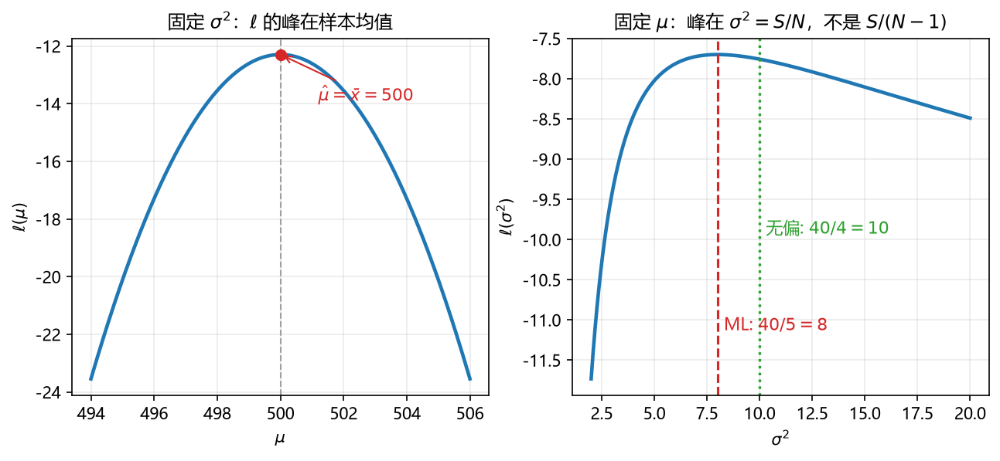

# 板书 · S006 · 第 12 课：Gaussian MLE 与无偏方差

- 会话ID：`S006`
- 日期：2026-10-28
- 对应：L12 / M3
- 修订记录：（初版）2026-10-28；v2 2026-10-28：「意义与场景」按新要求扩到 1–5 句、加类比（破案/重心/自己量自己/打补丁）；v3 2026-10-28：公式卡「例」改三段式，卡内数字与 §4/§5 去重；v4 2026-10-28：12.4 补「方差大 25% / 标准差约 11.8%」的区分；v5 2026-10-28：12.1 例的 Step 2 展开为三块（数据项 / 常数项 / 合计），补 Step 0 公式来源、Step 3 常数项不变、Step 4 差值只来自数据项；v6 2026-10-28：12.1 补「为什么是连乘（i.i.d.）」——联合密度 = 一维密度连乘，等价于 $\mathcal N(\mu\mathbf 1,\sigma^2\mathbf I)$

---

## 0. 生活化引入

你买了 5 袋糖，称出来是 $498,502,500,504,496$ g。
厂家到底该标多少克？误差该报多大？
**“最能让这 5 个数出现的参数”**，就是最大似然估计（MLE）。

---

## 1. 直觉

| 平时                         | MLE 反过来                                |
| ---------------------------- | ----------------------------------------- |
| 参数已知，问“数据会出现吗” | 数据已知，问“哪组参数最可能”            |
| 概率 $p(x\mid\theta)$      | 似然 $L(\theta)=\prod p(x_i\mid\theta)$ |

一句话：**似然就是把密度公式里的 $x$ 和 $\theta$ 换位置——数据固定，参数当未知。**

---

## 2. 几何

**看图**（5 袋糖：$498,502,500,504,496$）：

- 左图：固定 $\sigma^2=8$，把 $\mu$ 当横轴，$\ell(\mu)$ 是一条**开口向下的抛物线**，峰在 $\bar x=500$。
- 右图：固定 $\mu=500$，$\ell(\sigma^2)$ 的峰在 $S/N=40/5=8$；绿虚线是无偏版 $S/(N-1)=10$。
- **MLE = 找峰**：求导等于 0，峰的位置就是估计值。

> 一句话：**MLE 不是“算平均值”这么简单，它是“让这份数据最可能”的那个参数。**

---

## 3. 计算（公式卡片）

### 12.1 似然与对数似然（likelihood / log-likelihood）

$$
L(\theta)=\prod_{i=1}^{N}p(x_i\mid\theta),
\qquad
\ell(\theta)=\ln L(\theta)=\sum_{i=1}^{N}\ln p(x_i\mid\theta)
$$

- **符号**：$\theta$ 是参数（这里指 $\mu,\sigma^2$）；$x_i$ 是已观测数据；连乘容易下溢，取对数变连加，且 $\ln$ 单调 ⇒ 最大值点不变。
- **为什么是连乘（i.i.d.）**：假设各袋**独立同分布**（independent and identically distributed, i.i.d.），即 $x_i\sim\mathcal N(\mu,\sigma^2)$ 且相互独立，联合密度就是各自密度的乘积 $p(x_1,\dots,x_N\mid\mu,\sigma^2)=\prod_{i=1}^N p(x_i\mid\mu,\sigma^2)$。所以 3 袋糖用的仍是**一维**高斯公式，只是乘了 3 次；它等价于三维高斯 $\mathcal N(\mu\mathbf 1,\sigma^2\mathbf I)$（对角协方差）。若三袋之间不独立，才需要带协方差矩阵 $\boldsymbol\Sigma$ 的多维高斯（L11）。
- **意义与场景**：把“谁是参数”和“谁是数据”这两顶帽子对调，就是似然——数据已经躺在桌上不动，反过来猜“哪组参数最可能长出这堆数字”。像侦探破案：现场固定，嫌疑人排队，谁的“作案可能性”最大，谁就是 MLE。取对数只是把一长串乘法压成一串加法，手算轻松，峰的位置一点不变。
- **例（生活版）**：
  - **背景与题干**：3 袋糖称得 $198,200,202$ g，先假定噪声方差 $\sigma^2=2\ \mathrm{g}^2$。比较 $\mu=200$ 与 $\mu=202$ 的对数似然（log-likelihood）。
  - **解**：
    - **Step 0（先把公式写出来）**：每个点的对数密度是 $-\frac12\ln(2\pi\sigma^2)-\frac{(x_i-\mu)^2}{2\sigma^2}$，$N$ 个相加得 $\ell(\mu)=-\frac{N}{2}\ln(2\pi\sigma^2)-\frac{1}{2\sigma^2}\sum_{i=1}^N(x_i-\mu)^2=-\frac{N}{2}\ln(2\pi\sigma^2)-\frac{S}{2\sigma^2}$。
    - **Step 1（算 $S$）**：$\mu=200$ 时偏差 $-2,0,2$，$S=(-2)^2+0^2+2^2=4+0+4=8$。
    - **Step 2（代入，分三块算）**：$N=3$、$\sigma^2=2$、$S=8$。
      - ① 数据项：$-\dfrac{S}{2\sigma^2}=-\dfrac{8}{2\times2}=-\dfrac84=-2$。
      - ② 常数项：$-\dfrac{N}{2}\ln(2\pi\sigma^2)=-\dfrac32\ln(4\pi)$，而 $4\pi=2\cdot2\pi$ ⇒ $=-\dfrac32(\ln2+\ln2\pi)=-\dfrac32(0.6931+1.8379)=-\dfrac32\times2.5310\approx-3.7965$。
        （拆成两块：$-\frac32\ln2\approx-1.0397$，$-\frac32\ln(2\pi)\approx-2.7568$，相加 $-3.7965$。）
      - ③ 合计：$\ell(200)=-2-3.7965\approx-5.7965$。
    - **Step 3（换 $\mu=202$）**：偏差 $-4,-2,0$，$S=16+4+0=20$；数据项 $-20/4=-5$；常数项只跟 $N,\sigma^2$ 有关，仍是 $-3.7965$；$\ell(202)=-5-3.7965\approx-8.7965$。
    - **Step 4（比大小）**：$-5.80>-8.80$ ⇒ $\mu=200$ 更可能。两者之差 $-3$ 正好等于 $-\dfrac{20-8}{2\times2}=-3$——常数项抵消，只剩数据项。
  - **解读**：对数似然是负数很正常（概率小于 1），比较的是大小不是绝对值；别把 $\ell$ 的数值当成概率。

### 12.2 $\mu$ 的 MLE（maximum likelihood estimate of the mean）

$$
\hat\mu_{\mathrm{ML}}=\frac1N\sum_{i=1}^{N}x_i=\bar x
$$

- **符号**：$\bar x$ 是样本均值；$N$ 是样本量。
- **意义与场景**：平均值能当“代表”，不是习惯，而是似然最大化的结果：位置放在 $\bar x$ 上时，数据“围着它散开”的总平方距离最小。直观上它就是一群点的**重心**——把每个人的位置当重量，重心就是 $\bar x$。代价是它没有抵抗力：一个离谱的异常值就能把重心拽偏。
- **例（生活版）**：
  - **背景与题干**：4 袋糖称得 $197,203,199,201$ g，求均值 $\mu$ 的 MLE。
  - **解**：Step 1 求和 $197+203+199+201=800$；Step 2 除以 $N=4$：$\bar x=800/4=200$ g；Step 3 检查偏差 $-3,3,-1,1$，四项相加为 $0$，说明 $200$ 正好是重心。
  - **解读**：MLE 均值就是样本均值（sample mean）；一个异常值会把重心拽偏，所以它不稳健。

### 12.3 $\sigma^2$ 的 MLE（ML variance）

$$
\hat\sigma^2_{\mathrm{ML}}=\frac1N\sum_{i=1}^{N}(x_i-\bar x)^2=\frac{S}{N}
$$

- **符号**：$S=\sum(x_i-\bar x)^2$ 是平方和；注意分母是 $N$，不是 $N-1$。
- **意义与场景**：它回答“这堆数据自己有多不安分”。但注意中心用的是 $\bar x$，而 $\bar x$ 本来就是从这批数据里挑出来的最贴合的中心——等于**用自己量自己**，量出来的离散程度自然偏小。样本越少，这种自我贴合越明显，所以 $N=5$ 时能少报两成。
- **例（生活版）**：
  - **背景与题干**：5 袋糖称得 $190,210,200,200,200$ g，求噪声方差（variance）的 MLE。
  - **解**：Step 1 均值 $1000/5=200$；Step 2 偏差 $-10,10,0,0,0$，平方和 $S=100+100=200$；Step 3 除以 $N=5$：$\hat\sigma^2_{ML}=200/5=40\ \mathrm{g}^2$；Step 4 开方 $\hat\sigma_{ML}=\sqrt{40}\approx6.32$ g。
  - **解读**：$40$ 是方差、$6.32$ g 才是标准差（standard deviation）；两者单位不同，别把 $40$ 直接当“典型偏差”。

### 12.4 无偏方差（unbiased variance）

$$
s^2=\frac{1}{N-1}\sum_{i=1}^{N}(x_i-\bar x)^2,
\qquad
E[s^2]=\sigma^2
$$

- **符号**：$N-1$ 叫**自由度**（$N$ 个数里，均值一定后只剩 $N-1$ 个能自由变）；$E[s^2]=\sigma^2$ 就是“无偏”的含义。
- **意义与场景**：除以 $N-1$ 是在给上面那个“偏小”打补丁：既然平均会少算 $\sigma^2/N$，就把分母缩小一点补回来。**自由度**的说法来自另一个画面——$N$ 个数本来有 $N$ 个自由度，但均值一旦定死，就有一个数被“锁住”，只剩 $N-1$ 个能自由变。数据多时这块补丁几乎看不见，数据少时它很关键。
- **例（生活版）**：
  - **背景与题干**：同一组 5 袋糖 $190,210,200,200,200$ g，求无偏方差（unbiased variance）$s^2$。
  - **解**：Step 1 平方和 $S=200$（上一卡已算）；Step 2 除以 $N-1=4$：$s^2=200/4=50\ \mathrm{g}^2$；Step 3 开方 $s=\sqrt{50}\approx7.07$ g；Step 4 与 MLE 比：$50/40=1.25$，方差大 $25\%$（标准差只大 $\sqrt{1.25}-1\approx11.8\%$）。
  - **解读**：$N-1$ 是自由度（degrees of freedom）补丁；$N$ 越大两者越接近，别把 $s^2$ 写成 MLE。

---

## 4. 完整手算

**Example（5 袋糖）**：$498,502,500,504,496$ g。求 $\hat\mu_{\mathrm{ML}}$、$\hat\sigma^2_{\mathrm{ML}}$、$s^2$。

1. 均值：$\bar x=\dfrac{2500}{5}=500$。
2. 偏差：$-2,\ 2,\ 0,\ 4,\ -4$。
3. 平方和：$S=4+4+0+16+16=40$。
4. MLE 方差：$\hat\sigma^2_{\mathrm{ML}}=\dfrac{40}{5}=8$，$\hat\sigma_{\mathrm{ML}}\approx2.83$ g。
5. 无偏方差：$s^2=\dfrac{40}{4}=10$，$s\approx3.16$ g。
6. 读结论：MLE 把方差报小了；$N=5$ 时差 $25\%$，$N=100$ 时只差约 $1\%$。

**为什么 ML 偏小**：$\bar x$ 是“最贴合数据”的中心，用它算平方和，必然比用真 $\mu$ 算出来小一点。理论结果：$E[\hat\sigma^2_{\mathrm{ML}}]=\dfrac{N-1}{N}\sigma^2$。

---

## 5. 独立复现（先自己写，答案见第 9 节）

**Exercise.** 4 袋糖：$99,101,100,100$ g。求 $\bar x$、$S$、$\hat\sigma^2_{\mathrm{ML}}$、$s^2$。

---

## 6. 易错点

1. **不取对数直接连乘**：数值下溢，也没法求导。先 $\ln$ 再求导。
2. **$\sigma^2$ 的分母用错**：MLE 是 $N$，无偏是 $N-1$；题目问哪个要看清楚。
3. **求 $\sigma^2$ 时中心用真 $\mu$**：实际只知道 $\bar x$，必须用 $\bar x$。
4. **以为 MLE 一定无偏**：MLE 的方差就偏小，这是它的已知缺陷。

---

## 7. 与已学关系

L11 的密度 $p(x\mid\mu,\sigma^2)$，这课把它看成 $\theta$ 的函数再求最大值；L10 的 $E,\operatorname{Var}$ 提供了“均值/方差”的语义；L17 把 $\ell$ 展开就会发现**最大化似然 = 最小化平方误差**，SSE 就从这里来。

---

## 8. 作业

**Q1 (concept).** True or false? One line why.

(a) $\ell(\theta)=\ln L(\theta)$ has the same maximizer as $L(\theta)$.
(b) The ML estimate of $\mu$ is the sample mean.
(c) The ML estimate of $\sigma^2$ divides by $N-1$.
(d) $s^2$ is unbiased for $\sigma^2$.
(e) For large $N$, $N$ and $N-1$ give almost the same answer.

**Q2 (compute).** $D=\{1,2,3\}$：求 $\hat\mu_{\mathrm{ML}}$、$S$、$\hat\sigma^2_{\mathrm{ML}}$、$s^2$。

**Q3 (compute).** $10,12,14,16$：求 $\hat\mu_{\mathrm{ML}}$、$\hat\sigma^2_{\mathrm{ML}}$、$s^2$。

**Q4 (why).** 为什么 ML 方差会系统性偏小？

---

## 9. 答案（先做完再看）

**A1.**

(a) True. $\ln$ 单调递增，不改变最大值位置。
(b) True.
(c) False. MLE 除以 $N$；$N-1$ 是无偏版本。
(d) True. 这正是它的定义性质。
(e) True. 差别是 $1/N$ 量级。

**A2.** $\bar x=2$；偏差 $-1,0,1$ ⇒ $S=2$：

$$
\hat\sigma^2_{\mathrm{ML}}=\frac{2}{3}\approx0.667,\qquad
s^2=\frac{2}{2}=1
$$

**A3.** $\bar x=13$；偏差 $-3,-1,1,3$ ⇒ $S=20$：

$$
\hat\sigma^2_{\mathrm{ML}}=\frac{20}{4}=5,\qquad
s^2=\frac{20}{3}\approx6.67
$$

**A4.** 平方和用的是 $\bar x$，而 $\bar x$ 已经是“最贴合数据”的中心，换成真 $\mu$ 只会让平方和更大。所以 $E[S]=(N-1)\sigma^2$，除以 $N$ 就偏小。

**A5（第 5 节独立复现）.** $\bar x=100$；偏差 $-1,1,0,0$ ⇒ $S=2$：

$$
\hat\sigma^2_{\mathrm{ML}}=\frac{2}{4}=0.5,\qquad
s^2=\frac{2}{3}\approx0.667
$$
