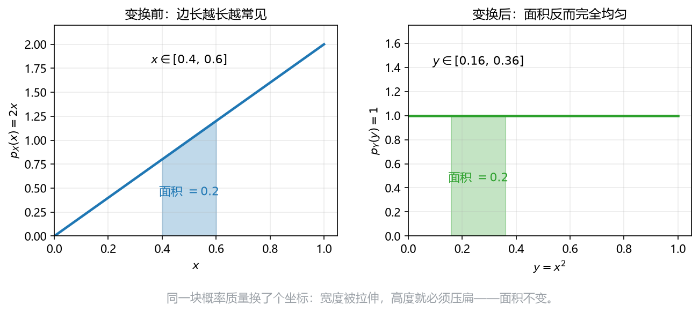

# 板书 · S006 · 第 13 课：一维变量变换（change of variables）

- 会话ID：`S006`
- 日期：2026-10-28
- 对应：L13 / M3
- 修订记录：（初版）2026-10-28

---

## 0. 生活化引入

一块正方形地毯，边长 $X$ 是随机的，面积 $Y=X^2$。
已知边长的分布，怎么求面积的分布？
直觉会说“把 $x$ 换成 $\sqrt y$ 代进去”——**但直接代是错的**，必须乘一个“拉伸系数”。

---

## 1. 直觉

**概率质量守恒**：区间 $[x,x+dx]$ 被映射成 $[y,y+dy]$，里面的概率一点没多也没少，但**长度变了**。
长度被拉长，高度就得压低；长度被压缩，高度就得堆高。这就是公式里那个 $|dx/dy|$。

一句话：**密度是“每单位长度的概率”，换坐标时长度变了，浓度必须跟着折算。**

---

## 2. 几何

**看图**（$X$ 的密度 $p_X(x)=2x$，$Y=X^2$）：

- 左图阴影：$x\in[0.4,0.6]$，面积 $=0.2$。
- 右图阴影：同一批点映射到 $y\in[0.16,0.36]$，面积**还是** $0.2$。
- 但 $y$ 区间长 $0.2$、$x$ 区间长 $0.2$——这里恰好没拉伸；越靠右，$y=x^2$ 的斜率越大、拉得越开，密度就被摊得越薄。
- 结果：原本“越长越常见”的 $2x$，平方后居然变成**完全均匀**的 $1$。

> 一句话：**换坐标不改变概率，只改变“浓度”。**

---

## 3. 计算（公式卡片）

### 13.1 CDF 法（CDF method）

$$
F_Y(y)=P(Y\le y)=P\big(X\le g^{-1}(y)\big)=F_X\big(g^{-1}(y)\big)
\quad\Longrightarrow\quad
p_Y(y)=\frac{d}{dy}F_Y(y)
$$

- **符号**：$g$ 是变换（这里 $y=x^2$），$g^{-1}$ 是反解（$x=\sqrt y$）；假设 $g$ 单调递增。
- **意义与场景**：最不容易出错的路——不直接搬密度，而是先把“$Y\le y$”翻译成“$X\le$ 某个值”，登记总量，再对 $y$ 求导。像过海关：先登记行李总量，再按新规则重新分配。任何单调变换都能这么走，不用背公式。
- **例（生活版）**：地毯面积 $Y=X^2$，$F_Y(y)=P(X\le\sqrt y)=(\sqrt y)^2=y$，所以 $p_Y(y)=1$。

### 13.2 变量变换公式（change-of-variables formula）

$$
p_Y(y)=p_X(x)\left|\frac{dx}{dy}\right|,
\qquad x=g^{-1}(y)
$$

- **符号**：$x=g^{-1}(y)$ 是反函数；$\left|\frac{dx}{dy}\right|$ 是“$y$ 变一点，$x$ 变多少”的换算率；**绝对值**因为长度永远为正。
- **意义与场景**：一条“汇率”：把厘米换成英寸，图形不变，但每单位的浓度要乘换算系数。单位换得越“密”，数值就得越小。它是 13.1 求导后的结果，熟练后可以直接用。
- **例（生活版）**：$Y=2X$、$p_X(x)=2x$：$x=y/2$，$dx/dy=1/2$，故 $p_Y(y)=2\cdot\frac y2\cdot\frac12=\frac y2$（$0<y<2$）。

### 13.3 非单调变换：多支相加（multiple branches）

$$
p_Y(y)=\sum_i p_X(x_i)\left|\frac{dx_i}{dy}\right|,
\qquad g(x_i)=y
$$

- **符号**：$x_i$ 是方程 $g(x)=y$ 的**所有**解；每一项都按 13.2 算，再相加。
- **意义与场景**：$Y=X^2$ 像把一张纸对折——两个位置（$+\sqrt y$ 和 $-\sqrt y$）的概率被叠到同一处。漏掉一支，密度就少一半，积分也对不上 1。
- **例（生活版）**：$X\sim\mathrm{Uniform}(-1,1)$（$p_X=\frac12$）、$Y=X^2$：两支各给 $\frac12\cdot\frac{1}{2\sqrt y}$，相加得 $p_Y(y)=\dfrac{1}{2\sqrt y}$（$0<y<1$）。

---

## 4. 完整手算

**Example（地毯）**：$X$ 的密度 $p_X(x)=2x$（$0<x<1$），$Y=X^2$。求 $p_Y(y)$ 并验证积分为 1。

1. **定范围**：$0<x<1$ ⇒ $0<y<1$。
2. **反解**：$x=\sqrt y$。
3. **求导**：$\dfrac{dx}{dy}=\dfrac{1}{2\sqrt y}$。
4. **代公式**：

$$
p_Y(y)=p_X(\sqrt y)\left|\frac{dx}{dy}\right|=2\sqrt y\cdot\frac{1}{2\sqrt y}=1
$$

5. **验证**：$\displaystyle\int_0^1 1\,dy=1$ ✓
6. **读结论**：边长越往长越常见（$2x$），但平方把右边的区间拉得很开、密度摊薄；左边的区间压得很紧、密度堆高，两者正好抵消 ⇒ 面积变成均匀分布。

---

## 5. 独立复现（先自己写，答案见第 9 节）

**Exercise.** 还是 $p_X(x)=2x$（$0<x<1$），令 $Y=2X$。求 $p_Y(y)$，并验证积分为 1。

---

## 6. 易错点

1. **只把 $x$ 换成 $g^{-1}(y)$，忘了乘 $\left|\frac{dx}{dy}\right|$**——这是最常见的错，也是 HW2 Q2(h) 问的那件事。
2. **忘绝对值**：$g$ 递减时 $\frac{dx}{dy}<0$，密度会变成负数。
3. **非单调时漏支**：$Y=X^2$ 必须把 $\pm\sqrt y$ 两支加起来。
4. **不重算支撑**：$p_Y$ 的定义域是 $Y$ 的范围，不是原来的 $(0,1)$。

---

## 7. 与已学关系

L10 的密度与积分是这里的骨架（面积 = 概率）；L11 的 Gaussian 经过线性变换仍是 Gaussian，就是 13.2 的直接应用；L14 把它推广到多维——那里的 $\left|\frac{dx}{dy}\right|$ 会变成 $|\det J|$。

---

## 8. 作业

**Q1 (concept).** True or false? One line why.

(a) You cannot substitute $x=g^{-1}(y)$ into the density without the factor $\left|\frac{dx}{dy}\right|$.
(b) If $X\sim\mathrm{Uniform}(0,1)$ and $Y=2X$, then $Y\sim\mathrm{Uniform}(0,2)$.
(c) For $Y=X^2$, each $y>0$ corresponds to exactly one $x$.
(d) The transformed density still integrates to 1.
(e) When $g$ is decreasing, the absolute value can be dropped.

**Q2 (compute).** $p_X(x)=2x$（$0<x<1$），$Y=X/3$：求 $p_Y(y)$ 并验证积分为 1。

**Q3 (compute).** $X\sim\mathrm{Uniform}(0,1)$，$Y=X^2$：求 $p_Y(y)$ 并验证积分为 1。

**Q4 (why).** 为什么不能直接写 $p_Y(y)=p_X(g^{-1}(y))$？

---

## 9. 答案（先做完再看）

**A1.**

(a) True. 密度是“每单位长度的概率”，换坐标后长度变了。
(b) True. 线性缩放只改区间，不改形状。
(c) False. 有两个解 $\pm\sqrt y$。
(d) True. 概率质量守恒。
(e) False. $\frac{dx}{dy}<0$ 会让密度为负，必须取绝对值。

**A2.** $x=3y$，$\dfrac{dx}{dy}=3$：

$$
p_Y(y)=p_X(3y)\cdot3=2(3y)\cdot3=18y,\quad 0<y<\frac13
$$

$$
\int_0^{1/3}18y\,dy=18\cdot\frac{1}{18}=1\ \checkmark
$$

**A3.** $x=\sqrt y$，$\dfrac{dx}{dy}=\dfrac{1}{2\sqrt y}$：

$$
p_Y(y)=1\cdot\frac{1}{2\sqrt y}=\frac{1}{2\sqrt y},\quad 0<y<1
$$

$$
\int_0^1\frac{1}{2\sqrt y}\,dy=\Big[\sqrt y\Big]_0^1=1\ \checkmark
$$

**A4.** 因为密度是“浓度”，不是“总量”。$Y$ 的区间被拉伸或压缩后，同样的概率要摊到不同长度的区间上；不乘 $\left|\frac{dx}{dy}\right|$ 就等于假设“长度没变”，积分一般不再是 1。

**A5（第 5 节独立复现）.** $x=y/2$，$\dfrac{dx}{dy}=\dfrac12$：

$$
p_Y(y)=p_X(y/2)\cdot\frac12=2\cdot\frac y2\cdot\frac12=\frac y2,\quad 0<y<2
$$

$$
\int_0^2\frac y2\,dy=\frac{1}{2}\cdot\frac{4}{2}=1\ \checkmark
$$
