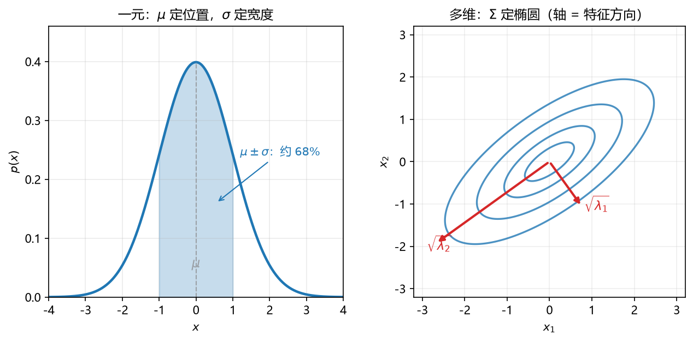

# 板书 · S006 · 第 16 课：Gaussian 噪声 → 似然 → SSE → $\sigma^2_{ML}$ → 预测分布

- 覆盖：原 L17+L19｜公告依据：L3 §2.3.4；"Questions will focus on conceptual understanding of the topics covered in these sections."
- 会话批次：批 A（第 14–18 课）｜日期：2026-10-28｜修订记录：（初版）2026-10-28；v2 2026-10-28：审核修正 + 公式卡例细化（三段式，数字与 §4/§5 去重）；v3 2026-10-29：16.1 例展开——公式拆成「峰值高度 × 衰减因子」、$z$ 与系数的具体值、三档 $t$ 对照表、密度与概率的区分（S007 答疑）；v4 2026-10-29：16.2/16.3/16.4 例按同一结构展开（Step 0 拆公式 + 逐项算 + 检查/对照表 + 常见误读）；v5 2026-10-29：文末新增「附：答疑记录」——CDF 只需 $z$、密度必须带 $1/\sigma$ 的推导与数值验证；v6 2026-10-29：答疑追加第二问——高斯 MLE 的四步流程、在 ML 中的六类用途、与 MSE/BCE/CE 的统一关系（含配对表解读）
- 主线：一条链——假设噪声是 Gaussian，最大化似然就等价于最小化 SSE。

## 0. 生活化引入

一袋糖标 500 g，实际称出 498、502、500、504、496 g。
读数围着 500 上下抖，误差像钟形——这就是"Gaussian 噪声"。

## 1. 直觉

每个数据点是一次"高斯投票"：真值附近概率大，远处概率小。
所有点同时发生的概率（似然）是它们的乘积；取对数，乘积变加法，最大化就好算了。

## 2. 几何

**看图**：固定一个 $x$，目标 $t$ 不是死数，而是一条以 $y(x,\mathbf w)$ 为峰的小钟形。
残差越大，$t_n$ 落在钟形尾巴上，概率越小——所以"让所有点都落在高处"就是"让残差小"。

## 3. 计算（公式卡片）

### 16.1 条件 Gaussian（conditional Gaussian）

$$
p(t\mid x,\mathbf w,\sigma^2)=\mathcal N\big(t\mid y(x,\mathbf w),\sigma^2\big)
$$

- **符号**：$y(x,\mathbf w)$ 是预测均值；$\sigma^2$ 是噪声方差；$t$ 是观测目标。
- **意义与场景**：把"预测"升级成"预测 + 不确定性"：不光说 500 g，还说"大约 $\pm2$ g"。回归、传感器读数都用它。
- **例（生活版）**：

**背景与题干**：零件长度预测 $10$ mm、噪声 $\sigma=0.4$ mm；求 $t=10.4$ mm 处的概率密度（probability density）。

**解**：

**Step 0｜先把公式拆成两块**（一块管高度，一块管衰减）：

$$
p(t)=\underbrace{\frac{1}{\sqrt{2\pi}\,\sigma}}_{\text{峰值高度}}\cdot
\underbrace{e^{-z^2/2}}_{\text{衰减因子}},
\qquad
z=\frac{t-y}{\sigma}
$$

**Step 1｜算标准化距离 $z$**（离均值几个标准差）：

$$
z=\frac{t-y}{\sigma}=\frac{10.4-10}{0.4}=\frac{0.4}{0.4}=1
$$

**Step 2｜算系数（峰值高度）**：

$$
\frac{1}{\sqrt{2\pi}\times0.4}=\frac{1}{2.5066\times0.4}=\frac{1}{1.0027}\approx0.9974\ \text{mm}^{-1}
$$

它是 $t=y=10$ 处的密度，即整条曲线的最高点。

**Step 3｜算衰减因子**：

$$
e^{-z^2/2}=e^{-1/2}=0.6065
$$

**Step 4｜相乘**：

$$
p(10.4)\approx0.9974\times0.6065\approx0.605\ \text{mm}^{-1}
$$

**Step 5｜两种检查**：
① 直接代公式：指数 $=\dfrac{(10.4-10)^2}{2\times0.4^2}=\dfrac{0.16}{0.32}=0.5=\dfrac{z^2}{2}$ ✓
② 与峰值比：$0.605/0.9974=0.6065=e^{-1/2}$，正是“衰减到 $60.65\%$”。

| $t$    | 离均值      | $z$ | 密度（$\text{mm}^{-1}$） |
| -------- | ----------- | ----- | -------------------------- |
| $10.0$ | $0$       | $0$ | $0.9974$（峰）           |
| $10.4$ | $1\sigma$ | $1$ | $0.605$                  |
| $10.8$ | $2\sigma$ | $2$ | $0.135$                  |

**解读**：$0.605$ 是**密度**（每 mm 的概率浓度），不是概率——乘区间长度才是概率，如 $P(10.4<t<10.5)\approx0.605\times0.1\approx6\%$。系数接近 $1$ 是巧合：$\sigma=0.4$ 恰好接近 $1/\sqrt{2\pi}\approx0.3989$；若 $\sigma=0.1$，峰值会变成 $3.99\ \text{mm}^{-1}$，可见密度完全可以大于 $1$。另外记住：**每远离 $1\sigma$，密度乘 $0.6065$**。

### 16.2 似然与对数似然（likelihood / log-likelihood）

$$
L(\mathbf w,\sigma^2)=\prod_{n=1}^{N}\mathcal N\big(t_n\mid y(x_n,\mathbf w),\sigma^2\big),
\qquad
\ln L=-\frac{1}{2\sigma^2}\sum_n\{y_n-t_n\}^2-\frac N2\ln\sigma^2-\frac N2\ln(2\pi)
$$

- **符号**：$y_n=y(x_n,\mathbf w)$；连乘来自 i.i.d.；后两项与 $\mathbf w$ 无关。
- **意义与场景**：似然是"这组参数有多像能生出眼前这批数据"。$L$ 是 $10^{-30}$ 级别的小数，取对数才不会下溢。
- **例（生活版）**：

**背景与题干**：某测距仪对同一目标测了 2 次，模型给出的预测是 $y=(2,2)$，实际读数 $t=(3,1)$；噪声方差 $\sigma^2=2$。求对数似然 $\ell=\ln L$。

**解**：

**Step 0｜先把三项摆出来**：

$$
\ln L=\underbrace{-\frac{1}{2\sigma^2}\sum_n(y_n-t_n)^2}_{A:\ \text{残差项}}
\;\underbrace{-\frac{N}{2}\ln\sigma^2}_{B:\ \text{宽度项}}
\;\underbrace{-\frac{N}{2}\ln(2\pi)}_{C:\ \text{常数项}}
$$

A 管“拟合得多准”，B 管“$\sigma^2$ 是不是开得太大”，C 与任何参数都无关。

**Step 1｜残差与平方和**：$y_n-t_n=(2-3,\ 2-1)=(-1,\ 1)$；$S=(-1)^2+1^2=2$。

**Step 2｜A 项**：

$$
-\frac{S}{2\sigma^2}=-\frac{2}{2\times2}=-\frac{2}{4}=-0.5
$$

**Step 3｜B 项**：$-\dfrac{N}{2}\ln\sigma^2=-\dfrac{2}{2}\ln2=-\ln2\approx-0.6931$。

**Step 4｜C 项**：$-\dfrac{N}{2}\ln(2\pi)=-\ln(2\pi)\approx-1.8379$。

**Step 5｜相加**：

$$
\ell=-0.5-0.6931-1.8379\approx-3.031,
\qquad
L=e^{-3.031}\approx0.048
$$

| 项       | 计算                     | 值          | 作用                                  |
| -------- | ------------------------ | ----------- | ------------------------------------- |
| A 残差项 | $-\dfrac{2}{2\times2}$ | $-0.5$    | 随 $\mathbf w$ 变；越小说明拟合越好 |
| B 宽度项 | $-\ln 2$               | $-0.6931$ | 随 $\sigma^2$ 变                    |
| C 常数项 | $-\ln(2\pi)$           | $-1.8379$ | 与参数无关，只上下平移                |

**Step 6｜检查（换成完美拟合）**：若残差全为 $0$，A 项 $=0$，$\ell=-2.531$，比 $-3.031$ **更大** ⇒ 残差越小、似然越大。这正是“最大化似然 = 最小化 SSE”的来源。

**解读**：$\ell<0$ 很正常（一串小概率相乘）；三项里只有 A 依赖 $\mathbf w$，所以调参数时只需盯 SSE；C 不移动最优点，但会让数值整体下移——比较不同数据集的 $\ell$ 别只看绝对值。

### 16.3 噪声方差的 MLE（$\sigma^2_{ML}$）

$$
\sigma^2_{ML}=\frac1N\sum_{n=1}^{N}\big\{y(x_n,\mathbf w_{ML})-t_n\big\}^2
$$

- **符号**：$N$ 是样本数；分子是拟合后的残差平方和；除 $N$ 而不是 $N-1$。
- **意义与场景**：训练完模型后，回头量"平均每个点错多少"，把它当成噪声的"音量旋钮"。
- **例（生活版）**：

**背景与题干**：4 袋糖，模型预测每袋都是 $500$ g；实际称得 $501,499,502,498$ g。求噪声方差的 MLE $\hat\sigma^2_{ML}$ 与标准差 $\hat\sigma_{ML}$。

**解**：

**Step 0｜公式与口径**：

$$
\hat\sigma^2_{ML}=\frac1N\sum_{n=1}^{N}(y_n-t_n)^2
$$

**除 $N$**（不是 $N-1$）；差值 $y_n-t_n$ 的符号会被平方抹掉，正负都无所谓。

**Step 1｜列残差表**：

| $n$ | $y_n$ | $t_n$ | $y_n-t_n$ |
| ----- | ------- | ------- | ----------- |
| 1     | 500     | 501     | $-1$      |
| 2     | 500     | 499     | $1$       |
| 3     | 500     | 502     | $-2$      |
| 4     | 500     | 498     | $2$       |

**Step 2｜平方求和**：$(-1)^2+1^2+(-2)^2+2^2=1+1+4+4=10$。

**Step 3｜除以 $N$**：

$$
\hat\sigma^2_{ML}=\frac{10}{4}=2.5\ \mathrm{g}^2
$$

**Step 4｜开方得标准差**：

$$
\hat\sigma_{ML}=\sqrt{2.5}\approx1.5811\approx1.58\ \mathrm{g}
$$

**Step 5｜对照无偏版**：

$$
s^2=\frac{10}{4-1}=3.333\ \mathrm{g}^2,\quad s=\sqrt{3.333}=1.826\ \mathrm{g},
\qquad
\frac{\hat\sigma^2_{ML}}{s^2}=\frac{2.5}{3.333}=0.75=\frac{N-1}{N}
$$

**解读**：$1.58$ g 读作“平均每袋偏离预测约 $1.6$ g”；$\hat\sigma^2_{ML}$ 因为除 $N$ 而**系统偏小**（自由度少了一个），不是算错。极端检查：$N=1$ 时 $\hat\sigma^2_{ML}=0$，显然不能解释成“没有噪声”——这正是它偏小的直观原因。

### 16.4 预测分布（predictive distribution）

$$
p(t\mid x,\mathbf w_{ML},\sigma^2_{ML})=\mathcal N\big(t\mid y(x,\mathbf w_{ML}),\sigma^2_{ML}\big)
$$

- **符号**：中心换成训练好的 $y(x,\mathbf w_{ML})$；宽度用 16.3 的 $\sigma^2_{ML}$。
- **意义与场景**：新输入来了，不只报一个数，而是报"最可能多少、上下浮动多大"；做区间估计、异常检测都靠它。
- **例（生活版）**：

**背景与题干**：新一袋糖，训练好的模型预测 $20$ g、$\sigma_{ML}=2$ g。求 $P(18<t<22)$，并与 $\pm2\sigma$ 区间对照。

**解**：

**Step 0｜把区间标准化**：

$$
z=\frac{t-y}{\sigma_{ML}},\qquad
t\in(18,22)\iff z\in\left(\frac{18-20}{2},\ \frac{22-20}{2}\right)
$$

**Step 1｜算两个端点**：$z_1=\dfrac{18-20}{2}=-1$，$z_2=\dfrac{22-20}{2}=1$。

**Step 2｜查标准正态 CDF**：$\Phi(1)=0.8413$；由对称性 $\Phi(-1)=1-\Phi(1)=0.1587$（只需背一个数）。

**Step 3｜相减得区间概率**：

$$
P(18<t<22)=\Phi(1)-\Phi(-1)=0.8413-0.1587=0.6827\approx68.3\%
$$

**Step 4｜对照 $k\sigma$**：

| 区间           | $z$ 范围 | 概率       |
| -------------- | ---------- | ---------- |
| $\pm1\sigma$ | $(-1,1)$ | $68.3\%$ |
| $\pm2\sigma$ | $(-2,2)$ | $95.4\%$ |
| $\pm3\sigma$ | $(-3,3)$ | $99.7\%$ |

**Step 5｜顺便算密度（别和概率混）**：

$$
p(20)=\frac{1}{\sqrt{2\pi}\times2}=0.1995\ \mathrm{g}^{-1}
$$

这是“每 g 的浓度”，不是概率；单点概率 $P(t=20)=0$。

**解读**：$68.3\%$ 是**区间概率**，来自“CDF 相减”；$\pm1\sigma\approx68\%$、$\pm2\sigma\approx95\%$ 值得背。常见误读：把 $p(20)=0.1995$ 当成“落在 20 的概率”——它只是浓度，乘区间长度才是概率。

## 4. 完整手算

**Example.** Three predictions $y=(2,3,4)$ and targets $t=(2.5,3.0,3.5)$. Find SSE, $\sigma^2_{ML}$, and $p(t=3\mid x)$.

1. **Residuals** $y_n-t_n$: $-0.5,\ 0,\ 0.5$.
2. **Squares.** $0.25,\ 0,\ 0.25$; sum $=0.50$.
3. **SSE.** $E=\frac12(0.50)=0.25$.
4. **Derive $\sigma^2$.** $\dfrac{d}{d\sigma^2}\ln L=-\dfrac{N}{2\sigma^2}+\dfrac{\sum r_n^2}{2\sigma^4}=0\Rightarrow\sigma^2_{ML}=\dfrac{0.50}{3}=\dfrac16$.
5. **Predictive.** $p(3\mid x)=\mathcal N(3\mid3,\tfrac16)=\dfrac{1}{\sqrt{2\pi/6}}\approx0.977$.

最大化 $\ln L$ 的第一项是 $-E/\sigma^2$，所以"最大化似然"就是"最小化 SSE"；$\sigma^2$ 那一项单独求导给出 16.3。

## 5. 独立复现

**Exercise.** Two predictions $y=(1,2)$, targets $t=(1.5,2.5)$. Find SSE and $\sigma^2_{ML}$.

## 6. 易错点

1. 把 likelihood $p(t\mid x,\mathbf w)$ 当成 posterior $p(\mathbf w\mid t)$。
2. 求 $\sigma^2$ 时漏掉 $-\frac N2\ln\sigma^2$ 这一项，只对残差项求导。
3. $\sigma^2_{ML}$ 除以 $N-1$（那是无偏估计 $s^2$，不是 ML）。

## 7. 与已学关系

L12 的 Gaussian MLE 是"只有 $\mu$"的版本；L15 的 SSE 到这里才拿到概率解释；第 17 课把 $y=\mathbf X\mathbf w$ 代进来，得到正规方程。

**P2 一句（4.2）**：平方损失下最优预测是条件均值 $\mathbb E[t\mid x]$；Gaussian 对称，所以就是 $y(x,\mathbf w)$。
**考场第一步**：先写 $t=y(x,\mathbf w)+\epsilon,\ \epsilon\sim\mathcal N(0,\sigma^2)$，再写 $p(t\mid x)=\mathcal N(y,\sigma^2)$。

## 8. 作业（答案在第 9 节，先做完再看）

**Q1 (concept).** True or false? One line why.
(a) Maximizing the Gaussian likelihood is the same as minimizing SSE. (b) $\sigma^2_{ML}$ divides by $N-1$. (c) The likelihood is a distribution over $\mathbf w$. (d) The predictive distribution gives an interval, not just a point.

**Q2 (exam-style, HW1 Q4(a) style).** Let $\mathbf X=[1,0;1,2;1,3]$, $\mathbf y=[2,3,7]$, and $\mathbf w=(0.5,1.5)$. Write the SSE and compute $\sigma^2_{ML}$.

**Q3 (self-test).** Why take the logarithm of the likelihood?

**Q4 (self-test).** Why is $\sigma^2_{ML}$ slightly too small on average?

## 9. 答案（先做完再看）

**A1.** (a) True. The log-likelihood is $-\text{SSE}/\sigma^2$ plus constants. (b) False. ML uses $N$. (c) False. It is a function of $\mathbf w$ for fixed data, not a distribution over $\mathbf w$. (d) True. It is a full Gaussian.
**A2.** Predictions $0.5,3.5,5.0$; residuals $-1.5,0.5,-2.0$; squares sum $=6.5$; $E=3.25$; $\sigma^2_{ML}=6.5/3\approx2.167$.
**A3.** Products of many small probabilities underflow; logs turn products into sums and preserve the maximizer.
**A4.** It measures residuals around the fitted mean, which already used the data, so it loses one degree of freedom; $s^2$ divides by $N-1$.

**A5（第 5 节）.** Residuals $-0.5,-0.5$; squares sum $=0.5$; $E=0.25$; $\sigma^2_{ML}=0.5/2=0.25$.

---

## 附：答疑记录（2026-10-29，S007）

### 问：查标准正态 CDF 只要 $z$，但密度 $p(t)=\frac{1}{\sqrt{2\pi}\sigma}e^{-z^2/2}$ 里系数也含 $\sigma$，不用管吗？

**答：算 CDF/概率时不用管，它会被换元时的 $du=\sigma\,dz$ 约掉；算密度时必须管。**

**1）CDF 为什么只剩 $z$**

$$
F(t)=P(t\le T)=\int_{-\infty}^{T}\frac{1}{\sqrt{2\pi}\,\sigma}
\exp\!\left(-\frac{(u-\mu)^2}{2\sigma^2}\right)du
$$

换元 $z=\dfrac{u-\mu}{\sigma}$，则 $du=\sigma\,dz$：

$$
F(t)=\int_{-\infty}^{\frac{T-\mu}{\sigma}}\frac{1}{\sqrt{2\pi}\,\sigma}e^{-z^2/2}\,\sigma\,dz
=\int_{-\infty}^{z}\frac{1}{\sqrt{2\pi}}e^{-z'^2/2}\,dz'
=\Phi(z)
$$

系数里的 $\dfrac{1}{\sigma}$ 与 $du$ 带来的 $\sigma$ **正好相消**，所以 CDF 只依赖 $z$，一张标准正态表管所有 $\mu,\sigma$。

**2）密度为什么必须带 $1/\sigma$**

密度是“每单位长度的概率”，横轴单位一变，浓度就变：

$$
p(t)=\frac{1}{\sigma}\,\phi(z),\qquad
\phi(z)=\frac{1}{\sqrt{2\pi}}e^{-z^2/2}
$$

$\phi(z)$ 是“每个**标准差**”的浓度；换成“每 mm”要再乘 $1/\sigma$。所以系数不是被忽略，而是“单位换算”。

**3）数值验证**（16.1：$\mu=10$、$\sigma=0.4$、$t=10.4$，$z=1$）

$$
p=\frac{\phi(1)}{\sigma}=\frac{0.2420}{0.4}=0.605\ \text{mm}^{-1}
$$

与拆块算法 $0.9974\times0.6065=0.605$ 一致（$\phi(1)=0.2420$，$0.9974\times0.4=0.3989\approx1/\sqrt{2\pi}$）。

**4）一句话版**

| 要算什么            | 要不要管 $1/\sigma$ | 公式                             |
| ------------------- | --------------------- | -------------------------------- |
| CDF / 区间概率      | **不用**        | $P(a<t<b)=\Phi(z_b)-\Phi(z_a)$ |
| 密度                | **要**          | $p(t)=\phi(z)/\sigma$          |
| 期望损失 / 概率加权 | 不用                  | 最终是概率                       |

> 考场提醒：16.4 求 $P(18<t<22)$ 只需 $z=\pm1$；16.1 求“密度”时那个系数 $0.9974$ 必须乘上。

### 问：高斯 MLE 具体怎么用？先估 $\sigma$ 再算似然吗？它在 ML 里干什么、和交叉熵什么关系？

**先纠正三个说法**

| 常见说法 | 准确说法 |
|---|---|
| 极大极小估计 | **最大似然估计（MLE, maximum likelihood estimation）** |
| 用“预测值 $t$、观察值 $\mu$” | 反了：**观测是 $t$（target），预测/均值是 $y(x,\mathbf w)$（常记 $\mu$）** |
| “得出该系数的似然” | 似然是**参数 $\mathbf w$** 的函数；$\hat\sigma^2_{ML}$ 是**噪声方差**的估计 |

**四步流程（顺序不能颠倒）**

**Step 1｜建模**：$t=y(x,\mathbf w)+\epsilon,\ \epsilon\sim\mathcal N(0,\sigma^2)$，于是

$$
p(t\mid x,\mathbf w,\sigma^2)=\mathcal N\big(t\mid y(x,\mathbf w),\sigma^2\big)
$$

**Step 2｜写似然**：$L(\mathbf w,\sigma^2)=\prod_{n=1}^{N}\mathcal N\big(t_n\mid y_n,\sigma^2\big)$，取对数变求和。

**Step 3｜先对 $\mathbf w$ 最大化**（这一步才是“训练模型”）：

$$
\max_{\mathbf w}\ln L\iff\min_{\mathbf w}\sum_n(y_n-t_n)^2
\quad\Longrightarrow\quad\mathbf w_{ML}
$$

**Step 4｜代回，再对 $\sigma^2$ 最大化**：

$$
\hat\sigma^2_{ML}=\frac1N\sum_n\big(y(x_n,\mathbf w_{ML})-t_n\big)^2
$$

> 为什么能拆两步：$\ln L$ 中 $\mathbf w$ 只出现在残差项；等方差假设下 $\mathbf w$ 的解不依赖 $\sigma^2$，所以“先 $\mathbf w$、后 $\sigma^2$”与联合求等价（异方差/加权最小二乘时才耦合）。

**Step 5｜写预测分布**：

$$
p(t\mid x,\mathbf w_{ML},\sigma^2_{ML})=\mathcal N\big(t\mid y(x,\mathbf w_{ML}),\ \sigma^2_{ML}\big)
$$

**这套东西在 ML 里干什么**

| 用途 | 具体怎么用 |
|---|---|
| 造损失函数 | 负对数似然就是训练目标；高斯这条线推出 MSE/SSE |
| 给不确定性 | $\sigma_{ML}$ = 误差棒，报“$20\pm2$ g”而不是只报 20 |
| 异常检测 | 新点落在尾巴上（$\lvert t-y\rvert\gg\sigma$）判为异常 |
| 区间估计 / 风险决策 | 用 $P(t\in[a,b])$ 估“最坏赔多少” |
| 正则化来源 | 给 $\mathbf w$ 加高斯先验 ⇒ MAP ⇒ L2（岭回归） |
| 生成式分类 | 每类一个高斯 ⇒ Bayes 得后验（LDA/QDA，本课不展开） |

**与交叉熵的关系：同一台机器，换一种分布**

$$
\text{损失}=-\ln p(\text{数据}\mid\text{参数})
$$

| 任务 | 假设的分布 | 负对数似然化简为 | 常见名字 |
|---|---|---|---|
| 回归 | 高斯 $\mathcal N(y,\sigma^2)$ | $\dfrac{1}{2\sigma^2}\sum(y_n-t_n)^2+\text{常数}$ | **MSE / SSE** |
| 二分类 | 伯努利 $\mathrm{Bernoulli}(y)$ | $-\sum[t_n\ln y_n+(1-t_n)\ln(1-y_n)]$ | **BCE** |
| 多分类 | 类别 $\mathrm{Categorical}(\mathbf y)$ | $-\sum_n\sum_k t_{nk}\ln y_{nk}$ | **CE（交叉熵）** |

- **“高斯 MLE ⇒ 平方误差”与“伯努利/类别 MLE ⇒ 交叉熵”是同一原理的两个实例**；交叉熵不是另一套理论，而是**分类问题的高斯 MLE**。
- 这也解释了 22.2 的配对表：**输出激活 = 分布的参数化**（sigmoid ↔ 伯努利概率，softmax ↔ 类别概率），**损失 = 该分布的负对数似然**；配错等于“假设的分布”和“输出”对不上。

> 一句话：**先假设分布 → 写似然 → 取负对数得损失 → 训练参数 → 再用同一分布给区间**。高斯这条路走到 MSE + 不确定性；伯努利/类别那条走到交叉熵。
