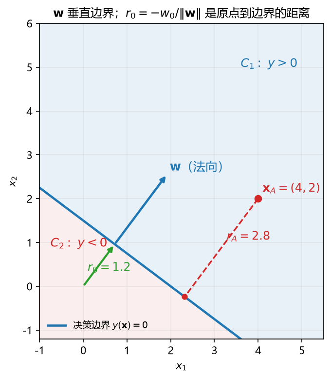

# 板书 · S006 · 第 18 课：线性判别、决策边界与 signed distance

- 覆盖：原 L20｜公告依据：L4 §5.1 "Questions will be similar in style and difficulty to Q1 ... in HW3."
- 会话批次：批 A（第 14–18 课）｜日期：2026-10-28｜修订记录：（初版）2026-10-28；v2 2026-10-28：审核修正 + 公式卡例细化（三段式，数字与 §4/§5 去重）

## 0. 生活化引入
门口保安拿一条线放行：线往哪边斜，由"方向"决定；线离门口多远，由"偏移"决定。
分类里这条线叫 decision boundary（决策边界）。

## 1. 直觉
$y(\mathbf x)=\mathbf w^\top\mathbf x+w_0$ 是一个"打分"：分数为正归 $C_1$，为负归 $C_2$。
分数为 0 的地方就是边界；想知道"离边界多远"，把分数除以 $\|\mathbf w\|$。

## 2. 几何

**看图**：$\mathbf w$ 垂直边界（它是"打分上升最快"的方向）；$w_0$ 把边界整体推离原点；$r_0=1.2$ 是原点到边界的距离，$x_A$ 到边界的垂线长度是 $r_A=2.8$。

## 3. 计算（公式卡片）
### 18.1 线性判别函数（linear discriminant function）
$$
y(\mathbf x)=\mathbf w^\top\mathbf x+w_0
$$
- **符号**：$\mathbf w$ 是 $D$ 维权重（法向）；$w_0$ 是偏置（位置）；$y$ 是标量分数。
- **意义与场景**：把 $D$ 维输入压成一个"支持度"；分数越高越像 $C_1$。感知机、SVM、线性分类器都用这个打分。
- **例（生活版）**：
  - **背景与题干**：判别函数 $\mathbf w=(1,2)$、$w_0=-5$，点 $(4,1)$；求分数与类别。
  - **解**：Step 1 内积 $1\times4+2\times1=6$；Step 2 $y=6-5=1$；Step 3 $y\ge0\Rightarrow C_1$。
  - **解读**：分数 $1$ 只表示“在正侧”，不是概率；大小会被 $\|\mathbf w\|$ 放大。
### 18.2 决策边界（decision boundary）
$$
\mathbf w^\top\mathbf x+w_0=0
$$
- **符号**：满足这条方程的 $\mathbf x$ 构成 $D-1$ 维超平面（二维里就是一条直线）。
- **意义与场景**：把空间一刀切成两半；边界上的点"两边都像"，分数为 0。
- **例（生活版）**：
  - **背景与题干**：同一 $\mathbf w=(1,2)$、$w_0=-5$；写决策边界并求两个截距。
  - **解**：Step 1 边界 $x_1+2x_2-5=0$；Step 2 令 $x_2=0\Rightarrow x_1=5$，过 $(5,0)$；Step 3 令 $x_1=0\Rightarrow x_2=2.5$，过 $(0,2.5)$。
  - **解读**：边界是一条直线；$w_0$ 只平移、不改朝向。
### 18.3 单位法向量（unit normal）
$$
\hat{\mathbf n}=\frac{\mathbf w}{\|\mathbf w\|}
$$
- **符号**：$\|\mathbf w\|=\sqrt{\mathbf w^\top\mathbf w}$ 是长度；$\hat{\mathbf n}$ 长度为 1，方向与 $\mathbf w$ 相同。
- **意义与场景**：边界的"朝向"；它指向分数增大的那一侧。$\mathbf w$ 只定方向，$\hat{\mathbf n}$ 把"长度"归一掉。
- **例（生活版）**：
  - **背景与题干**：同一 $\mathbf w=(1,2)$；求 $\|\mathbf w\|$ 与单位法向量 $\hat{\mathbf n}$。
  - **解**：Step 1 $\|\mathbf w\|=\sqrt{1^2+2^2}=\sqrt5\approx2.236$；Step 2 $\hat{\mathbf n}=(1/\sqrt5,2/\sqrt5)$；Step 3 数值 $(0.447,0.894)$。
  - **解读**：$\hat{\mathbf n}$ 长度是 $1$、指向分数增大的一侧；$\mathbf w$ 本身不是单位向量。
### 18.4 带符号距离（signed distance）
$$
r(\mathbf x)=\frac{y(\mathbf x)}{\|\mathbf w\|},
\qquad
r_0=-\frac{w_0}{\|\mathbf w\|}
$$
- **符号**：$r(\mathbf x)$ 是点 $\mathbf x$ 到边界的距离，正负表示在哪一侧；$r_0$ 是**边界到原点**的有向距离。
- **意义与场景**：距离不是"分数"，分数会被 $\|\mathbf w\|$ 放大；除以长度才是真正的几何距离。$r(0)=w_0/\|\mathbf w\|$ 是**原点相对边界**，$r_0=-w_0/\|\mathbf w\|$ 是**边界相对原点**，两者差一个负号。
- **例（生活版）**：
  - **背景与题干**：同一 $\mathbf w=(1,2)$、$w_0=-5$，点 $(4,1)$；求 $r_0$ 与 $r_A$。
  - **解**：Step 1 $r_0=-w_0/\|\mathbf w\|=5/\sqrt5=\sqrt5\approx2.236$；Step 2 $y(4,1)=1$（上一卡）；Step 3 $r_A=1/\sqrt5\approx0.447$。
  - **解读**：$r_0$ 是边界到原点、$r_A$ 是点到边界；参照点和方向不同，符号别乱套。

## 4. 完整手算
**Example.** $\mathbf w=(3,4)$, $w_0=-6$, $\mathbf x_A=(4,2)$.
1. **Boundary.** $3x_1+4x_2=6$.
2. **Norm.** $\|\mathbf w\|=\sqrt{9+16}=5$; $\hat{\mathbf n}=(0.6,0.8)$.
3. **Origin.** $r_0=-(-6)/5=1.2$; $y(\mathbf 0)=-6<0$, so the origin lies in $C_2$.
4. **Score.** $y(\mathbf x_A)=12+8-6=14\ge0\Rightarrow C_1$.
5. **Distance.** $r_A=14/5=2.8$.

分数 14 不是"距离 14"；除以 $\|\mathbf w\|=5$ 后才是 2.8。

## 5. 独立复现
**Exercise.** $\mathbf w=(0,2)$, $w_0=-4$, $\mathbf x=(1,5)$. Find the boundary, $\hat{\mathbf n}$, $r_0$, the class, and $r(\mathbf x)$.

## 6. 易错点
1. $r_0$ 写成 $+w_0/\|\mathbf w\|$：原点到边界的距离与"边界到原点的有向距离"差一个负号。
2. 忘除 $\|\mathbf w\|$，把分数当距离。
3. 把边界方向（沿边界的向量）当成法向 $\mathbf w$。

## 7. 与已学关系
L02 的内积/正交解释"为什么 $\mathbf w$ 垂直边界"；L06 的梯度指出"打分上升最快的方向"正是 $\mathbf w$；第 19 课用它做决策规则。
**考场第一步**：先写 $y(\mathbf x)=\mathbf w^\top\mathbf x+w_0$，再把边界写成 $\mathbf w^\top\mathbf x=-w_0$。

## 8. 作业（答案在第 9 节，先做完再看）
**Q1 (concept).** True or false? One line why.
(a) $\mathbf w$ is parallel to the decision boundary. (b) $r_0=-w_0/\|\mathbf w\|$. (c) A larger $|y(\mathbf x)|$ always means a larger distance. (d) $w_0$ changes the orientation of the boundary.

**Q2 (exam-style, HW3 Q1 style).** $\mathbf w=(1,-2)$, $w_0=3$, $\mathbf x_A=(2,1)$.
(a) Write the boundary. (b) Find $\hat{\mathbf n}$. (c) Find $r_0$ and the class of the origin. (d) Find the class of $\mathbf x_A$ and $r_A$.

**Q3 (self-test).** If $w_0$ changes sign, what happens to the boundary?

**Q4 (self-test).** Why does dividing by $\|\mathbf w\|$ not change the class?

## 9. 答案（先做完再看）
**A1.** (a) False. It is normal to it. (b) True. By definition. (c) False. Only after dividing by $\|\mathbf w\|$. (d) False. $w_0$ shifts the location; $\mathbf w$ sets orientation.
**A2.** (a) $x_1-2x_2=-3$. (b) $\|\mathbf w\|=\sqrt5$, $\hat{\mathbf n}=(1/\sqrt5,-2/\sqrt5)$. (c) $r_0=-3/\sqrt5\approx-1.34$; $y(\mathbf 0)=3\ge0\Rightarrow C_1$. (d) $y=2-2+3=3\ge0\Rightarrow C_1$; $r_A=3/\sqrt5\approx1.34$.
**A3.** The boundary shifts to the other side of the origin; its orientation is unchanged.
**A4.** Dividing by a fixed positive number preserves the sign of $y$.

**A5（第 5 节）.** Boundary $x_2=2$; $\hat{\mathbf n}=(0,1)$; $r_0=2$; $y=10-4=6\ge0\Rightarrow C_1$; $r=3$.
