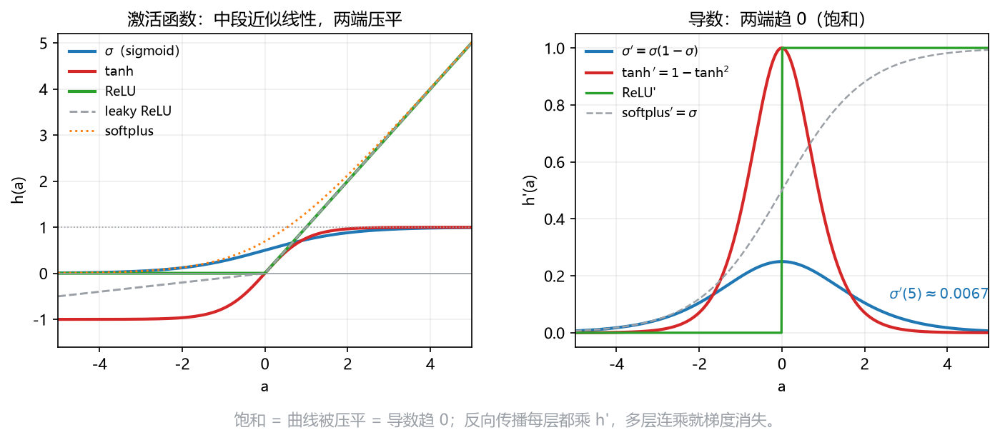

# 板书 · S006 · 第 21 课：网络结构、forward 与激活函数

- 覆盖：原 L25+L26｜公告依据：Ch6 §6.3 "Deep Networks ... concepts and motivation, as well as the choice of activation functions."
- 会话批次：批 B（第 19–23 课）｜日期：2026-10-28｜修订记录：（初版）2026-10-28；v2 2026-10-28：审核修正 + 公式卡例细化（三段式，数字与 §4/§5 去重）；v3 2026-10-28：补激活/饱和几何图 `fig_activation.png` + 概念题模板
- 主线：激活函数决定"这个单元多容易被点亮"；两端压平 = 饱和 = 梯度消失。次线（P1）：forward 与参数计数。

## 0. 生活化引入
调音台上一排旋钮：每个旋钮把声音推一点（权重），但音箱有"音量阈值"（激活）。
阈值太低一点就爆音，太高怎么推都没声——激活函数就是这条"响应曲线"。

## 1. 直觉
没有非线性，几层线性叠起来仍是一层（矩阵相乘还是矩阵）；激活把直线掰弯。
深度的意义：前层学"边缘"，中层拼"部件"，后层认"整只猫"——中间结果被复用。
**深度为什么有用（3 句模板）**：
1. 深度把中间结果变成可复用特征：前层输出是后层的输入，同一组特征可服务多个输出；
2. 层级结构对应「边缘 → 部件 → 物体」的逐级抽象，浅层局部、深层组合；
3. distributed representation 用 $M$ 个二值单元表示 $2^M$ 种组合，参数随 $M$ 线性增长，而不是随组合数指数增长。

**次线一句（P1）**：宽网络也能逼近，但要更多单元；深度用"组合"换参数效率（distributed representation：3 个 0/1 单元能记 $2^3=8$ 种组合）。

## 2. 几何
S 形（sigmoid/tanh）：中间近似直线，两端被压平；tanh 过原点、可取负值。
折线（ReLU）：负侧全平（输出 0），正侧斜率 1；leaky ReLU 给负侧留一个小斜率。
"压平"就是 saturation（饱和）：输入再大，输出也几乎不变，导数趋 0。

**看图**：左图 sigmoid/tanh 在 $|a|$ 大时被压平到 $0/1$（或 $-1/1$），ReLU 正侧是直线；
右图 $\sigma'$ 与 $\tanh'$ 在两端趋 $0$（$\sigma'(5)\approx0.0067$）——这就是饱和。
leaky ReLU 的负侧还留 $0.1$ 的斜率，所以不会完全“死掉”。

## 3. 计算（公式卡片）
### 21.1 前向传播（forward pass）——次线，P1
$$
\mathbf a^{(1)}=\mathbf W^{(1)}\mathbf x+\mathbf b^{(1)},\quad
\mathbf z=h(\mathbf a^{(1)}),\quad
\mathbf a^{(2)}=\mathbf W^{(2)}\mathbf z+\mathbf b^{(2)},\quad
\mathbf y=f(\mathbf a^{(2)})
$$
- **符号**：$\mathbf W^{(1)}$ 是 $M\times D$、$\mathbf W^{(2)}$ 是 $K\times M$；$\mathbf a$ 是 pre-activation；$h$ 隐藏激活、$f$ 输出激活。
- **意义与场景**：forward 就是"代入、乘、加、过激活"四步；形状对了，手算就不会乱。
- **例（生活版）**：
  - **背景与题干**：$D=2,M=2,K=1$；$\mathbf x=(3,1)$，$\mathbf W^{(1)}=[2,0;0,1]$、$\mathbf b^{(1)}=(-1,1)$；$\mathbf W^{(2)}=(1,2)$、$b^{(2)}=-2$；ReLU；求 $y$。
  - **解**：Step 1 $a_1=2\times3+0\times1-1=5$、$a_2=0\times3+1\times1+1=2$；Step 2 $\mathbf z=\operatorname{ReLU}(5,2)=(5,2)$；Step 3 $y=1\times5+2\times2-2=7$。
  - **解读**：forward 就是“乘、加、过激活”；形状对了，手算不会乱。
### 21.2 参数计数（parameter count）
$$
\#\text{params}=M(D+1)+K(M+1)
$$
- **符号**：$D$ 输入维、$M$ 隐藏单元、$K$ 输出；每个 $+1$ 是该层的 bias。
- **意义与场景**：数参数是"这模型多大"的快速体检；考试常问，漏 bias 就少一截。
- **例（生活版）**：
  - **背景与题干**：$D=4,M=5,K=3$；求这个两层网络的参数数。
  - **解**：Step 1 隐藏层 $5\times(4+1)=25$；Step 2 输出层 $3\times(5+1)=18$；Step 3 合计 $43$ 个。
  - **解读**：每个 $+1$ 是该层的 bias；漏掉就少 $5+3=8$ 个。
### 21.3 常见激活与导数（activation functions）
$$
\sigma(a)=\frac1{1+e^{-a}},\quad
\tanh(a),\quad
\operatorname{ReLU}(a)=\max(0,a),\quad
\operatorname{leaky}(a)=\max(\alpha a,a),\quad
\operatorname{softplus}(a)=\ln(1+e^a)
$$
$$
\sigma'(a)=\sigma(a)(1-\sigma(a)),\quad
\tanh'(a)=1-\tanh^2(a),\quad
\operatorname{ReLU}'(a)=\begin{cases}0,&a<0\\1,&a>0\end{cases},\quad
\operatorname{softplus}'(a)=\sigma(a)
$$
- **符号**：$a$ 是 pre-activation；$\alpha\in(0,1)$ 是 leaky 的负侧斜率；$\sigma'$ 在 $|a|$ 大时趋 0。
- **意义与场景**：隐藏层要"非线性 + 好传梯度"，输出层要"符合任务"；sigmoid 给概率，tanh 给 $(-1,1)$，ReLU 便宜且正侧不饱和。
- **例（生活版）**：
  - **背景与题干**：$a=2$；只把 sigmoid 算到底（其余激活查导数表）。
  - **解**：Step 1 $e^{-2}\approx0.1353$；Step 2 $\sigma(2)=1/(1+0.1353)\approx0.8808$；Step 3 $\sigma'(2)=0.8808\times(1-0.8808)\approx0.1050$。
  - **解读**：导数在 $0$ 附近最大（$0.25$），$|a|$ 大就趋 $0$；其余激活的导数见公式表。
### 21.4 饱和与梯度消失（saturation / vanishing gradient）
$$
\frac{\partial E}{\partial a}=\frac{\partial E}{\partial z}\,h'(a),
\qquad
|a|\text{ 大}\Rightarrow h'(a)\to0
$$
- **符号**：$h'$ 是激活导数；链式法则让每层都乘一个 $h'$。
- **意义与场景**：多层连乘一串小于 1 的数，梯度指数变小，前层几乎学不动——这就是"深层难训"的老问题。
- **例（生活版）**：
  - **背景与题干**：4 层网络、每层激活导数约为 $0.1$；求连乘后的梯度比例。
  - **解**：Step 1 单层 $0.1$；Step 2 两层 $0.1\times0.1=0.01$；Step 3 四层 $0.1^4=0.0001$；Step 4 只剩万分之一。
  - **解读**：梯度消失是“连乘”造成的，不是某一层算错；ReLU 负侧也会把梯度压成 $0$。

## 4. 完整手算
**Example.** $D=2$, $M=3$, $K=1$; $\mathbf x=(1,2)$, $\mathbf W^{(1)}=[1,0;0,1;-1,1]$, $\mathbf b^{(1)}=(0,1,-2)$, ReLU; $\mathbf W^{(2)}=(2,-1,1)$, $b^{(2)}=0.5$.
1. **Params.** $3(2+1)+1(3+1)=13$.
2. **Pre-activation.** $\mathbf a^{(1)}=(1,\ 3,\ -1)$.
3. **Activation.** $\mathbf z=\operatorname{ReLU}(\mathbf a^{(1)})=(1,\ 3,\ 0)$.
4. **Output.** $y=2(1)-1(3)+1(0)+0.5=-0.5$.
5. **Saturation check.** $\sigma(5)=0.9933$, $\sigma'(5)=0.00665$.
6. **Depth check.** 3 binary units encode $2^3=8$ combinations; one unit per combination would need 8.

负的隐藏单元被 ReLU 压成 0，等于"这个单元这题不发言"；它对 $y$ 的贡献也就没了。

## 5. 独立复现
**Exercise.** $D=1$, $M=2$, $K=2$; $\mathbf x=2$, $\mathbf W^{(1)}=[1;-1]$, $\mathbf b^{(1)}=(0,1)$, ReLU; $\mathbf W^{(2)}=[1,-1;0,1]$, $\mathbf b^{(2)}=(0,0)$. Count the parameters and compute $\mathbf y$.

## 6. 易错点
1. 参数数漏 bias：隐藏层是 $M(D+1)$，不是 $MD$。
2. 把隐藏层激活当输出激活；输出层由任务定（回归 identity、二分类 sigmoid、多分类 softmax）。
3. 以为 ReLU "不会饱和"：负侧导数为 0，单元可能永久"死掉"。

## 7. 与已学关系
L06 的矩阵–向量乘法就是 forward 的每一步；L08 的链式法则解释"为什么连乘会消失"；第 22 课接"输出激活 + 损失"的配对。

**考场第一步**：先写 $\mathbf a=\mathbf W\mathbf x+\mathbf b$ 的形状，再数每层参数。

**概念题 30 秒模板（饱和 / 梯度消失）**：
1. 现象：$|a|$ 大时 sigmoid/tanh 被压平，$h'(a)\to0$。
2. 后果：反向传播每层乘一个 $h'$，多层连乘使梯度指数变小，前层几乎学不动。
3. 对比：ReLU 正侧导数恒为 $1$，缓解饱和；但负侧为 $0$，可能形成“死单元”。

## 8. 作业（答案在第 9 节，先做完再看）
**Q1 (concept).** True or false? One line why.
(a) Two stacked linear layers are still linear. (b) ReLU has a nonzero gradient everywhere. (c) The output activation depends on the task. (d) With $M$ hidden units there are $MD+K M$ parameters.

**Q2 (exam-style, HW3 Q2(a) style).** $D=3$, $M=4$, $K=2$: count the parameters. Then verify $\sigma'(1.5)=\sigma(1.5)(1-\sigma(1.5))$ numerically.

**Q3 (self-test).** Why is saturation bad for deep networks?

**Q4 (self-test).** Give one reason depth helps beyond a wide single layer.

## 9. 答案（先做完再看）
**A1.** (a) True. A product of matrices is a matrix. (b) False. It is 0 for $a<0$. (c) True. Regression/multi-class need different outputs. (d) False. Biases add $M+K$.
**A2.** $4(3+1)+2(4+1)=16+10=26$; $\sigma(1.5)=0.8176$, $\sigma'=0.8176\times0.1824\approx0.149$.
**A3.** $h'(a)\to0$ makes the chain product tiny, so early layers receive almost no gradient.
**A4.** Depth reuses intermediate features (edges → parts → objects), which can represent some functions with fewer units.

**A5（第 5 节）.** $2(1+1)+2(2+1)=4+6=10$; $\mathbf a^{(1)}=(2,-1)$, $\mathbf z=(2,0)$, $\mathbf y=(2,0)$.
