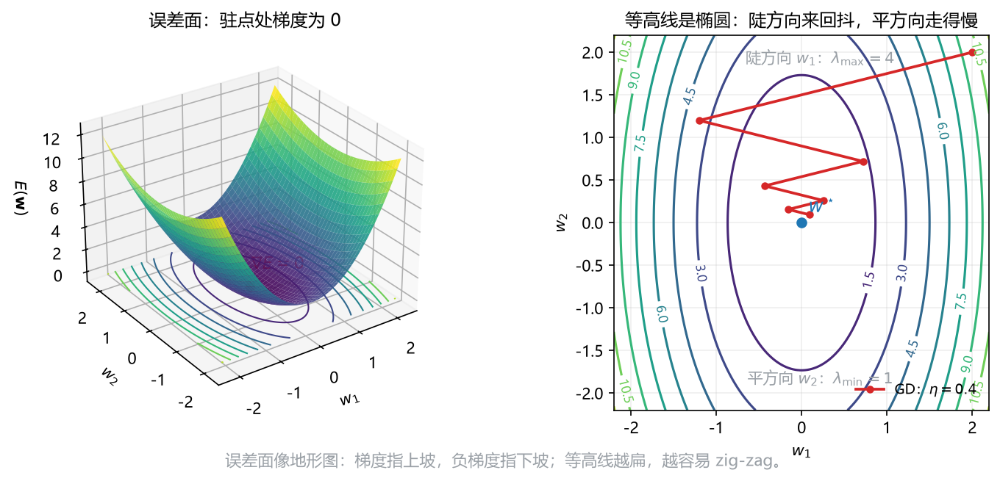

# 板书 · S006 · 第 23 课：梯度下降、SGD 与收敛条件（+ 全科复盘）

- 覆盖：原 L29+L30｜公告依据：L6 §7.2.1/§7.2.2/§7.3.1 "Batch gradient descent, convergence, and related topics."
- 会话批次：批 B（第 19–23 课）｜日期：2026-10-28｜修订记录：（初版）2026-10-28；v2 2026-10-28：审核修正 + 公式卡例细化（三段式，数字与 §4/§5 去重）
- 主线：负梯度是下坡方向；$\eta$ 决定一步走多远，能收敛的范围由最大曲率定。次线（P0 短讲）：SGD/mini-batch 对比。

## 0. 生活化引入
闭着眼下山，只能摸到脚下的坡度：往最陡的下坡方向迈一步。
步子太小，天黑还在半山腰；步子太大，一脚跨过谷底冲到对面山坡。

## 1. 直觉
更新 = 当前位置 $-$ 步长 $\times$ 坡度。梯度指上坡，所以要减。
SGD 是"每次只问一个路人"：方向更吵，但每一步更便宜、走得更多。

**次线一句**：batch 用全部 $N$ 个样本算梯度，SGD 用 1 个，mini-batch 用 $B$ 个；噪声与成本都居中。

## 2. 几何

**看图**（右图）：等高线是椭圆；$\eta$ 由最陡方向 $\lambda_{\max}$ 限制，平方向 $\lambda_{\min}$ 却走得很慢，于是之字形（zig-zag）。
$\kappa=\lambda_{\max}/\lambda_{\min}$ 越大，椭圆越扁，zig-zag 越明显。

## 3. 计算（公式卡片）
### 23.1 批量梯度下降（batch gradient descent）
$$
\mathbf w^{(\tau)}=\mathbf w^{(\tau-1)}-\eta\,\nabla E\big(\mathbf w^{(\tau-1)}\big),
\qquad
\nabla E=\frac1N\sum_{n=1}^{N}\nabla E_n
$$
- **符号**：$\tau$ 是迭代步；$\eta>0$ 是学习率；$\nabla E$ 是全部样本的平均梯度。
- **意义与场景**：最稳的方向，但每步都要过一遍全数据；小数据/凸问题很好用。
- **例（生活版）**：
  - **背景与题干**：$E(w)=3(w-1)^2$、$\eta=0.1$、$w^{(0)}=0$；走两步。
  - **解**：Step 1 $E'(w)=6(w-1)$，$w^{(0)}$ 处 $E'=-6$；Step 2 $w^{(1)}=0-0.1\times(-6)=0.6$；Step 3 $E'(0.6)=6\times(-0.4)=-2.4$，$w^{(2)}=0.6-0.1\times(-2.4)=0.84$。
  - **解读**：每步都在靠近 $1$；$\eta$ 太大会一步跨过谷底。
### 23.2 随机/小批量梯度下降（SGD / mini-batch）
$$
\mathbf w^{(\tau)}=\mathbf w^{(\tau-1)}-\eta\,\nabla E_n\big(\mathbf w^{(\tau-1)}\big),
\qquad
\nabla E_{\mathcal B}=\frac1B\sum_{n\in\mathcal B}\nabla E_n
$$
- **符号**：$n$ 是随机抽的一个样本；$\mathcal B$ 是大小为 $B$ 的小批；一个 epoch = 过完一遍数据。
- **意义与场景**：SGD 噪声大但便宜，还能靠噪声跳出浅坑；mini-batch 兼顾向量化与稳定，是深度学习默认选择。
- **例（生活版）**：
  - **背景与题干**：$N=6000$、mini-batch $B=50$；问一个 epoch 更新几次、每次算多少梯度。
  - **解**：Step 1 $6000/50=120$ 次更新；Step 2 每次只算 $50$ 个梯度；Step 3 全批量每次算 $6000$ 个、只更新 $1$ 次。
  - **解读**：小批量用“更多次、每次更便宜”换速度；代价是梯度更吵。
### 23.3 二次模型下的收敛（convergence）
$$
\alpha_i^{(T)}=(1-\eta\lambda_i)^T\alpha_i^{(0)},
\qquad
|1-\eta\lambda_i|<1\ \forall i
\iff
0<\eta<\frac{2}{\lambda_{\max}}
$$
- **符号**：$\alpha_i$ 是沿第 $i$ 个特征方向的位移；$\lambda_i$ 是 Hessian 特征值；$\lambda_{\max}$ 是最大曲率。
- **意义与场景**：$\eta$ 的上限不是拍脑袋，是"每步别把误差符号翻过来"；$\lambda_{\max}$ 越大（越陡），允许的步长越小。
- **例（生活版）**：
  - **背景与题干**：$\lambda_{\max}=6$；求收敛步长范围，并算 $\eta=0.1$ 时的收缩因子。
  - **解**：Step 1 上界 $2/\lambda_{\max}=2/6\approx0.333$；Step 2 $0.1<0.333$，可收敛；Step 3 $|1-\eta\lambda_{\max}|=|1-0.6|=0.4$。
  - **解读**：上限由最陡方向定；非对角 $\mathbf H$ 先求特征值再套。

**三行推导**：$E=\frac12\sum_i\lambda_i\alpha_i^2$ → 沿特征方向更新 $\alpha_i^{(t+1)}=(1-\eta\lambda_i)\alpha_i^{(t)}$ → 要收敛须 $|1-\eta\lambda_i|<1$，即 $0<\eta<2/\lambda_{\max}$。
**非对角 $\mathbf H$**：先求特征值，再用 $\lambda_{\max}$；$\eta$ 的上限由最陡方向决定。
### 23.4 条件数（condition number，P1）
$$
\kappa=\frac{\lambda_{\max}}{\lambda_{\min}}
$$
- **符号**：$\lambda_{\max}/\lambda_{\min}$ 是 Hessian 最大/最小特征值；$\kappa\ge1$。
- **意义与场景**：$\kappa$ 大 = 山谷又窄又长，步长被陡壁卡死，平底却挪不动，于是来回抖。
- **例（生活版）**：
  - **背景与题干**：$\lambda=(9,1)$ 与 $\lambda=(25,1)$；求条件数（condition number）并比较。
  - **解**：Step 1 $\kappa_1=9/1=9$；Step 2 $\kappa_2=25/1=25$；Step 3 $\kappa=25$ 的等高线更扁，zig-zag 更重。
  - **解读**：$\kappa$ 是“最陡/最平”的比；$\kappa=1$ 是圆，最好走。

## 4. 完整手算
**Example A（主线）.** $E(w)=2(w-2)^2$, $\eta=0.1$, $w^{(0)}=0$.
1. **Gradient.** $E'(w)=4(w-2)$.
2. **Step 1.** $w^{(1)}=0-0.1\times4(0-2)=0.8$.
3. **Step 2.** $w^{(2)}=0.8-0.1\times4(0.8-2)=1.28$.
4. **Step 3.** $w^{(3)}=1.28-0.1\times4(1.28-2)=1.568$.

**SGD vs batch (numbers).** $E_1=(w-1)^2$, $E_2=(w-5)^2$, $w=2$, $\eta=0.1$: batch gradient $=(2-6)/2=-2\Rightarrow w=2.2$; SGD on sample 2 gives $w=2-0.1(-6)=2.6$.

## 5. 独立复现
**Exercise.** $E(w)=(w-3)^2$, $\eta=0.2$, $w^{(0)}=0$: compute $w^{(1)},w^{(2)}$, then derive $0<\eta<2/\lambda_{\max}$.

## 6. 易错点
1. 更新写成 $w+\eta\nabla E$，方向反了。
2. SGD 用了全批量梯度；SGD 的关键就是"单个/小批"。
3. 收敛条件记成 $\eta<1/\lambda_{\max}$；正确是 $2/\lambda_{\max}$。

## 7. 与已学关系
L08 的链式法则负责算 $\nabla E$；L22 的误差面是"地图"；L07 的 Hessian 特征值给出 $\lambda_{\max}$ 与 $\kappa$。

**考场第一步**：先写 $E(\mathbf w)$ 和 $\nabla E(\mathbf w)$，再代 $\mathbf w^{(0)}$ 与 $\eta$。

## 8. 作业（答案在第 9 节，先做完再看）
**Q1 (concept).** True or false? One line why.
(a) Batch GD uses all samples per update. (b) SGD always follows a smoother path than batch GD. (c) Convergence requires $0<\eta<2/\lambda_{\max}$. (d) A large $\kappa$ makes GD zig-zag.

**Q2 (exam-style, HW1 Q3(a) style).** $L(w)=\frac12(we^w-1.5)^2$, $w^{(0)}=0$, $\eta=0.2$: compute $L'(0)$ and one update.

**Q3 (exam-style, HW1 Q4(c) style).** $J(\mathbf w)=\frac12\|\mathbf X\mathbf w-\mathbf y\|^2$, $\mathbf X=[1,0;1,1;1,2]$, $\mathbf y=(2,3,5)$, $\mathbf w^{(0)}=\mathbf 0$, $\eta=1/8$. Do one step and compute $J(\mathbf w^{(1)})$.

**Q4 (self-test, convergence).** $\mathbf H=\operatorname{diag}(2,8)$: give the convergence range for $\eta$ and one reason it is tight.

## 9. 答案（先做完再看）
**A1.** (a) True. (b) False. SGD is noisier. (c) True. (d) True. The valley is narrow.
**A2.** $g=we^w$, $g'=e^w(1+w)$; $L'(0)=(0-1.5)(1)=-1.5$; $w^{(1)}=0-0.2(-1.5)=0.3$.
**A3.** $\nabla J(\mathbf 0)=-\mathbf X^\top\mathbf y=(-10,-13)$; $\mathbf w^{(1)}=(1.25,1.625)$; $J(\mathbf w^{(1)})\approx0.414$.
**A4.** $0<\eta<2/8=0.25$; the steep direction $\lambda=8$ flips sign if $\eta$ exceeds $2/8$.

**A5（第 5 节）.** $E'=2(w-3)$; $w^{(1)}=0-0.2(-6)=1.2$; $w^{(2)}=1.2-0.2(-3.6)=1.92$; $\alpha^{(T)}=(1-\eta\lambda)^T\alpha^{(0)}$, so $|1-\eta\lambda|<1\Rightarrow0<\eta<2/\lambda$.

## 附：考前最后 10 条（进考场前 5 分钟看）
1. 先看 target 类型，再定输出激活与损失：回归 identity+SSE，二分类 sigmoid+BCE，多分类 softmax+CE，多标签多 sigmoid+BCE。
2. 概率题先写先验、似然、归一化；$P(C\mid T)\ne P(T\mid C)$。
3. 换变量必乘 $|\det J|$；一维是 $|dx/dy|$，别忘绝对值与支撑域。
4. Gaussian 噪声 → 负对数似然 → SSE；$\sigma^2_{ML}$ 除 $N$。
5. 线性回归：$\mathbf X$ 第一列全 1；解 $\mathbf X^\top\mathbf X\mathbf w=\mathbf X^\top\mathbf y$；验 $\mathbf X^\top\mathbf r=\mathbf 0$。
6. 判别式：$\mathbf w$ 垂直边界；$r_0=-w_0/\|\mathbf w\|$；$r(\mathbf x)=y(\mathbf x)/\|\mathbf w\|$。
7. 期望损失按列算 $\sum_kL_{kj}p(C_k\mid\mathbf x)$；$\theta=L_{21}/(L_{12}+L_{21})$。
8. 混淆矩阵先填四格；$F_1$ 不含 $TN$；不平衡别看 accuracy。
9. 激活导数：$\sigma'=\sigma(1-\sigma)$，$\tanh'=1-\tanh^2$，ReLU 负侧 0；饱和 → 梯度消失。
10. GD：$\mathbf w\leftarrow\mathbf w-\eta\nabla E$；收敛 $0<\eta<2/\lambda_{\max}$；SGD 用单样本梯度。

> 大纲 §5 自测清单：请**学生自己逐条打勾**（能/不能），老师不代打勾、不伪造掌握度。
