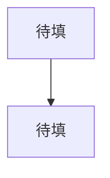

# 换课执行 Prompt（交给执行 Agent）

> **使用方式**：把本文件全文发给执行 Agent，并附一句：
> “按这个 Prompt 执行换课。先做安全快照和归档，不要直接删除任何未提交内容；
> 完成后给我变更报告和自检结果，等我确认再开始新课排课。”
>
> **你的角色**：执行 Agent。你不是规划 Agent，不要重新设计教学法；
> 你的任务是 **保留教学系统、归档旧课、建立新课骨架、等待新材料后按原风格排课**。

---

## 0. 一句话任务

把仓库从旧课 **AISC5000（2026 秋）** 切换到新课程：
**保留**角色、教学节奏、九段板书、公式卡、几何配图、语言偏好、记录规则、自检与 git 护栏；
**归档**旧课表、旧概念、旧板书、旧错题/复习队列、旧进度、旧课程资料；
**新建**新课空白骨架；
**等待**学生上传新课件后，按同样的风格排课与讲解。

---

## 1. 硬约束（先读三遍）

1. **先快照，后动手**：没有 git commit + tag 之前，不允许删除/移动任何文件。
2. **默认归档，不硬删**：旧内容移到 `_archive/AISC5000_2026秋/`；是否彻底删除由学生确认。
   - **归档 = 冷存储**：任何 Agent 默认不读 `_archive/**`；只有学生明确说“查旧课/看归档”时，才读指定的一个文件，不整目录扫描。
3. **教学法不动**：`rules.md` 的 R1–R23 一条不删；`学习偏好.md` 的教学法条目一条不删。
4. **习惯历史不改写**：`habits.jsonl` 只追加，不修改旧行。
5. **不编造**：新课程信息、考试范围、题量、分值，公告没写就不猜；缺信息先问。
6. **不代写作业**：新课程同样只讲解、出同型题、批改，不直接给学校作业答案。
7. **不跳过自检**：系统类改动后必须跑 `自检.py`，全绿才算完成。
8. **R17**：系统/skill 变更要先说明、改后报告、等学生确认；不要静默改核心规则。
9. **不做大而全的一次性输出**：先迁移，再出新课骨架；学生确认后再逐课排课、讲课。
10. **保护未提交内容**：当前工作区有学生/上一会话的未提交改动，必须先提交或 stash。

---

## 2. 先读这些文件（按顺序，不要跳）

1. `README.md`（系统总览与换课方案）
2. `ml-math-tutor/00_说明.md`
3. `ml-math-tutor/系统/09_辅导老师/SKILL.md`
4. `ml-math-tutor/系统/09_辅导老师/startup_protocol.md`
5. `ml-math-tutor/系统/09_辅导老师/rules.md`
6. `ml-math-tutor/系统/09_辅导老师/skill_metadata.yaml`
7. `ml-math-tutor/系统/06_学习习惯/学习偏好.md`
8. `ml-math-tutor/系统/06_学习习惯/habits.jsonl`
9. `ml-math-tutor/系统/08_模板/概念笔记模板.md`、`习题模板.md`
10. `ml-math-tutor/系统/05_学习进度/progress.json`
11. `ml-math-tutor/系统/05_学习进度/系统变更记录.md`
12. `ml-math-tutor/系统/05_学习进度/会话日志.md`
13. `ml-math-tutor/系统/05_学习进度/对话记录.md`（至少读 S007 段与最后 100 行）
14. `ml-math-tutor/学习内容/01_学习计划/` 下全部计划文件
15. `ml-math-tutor/学习内容/10_板书/00_索引.md`
16. `ml-math-tutor/系统/工具/自检.py`、`生成几何图.py`
17. `.opencode/skills/ml-math-tutor/SKILL.md`

读完后先声明：

> “我已读取 ml-math-tutor 的系统文件与旧课状态，理解换课边界：保留教学法，归档旧课，新建骨架。”

---

## 3. Phase 0：安全快照（必须先做）

在仓库根执行并记录结果：

```bash
git status --short
git diff --stat
git log --oneline -10
python -X utf8 ml-math-tutor/系统/工具/自检.py
```

### 3.1 处理未提交改动

当前至少有这些未提交项（以 `git status` 实际为准）：

- `ml-math-tutor/学习内容/10_板书/S006_第22课_损失配对与误差面.md`（修改）
- `ml-math-tutor/学习内容/11_笔记本/00_索引.md`（修改）
- `ml-math-tutor/系统/05_学习进度/对话记录.md`（修改）
- `ml-math-tutor/学习内容/11_笔记本/练习题.md`（新增，未跟踪）

要求：

1. 逐项检查 diff，确认是上一会话的正常产物。
2. **显式 add 这些文件**，不要无脑 `git add -A`；不要 add 临时文件、缓存、`node_modules`。
3. 提交：
   ```bash
   git commit -m "chore: snapshot before course migration (AISC5000 final state)"
   ```
4. 打 tag：
   ```bash
   git tag -a pre-course-migration-20261030 -m "AISC5000 final state before migration"
   ```
   若 tag 已存在，加后缀 `-v2`。
5. 记录 commit hash 与 tag 名，写进最终报告。

> 如果 `git status` 里有你无法判断归属的文件：**停下来问学生**，不要删、不要覆盖。

### 3.2 记录基线自检

把迁移前的自检结果原样记下来（通过/失败、错误数、警告数）。
迁移后要对比，确认没有引入新错误。

---

## 4. Phase 1：盘点与分类

生成一份内部清单（最终放进归档说明），至少包含：

### 4.1 旧课专属文件

- `AISC5000/**`：公告、HW1–3、Lecture 1–6 PDF。
- `学习内容/01_学习计划/`：`学习路线.md`、`概念优先级.md`、`概念登记表.md`、`AISC5000期中复习大纲.md`、`AISC5000期中30课冲刺课表.md`、`AISC5000期中压缩10课表.md`、`AISC5000期中公式速查.md`、`AISC5000期中微课执行协议.md`。
- `学习内容/02_知识图谱/知识图谱.md`。
- `学习内容/03_概念笔记/**`（含 `00_索引.md`、`必学/vector.md`、`必学/inner_product.md`）。
- `学习内容/04_习题/**`（含 `00_索引.md`、`必学/inner_product_习题.md`）。
- `学习内容/07_学校作业/学校作业索引.md`。
- `学习内容/10_板书/**`（30 份板书 + `00_索引.md` + `图片/` 29 张 PNG）。
- `学习内容/11_笔记本/**`（`00_索引.md`、`随手记.md`、`待问清单.md`、`必会_*`、`练习题.md`）。
- `系统/05_学习进度/对话记录.md`、`会话日志.md`、`会话摘要/**`、`错题本.md`、`复习队列.md`、`AISC5000期中诊断.md`、`progress.json`（旧课快照）。
- `系统/05_学习进度/诊断问卷.md`：如果内容是通用诊断问卷，可保留；如果绑定旧课，归档。

### 4.2 必须保留的文件

- `系统/09_辅导老师/{SKILL.md, startup_protocol.md, rules.md, skill_metadata.yaml}`。
- `系统/06_学习习惯/{学习偏好.md, habits.jsonl}`。
- `系统/08_模板/{概念笔记模板.md, 习题模板.md}`。
- `系统/工具/{自检.py, 生成几何图.py}`。
- `系统/05_学习进度/系统变更记录.md`（全部历史）。
- `.opencode/skills/ml-math-tutor/SKILL.md`。
- `README.md`、`换课执行Prompt.md`。
- `2627aisc5020hw1.pdf`：**可能是新课作业，未确认前不要归档/删除**。

### 4.3 待处理的历史债务

- `系统变更记录.md` 有两条 S006“待确认”变更：
  1. 期中剩余课程压缩为 10 课；
  2. 公式卡「例」改三段式。
- `progress.json` 里 S007 仍是“进行中”。
- `startup_protocol.md` 与 `学习偏好.md` 仍有“期中冲刺临时例外”。
- `SKILL.md` / `skill_metadata.yaml` 的 description 仍绑定 AISC5000 期中范围。
- `自检.py` 硬编码 AISC5000 检查。

这些都要在迁移中处理，处理方式见后文。

---

## 5. Phase 2：收尾 S007（在归档前）

不要直接归档一个“进行中”的会话。先根据已有记录补收尾，**只写有证据的事实**。

1. 读 `系统/05_学习进度/对话记录.md` 的 S007 段（T1–T23）与 `git log`。
2. 写 `系统/05_学习进度/会话摘要/S007_期中冲刺Day3与收尾.md`，内容只包含：
   - S007 的时间、主题；
   - 已讲/已修正的课（L14–L23 板书、L15/L16/L17 的口径修正）；
   - 学生提出的问题类型（如 MLE、SSE/half-SSE、BCE、max 记号等）；
   - 明确写“无考试结果记录”；不要编造分数或掌握度。
3. 向 `会话日志.md` 追加 S007 一行：日期、主题、掌握度变化（没有证据就写“无新增掌握度证据”）、错题（没有就写“无新增”）、下一步（“换课”）、摘要路径。
4. 更新旧 `progress.json`：S007 `status` 改为 `已结束`，`summary` 指向该摘要；`current_session_id` 可暂保留 S007，归档后再重置。
5. 运行一次自检，记录结果。

> 如果对话记录不足以支撑摘要，就写“记录不足，按流水归档”，不要补故事。

---

## 6. Phase 3：归档旧课

### 6.1 建归档目录

```
_archive/AISC5000_2026秋/
  README.md                 # 归档说明：日期、原因、git tag、清单、恢复方法
  课程资料/                 # AISC5000/** 原样
  学习内容/
    01_学习计划/
    02_知识图谱/
    03_概念笔记/
    04_习题/
    07_学校作业/
    10_板书/
    11_笔记本/
  系统/
    05_学习进度/
      progress_AISC5000_2026秋.json
      对话记录.md
      会话日志.md
      错题本.md
      复习队列.md
      AISC5000期中诊断.md
      会话摘要/
```

### 6.2 移动规则

- 已跟踪文件用 `git mv`，保留历史；未跟踪文件用普通移动。
- 保持原相对路径，方便恢复。
- 不要把 `系统/09_辅导老师/`、`系统/06_学习习惯/`、`系统/08_模板/`、`系统/工具/`、`系统变更记录.md` 移进归档。
- 不要把 `2627aisc5020hw1.pdf` 移进归档，除非学生明确说它是旧课材料。
- 移动后，原活跃目录要重建为空骨架（见 Phase 4），不能留旧文件。

### 6.3 归档说明必须写

`_archive/AISC5000_2026秋/README.md` 至少包含：

- 归档日期：2026-10-30；
- 原因：AISC5000 课程结束，换新课；
- git tag：`pre-course-migration-20261030`；
- 文件清单（按目录统计数量）；
- 恢复方法：`git checkout <tag> -- <path>` 或从归档目录复制；
- 明确：归档内容不再参与新课的索引、复习队列、自检。
- 明确：**本目录是冷存储，默认不被任何 Agent 读取**；只有学生明确要求时才读指定文件。

### 6.4 冷存储护栏（关键：防 token 浪费）

归档不是“每天上课前先读一遍”的历史，而是“想查时再查”的备份。必须做以下隔离：

1. 在仓库根确保 `.ignore` 包含：
   ```
   _archive/
   ```
   这样 ripgrep / 支持 `.ignore` 的检索工具默认跳过归档。
2. 新 `progress.json` 的 `session_index` **清空为 `[]`**，不要保留 S001–S007 的摘要路径；
   否则启动协议“读最近 3 份会话摘要”会顺着路径进入归档。
3. 旧会话历史只保留在 `_archive/AISC5000_2026秋/系统/05_学习进度/progress_AISC5000_2026秋.json`
   这一个快照中；新 `progress.json` 只放一个不跟随的指针字段：
   ```json
   "legacy": {
     "course": "AISC5000_2026秋",
     "archive": "_archive/AISC5000_2026秋/",
     "session_snapshot": "_archive/AISC5000_2026秋/系统/05_学习进度/progress_AISC5000_2026秋.json",
     "read_policy": "cold-storage: do not read unless the student explicitly asks"
   }
   ```
4. 活跃的 `学习内容/**` 文档、索引、课表、复习队列**不得链接** `_archive/**`。
   旧课入口只保留在 `README.md` 的说明里，不放进启动协议必读路径。
5. `startup_protocol.md` 明确写：
   > “`_archive/**` 是冷存储，默认不读；只有学生明确要求查旧课时，才读指定的一个文件。”
6. `00_说明.md` 写明旧课归档位置，但标注“默认不读，避免上下文膨胀”。

---

## 7. Phase 4：重建新课骨架

在活跃目录创建以下文件。内容先留“待配置”，不要编造课程信息。

### 7.1 `学习内容/01_学习计划/课程信息.md`

```markdown
# 课程信息（唯一配置）

> 本文件是新课程的唯一配置来源。未填完之前，不排课、不讲课。

| 项目 | 内容 |
|---|---|
| 课程代码 | 待填 |
| 课程名称 | 待填 |
| 学期 | 待填 |
| 授课语言 | 待填（默认中文为主，英文术语） |
| 教材/参考书 | 待填 |
| 课件目录 | 待填（如 `AISC5020/讲义/`） |
| 作业目录 | 待填（如 `AISC5020/HW/`） |
| 考试日期 | 待填 |
| 考试占比/时长 | 待填（公告没写就写“公告未给”） |
| 考试范围 | 待填（只写公告/大纲原文，不推断） |
| 当前状态 | 待配置 |
```

### 7.2 `学习内容/01_学习计划/学习路线.md`

只写骨架：

```markdown
# 学习路线（新课）

> 依赖顺序，不排钟点。等课程信息与课件分析完成后填充。

## 阶段 0：诊断与课程地图
## 阶段 1：待填
## 阶段 2：待填
...
```

### 7.3 `学习内容/01_学习计划/概念登记表.md`

```markdown
# 概念登记表（唯一索引）

> 本表是概念的**唯一索引**：`id ↔ 名称 ↔ 优先级 ↔ 前置 ↔ 状态`。
> `progress.json` 的 concepts 必须与本表一致。

| id | 概念 | 优先级 | 前置 | 状态 |
|---|---|---|---|---|
```

### 7.4 `学习内容/01_学习计划/概念优先级.md`

```markdown
# 概念优先级表（新课）

> 必学 = 必须会算会推；掌握 = 懂含义会算；了解 = 知道名字与用途。

## 必学
| 概念 | 一句话 | ML/课程用途 |
|---|---|---|

## 掌握
| 概念 | 一句话 | ML/课程用途 |
|---|---|---|

## 了解
| 概念 | 一句话 | ML/课程用途 |
|---|---|---|
```

### 7.5 `学习内容/01_学习计划/第01–NN课_课表.md`

先建表头，不填具体课：

```markdown
# 第 01–NN 课课表（新课）

> 等课件分析后填充。课号连续，不排钟点。
> 每课规格：范围 / 概念 id / 前置 / 产出 / 验收 / 板书文件名 / 配图 / 作业来源。

| 课次 | 主题 | 覆盖概念 | 前置 | 产出/验收 | 板书文件 | 作业来源 |
|---|---|---|---|---|---|---|
```

### 7.6 `学习内容/02_知识图谱/知识图谱.md`

````markdown
# 知识图谱（新课）

> 等概念登记表建立后填充。



## 关键路径
待填。
````

### 7.7 `学习内容/07_学校作业/学校作业索引.md`

```markdown
# 学校作业索引（新课）

> 作业 PDF 路径必须真实存在；只做知识点映射，不写答案。

| 作业 | PDF 路径 | 覆盖章节 | 关联概念 | 备注 |
|---|---|---|---|---|
```

### 7.8 `学习内容/10_板书/00_索引.md`

保留命名规则与空表：

```markdown
# 板书 · 索引（新课）

> 命名：`S{会话ID}_第NN课_{主题}.md`。
> 每节课：先写入本目录，同时在对话中以 Markdown 呈现同一份板书。
> 旧课补充/勘误更新原文件并记「修订记录」。

| 文件 | 会话 | 课程 | 主题 | 对应概念 id | 日期 |
|---|---|---|---|---|---|
```

同时保留 `学习内容/10_板书/图片/` 目录（可放 `.gitkeep`）。

### 7.9 `学习内容/11_笔记本/`

新建三个文件：

- `00_索引.md`：用法说明（直接编辑 / 说“记笔记：…” / 老师不改原文）。
- `随手记.md`：只有标题与“按时间追加”说明。
- `待问清单.md`：只有标题与“答完打勾”说明。

### 7.10 `系统/05_学习进度/` 新文件

#### `progress.json`

保留学生信息，重置课程数据；**`session_index` 必须清空**，避免启动协议顺着旧摘要路径读归档。

```json
{
  "course": {
    "id": "",
    "name": "",
    "term": "",
    "status": "待配置",
    "materials": []
  },
  "student": {
    "name": "JackGu",
    "math_background": "自评薄弱；诊断实测基础较好（10 题 9 对）：线代直觉扎实、单变量求导会、Python 有基础、ML 零基础",
    "goal": "掌握课程所需数学，能独立做题并映射到应用",
    "preferences_pending": false
  },
  "current_stage": "新课程待配置",
  "concepts": [],
  "wrong_questions": [],
  "review_queue": [],
  "sessions_count": 0,
  "session_counter": 7,
  "current_session_id": null,
  "session_index": [],
  "last_session": null,
  "legacy": {
    "course": "AISC5000_2026秋",
    "archive": "_archive/AISC5000_2026秋/",
    "session_snapshot": "_archive/AISC5000_2026秋/系统/05_学习进度/progress_AISC5000_2026秋.json",
    "read_policy": "cold-storage: do not read unless the student explicitly asks"
  },
  "notes": "2026-10-30 换课迁移：AISC5000 已归档（冷存储，默认不读）；新课待配置。旧课概念/错题/复习队列不进入新课；下一个会话 ID 为 S008。"
}
```

要点：

- `session_counter: 7` 保留，确保下一个会话是 `S008`，不会和旧课 S001–S007 撞号。
- `sessions_count: 0`：新课还没开始。
- `session_index: []`：启动协议看不到旧摘要，也就不会去读归档。
- `legacy` 只是指针，**启动时不跟随**；只有学生明确说“查旧课”才用。
- 旧会话的完整索引在归档的 `progress_AISC5000_2026秋.json` 里，不在活跃文件中重复。

#### `对话记录.md`

```markdown
# 对话记录

> 每轮对话后立即追加（R14）。格式：会话ID + 时间戳 + 学生说了什么 + 我做了什么 + 待办 + 新偏好。

## S008（待开始）
- 日期：
- 主题：
```

> 新会话 ID 用 `S008`（继续递增，避免和历史撞号）；`session_counter` 目前是 7。

#### `会话日志.md`

```markdown
# 会话日志

> 每次会话一行。会话ID 规则见 R16。

| 会话ID | 日期 | 时间 | 主题 | 掌握度变化 | 错题 | 下一步 | 摘要文件 |
|---|---|---|---|---|---|---|---|
```

#### `错题本.md`

```markdown
# 错题本

> 格式：题目 / 我的错误 / 错误原因 / 正确思路 / 关联概念 / 日期。

（暂无）
```

#### `复习队列.md`

```markdown
# 复习队列

> 按遗忘曲线：学完当天 → 1 天后 → 3 天后 → 7 天后 → 14 天后。
> 只记录已讲过的概念；未讲的概念不提前塞入。

## 概念复习

| 概念 | 首次学习日期 | 下次复习 | 复习次数 | 掌握度 |
|---|---|---|---|---|
```

#### `会话摘要/`

保留空目录，放 `00_说明.md`：

```markdown
# 会话摘要

> 每次会话结束写 `S{id}_主题.md`。旧课摘要已归档到 `_archive/AISC5000_2026秋/`。
```

---

## 8. Phase 5：系统文件“去课程化”

只做“去掉旧课专属内容”，**不要改教学法**。

### 8.1 `系统/09_辅导老师/SKILL.md`

- 保留：角色、教学目标、教学原则、板书机制、输出模板、启动协议、记录规则、禁止事项、命名规范、公式排版、笔记本、目录结构。
- 修改：
  - frontmatter `description` 删除“期中冲刺含概率、分类、神经网络、优化（2026-10-29 范围）”等旧课绑定；
  - 改成通用描述：“机器学习数理基础辅导老师；课程可替换，按新课材料排课”；
  - `version` 从 `1.9` 升到 `2.0`（课程层重构，属重大变更）。
- 不要删除 R1–R23 的任何引用。

### 8.2 `系统/09_辅导老师/startup_protocol.md`

- 保留步骤 1–6 的结构。
- 删除“步骤 3.5”的“期中冲刺临时例外（2026-10-26 至 2026-10-29）”。
- 改为通用表述：
  - 读取 `课程信息.md`；
  - 若课程状态是“待配置”，先输出“新课待配置清单”，不要讲课；
  - 若已配置，按学习路线与课表继续。
- 新增一条硬性说明：
  > “`_archive/**` 是冷存储，默认不读；只有学生明确要求查旧课时，才读指定的一个文件。
  > 不得为了‘衔接’而扫描归档目录。”
- 保留会话 ID 分配、摘要、日志、自检。

### 8.3 `系统/09_辅导老师/rules.md`

- **R1–R23 一条不删。**
- 只做措辞通用化：
  - R20 中若出现 AISC5000/期中冲刺的限定，改成“学习内容类文档与对话”；
  - R19/R23 的板书/配图规则保持；
  - R22 受保护文件清单保持。
- 不要新增规则编号；如需新增，先按 R17 说明并等确认。

### 8.4 `系统/06_学习习惯/学习偏好.md`

- **保留全部教学法条目**：
  - 固定讲解流程；
  - 版式要求；
  - 几何优先 + 配图；
  - 中英双语/术语；
  - 公式卡五行 + 例三段式；
  - 一次只讲清一件事；
  - 生活背景 + 计算；
  - 完整手算用中文；
  - 公式卡「例」模板；
  - 观察记录与背景。
- **只删除**“期中冲刺临时例外（2026-10-26）”这一节。
- 不要删除“不排时间表”“作业默认不批改”等长期偏好。

### 8.5 `系统/06_学习习惯/habits.jsonl`

- **不改旧行。**
- 追加一条换课事件：
  ```json
  {"ts": "2026-10-30T00:00:00", "topic": "换课迁移：AISC5000 → 新课", "duration_min": null, "stuck_points": [], "effective_explanations": [], "preferences": {"course_switch": "保留教学法，归档旧课", "session_id": "继续 S008"}, "note": "旧课归档到 _archive/AISC5000_2026秋/；新课待配置。"}
  ```
  时间用真实时间，不要固定 00:00。

### 8.6 `系统/09_辅导老师/skill_metadata.yaml`

- `version` 同步为 `2.0`。
- `description` 去掉 AISC5000 期中绑定。
- 保留 `state_files`、`board_output`、`figures`、`naming`、`checks` 结构。
- 如果新增 `course_config` 字段，写 `ml-math-tutor/学习内容/01_学习计划/课程信息.md`。

### 8.7 `ml-math-tutor/00_说明.md`

- 更新“怎么用”“文件速览”“当前进度”。
- 删除旧课 30 课表/期中大纲/公式速查的入口，改成 `课程信息.md`、`学习路线.md`、`第01–NN课_课表.md`。
- 保留“开始一次学习 / 记笔记 / 自检 / 结束一次学习”的操作说明。
- 指向 `README.md` 作为系统总览。
- 标注旧课归档在 `_archive/AISC5000_2026秋/`，但写明：**默认不读；只有学生明确要求查旧课时才看指定文件**。

### 8.8 `.opencode/skills/ml-math-tutor/SKILL.md`

- 保留入口指针与强制读取三件套。
- description 改成通用版：
  “机器学习数理基础辅导老师；用于按新课材料排课、讲解、出题、批改、复习。”
- 保留触发词：`开始学习`、`ml-math-tutor`、`继续学`、`讲解某个概念` 等。
- 增加触发词：`开始新课`、`换课`。

### 8.9 `系统/05_学习进度/系统变更记录.md`

- 保留全部历史，不删除旧记录。
- 追加一条“换课迁移”记录，状态先写 **“待确认（R17）”**，内容包括：
  - 归档范围；
  - 保留范围；
  - 新建骨架；
  - 自检脚本改造；
  - 版本 2.0；
  - 影响文件清单。
- 对两条 S006“待确认”旧变更，单列说明：
  > “随换课归档，未单独验收；不写成‘已确认’。”
  状态可改为“已随换课归档（未单独验收）”。

---

## 9. Phase 6：改造 `系统/工具/自检.py`

这是受保护文件，改动前先说明，改后跑自检。

### 9.1 删除硬编码

删除/改写以下 AISC5000 专属检查：

- 期中 4 份计划文件必须存在；
- `AISC5000/` 公告 + HW1–3 必须存在；
- 大纲必须含 `Day 1 = L01–L10` / `Day 2 = L11–L20` / `Day 3 = L21–L30`；
- 30 课表必须正好 30 行；
- `review_queue` 必须含 `orthogonal_projection` 和 `2026-10-28`；
- `orthogonal_projection.next_review == 2026-10-27`。

### 9.2 保留通用检查

1. `progress.json` / `habits.jsonl` 合法性。
2. 概念登记表 ↔ `progress.json` 一致（id / 优先级 / 状态 / 顺序）。
3. 板书索引指向的文件存在；概念笔记索引指向的文件存在。
4. 会话 ID：格式 `S\d{3}`、唯一、`<= session_counter`；`current_session_id` 若非空必须在 `session_index` 中且状态为“进行中”。
   - 允许 `session_index == []`（新课未开始）；此时 `current_session_id` 必须为 `null`。
   - `session_counter` 可以大于 0（继承旧课计数），不要求等于 `session_index` 长度。
5. `SKILL.md` 与 `skill_metadata.yaml` 版本号一致。
6. 受保护文件存在。
7. 作业索引里的 PDF 路径存在。
8. 复习队列里的 concept id 必须在登记表中；日期可解析。
9. 活跃 `学习内容/**` 不出现旧课关键词（`AISC5000`、`2026-10-29`、`30 课冲刺`、`压缩10课` 等）；`_archive/` 与 `系统变更记录.md` 例外。
10. 新课配置文件存在：`课程信息.md`、`学习路线.md`、`概念登记表.md`、`概念优先级.md`、`第01–NN课_课表.md`、`知识图谱.md`、`学校作业索引.md`、`板书/00_索引.md`。
11. 课表行数与 `课程信息.md` 声明的总课数一致（若已声明）；课号不重复。
12. git 未跟踪关键文件提醒（通用版，不绑定 AISC5000）。
13. **冷存储检查**：活跃的 `学习内容/**` 不得出现 `_archive/` 链接或路径；
    `progress.json` 只允许 `legacy` 字段出现一次归档路径，且启动协议不得跟随。
14. **归档隔离检查**：`_archive/` 不在板书索引、概念笔记索引、复习队列、作业索引中。

### 9.3 `current_session_id: null` 的处理

新课未开始时 `current_session_id` 允许为 `null`，条件：

- `course.status == "待配置"`，或
- `session_index` 为空，或
- `session_index` 中没有任何“进行中”的会话。

不要把它误报为错误。也不要因为 `session_index` 为空就报“缺少会话历史”——
旧课历史在归档快照里，活跃目录本来就应该为空。

### 9.4 运行

```bash
python -X utf8 ml-math-tutor/系统/工具/自检.py
```

必须 **0 错误**。警告要逐条解释；能修则修，不能修要写进报告。

---

## 10. Phase 7：变更报告（R17）

完成后先不要开始新课排课。给学生一份报告，格式如下：

```markdown
# 换课迁移报告

## 1. 安全快照
- commit:
- tag:
- 迁移前自检:

## 2. 保留了什么
- 系统层文件（逐项）
- 学习偏好/习惯（逐项）
- 规则 R1–R23（确认未删）
- 模板/工具（逐项）

## 3. 归档了什么
- 归档目录:
- 归档文件数:
- 归档说明:
- 旧课进度快照:
- 是否还有旧课文件留在活跃目录: 是/否

## 4. 新建了什么
- 课程信息 / 路线 / 登记表 / 优先级 / 课表 / 图谱 / 作业索引 / 板书索引 / 笔记本
- 新的 progress.json / 对话记录 / 会话日志 / 错题本 / 复习队列 / 摘要目录

## 5. 系统文件改了什么
- SKILL.md（版本 1.9 → 2.0）
- startup_protocol.md（删除期中例外）
- rules.md（只通用化，未删规则）
- 学习偏好.md（只删期中例外）
- skill_metadata.yaml（版本 2.0）
- 00_说明.md
- .opencode 入口
- 自检.py（删除 AISC5000 硬编码，新增通用检查）

## 6. 自检结果
- 迁移后:
- 错误:
- 警告:
- 与迁移前对比:

## 7. 待确认（R17）
- [ ] 换课迁移本身
- [ ] 两条 S006 旧变更按“已随换课归档（未单独验收）”处理
- [ ] 旧课归档是否保留（默认保留）
- [ ] 是否删除 `_archive/`（默认不删）

## 8. 待学生提供的新课信息
- 课程代码/名称/学期
- 课件目录
- 作业目录
- 考试日期/占比/时长/范围
- 每周强度/每次时长
- 是否开卷/闭卷（公告没写就写“未给”）

## 9. 遗留风险
- ...
```

报告末尾明确：

> “迁移已完成，自检全绿。请确认以上内容；确认后我再读新课件、出课程地图与排课表。
> 在收到新课材料前，我不会开始讲课。”

---

## 11. Phase 8：新课材料接入与排课协议

等学生确认迁移、并上传新材料后，才进入本阶段。

### 11.1 收材料

1. 建课程资料目录（默认用课程代码，如 `AISC5020/`）：
   ```
   AISC5020/
     讲义/
     HW/
     考试/
     其他/
   ```
2. 若根目录 `2627aisc5020hw1.pdf` 确认是新课作业，移到 `AISC5020/HW/Homework 1.pdf`；**移动前先问学生**。
3. 按文件类型读取：
   - PDF 用 pdf 技能提取文字/表格；
   - PPTX 用 pptx 技能；
   - DOCX 用 docx 技能；
   - 图片/扫描件必要时 OCR。
4. 生成 `AISC5020/材料清单.md`：文件 → 类型 → 章节/主题 → 用途（讲义/作业/考试/其他）。

### 11.2 只问缺的信息

不要编造。只问公告/大纲里没有的：

- 课程代码、名称、学期；
- 考试日期、占比、时长、范围；
- 教材/参考书；
- 每周可投入次数与时长（只用于排内容批次，不排钟点）；
- 是否需要模拟英文考卷。

### 11.3 建概念登记表

- 每个被讲义/作业/大纲点名的主题，建一个 id：
  - 小写英文 + 下划线，如 `gradient`、`normal_equation`；
  - 名称：中文（English）；
  - 优先级：必学 / 掌握 / 了解；
  - 前置：只填真实依赖；
  - 状态：未开始。
- 登记表是唯一索引；`progress.json` 的 concepts 必须与它一致。
- 不要沿用旧课 id，除非概念确实相同且学生同意。

### 11.4 建知识图谱

- Mermaid 总图 + 关键路径。
- 节点标注优先级；可选标注考试 P0/P1（如果有考试大纲）。
- 不把旧课节点带进来。

### 11.5 排课

生成 `学习内容/01_学习计划/第01–NN课_课表.md`，规则：

1. **第 01 课 = 诊断 + 课程地图**，不直接讲最难内容。
2. 按依赖顺序排；前置未讲不跳。
3. 一课一个概念簇；合并课只合并强相关概念。
4. 每课规格必须写全：
   - 课号/范围；
   - 覆盖概念 id；
   - 前置；
   - 产出/验收；
   - 板书文件名 `S{id}_第NN课_{主题}.md`；
   - 配图（哪些几何点需要图）；
   - 作业来源（哪份 HW 的哪题，只做同型题，不抄答案）。
5. **不排钟点**；只排“第 1 批 / 第 2 批”或“第 1–5 课 / 第 6–10 课”。
6. 留复习/缓冲课；不要把 30 课塞满没有回炉。
7. 课号连续；换会话不重置课号。
8. 先出“课程地图 + 排课骨架”，等学生确认后再写详细板书。

### 11.6 第一次上课

1. 跑启动协议：读三件套 → 读状态 → 分配会话 ID（S008 起）→ 输出 5–8 行衔接摘要。
2. 先做诊断/课程地图，不要直接倒讲义。
3. 确认后，按九段结构讲第 01 课。
4. 产出板书文件 + 索引登记 + 配图。
5. 每轮记录；会话结束写摘要/日志；跑自检。

---

## 12. 教学风格硬约束（换课不能丢）

无论新课是什么，以下必须保留：

1. **九段结构**：引入 → 直觉 → 几何（配图）→ 计算/公式卡 → 完整手算 → 独立复现 → 易错点 → 与已学关系 → 作业+答案（分区）。
2. **几何优先**：先直觉/几何，再公式/计算；几何部分至少一张图。
3. **公式卡五行**：名称 → 公式 → 符号 → 意义与场景 → 例（三段式：背景/解/解读）。
4. **完整手算用中文**：第 1 步 / 第 2 步……不跳步；中间结果可见；单位跟随。
5. **术语中英双语**：关键名词首次出现 `English（中文）`；考试术语保留英文。
6. **一次只讲一件事**：不主动加变式/对照表/自检表；学生要了再加。
7. **生活化例题**：1–2 句生活背景 → 算到最终数字 → 一句结论；背景可跨课重复。
8. **作业与答案分区**：默认不批改、不催交；学生提交后才批改。
9. **不代写学校作业**：只做同型题、讲思路、批改。
10. **不排钟点时间表**：只记录进度、安排内容。
11. **小步推进**：一次一个小概念；不信息过载。
12. **不假装记得**：读不到历史就如实说。

---

## 13. 验收清单

全部打勾才算完成迁移：

- [ ] 迁移前已 commit，已打 tag `pre-course-migration-20261030`。
- [ ] 未提交内容已保住（第22课板书、笔记本索引、对话记录、练习题）。
- [ ] S007 已补摘要与日志，状态改为“已结束”。
- [ ] `_archive/AISC5000_2026秋/` 已建立，含 `README.md` 与文件清单。
- [ ] 旧课资料、计划、概念、习题、板书、笔记本、进度、错题、复习队列已移出活跃目录。
- [ ] `AISC5000/` 不在活跃根目录（或已明确保留并说明）。
- [ ] `2627aisc5020hw1.pdf` 未被误删/误归档。
- [ ] 系统层文件保留：SKILL / startup / rules / metadata / 偏好 / habits / 模板 / 工具 / 变更记录。
- [ ] `rules.md` R1–R23 一条未删。
- [ ] `学习偏好.md` 教学法条目未删，只删期中例外。
- [ ] `habits.jsonl` 旧行未改，只追加换课事件。
- [ ] 新课骨架已建：课程信息 / 路线 / 登记表 / 优先级 / 课表 / 图谱 / 作业索引 / 板书索引 / 笔记本。
- [ ] 新的 `progress.json` 合法，`current_session_id` 为 null 或合法 S008。
- [ ] `session_index` 已清空为 `[]`，没有指向归档摘要的路径。
- [ ] `legacy` 指针存在，但启动协议不跟随；旧会话索引只在归档快照中。
- [ ] 新 `对话记录 / 会话日志 / 错题本 / 复习队列 / 摘要目录` 已建。
- [ ] `.ignore` 包含 `_archive/`；日常检索不会命中归档。
- [ ] `startup_protocol.md` 明确“`_archive/**` 冷存储，默认不读”。
- [ ] 活跃 `学习内容/**` 没有 `_archive/` 链接。
- [ ] `自检.py` 已去掉 AISC5000 硬编码，新增通用检查（含冷存储隔离）。
- [ ] 自检 0 错误；警告已解释。
- [ ] 变更报告已写，R17 状态为“待确认”。
- [ ] 没有在活跃目录留下旧课关键词（`AISC5000`、`2026-10-29`、`30 课冲刺`、`压缩10课`）。
- [ ] 没有开始新课讲课（等学生确认与材料）。

---

## 14. 禁止事项

- 禁止在未 commit/tag 的情况下删除或移动文件。
- 禁止直接删除未提交内容。
- 禁止改写 `habits.jsonl` 历史。
- 禁止删除 `rules.md` 的 R1–R23。
- 禁止删除 `学习偏好.md` 的教学法条目。
- 禁止把旧课表/板书/错题/进度留在 `学习内容/` 活跃目录。
- 禁止编造新课程信息、考试范围、题量、分值。
- 禁止一次性生成全部新课板书；先出骨架等确认。
- 禁止跳过自检。
- 禁止默认读取 `_archive/**`；只有学生明确要求查旧课时，才读指定文件。
- 禁止在新 `progress.json` 的 `session_index` 里保留归档摘要路径。
- 禁止把两条 S006 旧变更静默写成“已确认”。
- 禁止在未确认前改教学法核心规则。
- 禁止用 `git add -A` 把未知文件一起提交（先看 `git status`）。
- 禁止动 `2627aisc5020hw1.pdf`，除非学生明确确认它是旧课材料。

---

## 15. 完成后回复学生的模板

```markdown
已完成换课迁移，旧课已归档，新课骨架已建，自检全绿。

**快照**：commit `xxxxxxx`，tag `pre-course-migration-20261030`
**归档**：`_archive/AISC5000_2026秋/`（共 N 个文件，说明见该目录 README；冷存储，默认不读）
**保留**：角色/教学法/九段板书/公式卡/几何配图/语言偏好/记录规则/R1–R23
**防误读**：`session_index` 已清空；`.ignore` 已排除 `_archive/`；启动协议不读归档
**新建**：课程信息、学习路线、概念登记表、概念优先级、课表骨架、知识图谱、作业索引、板书索引、笔记本
**自检**：0 错误，N 警告（逐条说明）
**待确认**：换课迁移 + 两条 S006 旧变更按“已随换课归档（未单独验收）”处理
**待提供**：课程代码/名称、课件目录、作业目录、考试日期/占比/范围、每周强度

请确认以上内容。确认后把新课课件/作业/考试公告发我，我会先出“课程地图 + 排课表”，
再按原来的九段结构和公式卡风格逐课讲。
```
